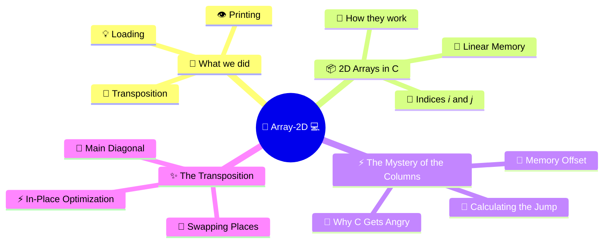
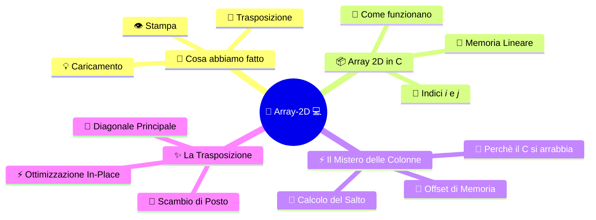

[](https://choosealicense.com/licenses/mit/)
[](https://opensource.org/licenses/)
[](http://www.gnu.org/licenses/agpl-3.0)

<a name="TOP"></a>

<a href="#IT"></a>
🤍
<a href="#EN"></a>

---

 <a name="EN"></A>

<!-- English -->

# 🚀 C Masterclass: The Dark (and Genius) Side of Matrices - Two-Dimensional Arrays! 🤯🔥

Welcome to this wild and fascinating trip into the beating heart of the **C Language**! 💻
> If you think a 2D array is just an Excel spreadsheet stuck in RAM, buckle up, because today we're tearing down every certainty to uncover the raw, naked engineering truth! 🛠️⚡

## 🗺️ Mind Map of the Guide 🧠

Here's the mind map of what we're about to unleash, followed by the full, epic guide! 👇



We'll go through the code you've got in hand line by line, figure out how memory chews through data, and crack the Holy Grail of programming doubts:

**why does the C compiler absolutely need to know how many columns the matrix has?** 🧐

Let's go! 🚀

## 🎬 1. What the heck does this [code](./main.c) do? 🕵️‍♂️🎯

Before we smash the atomic concepts, let's take a bird's-eye look at the masterpiece you wrote.
This program is a real **masterpiece of matrix manipulation**! 🌟 Here's what happens when you compile and run this [code](./main.c):

* 👋 `#define ROWS 4` and `COLS 4` 📏 $\rightarrow$ We set the fixed size of our two-dimensional universe: a square $4 \times 4$ grid! 🧱
* 📥 `loadMatrix(...)` ⌨️ $\rightarrow$ The program quizzes the user (that's you!) and asks for the 16 values, one by one, which fill up the matrix like pieces of a puzzle. 🧩
* 👁️ `printMatrix(...)` 🖥️ $\rightarrow$ Slaps the matrix on the screen nice and clean, separating values with commas and breaking the line at the end of each row for a cyberpunk-terminal vibe! 🤖✨
* 🔄 **`transposeSquareMatrix(...)`** ⚡ $\rightarrow$ The magic move! It takes the main diagonal and mirrors the matrix across it: rows become columns and vice versa! 🪞🔄

## 📦 2. Anatomy of a 2D Array: The Great Illusion 🎭🧠

Visually, we humans love to picture matrices as a **two-dimensional grid** made of rows and columns:

| 📊 Index | Column 0 🛑 | Column 1 🛑 | Column 2 🛑 | Column 3 🛑 |
| ---: | --- | --- | --- | --- |
| **Row 0 🏁** | `m[0][0]` 🥇 | `m[0][1]` 🥈 | `m[0][2]` 🥉 | `m[0][3]` 🏅 |
| **Row 1 📉** | `m[1][0]` 🔹 | `m[1][1]` 🔹 | `m[1][2]` 🔹 | `m[1][3]` 🔹 |
| **Row 2 📈** | `m[2][0]` 🔸 | `m[2][1]` 🔸 | `m[2][2]` 🔸 | `m[2][3]` 🔸 |
| **Row 3 🏁** | `m[3][0]` 🚀 | `m[3][1]` 🚀 | `m[3][2]` 🚀 | `m[3][3]` 🚀 |

### But hold up, dev! 🛑
This is just a handy **optical illusion** made for our limited brains. **RAM isn't a chessboard!** 🧠 Computer memory is one long, endless, boring **strip of linear cells** (a giant 1D array). 📏🔋

So, *how does C store a 2D matrix*?
> Simple: **by squashing it flat, row by row!** 🥞

The memory blocks get lined up like this:
`[ Row 0 (all 4 elements) ] -> [ Row 1 (all 4 elements) ] -> [ Row 2 ] -> [ Row 3 ]` 🔗

## ⚡ 3. Mystery Solved: Why Does C Need to Know the Number of Columns?! 🕵️‍♂️💥

We've reached the heart of the matter, the million-dollar question that freezes newbies and makes seasoned devs sweat in job interviews:

**Why do we absolutely have to specify `COLS` in the function signature `void loadMatrix(int m[][COLS], ...)`?** 🤔❌

Why won't C just let us write `int m[][]` and leave the brackets empty? 🤷‍♂️

### 💡 The Software Architect's Answer (Senior Mode):

The reason is pure math, tied to **memory address calculation (Memory Offset)**! 🧮⚙️

When you write `m[i][j]`, the compiler has to instantly translate those two-dimensional coordinates into a **single linear memory address** in RAM, using this exact formula:

$$\text{Address} = \text{Base Address} + (i \times \mathbf{COLS} + j) \times \text{sizeof(int)}$$

Take a good look at that formula! There's one crucial ingredient: **$\mathbf{COLS}$**! 🚨
To jump to the $i$-th row, the computer needs to know exactly **how many elements there are in a single row**, so it can do the multiplication jump (`i * COLS`).

* ❌ **If C let us leave out the columns (`int m[][]`):** The compiler would have zero clue how wide a row is. When you ask for `m[2][1]`, the computer couldn't tell whether each row is 4, 10 or 100 elements long. The offset calculation would fall flat on its face, leading to segmentation faults or memory corruption! 🔥💀
* ✔️ **Specifying `COLS` (e.g. `4`):** The compiler knows with pinpoint precision that every time a row ends, it has to hop 4 positions in memory to land on the next row. 🎯

> 📝 **Pro Note:** You can happily leave out the first dimension (`ROWS`) and write `int m[][COLS]`, because the compiler couldn't care less how many rows there are in total to work out the jump: all it needs to know is how wide a row is (`COLS`)! 💡✨

## 🔄 4. The Art of Transposition: Mirroring the Matrix 🪞⚡

Now that we've got memory figured out, let's look at the transpose function:

```c
void transposeSquareMatrix(int m[][COLS], const int size) {
	for (int i = 0; i < size; i++)
		for (int j = i + 1; j < size; j++) {
			int t = m[i][j];
			m[i][j] = m[j][i];
			m[j][i] = t;
		}
}
```

### How does this magic work? ✨

Transposing a square matrix means **flipping it along its main diagonal** (the one running from the top-left corner `[0][0]` to the bottom-right corner `[3][3]`). 📉📈

* 🏃‍♂️ **The `j = i + 1` loop trick: Instead of walking through the whole matrix (which would risk swapping everything twice and putting things back the way they were 🔄), we always start just above the main diagonal.
* 🤝 **The temporary variable `t**`: It's the classic spare "third glass"! 🥤 If you want to swap two variables without losing any data, you pour the first glass into `t`, put the second one into the first, and pour `t` into the second.
* 🎯 **Result**: The value at position `[i][j]` gets swapped with the one at the mirror position `[j][i]` in a flash and straight in-place (no extra memory wasted on a second matrix)! 🚀🏆

## 🎉 Conclusion: You're Ready to Rule C! 🚀🔥

And that's a wrap on this epic journey! 🌟 Now you know exactly what's cooking when you declare a two-dimensional array, you get the engineering behind memory offset calculation, and you can explain with surgical confidence why the compiler insists on that blessed number of columns! 💻💪

Keep writing code, experiment, break your programs and then fix them, and remember:

**programming isn't magic, it's pure and wonderful logic!** 🧠✨

*See you next time, dev*! 🚀🔥

---

<a href="#IT"></a>
🤍
<a href="#EN"></a>

---

 <a name="IT"></A>

<!-- Italiano -->

# 🚀 Masterclass C: Il Lato Oscuro (e Geniale) delle Matrici - Array Bi-dimensionali! 🤯🔥

Benvenuti in questo viaggio folle e affascinante nel cuore pulsante del **Linguaggio C**! 💻
> Se pensi che un array 2D sia semplicemente una tabella di Excel confinata nella RAM, allaccia le cinture perché oggi demoliremo ogni certezza per scoprire la nuda e cruda verità ingegneristica! 🛠️⚡

## 🗺️ Mappa Mentale della Guida 🧠

Ecco la mappa mentale di quello che stiamo per scatenare, seguita dalla guida completa ed epica! 👇



Analizzeremo riga per riga il codice che hai sottomano, capiremo come la memoria mastica i dati e risolveremo il Santo Graal dei dubbi di programmazione:

**perché il compilatore C vuole sapere obbligatoriamente quante colonne ha la matrice?** 🧐

Let's go! 🚀

## 🎬 1. Cosa diavolo fa questo [codice](./main.c)? 🕵️‍♂️🎯

Prima di spaccare i concetti atomici, diamo uno sguardo d'insieme all'opera d'arte che hai scritto.
Questo programma è un vero e proprio **capolavoro di manipolazione matriciale**! 🌟 Ecco cosa succede quando compili ed esegui questo il [codice](./main.c):

* 👋 `#define ROWS 4` e `COLS 4` 📏 $\rightarrow$ Definiamo le dimensioni statiche del nostro universo bidimensionale: una griglia quadrata $4 \times 4$! 🧱
* 📥 `loadMatrix(...)` ⌨️ $\rightarrow$ Il programma interroga l'utente (cioè tu!) chiedendo di inserire uno per uno i 16 valori che riempiranno la matrice come pezzi di un puzzle. 🧩
* 👁️ `printMatrix(...)` 🖥️ $\rightarrow$ Sbatte a schermo la matrice formattata in modo pulito, separando i valori con virgole e andando a capo a fine riga per un effetto visivo da terminale cyberpunk! 🤖✨
* 🔄 **`transposeSquareMatrix(...)`** ⚡ $\rightarrow$ L'operazione magica! Prende la diagonale principale e specchia la matrice capovolgendola: le righe diventano colonne e viceversa! 🪞🔄

## 📦 2. Anatomia di un Array 2D: La Grande Illusione 🎭🧠

A livello visivo, noi umani adoriamo pensare alle matrici come a una **griglia bidimensionale** fatta di righe e colonne:

| 📊 Indice | Colonna 0 🛑 | Colonna 1 🛑 | Colonna 2 🛑 | Colonna 3 🛑 |
| ---: | --- | --- | --- | --- |
| **Riga 0 🏁** | `m[0][0]` 🥇 | `m[0][1]` 🥈 | `m[0][2]` 🥉 | `m[0][3]` 🏅 |
| **Riga 1 📉** | `m[1][0]` 🔹 | `m[1][1]` 🔹 | `m[1][2]` 🔹 | `m[1][3]` 🔹 |
| **Riga 2 📈** | `m[2][0]` 🔸 | `m[2][1]` 🔸 | `m[2][2]` 🔸 | `m[2][3]` 🔸 |
| **Riga 3 🏁** | `m[3][0]` 🚀 | `m[3][1]` 🚀 | `m[3][2]` 🚀 | `m[3][3]` 🚀 |

### Ma attenzione, dev! 🛑
Questa è solo una comoda **illusione ottica** creata per il nostro cervello limitato. **La RAM non è una scacchiera bidimensionale!** 🧠 La memoria del computer è una lunghissima, infinita e noiosissima **striscia di caselle lineari** (un array 1D gigante). 📏🔋

Allora, *come fa il C a memorizzare una matrice 2D*?
> Semplice: **schiacciandola riga per riga!** 🥞

I blocchi di memoria vengono messi in fila così:
`[ Riga 0 (tutti i 4 elementi) ] -> [ Riga 1 (tutti i 4 elementi) ] -> [ Riga 2 ] -> [ Riga 3 ]` 🔗

## ⚡ 3. Il Mistero Svelato: Perché il C vuole sapere il Numero di Colonne?! 🕵️‍♂️💥

Arriviamo al nocciolo della questione, la domanda da un milione di dollari che fa impotrire i neofiti e sudare i programmatori esperti durante i colloqui:

**Perché nella firma della funzione `void loadMatrix(int m[][COLS], ...)` dobbiamo specificare `COLS` per forza?** 🤔❌

Perché il C non ci lascia mettere solo `int m[][]` lasciando i campi vuoti? 🤷‍♂️

### 💡 La Risposta dell'Architetto Software (Senior Mode):

Il motivo è una questione matematica legata al **calcolo degli indirizzi di memoria (Memory Offset)**! 🧮⚙️

Quando scrivi `m[i][j]`, il compilatore deve tradurre istantaneamente quelle coordinate bidimensionali in un **singolo indirizzo di memoria lineare** nella RAM usando questa formula esatta:

$$\text{Indirizzo} = \text{Base Address} + (i \times \mathbf{COLS} + j) \times \text{sizeof(int)}$$

Guardia bene quella formula! C'è un fattore cruciale: **$\mathbf{COLS}$**! 🚨
Per saltare alla riga $i$-esima, il computer deve sapere esattamente **quanti elementi ci sono in una singola riga** per poter fare il salto moltiplicativo (`i * COLS`).

* ❌ **Se il C permettesse di omettere le colonne (`int m[][]`):** Il compilatore non avrebbe la minima idea di quanto sia larga una riga. Quando chiedi di accedere a `m[2][1]`, il computer non saprebbe se ogni riga è lunga 4, 10 o 100 elementi. Il calcolo dell'offset fallirebbe miseramente, portando a segmentation fault o corruzione di memoria! 🔥💀
* ✔️ **Specificando `COLS` (es. `4`):** Il compilatore sa con precisione millimetrica che ogni volta che finisce una riga deve saltare di 4 posizioni in memoria per trovare la riga successiva. 🎯

> 📝 **Nota da Pro:** Nota che puoi tranquillamente omettere la prima dimensione (`ROWS`), scrivendo `int m[][COLS]`, perché al compilatore non frega nulla di quante righe ci siano in totale per calcolare il salto: gli basta sapere quanto è larga la riga (`COLS`)! 💡✨

## 🔄 4. L'Arte della Trasposizione: Specchiare la Matrice 🪞⚡

Ora che dominiamo la memoria, guardiamo la funzione di trasposizione:

```c
void transposeSquareMatrix(int m[][COLS], const int size) {
	for (int i = 0; i < size; i++)
		for (int j = i + 1; j < size; j++) {
			int t = m[i][j];
			m[i][j] = m[j][i];
			m[j][i] = t;
		}
}
```

### Come funziona questa magia? ✨

La trasposizione di una matrice quadrata consiste nel **ribaltarla lungo la sua diagonale principale** (quella che va dall'angolo in alto a sinistra `[0][0]` all'angolo in basso a destra `[3][3]`). 📉📈

* 🏃‍♂️ **Il trucco del ciclo `j = i + 1`: Invece di scorrere tutta la matrice (il che rischierebbe di fare un doppio scambio rimettendo le cose a posto come prima 🔄), partiamo sempre sopra la diagonale principale.
* 🤝 **La variabile temporanea `t**`: È il classico "terzo bicchiere" di scorta! 🥤 Se vuoi scambiare il contenuto di due variabili senza perdere dati, versi il primo bicchiere in `t`, metti il secondo nel primo, e versi `t` nel secondo.
* 🎯 **Risultato**: Il valore nella posizione `[i][j]` viene scambiato con quello nella posizione speculare `[j][i]` in un lampo e direttamente in-place (senza sprecare memoria extra per una seconda matrice)! 🚀🏆

## 🎉 Conclusione: Sei pronto a dominare il C! 🚀🔥

Eccoci alla fine di questo viaggio epico! 🌟 Adesso sai esattamente cosa bolle in pentola quando dichiari un array bidimensionale, comprendi l'ingegneria dietro il calcolo degli offset di memoria e sai spiegare con sicurezza chirurgica perché il compilatore esige quel benedetto numero di colonne! 💻💪

Continua a scrivere codice, sperimenta, rompi i programmi per poi aggiustarli e ricorda:

**la programmazione non è magia, è pura e straordinaria logica!** 🧠✨

*Alla prossima, dev*! 🚀🔥


<a href="#TOP">&utrif; top &utrif;</a>

## 🔗 Links
[](https://www.linkedin.com/in/biagio-rosario-greco-77145774/)
[](https://twitter.com/birg_81)
[](mailto:birg81@gmail.com)