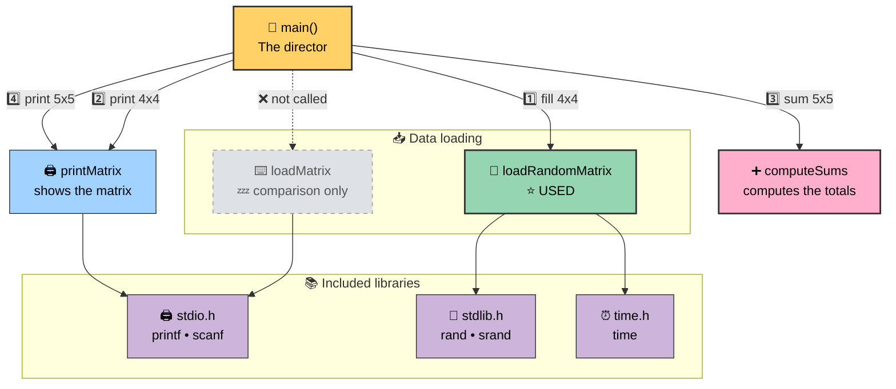
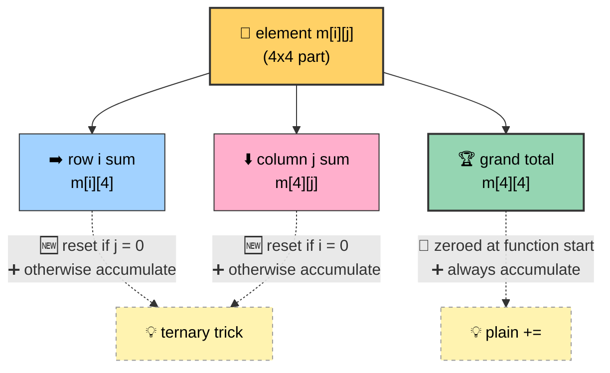
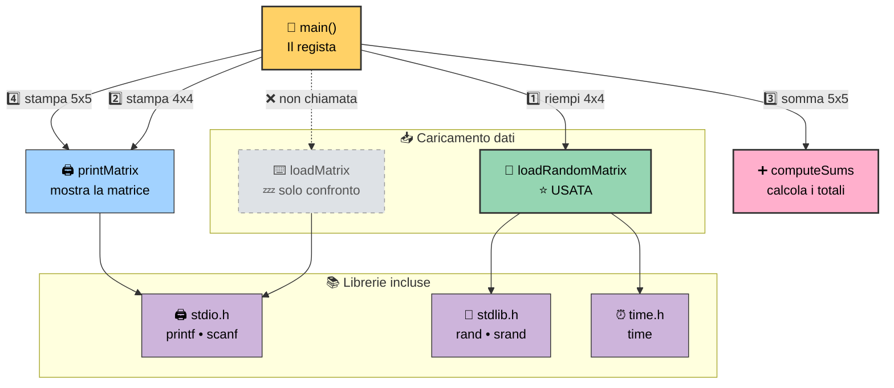
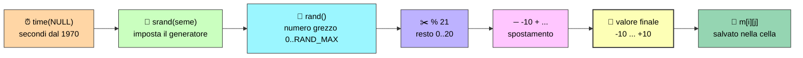
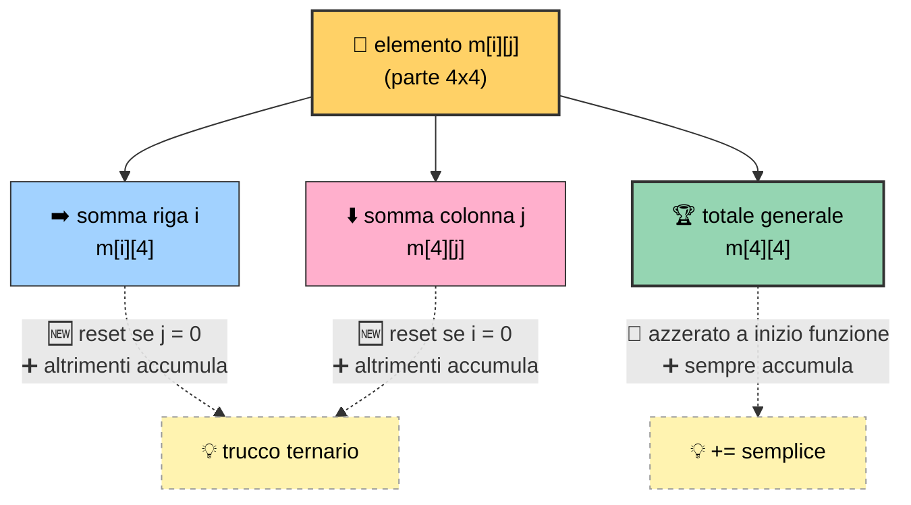

[](https://choosealicense.com/licenses/mit/)
[](https://opensource.org/licenses/)
[](http://www.gnu.org/licenses/agpl-3.0)

<a name="TOP"></a>

<a href="#IT"></a>
🤍
<a href="#EN"></a>

---

 <a name="EN"></a>

<!-- English -->

# 🧮🔥 Matrices, Random Numbers and Sums in C 🎲➕

### 🎬 The ultimate guide to finally get what this code does 💡🚀

🗣️ *Today we take a small **C** program apart piece by piece, like a mechanic with an engine* 🔧🏎️.

By the end, you'll know how to generate random numbers, fill a matrix, and compute all the sums in **ONE** pass.

Ready? *Let's go*! 🏁


# 📋🎯 PART 1 — The Brief

## 🕵️ 1.1 The Mission

🎯 **Goal:** write a C program that:

1. 🎲 fills a matrix with **random** numbers from **-10 to +10**;
2. 🖨️ prints the matrix;
3. ➕ computes the **sum of each row**, the **sum of each column** and the **grand total**;
4. 🖨️ prints the matrix again, now "extended" with the results.

🧠 In one line: **take a 4×4 matrix, add a row and a column of totals, get a 5×5.** 🎁

## ✅ 1.2 Learning goals

By the end of this guide you should be able to answer these questions:

- 🎲 How do you generate random numbers in C?
- 📚 What are `stdlib.h` and `time.h` for (and `stdio.h` too)?
- ➕ How does `computeSums` work, line by line?
- 🧩 Which **algorithm** is behind it? Why does it work without zeroing the cells first?
- 🗺️ How do all the functions fit together in `main`?

## 🧰 1.3 Prerequisites

| 🧱 Concept | 💬 Required level | 🎚️ Difficulty |
|---|---|---|
| 🔁 Nested `for` loops | Know what a double loop does | 🟢 Easy |
| 🧮 2D arrays | Know what `m[i][j]` is | 🟢 Easy |
| 📥 Functions and parameters | Pass an array to a function | 🟡 Medium |
| ❓ Ternary operator | Read `cond ? a : b` | 🟡 Medium |
| 🔢 Modulo operator `%` | Know what a remainder is | 🟢 Easy |

## 📦 1.4 The code under the microscope 🔬
[`main.c`](./main.c)

## 🖥️ 1.5 Expected output (example)

The numbers change on every run 🎰, but the **shape** is always the same:

| C1 | C2 | C3 | C4 |
| :---: | :---: | :---: | :---: |
| 3 | -2 | 5 | 1 |
| -4 | 0 | 7 | 2 |
| 6 | -1 | -3 | 8 |
| 2 | 9 | -5 | -6 |

and after the sum:
| C1 | C2 | C3 | C4 | **Σ** |
| :---: | :---: | :---: | :---:  | :---: |
| 3 | -2 | 5 | 1 | **7** |
| -4 | 0 | 7 | 2 | **5** |
| 6 | -1 | -3 | 8 | **10** |
| 2 | 9 | -5 | -6 | **0** |
| **7** | **6** | **4** | **5** | **22** |

#### 🔍 How to read it:

- ➡️ The **last column** holds the row sums.
- ⬇️ The **last row** holds the column sums.
- 🏆 The **bottom-right corner** (22) is the sum of **all** the numbers.

# 📖🧠 PART 2 — The Explanations

## 🌍 CHAPTER 1 — The Big Picture

### 🎞️ 1.1 The plot in 30 seconds

🎬 Picture a table of numbers.
You want to add a row and a column with the totals, just like in an Excel sheet 📊.
Here's what the program does:

1. 🏗️ **Creates** a 5×5 matrix (but uses only 4×4 for the data).
2. 🎲 **Fills** the 4×4 part with random numbers.
3. 🖨️ **Prints** the 4×4 matrix.
4. ➕ **Computes** the sums and writes them in the "extra" row/column.
5. 🖨️ **Prints** the full 5×5 matrix.

### 🎭 1.2 The cast of functions

| 🎬 Function | 🎭 Role | 📥 Useful input | 📤 What it produces | 🟢 Used? |
|---|---|---|---|---|
| 🚀 `main` | The director, runs the show | — | Runs the program | ✅ Yes |
| ⌨️ `loadMatrix` | Fills the matrix **by hand** (keyboard) | matrix, rows, columns | Matrix with the user's values | ❌ No (comparison only) |
| 🎲 `loadRandomMatrix` | Fills the matrix **automatically** | matrix, rows, columns | Matrix with random numbers | ✅ Yes |
| 🖨️ `printMatrix` | Prints to screen | matrix, rows, columns | Console text | ✅ Yes (twice) |
| ➕ `computeSums` | Computes row, column and grand totals | matrix, rows, columns | Row and column of totals | ✅ Yes |

### 🧲 1.3 Why `ROWS - 1` and `COLS - 1` in main?

🤔 **Champion question**: the matrix is 5×5 but we only fill **4×4**. *Why?*

💡 Because **the last row and the last column are "reserved"** 🅿️ for the sums.

Think of a table with 5 seats: 4 for the guests 🧑‍🤝‍🧑 and 1 for the bill 🧾.

```text
		col0  col1  col2  col3 | col4
row0  [  🎲    🎲    🎲    🎲  |  ➕  ]   ➕ = row 0 sum
row1  [  🎲    🎲    🎲    🎲  |  ➕  ]
row2  [  🎲    🎲    🎲    🎲  |  ➕  ]
row3  [  🎲    🎲    🎲    🎲  |  ➕  ]
		------------------------ + -----
row4  [  ⬇️    ⬇️    ⬇️    ⬇️  |  🏆  ]   ⬇️ = column sums, 🏆 = grand total
```

## 📚 CHAPTER 2 — The Libraries: why `#include`?

### 🧩 2.1 The concept

🔌 In C, functions like `printf` or `rand` **aren't magic**: someone already wrote them, and they're "declared" in files called **headers** (`.h`). With `#include` you tell the compiler: *"hey, trust me, these functions exist! 🤝"*

### 🗂️ 2.2 The three libraries

| 📦 Header | 🎁 What it gives us | 🛠️ Where you see it in the code |
|---|---|---|
| 🖨️ `stdio.h` | Standard input/output: `printf`, `scanf` | `printMatrix` and `loadMatrix` |
| 🎲 `stdlib.h` | General utilities: `rand()`, `srand()` (plus `malloc`, `exit`…) | `loadRandomMatrix` |
| ⏰ `time.h` | Time handling: `time()` | `srand(time(NULL))` |

### 🎯 2.3 What `stdlib.h` and `time.h` are really for

- 🎲 **`stdlib.h`** → has `rand()` (**generates** the random number) and `srand()` (**sets the seed**, i.e. the starting point).
- ⏰ **`time.h`** → has `time()`, which returns **the seconds elapsed since a reference date** (the "Unix epoch", January 1, 1970 🕰️). It **changes every second**, so it's a perfect seed to get a different sequence on every run.

🤝 **Together:** `time.h` gives a seed that's *always different*, `stdlib.h` uses it to generate *always different* numbers. Perfect team! 🏆

## ⚔️ CHAPTER 3 — `loadMatrix` VS `loadRandomMatrix`

### 🥊 3.1 The showdown

🎙️ *"In the left corner, the manual one, the patient one: `loadMatrix`! ⌨️🐢 In the right corner, the automatic one, the sprinter: `loadRandomMatrix`! 🎲⚡"*

### 🔎 3.2 `loadMatrix` — the manual version ⌨️

```c
void loadMatrix(int m[][COLS], const int rows, const int cols) {
	for(int i = 0; i < rows; i++)
		for(int j = 0; j < cols; j++) {
			printf("Insert value [%d][%d]: ", i, j);	// 💬 asks for the value
			scanf("%d", &m[i][j]);						// ⌨️ reads it from the keyboard
		}
}
```

📝 **What happens:**

1. 🔁 The double loop visits **every cell** (row by row).
2. 💬 `printf` writes *"Insert value [0][0]:"* so the user knows which cell they're filling.
3. ⌨️ `scanf("%d", &m[i][j])` **waits** for the user to type an integer and stores it in the cell.
4. 🧠 Note the **`&`**: `scanf` needs the cell's **address** to write into it 📍.

⚠️ **Downside:** with a 4×4 matrix you type **16 numbers** 😵. With a 100×100 you'd be better off changing careers.

### 🔎 3.3 `loadRandomMatrix` — the automatic version 🎲

```c
void loadRandomMatrix(int m[][COLS], const int rows, const int cols) {
	srand(time(NULL));						// 🌱 plant the seed (ONCE only)
	for (int i = 0; i < rows; i++)
		for (int j = 0; j < cols; j++)
			m[i][j] = -10 + rand() % 21;	// 🎰 random number in [-10, +10]
}
```

📝 **What happens:**

1. 🌱 `srand(time(NULL))` initializes the generator (covered in depth in Chapter 4).
2. 🔁 The double loop visits every cell, **same as** `loadMatrix`.
3. 🎰 Each cell gets a random value. **Zero interaction** with the user.

### 🆚 3.4 Comparison table

| 🏷️ Feature | ⌨️ `loadMatrix` | 🎲 `loadRandomMatrix` |
|---|---|---|
| 🎯 Data source | User (keyboard) | Pseudo-random generator |
| 📥 Uses `scanf`? | ✅ Yes | ❌ No |
| 🎲 Uses `rand`/`srand`? | ❌ No | ✅ Yes |
| ⏰ Uses `time`? | ❌ No | ✅ Yes |
| ⚡ Speed | 🐢 Slow | 🚀 Instant |
| 🔁 Repeatable result? | ✅ Yes (you type the same numbers) | ❌ No (changes on every run) |
| 🧪 Best for | Targeted tests, specific cases | Quick tests, simulations, demos |
| 📍 In the program | 💤 Kept for comparison only | ⭐ The star |

### 🧠 3.5 What do they have in common?

🤝 Same **signature** (same parameters) and same **structure** (double `for`). Only **one line** changes: the one that decides *where the cell's value comes from*. 🎯 It's a nice example of **separation of concerns**: "how I walk the matrix" stays the same, "where I get the data" is swappable. 🔌

### 🧬 3.6 Why `int m[][COLS]`?

📐 In C, to reach `m[i][j]` the compiler computes the memory position as `i * COLS + j`.
To do that, it **must know `COLS`** 🔢. That's why the column count has to be written, while the row count can be left empty. It's also why `COLS` shows up in every prototype! 🧾

## 🎰 CHAPTER 4 — How random numbers are generated in C

### 🤯 4.1 Shocking truth: the numbers are NOT really random!

🎭 A computer is a **deterministic** machine 🤖:
same input, same output.
It can't really "roll a die" 🎲. What `rand()` does is a **PRNG** (*Pseudo-Random Number Generator*): a math formula that produces a **sequence of numbers that look random**, but is fully determined by the initial **seed** 🌱.

> 🍳 **Metaphor:** the seed is the *recipe*. Same recipe → same cake. Different recipe → different cake. 🎂

### 🧰 4.2 The three players

| 🎭 Player | 📦 Library | 🎯 Role |
|---|---|---|
| 🌱 `srand(seed)` | `stdlib.h` | **Sets the seed** of the generator |
| 🎲 `rand()` | `stdlib.h` | **Returns** the next number in the sequence (an integer between `0` and `RAND_MAX`) |
| ⏰ `time(NULL)` | `time.h` | **Provides the seed**: seconds elapsed since 1/1/1970 |

📏 `RAND_MAX` is a constant defined in `stdlib.h`: the maximum value `rand()` can return (at least **32767**).

### 🌱 4.3 Why `srand(time(NULL))`?

🧪 **Thought experiment:**

| 🔬 Scenario | 🌱 Seed | 🎲 Result |
|---|---|---|
| ❌ No call to `srand` | Default (same as `srand(1)`) | Same sequence **every time** 😴 |
| ❌ `srand(42)` | Fixed | Same sequence **every time** (only useful for debugging) 🐞 |
| ✅ `srand(time(NULL))` | Changes every second | **Different** sequence on every run 🎉 |

⏰ `time(NULL)` returns the current time in seconds: each time you run the program, the number is different → different seed → different numbers. 🔄

### 🧮 4.4 The magic formula: `-10 + rand() % 21`

🪄 Let's break it down like a magic trick:

| 🪜 Step | 🧾 Expression | 🎯 Resulting range | 💬 Explanation |
|---|---|---|---|
| 1️⃣ | `rand()` | `0` … `RAND_MAX` | Raw number, huge 🐘 |
| 2️⃣ | `rand() % 21` | `0` … `20` | The **remainder** of a division by 21 is always between 0 and 20 ✂️ |
| 3️⃣ | `-10 + rand() % 21` | `-10` … `+10` | We shift everything 10 places to the left ⬅️ |

🧠 **General formula** to get a random integer between `min` and `max` (both included):

```c
number = min + rand() % (max - min + 1);
```

✅ Check with our case: `min = -10`, `max = 10` → `max - min + 1 = 21`. 🎯

### 🔢 4.5 How many possible values?

📊 Between -10 and +10 there are **21 values** (10 negative 🔻, zero ⚪, 10 positive 🔺). That's why the modulo is **21**, not 20: a classic beginner mistake! 🙈

### 🚨 4.6 Mistakes to avoid

| ⚠️ Mistake | 💥 Consequence | ✅ Fix |
|---|---|---|
| 🔁 Calling `srand(time(NULL))` **inside a loop** | The seed stays the same (same second) → all numbers are equal 😱 | Call it **only once**, at the start |
| 🙅 Forgetting `srand` | Same numbers on every run 🥱 | Add `srand(time(NULL))` |
| 🧮 Wrong modulo (`% 20`) | `+10` never comes up 📉 | Use `max - min + 1` |
| 🔒 Using it for **cryptography** | Predictable and insecure 🕵️ | Use dedicated cryptographic generators |
| 📚 Forgetting `#include <stdlib.h>` / `<time.h>` | Warning or compile error 🛑 | Include both |

### 🎓 4.7 Pro note

🧐 Using `%` adds a tiny **bias** (some values come up slightly more often than others), because `RAND_MAX + 1` isn't an exact multiple of 21. For a learning exercise it doesn't matter ✅; for serious simulations there are better techniques. 🔬

## 🖨️ CHAPTER 5 — `printMatrix`: the shop window

```c
void printMatrix(const int m[][COLS], const int rows, const int cols) {
	for(int i = 0; i < rows; i++)
		for(int j = 0; j < cols; j++)
			printf("%d%s", m[i][j], j < cols -1 ? ", " : "\n");
}
```

### 🔍 5.1 What it does

🖼️ It walks through the matrix and prints every value. The cool detail 😎 is **what it prints after each number**:

| 📍 Condition | 🖨️ Separator | 💬 Why |
|---|---|---|
| `j < cols - 1` (not the last column) | `", "` | Separates the numbers with a comma ✂️ |
| `j == cols - 1` (last column) | `"\n"` | Line break, new row ⏎ |

🎯 So there's **never a trailing comma** at the end of a row. Clean! ✨

### 🛡️ 5.2 The `const` in front of the array

🔒 `const int m[][COLS]` is a **promise**: *"this function only reads, it never modifies"*. 🤞 If you try to write to `m`, the compiler stops you. Great safety practice! 🦺

### 🔁 5.3 Why is it called twice?

| 🥇 Call | 📐 Parameters | 🎯 Purpose |
|---|---|---|
| 1️⃣ | `ROWS - 1, COLS - 1` (4×4) | Shows **only the random data**, before the sums 👀 |
| 2️⃣ | `ROWS, COLS` (5×5) | Shows **data + totals** 🏆 |

## ➕ CHAPTER 6 — `computeSums`: the brain of the operation 🧠

```c
void computeSums(int m[][COLS], const int rows, const int cols) {
	m[rows - 1][cols - 1] = 0;
	for(int i = 0; i < rows - 1; i++)
		for(int j = 0; j < cols - 1; j++) {
			m[i][cols - 1] = m[i][j] + (j != 0 ? m[i][cols - 1] : 0);
			m[rows - 1][j] = m[i][j] + (i != 0 ? m[rows - 1][j] : 0);
			m[rows - 1][cols - 1] += m[i][j];
		}
}
```

### 🗺️ 6.1 The treasure map: where do the results go?

Here `rows = 5` and `cols = 5`, so:

| 🎯 Expression | 📍 Cell | 🏷️ Holds |
|---:|---|---|
| `m[i][cols - 1]` → `m[i][4]` | Last **column**, row `i` | ➡️ Sum of **row i** |
| `m[rows - 1][j]` → `m[4][j]` | Last **row**, column `j` | ⬇️ Sum of **column j** |
| `m[rows - 1][cols - 1]` → `m[4][4]` | **Bottom-right corner** | 🏆 Sum of **all** the elements |

### 🏁 6.2 Line 1: `m[rows - 1][cols - 1] = 0;`

🧹 It zeroes the grand-total corner. **Why do we need it?** Because the matrix was declared without initialization: untouched cells hold **garbage** 🗑️ (random leftover values in memory). If we started from there with `+=`, the total would be wrong! ❌

### 🔁 6.3 The double loop: only on the 4×4 part

📐 The loops go from `0` to `rows - 2` and from `0` to `cols - 2` (`i < rows - 1`, `j < cols - 1`). So they visit **only the 16 real data cells** 🎲 and **never touch** the totals row/column while reading. 🚧

### 🔬 6.4 The three lines in the loop, one by one

#### ➡️ Line A — Sum of row `i`

```c
m[i][cols - 1] = m[i][j] + (j != 0 ? m[i][cols - 1] : 0);
```

🧠 Read it like this:

| 🔢 If… | 🧮 Then… | 💬 Meaning |
|---|---|---|
| `j == 0` (first element of the row) | `m[i][4] = m[i][0] + 0` | 🆕 **Reset**: I start from zero, ignoring the garbage |
| `j != 0` (next elements) | `m[i][4] = m[i][j] + m[i][4]` | ➕ **Accumulate**: I add to the running total |

#### ⬇️ Line B — Sum of column `j`

```c
m[rows - 1][j] = m[i][j] + (i != 0 ? m[rows - 1][j] : 0);
```

| 🔢 If… | 🧮 Then… | 💬 Meaning |
|---|---|---|
| `i == 0` (first row) | `m[4][j] = m[0][j] + 0` | 🆕 **Reset**: the column sum starts here |
| `i != 0` (next rows) | `m[4][j] = m[i][j] + m[4][j]` | ➕ **Accumulate** |

#### 🏆 Line C — Grand total

```c
m[rows - 1][cols - 1] += m[i][j];
```

➕ Every visited element goes **also** into the grand total. No reset trick needed here, since the zeroing was already done on the first line of the function. ✅

### 🪄 6.5 The "reset on the first element" trick 🎩

💡 The clever idea: **initialize and accumulate in the same statement**, using the ternary.

> 🧠 *"If I'm first in line, I start over from myself. Otherwise, I add to the total I already have."*

✅ **Benefit:** no need for a preliminary loop to zero the totals row and column. Less code, fewer passes. 🏎️

### 🎬 6.6 Step-by-step simulation (first row)

Take row 0 of the example: `3, -2, 5, 1`.

| ⏱️ Step | 📍 `i, j` | 🔢 `m[i][j]` | ➡️ `m[0][4]` (row 0 sum) | ⬇️ `m[4][j]` (column j) | 🏆 `m[4][4]` (total) |
|---|---|---|---|---|---|
| 0️⃣ | start | — | 🗑️ garbage | 🗑️ garbage | `0` |
| 1️⃣ | `0, 0` | `3` | `3` (reset) | `m[4][0] = 3` (reset) | `3` |
| 2️⃣ | `0, 1` | `-2` | `3 + (-2) = 1` | `m[4][1] = -2` (reset) | `1` |
| 3️⃣ | `0, 2` | `5` | `1 + 5 = 6` | `m[4][2] = 5` (reset) | `6` |
| 4️⃣ | `0, 3` | `1` | `6 + 1 = 7` ✅ | `m[4][3] = 1` (reset) | `7` |

🎉 At the end of row 0: row sum = **7**, and the columns already hold their first values. From row 1 on, the columns **accumulate**.

### 🧬 6.7 Column simulation (first column)

Column 0 of the example: `3, -4, 6, 2`.

| ⏱️ Row `i` | 🔢 `m[i][0]` | ⬇️ `m[4][0]` after the statement | 💬 Note |
|---|---|---|---|
| `0` | `3` | `3` | 🆕 Reset (`i == 0`) |
| `1` | `-4` | `3 + (-4) = -1` | ➕ Accumulate |
| `2` | `6` | `-1 + 6 = 5` | ➕ Accumulate |
| `3` | `2` | `5 + 2 = 7` ✅ | ➕ Accumulate |

### 🧩 6.8 The algorithm behind the scenes

🏷️ **Code name:** *single-pass accumulation of partial sums*, with **conditional initialization** on the first element. 🧠

| 🧱 Ingredient | 💬 Description |
|---|---|
| 🎒 **Accumulators** | Each totals cell is a "piggy bank" 🐷 that grows one element at a time |
| 🔁 **Single scan** | The matrix is read **only once**, row by row |
| 🎯 **Three birds, one stone** | Each `m[i][j]` updates row, column and total **at the same time** 🐦🐦🐦 |
| 🆕 **Conditional reset** | `j != 0` and `i != 0` avoid using dirty values |
| ⏱️ **Complexity** | **O(n × m)** → each cell is visited once. More efficient than 3 separate passes 🚀 |

### 🔒 6.9 Why is the result correct? (the pro check)

✅ **Cross-check:** the grand total can be computed in three equivalent ways:

1. 🏆 `m[4][4]` (accumulated directly);
2. ➡️ the sum of all the row sums (last column);
3. ⬇️ the sum of all the column sums (last row).

In the example: `7 + 5 + 10 + 0 = 22` and `7 + 6 + 4 + 5 = 22`. 🎯 They match! If they didn't, you'd have a bug. 🐛

### 🧹 6.10 "Classic" version for comparison

If you prefer a more explicit approach, **zero first** and **sum after**:

```c
// 🧹 Step 1: zero all the totals cells
for (int i = 0; i < rows; i++) m[i][cols - 1] = 0;
for (int j = 0; j < cols; j++) m[rows - 1][j] = 0;

// ➕ Step 2: just sum, no ternaries
for (int i = 0; i < rows - 1; i++)
	for (int j = 0; j < cols - 1; j++) {
		m[i][cols - 1]			+= m[i][j];
		m[rows - 1][j]			+= m[i][j];
		m[rows - 1][cols - 1]	+= m[i][j];
	}
```

| ⚖️ Approach | ✅ Pros | ❌ Cons |
|---|---|---|
| 🎩 Original (ternary) | Compact, a single loop | Less obvious to read 🤔 |
| 🧹 Classic (zero + sum) | Crystal clear, easy to debug 🔍 | One extra pass, more lines |

---

## 🚀 CHAPTER 7 — `main` step by step

```c
int main(int argc, char* argv[]) {
	int matrix[ROWS][COLS];
	loadRandomMatrix(matrix, ROWS - 1, COLS - 1);
	printMatrix(matrix, ROWS - 1, COLS - 1);

	printf("\n>>>>> SOMMATORIA <<<<<\n");
	computeSums(matrix, ROWS, COLS);
	printMatrix(matrix, ROWS, COLS);

	return 0;
}
```

| 🪜 Line | 🎬 What happens | 💬 Detail |
|---|---|---|
| 1️⃣ `int matrix[ROWS][COLS];` | 🏗️ The 5×5 matrix is born | Initial content: 🗑️ garbage |
| 2️⃣ `loadRandomMatrix(...4,4)` | 🎲 Fills only the 4×4 block | Row/column 5 stay dirty |
| 3️⃣ `printMatrix(...4,4)` | 🖨️ Prints the clean data | Doesn't show the dirty cells 🙈 |
| 4️⃣ `printf(">>>>> SOMMATORIA <<<<<")` | 🏷️ Little separator title | Leading `\n` = blank line to breathe 😮‍💨 |
| 5️⃣ `computeSums(...5,5)` | ➕ Computes and writes the totals | Cleans up the "garbage" too 🧹 |
| 6️⃣ `printMatrix(...5,5)` | 🖨️ Prints the full matrix | Now every cell has a meaningful value ✅ |
| 7️⃣ `return 0;` | 🏁 Done, all good | Convention: 0 = success 🎉 |

📌 **Note:** `argc` and `argv` aren't used: they're the standard `main` signature for command-line arguments. Here they're "silent guests". 🤫

### 🔄 7.1 How the parameters interact

🔗 Notice how the meaning of `rows` and `cols` changes:

| 📞 Call | `rows` | `cols` | 🎯 Meaning |
|---|---|---|---|
| `loadRandomMatrix` | 4 | 4 | "How many **data** cells to fill" |
| `printMatrix` (1st) | 4 | 4 | "How many cells to print" |
| `computeSums` | 5 | 5 | "**Total** size (data + totals)" ⚠️ |
| `printMatrix` (2nd) | 5 | 5 | "Print everything" |

⚠️ **Watch out, conceptual trap:** inside `computeSums`, `rows` and `cols` mean the **whole** matrix. That's why the loops use `rows - 1` and `cols - 1` to stop **before** the totals area. 🧠

## 🗺️ CHAPTER 8 — The Concept Map

### 🧭 8.1 Overview: how the functions connect



### 🎲 8.2 A random number's journey

```mermaid
flowchart LR
	T["⏰ time(NULL)<br/>seconds since 1970"]:::a --> S["🌱 srand(seed)<br/>sets up the generator"]:::b
	S --> R["🎲 rand()<br/>raw number 0..RAND_MAX"]:::c
	R --> M["✂️ % 21<br/>remainder 0..20"]:::d
	M --> O["➖ -10 + ...<br/>shift"]:::e
	O --> F["🎯 final value<br/>-10 ... +10"]:::f
	F --> C["🧮 m[i][j]<br/>stored in the cell"]:::g

	classDef a fill:#ffd6a5,stroke:#333,color:#000
	classDef b fill:#caffbf,stroke:#333,color:#000
	classDef c fill:#9bf6ff,stroke:#333,color:#000
	classDef d fill:#bdb2ff,stroke:#333,color:#000
	classDef e fill:#ffc6ff,stroke:#333,color:#000
	classDef f fill:#fdffb6,stroke:#333,stroke-width:2px,color:#000
	classDef g fill:#95d5b2,stroke:#333,color:#000
```



### ➕ 8.3 The heart of `computeSums`: where each element goes



---

## 🪤 CHAPTER 9 — Traps, Curiosities and Improvements

### 🕳️ 9.1 Hidden traps

| 🪤 Trap | 💥 Risk | 🛟 How to avoid it |
|---|---|---|
| 🗑️ Uninitialized matrix | Last row/column cells full of garbage | `computeSums` takes care of it ✅ (but keep it in mind!) |
| 🔄 `computeSums` called twice | Still works, thanks to the resets 😎 | But `m[4][4]` must be zeroed (already done!) |
| ⌨️ Unchecked `scanf` | If you type a letter, the value stays invalid 🔤 | Check `scanf`'s return value |
| 🔢 `int` overflow | With huge matrices the totals could overflow | Use `long long` for the totals |
| ⏰ Two runs in the same second | Same seed → same numbers 👯 | Use a finer seed (e.g. microseconds) |

### 🌟 9.2 Ideas to improve the code

- 🎛️ Make `min` and `max` **parameters** of `loadRandomMatrix`.
- 🧩 Move `srand(time(NULL))` into `main`, so the seed is set **only once** for the whole program.
- 🎨 Print **aligned** columns with `%4d` for nicer output 💅.
- 🔀 Choose at runtime between `loadMatrix` and `loadRandomMatrix` with a menu 📋.


## 🧾 CHAPTER 10 — Final Cheat Sheet

| 🧠 Concept | 💡 Remember that… |
|---|---|
| 🎲 Random numbers | `srand(time(NULL))` **once**, then `rand()` as many times as you like |
| 📏 Range `[min, max]` | `min + rand() % (max - min + 1)` |
| 📚 `stdlib.h` | Provides `rand` and `srand` |
| ⏰ `time.h` | Provides `time`, the always-different seed |
| 🖨️ `stdio.h` | Provides `printf` and `scanf` |
| ⌨️ `loadMatrix` | Manual, uses `scanf` with `&` |
| 🎲 `loadRandomMatrix` | Automatic, uses `rand` |
| ➕ `computeSums` | Single pass, three accumulators |
| 🎩 Ternary trick | First element → reset, then → accumulate |
| ⏱️ Complexity | O(rows × columns) |
| 🔒 Check | Last row sum = last column sum = grand total |

## 🎤🏁 CONCLUSION

🎬 *"And that's a wrap, folks! 🎉 We saw how C generates **fake-random** numbers from a seed tied to the clock ⏰, how to fill a matrix automatically 🎲 instead of by hand ⌨️, and how to get row, column and grand totals with **a single loop** thanks to a little ternary trick 🎩. If you liked the guide, go ahead and tweak the code: change the range, add the average 📊, or write the classic version. Hands on the keyboard! 💻🔥 See you next time! 👋"*

> 🌟 **Final challenge:** can you modify `computeSums` to also compute the **maximum of each row**? 🏔️ Happy coding! 🚀

---

<a href="#IT"></a>
🤍
<a href="#EN"></a>

---

 <a name="IT"></A>

<!-- Italiano -->

# 🧮🔥 Matrici, Numeri Casuali e Sommatorie in C 🎲➕

### 🎬 La guida definitiva per capire (davvero) cosa fa questo codice 💡🚀

🗣️ *Oggi smontiamo un programmino **C** pezzo per pezzo, come un meccanico fa con un motore* 🔧🏎️.

Alla fine saprete generare numeri casuali, riempire una matrice e calcolare le sommatorie con **UN SOLO** passaggio.

Pronti? *Si parte*! 🏁


# 📋🎯 PARTE 1 — La Consegna

## 🕵️ 1.1 La Missione

🎯 **Obiettivo:** sviluppare un programma in C che:

1. 🎲 riempie una matrice con numeri **casuali** compresi tra **-10 e +10**;
2. 🖨️ stampa la matrice;
3. ➕ calcola la **somma di ogni riga**, la **somma di ogni colonna** e la **somma totale**;
4. 🖨️ ristampa la matrice, ora "aumentata" con i risultati.

🧠 In una frase: **prendi una matrice 4×4, aggiungi una riga e una colonna di totali, ottieni una 5×5.** 🎁

## ✅ 1.2 Obiettivi di apprendimento

Alla fine di questa guida dovrai saper rispondere a queste domande:

- 🎲 Come si generano i numeri casuali in C?
- 📚 A cosa servono `stdlib.h` e `time.h` (e anche `stdio.h`)?
- ➕ Come funziona `computeSums`, riga per riga?
- 🧩 Quale **algoritmo** c'è dietro? Perché funziona senza inizializzare a zero?
- 🗺️ Come si collegano tutte le funzioni nel `main`?

## 🧰 1.3 Prerequisiti

| 🧱 Concetto | 💬 Livello richiesto | 🎚️ Difficoltà |
|---|---|---|
| 🔁 Cicli `for` annidati | Sapere cosa fa un doppio ciclo | 🟢 Facile |
| 🧮 Array bidimensionali | Sapere cos'è `m[i][j]` | 🟢 Facile |
| 📥 Funzioni e parametri | Passare array a una funzione | 🟡 Medio |
| ❓ Operatore ternario | Leggere `cond ? a : b` | 🟡 Medio |
| 🔢 Operatore modulo `%` | Sapere cos'è un resto | 🟢 Facile |

## 📦 1.4 Il codice sotto la lente 🔬
[`main.c`](./main.c)

## 🖥️ 1.5 Output atteso (esempio)

I numeri cambiano a ogni esecuzione 🎰, ma la **forma** è sempre questa:

| C1 | C2 | C3 | C4 |
| :---: | :---: | :---: | :---: |
| 3 | -2 | 5 | 1 |
| -4 | 0 | 7 | 2 |
| 6 | -1 | -3 | 8 |
| 2 | 9 | -5 | -6 |

e dopo la sommatoria invece
| C1 | C2 | C3 | C4 | **Σ** |
| :---: | :---: | :---: | :---:  | :---: |
| 3 | -2 | 5 | 1 | **7** |
| -4 | 0 | 7 | 2 | **5** |
| 6 | -1 | -3 | 8 | **10** |
| 2 | 9 | -5 | -6 | **0** |
| **7** | **6** | **4** | **5** | **22** |

#### 🔍 Come si legge:

- ➡️ L'**ultima colonna** contiene le somme delle righe.
- ⬇️ L'**ultima riga** contiene le somme delle colonne.
- 🏆 L'**angolo in basso a destra** (22) è la somma di **tutti** i numeri.

# 📖🧠 PARTE 2 — Le Spiegazioni

## 🌍 CAPITOLO 1 — Il Quadro Generale

### 🎞️ 1.1 La trama in 30 secondi

🎬 Immagina una tabella di numeri.
Vuoi aggiungere una riga e una colonna con i totali, proprio come in un foglio Excel 📊.
Il programma fa questo:

1. 🏗️ **Crea** una matrice 5×5 (ma ne usa solo 4×4 per i dati).
2. 🎲 **Riempie** la parte 4×4 con numeri casuali.
3. 🖨️ **Mostra** la matrice 4×4.
4. ➕ **Calcola** le somme e le scrive nella riga/colonna "extra".
5. 🖨️ **Mostra** la matrice completa 5×5.

### 🎭 1.2 Il cast delle funzioni

| 🎬 Funzione | 🎭 Ruolo | 📥 Input utile | 📤 Cosa produce | 🟢 Usata? |
|---|---|---|---|---|
| 🚀 `main` | Il regista, coordina tutto | — | Esegue il programma | ✅ Sì |
| ⌨️ `loadMatrix` | Riempie la matrice **a mano** (da tastiera) | matrice, righe, colonne | Matrice con valori dell'utente | ❌ No (solo confronto) |
| 🎲 `loadRandomMatrix` | Riempie la matrice **in automatico** | matrice, righe, colonne | Matrice con numeri casuali | ✅ Sì |
| 🖨️ `printMatrix` | Stampa a schermo | matrice, righe, colonne | Testo in console | ✅ Sì (2 volte) |
| ➕ `computeSums` | Calcola righe, colonne e totale | matrice, righe, colonne | Riga e colonna dei totali | ✅ Sì |

### 🧲 1.3 Perché `ROWS - 1` e `COLS - 1` nel main?

🤔 **Domanda da campioni**: la matrice è 5×5 ma carichiamo solo **4×4**. *Perché?*

💡 Perché **l'ultima riga e l'ultima colonna sono "riservate"** 🅿️ ai risultati delle somme.

Pensala come un tavolo da 5 posti dove 4 sono per gli ospiti 🧑‍🤝‍🧑 e 1 è per il conto 🧾.

```text
		col0  col1  col2  col3 | col4
row0  [  🎲    🎲    🎲    🎲  |  ➕  ]   ➕ = somma riga 0
row1  [  🎲    🎲    🎲    🎲  |  ➕  ]
row2  [  🎲    🎲    🎲    🎲  |  ➕  ]
row3  [  🎲    🎲    🎲    🎲  |  ➕  ]
		------------------------ + -----
row4  [  ⬇️    ⬇️    ⬇️    ⬇️  |  🏆  ]   ⬇️ = somma colonne, 🏆 = totale
```

## 📚 CAPITOLO 2 — Le Librerie: perché `#include`?

### 🧩 2.1 Il concetto

🔌 In C, le funzioni come `printf` o `rand` **non sono magia**: sono già scritte da qualcun altro e "dichiarate" in file chiamati **header** (`.h`). Con `#include` dici al compilatore: *"ehi, fidati, queste funzioni esistono! 🤝"*

### 🗂️ 2.2 Tabella delle tre librerie

| 📦 Header | 🎁 Cosa ci regala | 🛠️ Dove si vede nel codice |
|---|---|---|
| 🖨️ `stdio.h` | Input/output standard: `printf`, `scanf` | `printMatrix` e `loadMatrix` |
| 🎲 `stdlib.h` | Utilità generali: `rand()`, `srand()` (e anche `malloc`, `exit`…) | `loadRandomMatrix` |
| ⏰ `time.h` | Gestione del tempo: `time()` | `srand(time(NULL))` |

### 🎯 2.3 Il vero scopo di `stdlib.h` e `time.h`

- 🎲 **`stdlib.h`** → contiene `rand()` (**genera** il numero casuale) e `srand()` (**imposta il seme**, cioè il punto di partenza).
- ⏰ **`time.h`** → contiene `time()`, che restituisce **i secondi trascorsi da una data di riferimento** (l'"epoca Unix", 1 gennaio 1970 🕰️). Questo numero **cambia ogni secondo**, quindi è un seme perfetto per avere sequenze diverse a ogni esecuzione.

🤝 **Insieme:** `time.h` fornisce un seme *sempre diverso*, `stdlib.h` lo usa per generare numeri *sempre diversi*. Team perfetto! 🏆

## ⚔️ CAPITOLO 3 — `loadMatrix` VS `loadRandomMatrix`

### 🥊 3.1 Lo scontro

🎙️ *"Nell'angolo sinistro, il manuale, il paziente: `loadMatrix`! ⌨️🐢 Nell'angolo destro, l'automatica, la velocista: `loadRandomMatrix`! 🎲⚡"*

### 🔎 3.2 `loadMatrix` — la versione manuale ⌨️

```c
void loadMatrix(int m[][COLS], const int rows, const int cols) {
	for(int i = 0; i < rows; i++)
		for(int j = 0; j < cols; j++) {
			printf("Insert value [%d][%d]: ", i, j);	// 💬 chiede il valore
			scanf("%d", &m[i][j]);						// ⌨️ lo legge da tastiera
		}
}
```

📝 **Cosa succede:**

1. 🔁 Il doppio ciclo visita **ogni cella** (riga per riga).
2. 💬 `printf` scrive a schermo *"Insert value [0][0]:"* così l'utente sa quale cella sta riempiendo.
3. ⌨️ `scanf("%d", &m[i][j])` **aspetta** che l'utente digiti un intero e lo salva nella cella.
4. 🧠 Nota la **`&`**: `scanf` ha bisogno dell'**indirizzo** della cella per poterci scrivere dentro 📍.

⚠️ **Contro:** con una matrice 4×4 devi digitare **16 numeri** 😵. Con una 100×100 faresti prima a cambiare mestiere.

### 🔎 3.3 `loadRandomMatrix` — la versione automatica 🎲

```c
void loadRandomMatrix(int m[][COLS], const int rows, const int cols) {
	srand(time(NULL));						// 🌱 pianta il seme (UNA volta sola)
	for (int i = 0; i < rows; i++)
		for (int j = 0; j < cols; j++)
			m[i][j] = -10 + rand() % 21;	// 🎰 numero casuale in [-10, +10]
}
```

📝 **Cosa succede:**

1. 🌱 `srand(time(NULL))` inizializza il generatore (spiegato a fondo nel Capitolo 4).
2. 🔁 Il doppio ciclo visita ogni cella, **identico** a `loadMatrix`.
3. 🎰 Ogni cella riceve un valore casuale. **Zero interazione** con l'utente.

### 🆚 3.4 Tabella di confronto

| 🏷️ Caratteristica | ⌨️ `loadMatrix` | 🎲 `loadRandomMatrix` |
|---|---|---|
| 🎯 Origine dei dati | Utente (tastiera) | Generatore pseudo-casuale |
| 📥 Usa `scanf`? | ✅ Sì | ❌ No |
| 🎲 Usa `rand`/`srand`? | ❌ No | ✅ Sì |
| ⏰ Usa `time`? | ❌ No | ✅ Sì |
| ⚡ Velocità di uso | 🐢 Lenta | 🚀 Istantanea |
| 🔁 Risultato ripetibile? | ✅ Sì (scrivi sempre gli stessi numeri) | ❌ No (cambia a ogni esecuzione) |
| 🧪 Ideale per | Test mirati, casi precisi | Test veloci, simulazioni, demo |
| 📍 Nel programma | 💤 Lasciata solo per confronto | ⭐ Protagonista |

### 🧠 3.5 Cosa hanno in comune?

🤝 Hanno **la stessa firma** (stessi parametri) e **la stessa struttura** (doppio `for`). Cambia **una sola riga**: quella che decide *da dove arriva il valore* della cella. 🎯 Questo è un bellissimo esempio di **separazione delle responsabilità**: il "come scorro la matrice" resta uguale, il "da dove prendo i dati" è intercambiabile. 🔌

### 🧬 3.6 Perché `int m[][COLS]`?

📐 In C, per accedere a `m[i][j]` il compilatore calcola la posizione in memoria come `i * COLS + j`.
Per fare questo conto **deve conoscere `COLS`** 🔢. Ecco perché il numero di colonne va scritto, mentre quello delle righe può restare vuoto. È la ragione per cui `COLS` compare in tutti i prototipi! 🧾

## 🎰 CAPITOLO 4 — Come si generano i numeri casuali in C

### 🤯 4.1 Verità shock: i numeri NON sono davvero casuali!

🎭 Il computer è una macchina **deterministica** 🤖:
dati gli stessi input, produce gli stessi output.
Non può "tirare un dado" davvero 🎲. Quello che fa `rand()` è un **PRNG** (*Pseudo-Random Number Generator*): una formula matematica che produce una **sequenza di numeri che sembrano casuali**, ma che è interamente determinata dal **seme** (*seed*) iniziale 🌱.

> 🍳 **Metafora:** il seme è la *ricetta*. Stessa ricetta → stessa torta. Ricetta diversa → torta diversa. 🎂

### 🧰 4.2 I tre attori

| 🎭 Attore | 📦 Libreria | 🎯 Ruolo |
|---|---|---|
| 🌱 `srand(seme)` | `stdlib.h` | **Imposta il seme** del generatore |
| 🎲 `rand()` | `stdlib.h` | **Restituisce** il prossimo numero della sequenza (intero tra `0` e `RAND_MAX`) |
| ⏰ `time(NULL)` | `time.h` | **Fornisce il seme**: secondi trascorsi dal 1/1/1970 |

📏 `RAND_MAX` è una costante definita in `stdlib.h`: il valore massimo che `rand()` può restituire (almeno **32767**).

### 🌱 4.3 Perché `srand(time(NULL))`?

🧪 **Esperimento mentale:**

| 🔬 Scenario | 🌱 Seme | 🎲 Risultato |
|---|---|---|
| ❌ Nessuna chiamata a `srand` | Default (come `srand(1)`) | Stessa sequenza **ogni volta** 😴 |
| ❌ `srand(42)` | Fisso | Stessa sequenza **ogni volta** (utile solo per debug) 🐞 |
| ✅ `srand(time(NULL))` | Cambia ogni secondo | Sequenza **diversa** a ogni avvio 🎉 |

⏰ `time(NULL)` restituisce l'ora attuale in secondi: ogni volta che lanci il programma, il numero è diverso → seme diverso → numeri diversi. 🔄

### 🧮 4.4 La formula magica: `-10 + rand() % 21`

🪄 Smontiamola come un trucco di magia:

| 🪜 Passo | 🧾 Espressione | 🎯 Intervallo risultante | 💬 Spiegazione |
|---|---|---|---|
| 1️⃣ | `rand()` | `0` … `RAND_MAX` | Numero grezzo, enorme 🐘 |
| 2️⃣ | `rand() % 21` | `0` … `20` | Il **resto** della divisione per 21 è sempre tra 0 e 20 ✂️ |
| 3️⃣ | `-10 + rand() % 21` | `-10` … `+10` | Spostiamo tutto di 10 posizioni a sinistra ⬅️ |

🧠 **Formula generale** per avere un intero casuale tra `min` e `max` inclusi:

```c
numero = min + rand() % (max - min + 1);
```

✅ Verifica col nostro caso: `min = -10`, `max = 10` → `max - min + 1 = 21`. 🎯

### 🔢 4.5 Quanti valori possibili?

📊 Tra -10 e +10 ci sono **21 valori** (10 negativi 🔻, lo zero ⚪, 10 positivi 🔺). Per questo il modulo è **21** e non 20: errore classico da principianti! 🙈

### 🚨 4.6 Errori da evitare

| ⚠️ Errore | 💥 Conseguenza | ✅ Soluzione |
|---|---|---|
| 🔁 Chiamare `srand(time(NULL))` **dentro un ciclo** | Il seme resta uguale (stesso secondo) → tutti i numeri uguali 😱 | Chiamarla **una sola volta**, all'inizio |
| 🙅 Dimenticare `srand` | Stessi numeri a ogni esecuzione 🥱 | Aggiungere `srand(time(NULL))` |
| 🧮 Sbagliare il modulo (`% 20`) | Il valore `+10` non esce mai 📉 | Usare `max - min + 1` |
| 🔒 Usarla per **crittografia** | Prevedibile e insicura 🕵️ | Usare generatori crittografici dedicati |
| 📚 Dimenticare `#include <stdlib.h>` / `<time.h>` | Warning o errore di compilazione 🛑 | Includere entrambe |

### 🎓 4.7 Nota da pro

🧐 Usare `%` introduce un piccolissimo **bias** (alcuni valori escono leggermente più spesso di altri), perché `RAND_MAX + 1` non è un multiplo esatto di 21. Per un esercizio didattico è irrilevante ✅, per simulazioni serie esistono tecniche migliori. 🔬

## 🖨️ CAPITOLO 5 — `printMatrix`: la vetrina

```c
void printMatrix(const int m[][COLS], const int rows, const int cols) {
	for(int i = 0; i < rows; i++)
		for(int j = 0; j < cols; j++)
			printf("%d%s", m[i][j], j < cols -1 ? ", " : "\n");
}
```

### 🔍 5.1 Cosa fa

🖼️ Scorre la matrice e stampa ogni valore. Il dettaglio fico 😎 è **cosa stampa dopo ogni numero**:

| 📍 Condizione | 🖨️ Separatore | 💬 Perché |
|---|---|---|
| `j < cols - 1` (non è l'ultima colonna) | `", "` | Separa i numeri con una virgola ✂️ |
| `j == cols - 1` (ultima colonna) | `"\n"` | Va a capo, nuova riga ⏎ |

🎯 Così **non c'è mai una virgola in eccesso** a fine riga. Pulito! ✨

### 🛡️ 5.2 Il `const` davanti all'array

🔒 `const int m[][COLS]` è una **promessa**: *"questa funzione legge soltanto, non modifica"*. 🤞 Se provi a scrivere in `m`, il compilatore ti blocca. Ottima pratica di sicurezza! 🦺

### 🔁 5.3 Perché viene usata 2 volte?

| 🥇 Chiamata | 📐 Parametri | 🎯 Scopo |
|---|---|---|
| 1️⃣ | `ROWS - 1, COLS - 1` (4×4) | Mostra **solo i dati casuali**, prima delle somme 👀 |
| 2️⃣ | `ROWS, COLS` (5×5) | Mostra **dati + totali** 🏆 |

## ➕ CAPITOLO 6 — `computeSums`: il cervello dell'operazione 🧠

```c
void computeSums(int m[][COLS], const int rows, const int cols) {
	m[rows - 1][cols - 1] = 0;
	for(int i = 0; i < rows - 1; i++)
		for(int j = 0; j < cols - 1; j++) {
			m[i][cols - 1] = m[i][j] + (j != 0 ? m[i][cols - 1] : 0);
			m[rows - 1][j] = m[i][j] + (i != 0 ? m[rows - 1][j] : 0);
			m[rows - 1][cols - 1] += m[i][j];
		}
}
```

### 🗺️ 6.1 La mappa del tesoro: dove finiscono i risultati?

Qui `rows = 5` e `cols = 5`, quindi:

| 🎯 Espressione | 📍 Cella | 🏷️ Contiene |
|---:|---|---|
| `m[i][cols - 1]` → `m[i][4]` | Ultima **colonna**, riga `i` | ➡️ Somma della **riga i** |
| `m[rows - 1][j]` → `m[4][j]` | Ultima **riga**, colonna `j` | ⬇️ Somma della **colonna j** |
| `m[rows - 1][cols - 1]` → `m[4][4]` | **Angolo** in basso a destra | 🏆 Somma di **tutti** gli elementi |

### 🏁 6.2 Riga 1: `m[rows - 1][cols - 1] = 0;`

🧹 Azzera l'angolo del totale generale. **Perché serve?** Perché la matrice è stata dichiarata senza inizializzazione: nelle celle non toccate c'è **spazzatura** 🗑️ (valori casuali lasciati in memoria). Se partissimo da lì con `+=`, il totale sarebbe sbagliato! ❌

### 🔁 6.3 Il doppio ciclo: solo sulla parte 4×4

📐 I cicli vanno da `0` a `rows - 2` e da `0` a `cols - 2` (`i < rows - 1`, `j < cols - 1`). Quindi visitano **solo i 16 dati veri** 🎲 e **non toccano** la riga/colonna dei totali durante la lettura. 🚧

### 🔬 6.4 Le tre righe nel ciclo, una per una

#### ➡️ Riga A — Somma della riga `i`

```c
m[i][cols - 1] = m[i][j] + (j != 0 ? m[i][cols - 1] : 0);
```

🧠 Si legge così:

| 🔢 Se… | 🧮 Allora… | 💬 Significato |
|---|---|---|
| `j == 0` (primo elemento della riga) | `m[i][4] = m[i][0] + 0` | 🆕 **Reset**: parto da zero, ignoro la spazzatura |
| `j != 0` (elementi successivi) | `m[i][4] = m[i][j] + m[i][4]` | ➕ **Accumulo**: aggiungo al totale parziale |

#### ⬇️ Riga B — Somma della colonna `j`

```c
m[rows - 1][j] = m[i][j] + (i != 0 ? m[rows - 1][j] : 0);
```

| 🔢 Se… | 🧮 Allora… | 💬 Significato |
|---|---|---|
| `i == 0` (prima riga) | `m[4][j] = m[0][j] + 0` | 🆕 **Reset**: inizia la somma della colonna |
| `i != 0` (righe successive) | `m[4][j] = m[i][j] + m[4][j]` | ➕ **Accumulo** |

#### 🏆 Riga C — Somma totale

```c
m[rows - 1][cols - 1] += m[i][j];
```

➕ Ogni elemento visitato finisce **anche** nel totale generale. Qui non serve il trucco del reset perché l'azzeramento è già stato fatto alla riga 1 della funzione. ✅

### 🪄 6.5 Il trucco del "reset al primo elemento" 🎩

💡 L'idea geniale: **inizializzare e accumulare con la stessa istruzione**, usando il ternario.

> 🧠 *"Se sono il primo della fila, ricomincio da me stesso. Altrimenti, aggiungo al totale che ho già."*

✅ **Vantaggio:** non devi fare un ciclo preliminare per azzerare la riga e la colonna dei totali. Meno codice, meno passaggi. 🏎️

### 🎬 6.6 Simulazione passo passo (prima riga)

Prendiamo la riga 0 dell'esempio: `3, -2, 5, 1`.

| ⏱️ Passo | 📍 `i, j` | 🔢 `m[i][j]` | ➡️ `m[0][4]` (somma riga 0) | ⬇️ `m[4][j]` (colonna j) | 🏆 `m[4][4]` (totale) |
|---|---|---|---|---|---|
| 0️⃣ | start | — | 🗑️ spazzatura | 🗑️ spazzatura | `0` |
| 1️⃣ | `0, 0` | `3` | `3` (reset) | `m[4][0] = 3` (reset) | `3` |
| 2️⃣ | `0, 1` | `-2` | `3 + (-2) = 1` | `m[4][1] = -2` (reset) | `1` |
| 3️⃣ | `0, 2` | `5` | `1 + 5 = 6` | `m[4][2] = 5` (reset) | `6` |
| 4️⃣ | `0, 3` | `1` | `6 + 1 = 7` ✅ | `m[4][3] = 1` (reset) | `7` |

🎉 Alla fine della riga 0: somma riga = **7**, e le colonne hanno già i loro primi valori. Dalla riga 1 in poi le colonne **accumulano**.

### 🧬 6.7 Simulazione delle colonne (prima colonna)

Colonna 0 dell'esempio: `3, -4, 6, 2`.

| ⏱️ Riga `i` | 🔢 `m[i][0]` | ⬇️ `m[4][0]` dopo l'istruzione | 💬 Nota |
|---|---|---|---|
| `0` | `3` | `3` | 🆕 Reset (`i == 0`) |
| `1` | `-4` | `3 + (-4) = -1` | ➕ Accumulo |
| `2` | `6` | `-1 + 6 = 5` | ➕ Accumulo |
| `3` | `2` | `5 + 2 = 7` ✅ | ➕ Accumulo |

### 🧩 6.8 L'algoritmo dietro le quinte

🏷️ **Nome in codice:** *accumulazione di somme parziali in un unico passaggio* (single-pass accumulation), con **inizializzazione condizionata** al primo elemento. 🧠

| 🧱 Ingrediente | 💬 Descrizione |
|---|---|
| 🎒 **Accumulatori** | Ogni cella dei totali è un "salvadanaio" 🐷 che cresce un elemento alla volta |
| 🔁 **Scansione unica** | La matrice si legge **una volta sola**, riga per riga |
| 🎯 **Tre piccioni, una fava** | Ogni `m[i][j]` aggiorna **contemporaneamente** riga, colonna e totale 🐦🐦🐦 |
| 🆕 **Reset condizionato** | `j != 0` e `i != 0` evitano di usare valori sporchi |
| ⏱️ **Complessità** | **O(n × m)** → visito ogni cella una volta. Più efficiente di fare 3 passaggi separati 🚀 |

### 🔒 6.9 Perché il risultato è corretto? (la verifica da pro)

✅ **Controllo incrociato:** il totale generale può essere calcolato in tre modi equivalenti:

1. 🏆 `m[4][4]` (accumulato direttamente);
2. ➡️ la somma di tutte le somme di riga (ultima colonna);
3. ⬇️ la somma di tutte le somme di colonna (ultima riga).

Nell'esempio: `7 + 5 + 10 + 0 = 22` e `7 + 6 + 4 + 5 = 22`. 🎯 Coincidono! Se non coincidessero, avresti un bug. 🐛

### 🧹 6.10 Versione "classica" per confronto

Chi preferisce un approccio più esplicito può **azzerare prima** e **sommare dopo**:

```c
// 🧹 Passo 1: azzero tutte le celle dei totali
for (int i = 0; i < rows; i++) m[i][cols - 1] = 0;
for (int j = 0; j < cols; j++) m[rows - 1][j] = 0;

// ➕ Passo 2: sommo e basta, niente ternari
for (int i = 0; i < rows - 1; i++)
	for (int j = 0; j < cols - 1; j++) {
		m[i][cols - 1]			+= m[i][j];
		m[rows - 1][j]			+= m[i][j];
		m[rows - 1][cols - 1]	+= m[i][j];
	}
```

| ⚖️ Approccio | ✅ Pro | ❌ Contro |
|---|---|---|
| 🎩 Originale (ternario) | Compatto, un solo ciclo | Meno immediato da leggere 🤔 |
| 🧹 Classico (azzera + somma) | Chiarissimo, facile da debuggare 🔍 | Un passaggio in più, più righe |

---

## 🚀 CAPITOLO 7 — Il `main` passo passo

```c
int main(int argc, char* argv[]) {
	int matrix[ROWS][COLS];
	loadRandomMatrix(matrix, ROWS - 1, COLS - 1);
	printMatrix(matrix, ROWS - 1, COLS - 1);

	printf("\n>>>>> SOMMATORIA <<<<<\n");
	computeSums(matrix, ROWS, COLS);
	printMatrix(matrix, ROWS, COLS);

	return 0;
}
```

| 🪜 Riga | 🎬 Cosa accade | 💬 Dettaglio |
|---|---|---|
| 1️⃣ `int matrix[ROWS][COLS];` | 🏗️ Nasce la matrice 5×5 | Contenuto iniziale: 🗑️ spazzatura |
| 2️⃣ `loadRandomMatrix(...4,4)` | 🎲 Riempie solo il blocco 4×4 | Riga/colonna 5 restano sporche |
| 3️⃣ `printMatrix(...4,4)` | 🖨️ Stampa i dati puliti | Non mostra le celle sporche 🙈 |
| 4️⃣ `printf(">>>>> SOMMATORIA <<<<<")` | 🏷️ Titoletto separatore | `\n` iniziale = riga vuota per respirare 😮‍💨 |
| 5️⃣ `computeSums(...5,5)` | ➕ Calcola e scrive i totali | Pulisce anche la "spazzatura" 🧹 |
| 6️⃣ `printMatrix(...5,5)` | 🖨️ Stampa la matrice completa | Ora ogni cella ha un valore sensato ✅ |
| 7️⃣ `return 0;` | 🏁 Fine, tutto ok | Convenzione: 0 = successo 🎉 |

📌 **Nota:** `argc` e `argv` non vengono usati: sono la firma standard del `main` per ricevere argomenti da riga di comando. Qui sono "ospiti silenziosi". 🤫

### 🔄 7.1 L'interazione tra i parametri

🔗 Nota come cambia il significato di `rows` e `cols`:

| 📞 Chiamata | `rows` | `cols` | 🎯 Significato |
|---|---|---|---|
| `loadRandomMatrix` | 4 | 4 | "Quante celle **dati** riempire" |
| `printMatrix` (1ª) | 4 | 4 | "Quante celle stampare" |
| `computeSums` | 5 | 5 | "Dimensione **totale** (dati + totali)" ⚠️ |
| `printMatrix` (2ª) | 5 | 5 | "Stampa tutto" |

⚠️ **Attenzione, trappola concettuale:** dentro `computeSums`, `rows` e `cols` indicano la matrice **completa**. Per questo i cicli usano `rows - 1` e `cols - 1` per fermarsi **prima** dell'area dei totali. 🧠

## 🗺️ CAPITOLO 8 — La Mappa Concettuale

### 🧭 8.1 Vista d'insieme: come si collegano le funzioni



### 🎲 8.2 Il viaggio di un numero casuale



### ➕ 8.3 Il cuore di `computeSums`: dove va ogni elemento



---

## 🪤 CAPITOLO 9 — Trappole, Curiosità e Miglioramenti

### 🕳️ 9.1 Le trappole nascoste

| 🪤 Trappola | 💥 Rischio | 🛟 Come evitarla |
|---|---|---|
| 🗑️ Matrice non inizializzata | Celle ultima riga/colonna piene di spazzatura | Ci pensa `computeSums` ✅ (ma ricordalo!) |
| 🔄 `computeSums` richiamata due volte | Funziona ugualmente grazie ai reset 😎 | Ma `m[4][4]` va azzerato (già fatto!) |
| ⌨️ `scanf` senza controllo | Se scrivi una lettera, il valore resta invalido 🔤 | Controllare il valore di ritorno di `scanf` |
| 🔢 Overflow di `int` | Con matrici enormi i totali potrebbero "sforare" | Usare `long long` per i totali |
| ⏰ Due avvii nello stesso secondo | Stesso seme → stessi numeri 👯 | Seme più fine (es. microsecondi) |

### 🌟 9.2 Idee per migliorare il codice

- 🎛️ Rendere `min` e `max` **parametri** di `loadRandomMatrix`.
- 🧩 Spostare `srand(time(NULL))` nel `main`, così il seme si imposta **una volta sola** per tutto il programma.
- 🎨 Stampare le colonne **allineate** con `%4d` per un output più bello 💅.
- 🔀 Scegliere a runtime se usare `loadMatrix` o `loadRandomMatrix` con un menu 📋.


## 🧾 CAPITOLO 10 — Cheat Sheet Finale

| 🧠 Concetto | 💡 Ricordati che… |
|---|---|
| 🎲 Numeri casuali | `srand(time(NULL))` **una volta**, poi `rand()` quante vuoi |
| 📏 Intervallo `[min, max]` | `min + rand() % (max - min + 1)` |
| 📚 `stdlib.h` | Fornisce `rand` e `srand` |
| ⏰ `time.h` | Fornisce `time`, il seme sempre diverso |
| 🖨️ `stdio.h` | Fornisce `printf` e `scanf` |
| ⌨️ `loadMatrix` | Manuale, usa `scanf` con `&` |
| 🎲 `loadRandomMatrix` | Automatica, usa `rand` |
| ➕ `computeSums` | Un solo passaggio, tre accumulatori |
| 🎩 Trucco ternario | Primo elemento → reset, poi → accumulo |
| ⏱️ Complessità | O(righe × colonne) |
| 🔒 Verifica | Somma ultima riga = somma ultima colonna = totale |

## 🎤🏁 CONCLUSIONE

🎬 *"E questo, ragazzi, è tutto! 🎉 Abbiamo visto come il C genera numeri **finti-casuali** partendo da un seme legato all'orologio ⏰, come riempire una matrice in automatico 🎲 invece che a mano ⌨️, e come calcolare righe, colonne e totale con **un solo ciclo** grazie a un trucchetto con il ternario 🎩. Se ti è piaciuta la guida, ora prova a modificare il codice: cambia l'intervallo, aggiungi il calcolo della media 📊, o scrivi la versione classica. Mani sulla tastiera! 💻🔥 Alla prossima! 👋"*

> 🌟 **Sfida finale:** riesci a modificare `computeSums` per calcolare anche il **massimo di ogni riga**? 🏔️ Buon codice! 🚀

<a href="#TOP">&utrif; top &utrif;</a>

## 🔗 Links
[](https://www.linkedin.com/in/biagio-rosario-greco-77145774/)
[](https://twitter.com/birg_81)
[](mailto:birg81@gmail.com)