[](https://choosealicense.com/licenses/mit/)
[](https://opensource.org/licenses/)
[](http://www.gnu.org/licenses/agpl-3.0)

<a name="TOP"></a>

<a href="#IT"></a>
🤍
<a href="#EN"></a>

---

 <a name="EN"></a>

<!-- English -->

<a id="en-top"></a>

# 🎯 **Pointers in C**: *the guide you never saw coming*

## 🎬 Before we start: the bug that shouldn't exist

Let's run an experiment.
Write this function, which looks **flawless**:

```c
#include <stdio.h>

void broken_swap(int x, int y) {
	int t = x;
	x = y;
	y = t;
}

int main(void) {
	int a = 3, b = 9;
	broken_swap(a, b);
	printf("a=%d b=%d\n", a, b);
	return 0;
}
```

🔮 What do you expect? `a=9 b=3`.
😱 What actually happens? **`a=3 b=9`**.
Nothing changed.

It's not the compiler hating on you 🤖, and it's not bad luck:
C passes **everything by value**, so the function works on **photocopies** of `a` and `b`, and the moment it returns, the photocopies go straight to the trash. 🗑️

💡 **What if, instead of a photocopy of the value, we handed over the home address?**
With that, the function could knock on the original's door and actually change it.
This trick is called a **pointer**, and it's the difference between **using C** and **getting C**.

In this guide we take it apart piece by piece: first **voodoo dolls** 🪆, then **apartment buildings** 🏢, then **trains** 🚂, and finally we'll **sort arrays with our bare hands** 🔀.
At the end of every chapter you'll find a **hook** to the next one: follow them in order and the story flows. 🎢

👉 *Spoiler: the working `swap()` is waiting for you in [Chapter 2](#en-cap2).*

<a id="en-index"></a>

## 📚 Index

| 🔢 | 📖 Chapter | 🎭 Metaphor |
|---|---|---|
| 1 | [🗺️ Memory is a street](#en-cap1) | 🛣️ A street with house numbers |
| 2 | [🪆 The pointer: the voodoo doll](#en-cap2) | 🪆 Doll and victim |
| 3 | [🏢 Arrays and pointers: the building](#en-cap3) | 🏢 Front door + floor |
| 4 | [📦 Arrays and functions: the key to the building](#en-cap4) | 🔑 A key, not a copy |
| 5 | [🚂 `const` and pointers: the train](#en-cap5) | 🚂 Cart and padlocks |
| 6 | [🔀 Sorting: indexes vs pointers](#en-cap6) | 🥊 Two styles head to head |
| 7 | [🧠 Mind map and cheat sheet](#en-cap7) | 🗺️ Everything on one page |

🔀 **Shortcuts inside chapter 6:**
[🧰 Tools](#en-cap6-tools) · [🫧 Bubble](#en-cap6-bubble) · [🎯 Selection](#en-cap6-selection) · [🃏 Insertion](#en-cap6-insertion) · [🏁 Main](#en-cap6-main) · [📊 Showdown](#en-cap6-compare)

⚠️ **Shortcuts to the traps:**
[1️⃣ Uninitialized pointer](#en-trap1) · [2️⃣ Out of bounds](#en-trap2) · [3️⃣ `sizeof` in functions](#en-trap3)

🎬 [Finale](#en-finale)

<a id="en-cap1"></a>

## 🗺️ Chapter 1: Memory is a street

Picture RAM as a **never-ending street** 🛣️: every little house is **1 byte** and has a **house number**.
That number is the **address**.

When you write `int age = 17;` the compiler reserves **4 bytes** (usually) on that street, and from then on:

- 🏷️ `age` is the **name** you use
- 📦 `17` is the **content**
- 📍 the **address** is the house number of the first occupied house

```c
#include <stdio.h>

int main(void) {
	int age = 17;
	printf("value		: %d\n", age);
	printf("address		: %p\n", (void *)&age);			// %p wants a void*
	printf("size		: %zu bytes\n", sizeof age);
	return 0;
}
```

```text
value		: 17
address		: 0x7ffd5c3a1c24		<- changes on every run!
size		: 4 bytes
```

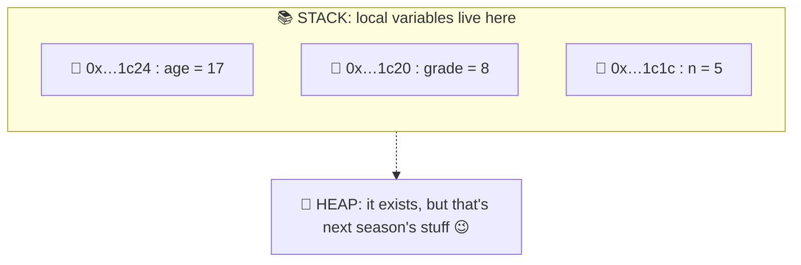

🧱 **Golden rule for now:** in this guide we work **only with the stack**, meaning normally declared variables and arrays.
When the function returns, its local variables **vanish**. 💨

🎣 **Hook:** if every variable has an address… can we **store that address in another variable**? Spoiler: yes.
And it's called a pointer.
Jump to [Chapter 2](#en-cap2). 👇

[⬆️ Back to top](#en-top) · [📚 Back to index](#en-index)

<a id="en-cap2"></a>

## 🪆 Chapter 2: The pointer, a.k.a. the voodoo doll

You know voodoo dolls, right? 🪆 They've got a creepy property: **stab the doll and something happens to the real person**.

- 🧍 **The person** = the variable (`int life`)
- 🪆 **The doll** = the pointer (`int* voodoo`)
- 📌 **The link** = the person's address, written inside the doll
- 🗡️ **Stabbing the doll** = dereferencing (`*voodoo = …`)

```c
int  life	= 100;
int* voodoo	= &life;		// the doll "knows" life's address

*voodoo = 50;				// 🗡️ stab: I change life through the doll
printf("%d\n", life);		// 50 😱
```

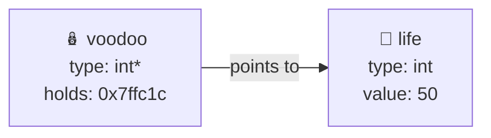

### 🔧 The tools of the trade

| 🔣 | 🧙 Name | 🗣️ Read as | 🧪 Example |
|---|---|---|---|
| `&` | **address-of** operator | "the address of…" | `&life` |
| `*` (in a declaration) | **creates** the pointer type | "pointer to…" | `int* p;` |
| `*` (in use) | **dereference** | "the content of…" | `*p = 5;` |
| `NULL` | 🚫 doll with no victim | "I point to nothing" | `int* p = NULL;` |

🧠 The very same `*` does **two different jobs** depending on where it sits.
In a **declaration** it says "I'm a pointer"; in an **expression** it says "go see what's over there".

### 🔄 Switching dolls

A pointer is a variable like any other: you can make it change victim.

```c
int a = 1, b = 2;
int* p = &a;
*p = 10;		// a is now 10
p = &b;			// 🔄 now the doll stands for b
*p = 20;		// b is 20, a is safe
```

### 🧪 The use case that changes your life: `swap()`

Remember `broken_swap()` from the [intro](#en-top)?
The problem was that in C **everything is passed by value**:
functions work on **copies**.
But if the copy is **the address**, you've got a photocopied voodoo doll: you can still hit the original! 🎯

```c
void swap(int* x, int* y) {
	int tmp = *x;
	*x = *y;
	*y = tmp;
}

int main(void) {
	int a = 3, b = 9;
	swap(&a, &b);
	printf("a=%d b=%d\n", a, b);	// a=9 b=3
	return 0;
}
```

> 🔁 This little function will **come back in every sorting algorithm** in [chapter 6](#en-cap6). Keep it handy!

<a id="en-trap1"></a>

### ⚠️ Trap #1: the doll with no victim

```c
int* p;			// 😱 uninitialized: it holds garbage
*p = 42;		// 💥 you write to a random address: undefined behavior
```

✅ **Antidote:** **always** initialize a pointer, either with `&something` or with `NULL`.

🎣 **Hook:** we've got a doll pointing to **one** victim. But what if the victims are **all lined up**, like in an array? Enter the [building](#en-cap3). 🏢

[⬆️ Back to top](#en-top) · [📚 Back to index](#en-index)

<a id="en-cap3"></a>

## 🏢 Chapter 3: Arrays and pointers, the building

An array is a **building with identical floors** 🏢: same height (the `sizeof` of the type), stacked one on top of the other, **no gaps in between**.

```c
int a[5] = {10, 20, 30, 40, 50};
```

### 🚪 The array name is the front door

The name `a` **isn't some magic container**: in most expressions it equals **the address of the first cell**, i.e. `&a[0]`.

Think about your home address 🏠: it's always **"building address + your floor"**. Even if all the windows of your apartment look out onto the street behind the front door, your address **doesn't change** depending on the view: it always starts at the front door and adds the floor.

Arrays work exactly the same way: **`a[i]` means "start at the front door `a`, climb `i` floors, and go see what's there"**.

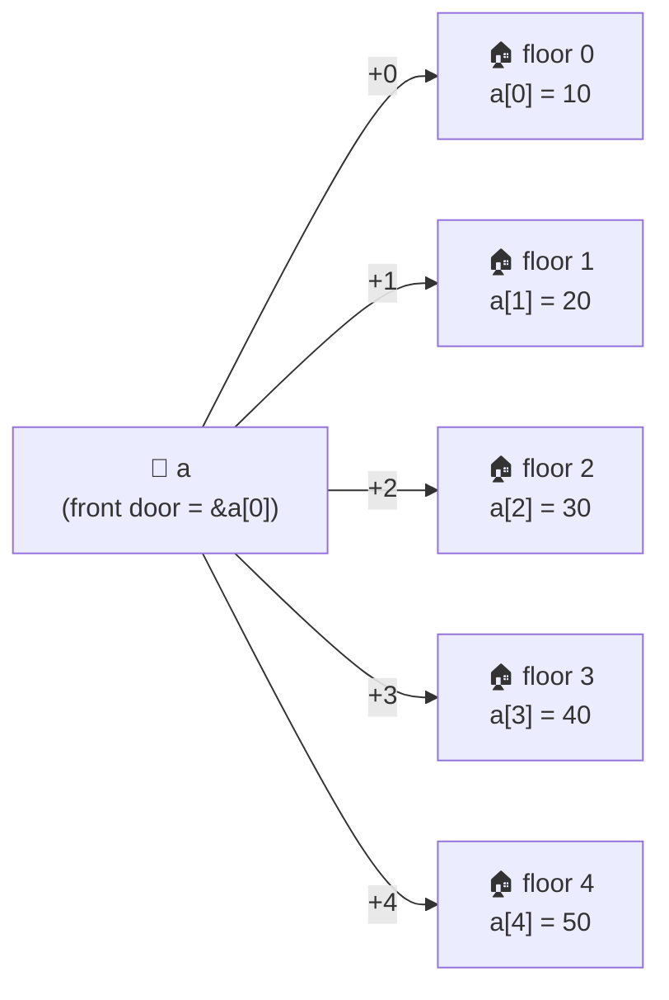

### 🧮 The fundamental equivalence

```c
a[i]	≡	*(a + i)
&a[i]	≡	a + i
```

| 🧩 Expression | 🗣️ Meaning | 🎯 With `a = {10,20,30,40,50}` |
|---|---|---|
| `a` | 🚪 front door (address of `a[0]`) | `0x…a0` |
| `a + 2` | 📍 address of floor 2 | `0x…a8` |
| `*(a + 2)` | 🔎 content of floor 2 | `30` |
| `a[2]` | 🔎 same thing, syntactic sugar | `30` |

🎁 **Easter egg:** since `a + i` is commutative, `i[a]` is **valid** and means the same as `a[i]`. Never use it, but go blow your teacher's mind. 🤯

### 📏 Pointer arithmetic doesn't count bytes, it counts floors

When you write `a + 1`, you're **not** adding 1 byte: you're climbing **one floor**, i.e. `sizeof(int)` bytes. The compiler does the multiplication for you.

```c
#include <stdio.h>

int main(void) {
	int a[5] = {10, 20, 30, 40, 50};

	printf("a		= %p\n", (void *)a);
	printf("a + 1	= %p\n", (void *)(a + 1));
	printf("&a[1]	= %p\n", (void *)&a[1]);
	return 0;
}
```

```text
a		= 0x7ffd1000
a + 1	= 0x7ffd1004	<- +4 bytes, not +1!
&a[1]	= 0x7ffd1004
```

🚨 With a `double` (8 bytes) the same `+ 1` would jump 8 bytes. **The pointer's type decides the step length.**

### ➖ Subtracting two pointers: how many floors apart?

If two pointers point into the **same array**, their difference is a **number of elements**, not bytes. The result type is `ptrdiff_t` (from `<stddef.h>`, printed with `%td`).

```c
#include <stddef.h>

ptrdiff_t dist = &a[4] - &a[1];		// 3 floors apart
printf("%td\n", dist);				// 3
```

### 🚶 Three ways to tour the building

```c
// 🏠 "Floor by floor" style: index
for (size_t i = 0; i < 5; i++) {
	printf("%d ", a[i]);
}

// 🧮 "Address + floor" style
for (size_t i = 0; i < 5; i++) {
	printf("%d ", *(a + i));
}

// 🚶 "Tenant climbing the stairs" style: the pointer moves forward
for (const int* p = a; p < a + 5; p++) {
	printf("%d ", *p);
}
```

All three print `10 20 30 40 50`. 🎉

> 🔑 **The building doesn't move, the tenant does.** `a` is the front door: you **can't** write `a++`. A pointer `p`, on the other hand, **moves** freely between floors.

### 🪄 Bonus: `&a` is the whole building

`a` points to the **first floor**. `&a`, instead, is the address of the **entire building**, so `&a + 1` jumps **a whole building**, i.e. `sizeof(a)` bytes: you land at the building next door! 🏘️

```c
printf("%p\n", (void *)(a + 1));	// +4 bytes (one floor)
printf("%p\n", (void *)(&a + 1));	// +20 bytes (a 5-floor building)
```

<a id="en-trap2"></a>

### ⚠️ Trap #2: walking out of the building

```c
int a[5] = {10, 20, 30, 40, 50};
int x = a[5];					// 💥 floor 5 does NOT exist (indexes go from 0 to 4)
```

C **won't stop you**: you read or write in somebody else's house. ☠️ The only exception is the **"one past the end"** pointer (`a + 5`): you can **compare** it (like in the loop above) but **never dereference** it.

🎣 **Hook:** what happens when you **hand the building over to a function**? Spoiler: you don't give it the building, you give it the **key**. Head to [Chapter 4](#en-cap4). 🔑

[⬆️ Back to top](#en-top) · [📚 Back to index](#en-index)

<a id="en-cap4"></a>

## 📦 Chapter 4: Arrays and functions, the key to the building

When you pass an array to a function, C **doesn't copy the building**. It passes **just the address of the front door**. This phenomenon is called the **decay** of the array into a pointer.

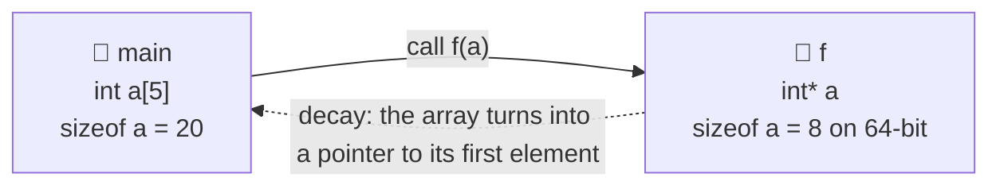

To the compiler, **these three signatures are identical**:

```c
void f(int a[5]);
void f(int a[]);
void f(int* a);
```

### 🕵️ The litmus test

```c
#include <stdio.h>

void measure(int a[]) {
	printf("inside measure : %zu bytes\n", sizeof a);	// 🪤 it's sizeof(int*), not the array's!
}

int main(void) {
	int a[5] = {10, 20, 30, 40, 50};
	printf("inside main	: %zu bytes\n", sizeof a);	// 20
	measure(a);
	return 0;
}
```

```text
inside main		: 20 bytes
inside measure	: 8 bytes		<- on a 64-bit system
```

<a id="en-trap3"></a>

### ⚠️ Trap #3: `sizeof` inside the function

Inside `measure` the building is gone: you only have **the key**, so `sizeof a` gives you the size of the key. 🔑 **Consequence:** the function **has no idea how many floors there are**. You have to tell it.

```c
size_t n = sizeof a / sizeof a[0];		// ✅ computed in main, where a is really an array
```

### 🧯 Two template functions to learn by heart

```c
// 👀 Read-only: const says "I promise not to touch anything"
void print_array(const int* a, size_t n) {
	for (size_t i = 0; i < n; i++)
		printf("%d ", a[i]);
	printf("\n");
}

// 🔨 Modifies: I gave you the key, you renovate the original!
void double_values(int* a, size_t n) {
	for (int* p = a; p < a + n; p++)
		*p *= 2;
}

int main(void) {
	int v[] = {1, 2, 3, 4};
	size_t n = sizeof v / sizeof v[0];

	double_values(v, n);
	print_array(v, n);		// 2 4 6 8
	return 0;
}
```

🎣 **Hook:** that `const` in `print_array` is a **promise**. But `const` can sit in **three different spots** with **three different meanings**. All aboard the [train](#en-cap5)! 🚂

[⬆️ Back to top](#en-top) · [📚 Back to index](#en-index)

<a id="en-cap5"></a>

## 🚂 Chapter 5: `const` and pointers, the train

### 🎬 The scene

- 🛤️ **The track** = memory (the array, with its cells in a row, see the [building](#en-cap3))
- 🚃 **The cart** = the **pointer**, which can stop on a cell
- 📦 **The cargo** = the **data** under the cart, i.e. `*p`
- 🔒 **The padlocks** = the two `const`s, and **each one locks a different thing**

You've got **two padlocks** available: one for the **cargo** and one for the **wheels**. 🛞

### 🧭 How to read a declaration: right to left

> 📖 `int* const p;` reads: **p is** a **const** **pointer** to **int**

The trick: look at **what comes right before** `const`.

### 🔒 Case 1: `const int* p`, the cargo is sealed 📦🔒

*"The cart can roll along the tracks, but the cargo is sealed."*

```c
int v[3] = {10, 20, 30};

const int* sealed_cargo = v;
sealed_cargo++;					// ✅ I move the cart: now it points to 20
// *sealed_cargo = 99;			// ❌ ERROR: the cargo is sealed (from here)
```

🧠 **Heads-up:** the data `v[1]` **hasn't** become constant in absolute terms. It's just that **through `sealed_cargo`** you can't modify it (`v[1] = 99;` still works). The padlock is on the **path**, not on the cell. It's the promise a read-only function would make.

> ✍️ `int const *p` is **identical** to `const int* p`.

### 🛑 Case 2: `int* const p`, the wheels are locked 🛞🔒

*"The cart is bolted to the track, but you can swap the cargo."*

```c
int* const locked_wheels = v;		// always initialized right away!
*locked_wheels = 99;				// ✅ I change the cargo: v[0] is now 99
// locked_wheels++;					// ❌ ERROR: the cart doesn't move
// locked_wheels = &other;			// ❌ ERROR: not even to another track
```

Handy when you want to guarantee that a pointer **always points to the same cell**.

### 🔐 Case 3: `const int* const p`, everything locked 📦🔒🛞🔒

*"Cart bolted down and cargo sealed: all read-only."*

```c
const int* const fully_locked = v;
// *fully_locked = 1;				// ❌ ERROR
// fully_locked++;					// ❌ ERROR
printf("%d\n", *fully_locked);		// ✅ looking is allowed
```

### 📊 Summary table

| 🏷️ Declaration | 🚃 Can I move `p`? | 📦 Can I change `*p`? | 🎭 Mental image |
|---|---|---|---|
| `int* p` | ✅ yes | ✅ yes | 🆓 total freedom |
| `const int* p` | ✅ yes | ❌ no | 📦🔒 sealed cargo |
| `int* const p` | ❌ no | ✅ yes | 🛞🔒 locked wheels |
| `const int* const p` | ❌ no | ❌ no | 📦🔒🛞🔒 everything locked |

### 🌳 Decision tree

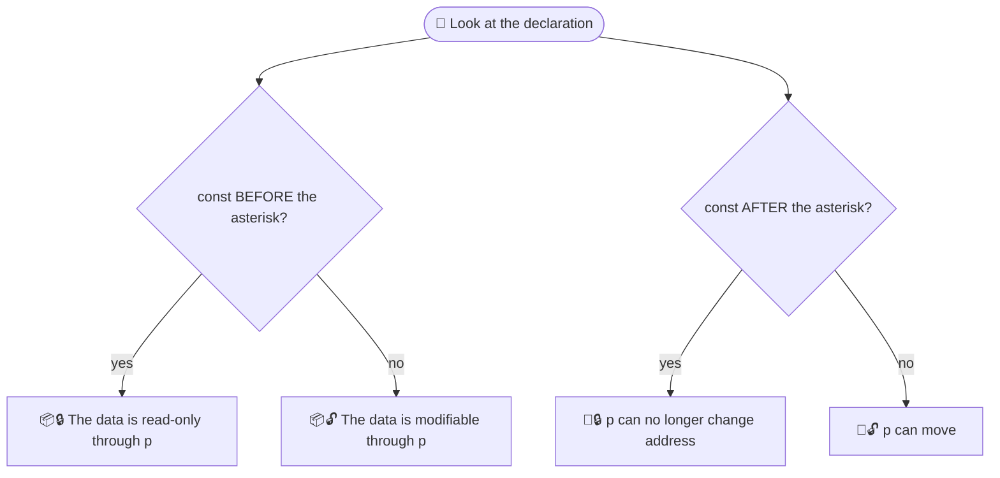

### 🚆 The whole train in a single snippet

```c
#include <stdio.h>

int main(void) {
	int v[3] = {10, 20, 30};

	const int* sealed_cargo = v;			// 📦🔒
	int* const locked_wheels = v;			// 🛞🔒
	const int* const fully_locked = v;		// 📦🔒🛞🔒

	sealed_cargo++;							// ✅
	*locked_wheels = 11;					// ✅
	printf("%d %d %d\n", *sealed_cargo, *locked_wheels, *fully_locked);	// 20 11 11

	return 0;
}
```

🎯 **Rule of thumb:** every function that **doesn't modify** the array should take a `const int*`, like `print_array()` from [chapter 4](#en-cap4). The compiler becomes your **ticket inspector**: break the promise and it stops you. 🎫

🎣 **Hook:** we've got all the ingredients: dolls, buildings, trains. Time to [cook](#en-cap6)! 🍳

[⬆️ Back to top](#en-top) · [📚 Back to index](#en-index)

<a id="en-cap6"></a>

## 🔀 Chapter 6: Sorting, indexes vs pointers

Three classic algorithms, each in **two flavors**:

- 🏠 **Index style:** `a[i]`, `a[j]` (like in the [building](#en-cap3))
- 🚶 **Pointer style:** `*(p + i)`, `p++`, and pointer comparisons

The result is identical, **only the way you look at the building changes**. 👀

<a id="en-cap6-tools"></a>

### 🧰 Common tools (put them at the top of the file)

```c
#include <stdio.h>
#include <stddef.h>

// 🔁 The voodoo doll from chapter 2!
static void swap(int* x, int* y) {
	int tmp = *x;
	*x = *y;
	*y = tmp;
}

// 👀 Read-only: "sealed cargo" train (chapter 5)
static void print_array(const int* a, size_t n) {
	for (const int* p = a; p < a + n; p++)
		printf("%d ", *p);
	printf("\n");
}

// 📋 Copy one array into another: sealed source, free destination
static void copy_array(const int* src, int* dst, size_t n) {
	for (size_t i = 0; i < n; i++) {
		*(dst + i) = *(src + i);
	}
}
```

<a id="en-cap6-bubble"></a>

### 🫧 6.1 Optimized bubble sort

💡 **The idea:** on every pass the biggest bubble **floats up to the end**, just like real bubbles. 🫧

🚀 **The optimizations:**

- 🏁 we remember **the last position where a swap happened** (`last_swap`): **past that point the array is already sorted**, so the next pass stops there
- ⚡ if a pass **makes no swaps at all** (`last_swap = 0`), we're done: in the best case it costs **O(n)**

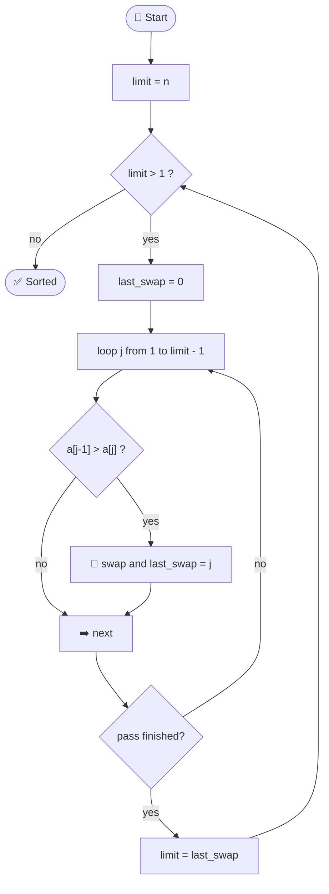

#### 🏠 Index version

```c
void bubble_sort_idx(int a[], size_t n) {
	size_t limit = n;				// elements still to check
	while (limit > 1) {
		size_t last_swap = 0;		// position of the last swap
		for (size_t j = 1; j < limit; j++) {
			if (a[j - 1] > a[j]) {
				swap(&a[j - 1], &a[j]);
				last_swap = j;
			}
		}
		limit = last_swap;			// past "last_swap" everything is already in place
	}
}
```

#### 🚶 Pointer version

```c
void bubble_sort_ptr(int* a, size_t n) {
	size_t limit = n;
	while (limit > 1) {
		size_t last_swap = 0;
		for (int* p = a + 1; p < a + limit; p++) {
			if (*(p - 1) > *p) {
				swap(p - 1, p);						// I pass the pointers straight in!
				last_swap = (size_t)(p - a);		// pointer difference = index
			}
		}
		limit = last_swap;
	}
}
```

👀 **What do you notice?**

- `&a[j - 1]` simply becomes `p - 1`: **no `&`, no indexes**
- `p - a` rebuilds the index: it's the **pointer difference** from [chapter 3](#en-cap3)

[⬆️ Back to top](#en-top) · [📚 Back to index](#en-index) · [🔀 Back to chapter 6](#en-cap6)

<a id="en-cap6-selection"></a>

### 🎯 6.2 Optimized selection sort (min **and** max together)

💡 **The idea:** on every pass you **look for the smallest and the biggest** in the unsorted stretch. The small one goes **to the front**, the big one **to the back**: **you sort two ends at a time**, so the number of passes gets cut in half. ✂️

⚠️ **The sneaky catch:** if the maximum sits right in cell `lo` and you swap the minimum first, **the maximum has moved** to `min_idx`/`min_ptr`. That's why there's a fix-up line.

#### 🏠 Index version

```c
void selection_sort_idx(int a[], size_t n) {
	if (n < 2)
		return;
	size_t lo = 0, hi = n - 1;

	while (lo < hi) {
		size_t min_idx = lo, max_idx = lo;
		for (size_t i = lo + 1; i <= hi; i++) {
			if (a[i] < a[min_idx])
				min_idx = i;
			if (a[i] > a[max_idx])
				max_idx = i;
		}
		swap(&a[lo], &a[min_idx]);			// minimum to the front
		if (max_idx == lo)
			max_idx = min_idx;				// 🩹 the maximum has moved!
		swap(&a[hi], &a[max_idx]);			// maximum to the back
		lo++;
		hi--;
	}
}
```

#### 🚶 Pointer version

```c
void selection_sort_ptr(int* a, size_t n) {
	if (n < 2)
		return;
	int* lo = a, *hi = a + n - 1;				// two tenants: one starts from the bottom, one from the top

	while (lo < hi) {
		int* min_ptr = lo, *max_ptr = lo;
		for (int* p = lo + 1; p <= hi; p++) {
			if (*p < *min_ptr)
				min_ptr = p;
			if (*p > *max_ptr)
				max_ptr = p;
		}
		swap(lo, min_ptr);
		if (max_ptr == lo)
			max_ptr = min_ptr;					// 🩹 same fix
		swap(hi, max_ptr);
		lo++;
		hi--;
	}
}
```

👀 **What do you notice?** Here the pointer style feels **more natural**: `lo` and `hi` are **two pointers closing in on each other**, like two people going up and down the stairs. 🧗‍♂️🧗‍♀️ No indexes to juggle.

[⬆️ Back to top](#en-top) · [📚 Back to index](#en-index) · [🔀 Back to chapter 6](#en-cap6)

<a id="en-cap6-insertion"></a>

### 🃏 6.3 Insertion sort

💡 **The idea:** just like **sorting the cards in your hand**. 🃏 Take the next card (the `key`), compare it with the ones on its left, **shift right** the bigger ones, and slot the `key` into the gap.

🌟 It's blazing fast when the array is **almost sorted** (best case **O(n)**).

#### 🏠 Index version

```c
void insertion_sort_idx(int a[], size_t n) {
	for (size_t i = 1; i < n; i++) {
		int key = a[i];
		size_t j = i;
		while (j > 0 && a[j - 1] > key) {
			a[j] = a[j - 1];			// 🚚 shift right
			j--;
		}
		a[j] = key;						// 🕳️ slot the card into the gap
	}
}
```

#### 🚶 Pointer version

```c
void insertion_sort_ptr(int* a, size_t n) {
	if (n < 2)
		return;
	for (int* i = a + 1; i < a + n; i++) {
		int key = *i;
		int* j = i;
		while (j > a && *(j - 1) > key) {
			*j = *(j - 1);			// 🚚 shift right
			j--;					// ⬅️ the pointer goes down one floor
		}
		*j = key;
	}
}
```

👀 **What do you notice?** The condition `j > a` is the pointer version of `j > 0`: **the front door is the lower bound**. 🚪

[⬆️ Back to top](#en-top) · [📚 Back to index](#en-index) · [🔀 Back to chapter 6](#en-cap6)

<a id="en-cap6-main"></a>

### 🏁 6.4 The main that makes them race

```c
int main(void) {
	const int base[] = {42, 7, 19, 3, 88, 1, 56, 23};
	const size_t n = sizeof base / sizeof base[0];
	int work[8];						// 🧱 all on the stack: size known at compile time

	printf("📥 Original		: "); print_array(base, n);

	copy_array(base, work, n); bubble_sort_idx(work, n);
	printf("🫧 Bubble idx		: "); print_array(work, n);

	copy_array(base, work, n); bubble_sort_ptr(work, n);
	printf("🫧 Bubble ptr		: "); print_array(work, n);

	copy_array(base, work, n); selection_sort_idx(work, n);
	printf("🎯 Selection idx : "); print_array(work, n);

	copy_array(base, work, n); selection_sort_ptr(work, n);
	printf("🎯 Selection ptr : "); print_array(work, n);

	copy_array(base, work, n); insertion_sort_idx(work, n);
	printf("🃏 Insertion idx : "); print_array(work, n);

	copy_array(base, work, n); insertion_sort_ptr(work, n);
	printf("🃏 Insertion ptr : "); print_array(work, n);

	return 0;
}
```

```text
📥 Original		: 42 7 19 3 88 1 56 23
🫧 Bubble idx		: 1 3 7 19 23 42 56 88
🫧 Bubble ptr		: 1 3 7 19 23 42 56 88
🎯 Selection idx	: 1 3 7 19 23 42 56 88
🎯 Selection ptr	: 1 3 7 19 23 42 56 88
🃏 Insertion idx	: 1 3 7 19 23 42 56 88
🃏 Insertion ptr	: 1 3 7 19 23 42 56 88
```

🔎 Notice how `base` is a `const int[]`: pass it to `copy_array(const int* src, …)` and the train **can't touch** the original. [Chapter 5](#en-cap5) at work! 🚂

[⬆️ Back to top](#en-top) · [📚 Back to index](#en-index) · [🔀 Back to chapter 6](#en-cap6)

<a id="en-cap6-compare"></a>

### 📊 The final showdown

| 🥊 Algorithm | ⏱️ Best | ⏱️ Worst | 🔁 Swaps | ⚖️ Stable? | 🌟 Perfect when… |
|---|---|---|---|---|---|
| 🫧 Bubble (optimized) | O(n) | O(n²) | lots | ✅ yes | almost-sorted arrays, teaching |
| 🎯 Selection (min+max) | O(n²) | O(n²) | few (≤ n) | ❌ no | swaps are expensive |
| 🃏 Insertion | O(n) | O(n²) | shifts | ✅ yes | small or almost-sorted arrays |

### 🏠 vs 🚶 Styles head to head

| 🎭 | 🏠 Indexes | 🚶 Pointers |
|---|---|---|
| 📖 Readability | ✅ instant | 🤔 takes a sec |
| 🧮 Previous element | `a[j - 1]` | `*(p - 1)` |
| 📍 Address of a cell | `&a[j]` | `p` |
| 🧗 Two "ends" closing in | `lo`, `hi` (indexes) | `lo`, `hi` (pointers) ✨ |
| ⚙️ Performance | 🟰 pretty much the same once the compiler optimizes | 🟰 |

💬 **Verdict:** neither style is "better". Learn **both**, because you'll run into code written either way, and you'll **always** know what's going on.

🎣 **Hook:** now that you've seen it all, let's tidy up your head too with the [mind map](#en-cap7). 🧠

[⬆️ Back to top](#en-top) · [📚 Back to index](#en-index) · [🔀 Back to chapter 6](#en-cap6)

<a id="en-cap7"></a>

## 🧠 Chapter 7: Mind map and cheat sheet

### 🗺️ Everything you've learned

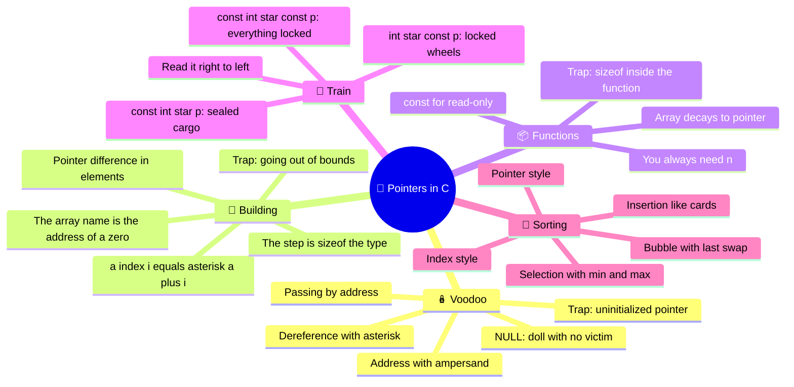

### 🧾 Cheat sheet to print

| 🎯 I want… | ✍️ I write | 🎭 Metaphor |
|---|---|---|
| the address of `x` | `&x` | 📍 house number |
| the content `p` points to | `*p` | 🗡️ stab the doll |
| floor `i` of `a` | `a[i]` or `*(a + i)` | 🏢 front door + floor |
| the address of floor `i` | `&a[i]` or `a + i` | 📍 the floor's house number |
| how many floors between `p` and `q` | `q - p` | 📏 distance in elements |
| how many elements an array has | `sizeof a / sizeof a[0]` | 🧮 only where `a` is really an array |
| read-only access to an array | `const int* a` | 📦🔒 sealed cargo |
| a pointer that never moves | `int* const p` | 🛞🔒 locked wheels |
| an "empty" pointer | `NULL` | 🚫 doll with no victim |

### 🛡️ The 3 traps in one line

1. ⚠️ **Uninitialized pointer** → always use `&something` or `NULL` ([details](#en-trap1))
2. ⚠️ **Out of bounds** → valid indexes go from `0` to `n - 1` ([details](#en-trap2))
3. ⚠️ **`sizeof` inside a function** → you've got the key, not the building: pass `n` ([details](#en-trap3))

### 🏋️ Weekend challenges

1. 🔄 **Reverse an array** with two pointers, `start` and `end`, closing in on each other and swapping values
2. 🔍 **Find the maximum** in an array and return **a pointer** to the element you found (and print its index using pointer difference)
3. 🧪 **Swap counter:** tweak the three sorts to count how many swaps they make on random arrays, and check the [comparison table](#en-cap6-compare)
4. 🎓 **Senior bonus:** write `const int* find(const int* a, size_t n, int target)` that returns a pointer to the element or `NULL`. Which padlock from the [train](#en-cap5) are you using, and why?

[⬆️ Back to top](#en-top) · [📚 Back to index](#en-index)

<a id="en-finale"></a>

## 🎬 Finale

If you made it this far, you now know that:

- 🪆 a pointer is **just a variable that holds an address**
- 🏢 an array is **a building**, and `a[i]` is just **front door + floor**
- 🚂 `const` lets you **seal the cargo or lock the wheels**
- 🔀 the same algorithms can be written **with indexes or with pointers**, and now you can read both

🔮 **Next episode:** so far our buildings had a **size decided at compile time**, and they all lived on the stack. But what if you want to **build the building while the program is running**? 🏗️ That's another chapter… and another adventure. 😉

**Happy coding! 💻🔥**

[⬆️ Back to top](#en-top) · [📚 Back to index](#en-index)

---

<a href="#IT"></a>
🤍
<a href="#EN"></a>

---

 <a name="IT"></A>

<!-- Italiano -->

<a id="it-top"></a>

# 🎯 **Puntatori in C**: *la guida che non ti aspetti*

## 🎬 Prima di cominciare: il bug che non dovrebbe esistere

Facciamo un esperimento.
Scrivi questa funzione, che sembra **perfetta**:

```c
#include <stdio.h>

void broken_swap(int x, int y) {
	int t = x;
	x = y;
	y = t;
}

int main(void) {
	int a = 3, b = 9;
	broken_swap(a, b);
	printf("a=%d b=%d\n", a, b);
	return 0;
}
```

🔮 Cosa ti aspetti? `a=9 b=3`.
😱 Cosa succede davvero? **`a=3 b=9`**.
Non è cambiato niente.

Non è il compilatore che ti odia 🤖 e non è sfortuna:
il C passa **tutto per valore**, quindi la funzione lavora su **fotocopie** di `a` e `b`, e a fine funzione le fotocopie finiscono nel cestino. 🗑️

💡 **E se invece di una fotocopia del valore le passassimo l'indirizzo di casa?**
Con quello la funzione potrebbe bussare alla porta dell'originale e cambiarlo davvero.
Questo trucco si chiama **puntatore**, ed è la differenza tra **usare il C** e **capire il C**.

In questa guida lo smontiamo pezzo per pezzo: prima **bambole voodoo** 🪆, poi **palazzi** 🏢, poi **treni** 🚂, e alla fine **ordineremo array a mani nude** 🔀.
In fondo a ogni capitolo trovi un **aggancio** al successivo: se li segui in ordine, la storia fila. 🎢

👉 *Spoiler: la `swap()` funzionante ti aspetta nel [Capitolo 2](#it-cap2).*

<a id="it-index"></a>

## 📚 Indice

| 🔢 | 📖 Capitolo | 🎭 Metafora |
|---|---|---|
| 1 | [🗺️ La memoria è una strada](#it-cap1) | 🛣️ Strada con i numeri civici |
| 2 | [🪆 Il puntatore: la bambola voodoo](#it-cap2) | 🪆 Bambola e vittima |
| 3 | [🏢 Array e puntatori: il palazzo](#it-cap3) | 🏢 Portone + piano |
| 4 | [📦 Array e funzioni: la chiave del palazzo](#it-cap4) | 🔑 Chiave, non copia |
| 5 | [🚂 `const` e puntatori: il treno](#it-cap5) | 🚂 Carrello e lucchetti |
| 6 | [🔀 Ordinamenti: indici vs puntatori](#it-cap6) | 🥊 Due stili a confronto |
| 7 | [🧠 Mappa mentale e cheat sheet](#it-cap7) | 🗺️ Tutto in una pagina |

🔀 **Scorciatoie nel capitolo 6:**
[🧰 Attrezzi](#it-cap6-tools) · [🫧 Bubble](#it-cap6-bubble) · [🎯 Selection](#it-cap6-selection) · [🃏 Insertion](#it-cap6-insertion) · [🏁 Main](#it-cap6-main) · [📊 Confronto](#it-cap6-compare)

⚠️ **Scorciatoie alle trappole:**
[1️⃣ Puntatore non inizializzato](#it-trap1) · [2️⃣ Fuori dai limiti](#it-trap2) · [3️⃣ `sizeof` nelle funzioni](#it-trap3)

🎬 [Finale](#it-finale)

<a id="it-cap1"></a>

## 🗺️ Capitolo 1: La memoria è una strada

Immagina la RAM come una **strada lunghissima** 🛣️: ogni casetta è **1 byte** e ha un **numero civico**.
Quel numero è l'**indirizzo**.

Quando scrivi `int age = 17;` il compilatore prenota **4 byte** (di solito) su quella strada, e da quel momento:

- 🏷️ `age` è il **nome** che usi tu
- 📦 `17` è il **contenuto**
- 📍 l'**indirizzo** è il civico della prima casetta occupata

```c
#include <stdio.h>

int main(void) {
	int age = 17;
	printf("valore		: %d\n", age);
	printf("indirizzo	: %p\n", (void *)&age);			// %p vuole un void*
	printf("occupa		: %zu byte\n", sizeof age);
	return 0;
}
```

```text
valore		: 17
indirizzo	: 0x7ffd5c3a1c24		<- cambia a ogni esecuzione!
occupa		: 4 byte
```

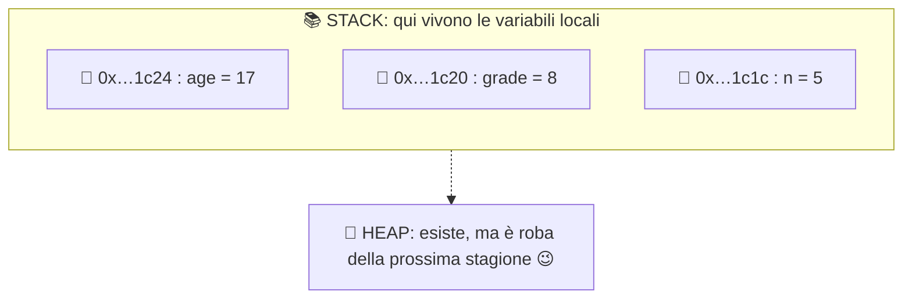

🧱 **Regola d'oro per ora:** in questa guida lavoriamo **solo con lo stack**, cioè variabili e array dichiarati normalmente.
Quando la funzione finisce, le sue variabili locali **spariscono**. 💨

🎣 **Aggancio:** se ogni variabile ha un indirizzo… possiamo **salvare quell'indirizzo in un'altra variabile**? Spoiler: sì.
E si chiama puntatore.
Passa al [Capitolo 2](#it-cap2). 👇

[⬆️ Torna su](#it-top) · [📚 Torna all'indice](#it-index)

<a id="it-cap2"></a>

## 🪆 Capitolo 2: Il puntatore, la bambola voodoo

Hai presente le bambole voodoo? 🪆 Hanno una proprietà inquietante: **se pungi la bambola, succede qualcosa alla persona vera**.

- 🧍 **La persona** = la variabile (`int life`)
- 🪆 **La bambola** = il puntatore (`int* voodoo`)
- 📌 **Il legame** = l'indirizzo della persona, scritto dentro la bambola
- 🗡️ **Pungere la bambola** = dereferenziare (`*voodoo = …`)

```c
int  life	= 100;
int* voodoo	= &life;		// la bambola "conosce" l'indirizzo di life

*voodoo = 50;				// 🗡️ pugnalata: modifico life tramite la bambola
printf("%d\n", life);		// 50 😱
```

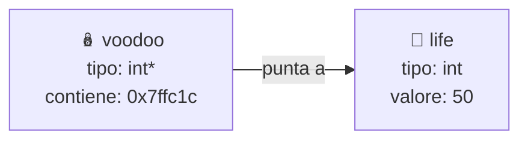

### 🔧 Gli attrezzi del mestiere

| 🔣 | 🧙 Nome | 🗣️ Si legge | 🧪 Esempio |
|---|---|---|---|
| `&` | operatore **indirizzo** | "l'indirizzo di…" | `&life` |
| `*` (in dichiarazione) | **crea** il tipo puntatore | "puntatore a…" | `int* p;` |
| `*` (in uso) | **dereferenziazione** | "il contenuto di…" | `*p = 5;` |
| `NULL` | 🚫 bambola senza vittima | "non punto a niente" | `int* p = NULL;` |

🧠 Lo stesso `*` fa **due lavori diversi** a seconda di dove sta.
Se è nella **dichiarazione** dice "sono un puntatore"; se è in un'**espressione** dice "vai a vedere cosa c'è là".

### 🔄 Cambiare bambola

Il puntatore è una variabile come le altre: puoi fargli cambiare vittima.

```c
int a = 1, b = 2;
int* p = &a;
*p = 10;		// a vale 10
p = &b;			// 🔄 ora la bambola rappresenta b
*p = 20;		// b vale 20, a è salvo
```

### 🧪 Il caso d'uso che cambia la vita: `swap()`

Ricordi la `broken_swap()` dell'[introduzione](#it-top)?
Il problema era che in C **tutto si passa per valore**:
le funzioni lavorano su **copie**.
Ma se la copia è **l'indirizzo**, hai una bambola voodoo fotocopiata: puoi comunque colpire l'originale! 🎯

```c
void swap(int* x, int* y) {
	int tmp = *x;
	*x = *y;
	*y = tmp;
}

int main(void) {
	int a = 3, b = 9;
	swap(&a, &b);
	printf("a=%d b=%d\n", a, b);	// a=9 b=3
	return 0;
}
```

> 🔁 Questa funzioncina **tornerà in tutti gli ordinamenti** del [capitolo 6](#it-cap6). Tienila a portata di mano!

<a id="it-trap1"></a>

### ⚠️ Trappola n.1: la bambola senza vittima

```c
int* p;        // 😱 non inizializzato: contiene spazzatura
*p = 42;       // 💥 scrivi in un indirizzo a caso: comportamento indefinito
```

✅ **Antidoto:** inizializza **sempre** un puntatore, con `&qualcosa` oppure con `NULL`.

🎣 **Aggancio:** abbiamo una bambola che punta a **una** vittima. Ma se le vittime stanno **tutte in fila**, come in un array? Entra in scena il [palazzo](#it-cap3). 🏢

[⬆️ Torna su](#it-top) · [📚 Torna all'indice](#it-index)

<a id="it-cap3"></a>

## 🏢 Capitolo 3: Array e puntatori, il palazzo

Un array è un **palazzo con i piani tutti uguali** 🏢: stessa altezza (`sizeof` del tipo), uno sopra l'altro, **senza buchi in mezzo**.

```c
int a[5] = {10, 20, 30, 40, 50};
```

### 🚪 Il nome dell'array è il portone

Il nome `a` **non è un contenitore magico**: nella maggior parte delle espressioni vale **l'indirizzo della prima cella**, cioè `&a[0]`.

Pensa al tuo indirizzo di casa 🏠: sarà sempre **"indirizzo del palazzo + il tuo piano"**. Anche se tutte le finestre del tuo appartamento si affacciano sulla strada dietro al portone, l'indirizzo **non cambia** in base alla vista: parte sempre dal portone e aggiunge il piano.

Con gli array è identico: **`a[i]` significa "parti dal portone `a`, sali di `i` piani, e vai a vedere cosa c'è"**.

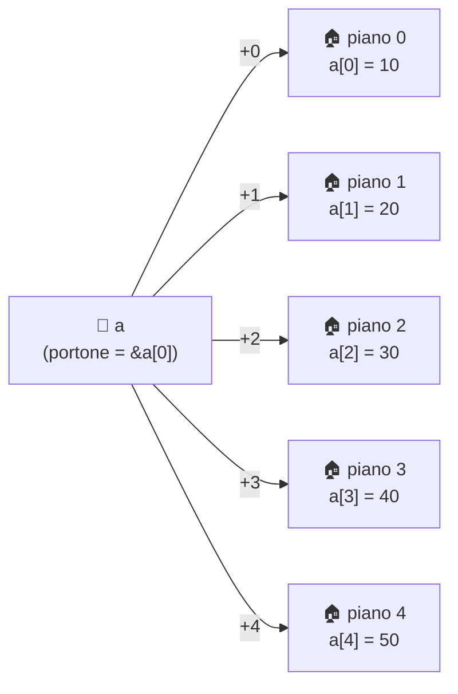

### 🧮 L'equivalenza fondamentale

```c
a[i]	≡	*(a + i)
&a[i]	≡	a + i
```

| 🧩 Scrittura | 🗣️ Significato | 🎯 Con `a = {10,20,30,40,50}` |
|---|---|---|
| `a` | 🚪 portone (indirizzo di `a[0]`) | `0x…a0` |
| `a + 2` | 📍 indirizzo del piano 2 | `0x…a8` |
| `*(a + 2)` | 🔎 contenuto del piano 2 | `30` |
| `a[2]` | 🔎 stessa cosa, zucchero sintattico | `30` |

🎁 **Easter egg:** siccome `a + i` è commutativa, `i[a]` è **valido** e vale come `a[i]`. Non usarlo mai, ma stupisci il prof. 🤯

### 📏 L'aritmetica dei puntatori non conta byte, conta piani

Quando scrivi `a + 1`, **non** sommi 1 byte: sali di **un piano**, cioè di `sizeof(int)` byte. Il compilatore moltiplica per te.

```c
#include <stdio.h>

int main(void) {
	int a[5] = {10, 20, 30, 40, 50};

	printf("a		= %p\n", (void *)a);
	printf("a + 1	= %p\n", (void *)(a + 1));
	printf("&a[1]	= %p\n", (void *)&a[1]);
	return 0;
}
```

```text
a		= 0x7ffd1000
a + 1	= 0x7ffd1004	<- +4 byte, non +1!
&a[1]	= 0x7ffd1004
```

🚨 Con un `double` (8 byte) lo stesso `+ 1` salterebbe di 8 byte. **Il tipo del puntatore decide la lunghezza del passo.**

### ➖ Sottrarre due puntatori: quanti piani di distanza?

Se due puntatori puntano allo **stesso array**, la loro differenza è un **numero di elementi**, non di byte. Il tipo del risultato è `ptrdiff_t` (da `<stddef.h>`, si stampa con `%td`).

```c
#include <stddef.h>

ptrdiff_t dist = &a[4] - &a[1];		// 3 piani di distanza
printf("%td\n", dist);				// 3
```

### 🚶 Tre modi di visitare il palazzo

```c
// 🏠 Stile "a piani": indice
for (size_t i = 0; i < 5; i++) {
	printf("%d ", a[i]);
}

// 🧮 Stile "indirizzo + piano"
for (size_t i = 0; i < 5; i++) {
	printf("%d ", *(a + i));
}

// 🚶 Stile "inquilino che sale le scale": il puntatore avanza
for (const int* p = a; p < a + 5; p++) {
	printf("%d ", *p);
}
```

Tutti e tre stampano `10 20 30 40 50`. 🎉

> 🔑 **Il palazzo non si sposta, l'inquilino sì.** `a` è il portone: **non puoi** scrivere `a++`. Un puntatore `p` invece **si muove** liberamente tra i piani.

### 🪄 Bonus: `&a` è il palazzo intero

`a` punta al **primo piano**. `&a` invece è l'indirizzo **dell'intero palazzo**, quindi `&a + 1` salta **un palazzo intero**, cioè `sizeof(a)` byte: arrivi al palazzo accanto! 🏘️

```c
printf("%p\n", (void *)(a + 1));	// +4 byte (un piano)
printf("%p\n", (void *)(&a + 1));	// +20 byte (un palazzo da 5 piani)
```

<a id="it-trap2"></a>

### ⚠️ Trappola n.2: uscire dal palazzo

```c
int a[5] = {10, 20, 30, 40, 50};
int x = a[5];					// 💥 il piano 5 NON esiste (gli indici vanno da 0 a 4)
```

Il C **non ti ferma**: leggi o scrivi in casa d'altri. ☠️ Fa eccezione solo il puntatore **"un passo oltre la fine"** (`a + 5`): puoi **confrontarlo** (come nel ciclo qui sopra) ma **mai dereferenziarlo**.

🎣 **Aggancio:** cosa succede quando **passi il palazzo a una funzione**? Spoiler: non gli dai il palazzo, gli dai la **chiave**. Vai al [Capitolo 4](#it-cap4). 🔑

[⬆️ Torna su](#it-top) · [📚 Torna all'indice](#it-index)

<a id="it-cap4"></a>

## 📦 Capitolo 4: Array e funzioni, la chiave del palazzo

Quando passi un array a una funzione, il C **non copia il palazzo**. Passa **solo l'indirizzo del portone**. Questo fenomeno si chiama **decadimento** (*decay*) dell'array a puntatore.

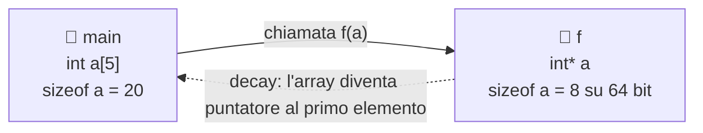

Per il compilatore **queste tre firme sono identiche**:

```c
void f(int a[5]);
void f(int a[]);
void f(int* a);
```

### 🕵️ Prova del nove

```c
#include <stdio.h>

void measure(int a[]) {
	printf("dentro measure : %zu byte\n", sizeof a);	// 🪤 è sizeof(int*), non dell'array!
}

int main(void) {
	int a[5] = {10, 20, 30, 40, 50};
	printf("dentro main	: %zu byte\n", sizeof a);	// 20
	measure(a);
	return 0;
}
```

```text
dentro main		: 20 byte
dentro measure	: 8 byte		<- su un sistema a 64 bit
```

<a id="it-trap3"></a>

### ⚠️ Trappola n.3: `sizeof` dentro la funzione

Dentro `measure` il palazzo non c'è più: hai **solo la chiave**, quindi `sizeof a` ti dà la dimensione della chiave. 🔑 **Conseguenza:** la funzione **non sa quanti piani ci sono**. Devi passarglielo.

```c
size_t n = sizeof a / sizeof a[0];		// ✅ si calcola in main, dove a è davvero un array
```

### 🧯 Due funzioni tipo da imparare a memoria

```c
// 👀 Sola lettura: const dice "prometto di non toccare nulla"
void print_array(const int* a, size_t n) {
	for (size_t i = 0; i < n; i++)
		printf("%d ", a[i]);
	printf("\n");
}

// 🔨 Modifica: ti ho dato la chiave, ristrutturi l'originale!
void double_values(int* a, size_t n) {
	for (int* p = a; p < a + n; p++)
		*p *= 2;
}

int main(void) {
	int v[] = {1, 2, 3, 4};
	size_t n = sizeof v / sizeof v[0];

	double_values(v, n);
	print_array(v, n);            // 2 4 6 8
	return 0;
}
```

🎣 **Aggancio:** quel `const` in `print_array` è una **promessa**. Ma `const` può stare in **tre posti diversi** con **tre significati diversi**. Tutti a bordo del [treno](#it-cap5)! 🚂

[⬆️ Torna su](#it-top) · [📚 Torna all'indice](#it-index)

<a id="it-cap5"></a>

## 🚂 Capitolo 5: `const` e puntatori, il treno

### 🎬 La scena

- 🛤️ **Il binario** = la memoria (l'array, con le sue celle in fila, vedi il [palazzo](#it-cap3))
- 🚃 **Il carrello** = il **puntatore**, che può fermarsi su una cella
- 📦 **Il carico** = il **dato** sotto il carrello, cioè `*p`
- 🔒 **I lucchetti** = le due `const`, e **ognuno blocca una cosa diversa**

Hai **due lucchetti** disponibili: uno per il **carico** e uno per le **ruote**. 🛞

### 🧭 Come si legge una dichiarazione: da destra a sinistra

> 📖 `int* const p;` si legge: **p è** un **const** **puntatore** a **int**

Il trucco: guarda **cosa sta subito prima** di `const`.

### 🔒 Caso 1: `const int* p`, il carico è sigillato 📦🔒

*"Il carrello può correre sui binari, ma il carico è sigillato."*

```c
int v[3] = {10, 20, 30};

const int* sealed_cargo = v;
sealed_cargo++;					// ✅ sposto il carrello: ora punta a 20
// *sealed_cargo = 99;			// ❌ ERRORE: il carico è sigillato (da qui)
```

🧠 **Attenzione:** il dato `v[1]` **non è** diventato costante in assoluto. Semplicemente **tramite `sealed_cargo`** non puoi modificarlo (`v[1] = 99;` funziona ancora). Il lucchetto è sul **cammino**, non sulla cella. È la promessa che farebbe una funzione di sola lettura.

> ✍️ `int const *p` è **identico** a `const int* p`.

### 🛑 Caso 2: `int* const p`, le ruote sono bloccate 🛞🔒

*"Il carrello è inchiodato al binario, ma puoi cambiare il carico."*

```c
int* const locked_wheels = v;		// sempre inizializzato subito!
*locked_wheels = 99;				// ✅ cambio il carico: v[0] ora vale 99
// locked_wheels++;					// ❌ ERRORE: il carrello non si muove
// locked_wheels = &other;			// ❌ ERRORE: nemmeno un altro binario
```

Utile quando vuoi garantire che un puntatore punti **sempre alla stessa cella**.

### 🔐 Caso 3: `const int* const p`, tutto bloccato 📦🔒🛞🔒

*"Carrello inchiodato e carico sigillato: tutto in sola lettura."*

```c
const int* const fully_locked = v;
// *fully_locked = 1;				// ❌ ERRORE
// fully_locked++;					// ❌ ERRORE
printf("%d\n", *fully_locked);		// ✅ guardare si può
```

### 📊 Tabella riassuntiva

| 🏷️ Dichiarazione | 🚃 Sposto `p`? | 📦 Modifico `*p`? | 🎭 Immagine mentale |
|---|---|---|---|
| `int* p` | ✅ sì | ✅ sì | 🆓 libertà totale |
| `const int* p` | ✅ sì | ❌ no | 📦🔒 carico sigillato |
| `int* const p` | ❌ no | ✅ sì | 🛞🔒 ruote bloccate |
| `const int* const p` | ❌ no | ❌ no | 📦🔒🛞🔒 tutto bloccato |

### 🌳 Albero decisionale

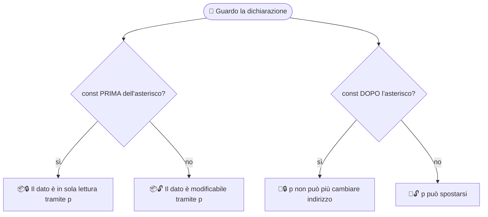

### 🚆 Il treno completo in un unico snippet

```c
#include <stdio.h>

int main(void) {
	int v[3] = {10, 20, 30};

	const int* sealed_cargo = v;			// 📦🔒
	int* const locked_wheels = v;			// 🛞🔒
	const int* const fully_locked = v;		// 📦🔒🛞🔒

	sealed_cargo++;							// ✅
	*locked_wheels = 11;					// ✅
	printf("%d %d %d\n", *sealed_cargo, *locked_wheels, *fully_locked);	// 20 11 11

	return 0;
}
```

🎯 **Regola pratica:** ogni funzione che **non modifica** l'array dovrebbe ricevere `const int* `, come la `print_array()` del [capitolo 4](#it-cap4). Il compilatore diventa il tuo **controllore dei biglietti**: se infrangi la promessa, ti blocca. 🎫

🎣 **Aggancio:** abbiamo tutti gli ingredienti: bambole, palazzi, treni. È ora di [cucinare](#it-cap6)! 🍳

[⬆️ Torna su](#it-top) · [📚 Torna all'indice](#it-index)

<a id="it-cap6"></a>

## 🔀 Capitolo 6: Ordinamenti, indici vs puntatori

Tre algoritmi classici, ciascuno in **due versioni**:

- 🏠 **Stile indici:** `a[i]`, `a[j]` (come nel [palazzo](#it-cap3))
- 🚶 **Stile puntatori:** `*(p + i)`, `p++`, e confronti tra puntatori

Il risultato è identico, **cambia solo il modo di guardare il palazzo**. 👀

<a id="it-cap6-tools"></a>

### 🧰 Gli attrezzi comuni (mettili in cima al file)

```c
#include <stdio.h>
#include <stddef.h>

// 🔁 La bambola voodoo del capitolo 2!
static void swap(int* x, int* y) {
	int tmp = *x;
	*x = *y;
	*y = tmp;
}

// 👀 Sola lettura: treno "carico sigillato" (capitolo 5)
static void print_array(const int* a, size_t n) {
	for (const int* p = a; p < a + n; p++)
		printf("%d ", *p);
	printf("\n");
}

// 📋 Copia un array in un altro: sorgente sigillata, destinazione libera
static void copy_array(const int* src, int* dst, size_t n) {
	for (size_t i = 0; i < n; i++) {
		*(dst + i) = *(src + i);
	}
}
```

<a id="it-cap6-bubble"></a>

### 🫧 6.1 Bubble sort ottimizzato

💡 **L'idea:** a ogni giro la bolla più grande **sale in fondo**, come le bollicine. 🫧

🚀 **Le ottimizzazioni:**

- 🏁 ricordiamo **l'ultima posizione dove è avvenuto uno scambio** (`last_swap`): **oltre quel punto l'array è già ordinato**, quindi il giro dopo si ferma lì
- ⚡ se in un giro **non avviene nessuno scambio** (`last_swap = 0`), abbiamo finito: sul caso migliore costa **O(n)**

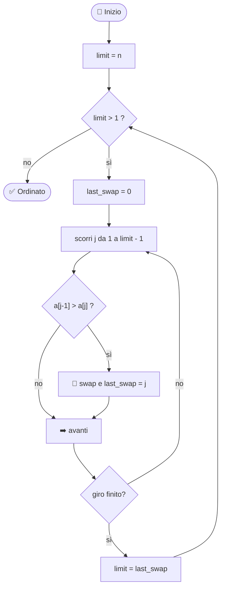

#### 🏠 Versione a indici

```c
void bubble_sort_idx(int a[], size_t n) {
	size_t limit = n;                    // elementi ancora da controllare
	while (limit > 1) {
		size_t last_swap = 0;               // posizione dell'ultimo scambio
		for (size_t j = 1; j < limit; j++) {
			if (a[j - 1] > a[j]) {
				swap(&a[j - 1], &a[j]);
				last_swap = j;
			}
		}
		limit = last_swap;                  // oltre "last_swap" è già tutto a posto
	}
}
```

#### 🚶 Versione a puntatori

```c
void bubble_sort_ptr(int* a, size_t n) {
	size_t limit = n;
	while (limit > 1) {
		size_t last_swap = 0;
		for (int* p = a + 1; p < a + limit; p++) {
			if (*(p - 1) > *p) {
				swap(p - 1, p);                      // passo direttamente i puntatori!
				last_swap = (size_t)(p - a);         // differenza di puntatori = indice
			}
		}
		limit = last_swap;
	}
}
```

👀 **Cosa noti?**

- `&a[j - 1]` diventa semplicemente `p - 1`: **niente `&`, niente indici**
- `p - a` ricostruisce l'indice: è la **differenza tra puntatori** del [capitolo 3](#it-cap3)

[⬆️ Torna su](#it-top) · [📚 Torna all'indice](#it-index) · [🔀 Torna al capitolo 6](#it-cap6)

<a id="it-cap6-selection"></a>

### 🎯 6.2 Selection sort ottimizzato (min **e** max insieme)

💡 **L'idea:** a ogni giro **cerchi il più piccolo e il più grande** nel tratto non ordinato. Il piccolo va **all'inizio**, il grande **in fondo**: **si ordinano due estremi per volta**, quindi i giri si dimezzano. ✂️

⚠️ **Il tranello furbo:** se il massimo si trova proprio nella cella `lo` e tu scambi prima il minimo, **il massimo si è spostato** in `min_idx`/`min_ptr`. Per questo c'è una riga di correzione.

#### 🏠 Versione a indici

```c
void selection_sort_idx(int a[], size_t n) {
	if (n < 2)
		return;
	size_t lo = 0, hi = n - 1;

	while (lo < hi) {
		size_t min_idx = lo, max_idx = lo;
		for (size_t i = lo + 1; i <= hi; i++) {
			if (a[i] < a[min_idx])
				min_idx = i;
			if (a[i] > a[max_idx])
				max_idx = i;
		}
		swap(&a[lo], &a[min_idx]);			// minimo in testa
		if (max_idx == lo)
			max_idx = min_idx;				// 🩹 il massimo si è spostato!
		swap(&a[hi], &a[max_idx]);			// massimo in coda
		lo++;
		hi--;
	}
}
```

#### 🚶 Versione a puntatori

```c
void selection_sort_ptr(int* a, size_t n) {
	if (n < 2)
		return;
	int* lo = a, *hi = a + n - 1;				// due inquilini: uno parte dal basso, uno dall'alto

	while (lo < hi) {
		int* min_ptr = lo, *max_ptr = lo;
		for (int* p = lo + 1; p <= hi; p++) {
			if (*p < *min_ptr)
				min_ptr = p;
			if (*p > *max_ptr)
				max_ptr = p;
		}
		swap(lo, min_ptr);
		if (max_ptr == lo)
			max_ptr = min_ptr;					// 🩹 stessa correzione
		swap(hi, max_ptr);
		lo++;
		hi--;
	}
}
```

👀 **Cosa noti?** Qui lo stile a puntatori è **più naturale**: `lo` e `hi` sono **due puntatori che si avvicinano** come due persone che salgono e scendono dalle scale. 🧗‍♂️🧗‍♀️ Niente indici da incrociare.

[⬆️ Torna su](#it-top) · [📚 Torna all'indice](#it-index) · [🔀 Torna al capitolo 6](#it-cap6)

<a id="it-cap6-insertion"></a>

### 🃏 6.3 Insertion sort

💡 **L'idea:** come quando **ordini le carte in mano**. 🃏 Prendi la prossima carta (la `key`), la confronti con quelle a sinistra, **sposti a destra** quelle più grandi, e infili la `key` nel buco.

🌟 È velocissimo se l'array è **quasi ordinato** (caso migliore **O(n)**).

#### 🏠 Versione a indici

```c
void insertion_sort_idx(int a[], size_t n) {
	for (size_t i = 1; i < n; i++) {
		int key = a[i];
		size_t j = i;
		while (j > 0 && a[j - 1] > key) {
			a[j] = a[j - 1];			// 🚚 sposto a destra
			j--;
		}
		a[j] = key;						// 🕳️ infilo la carta nel buco
	}
}
```

#### 🚶 Versione a puntatori

```c
void insertion_sort_ptr(int* a, size_t n) {
	if (n < 2)
		return;
	for (int* i = a + 1; i < a + n; i++) {
		int key = *i;
		int* j = i;
		while (j > a && *(j - 1) > key) {
			*j = *(j - 1);			// 🚚 sposto a destra
			j--;					// ⬅️ il puntatore scende di un piano
		}
		*j = key;
	}
}
```

👀 **Cosa noti?** La condizione `j > a` è la versione a puntatori di `j > 0`: **il portone è il limite inferiore**. 🚪

[⬆️ Torna su](#it-top) · [📚 Torna all'indice](#it-index) · [🔀 Torna al capitolo 6](#it-cap6)

<a id="it-cap6-main"></a>

### 🏁 6.4 Il main che li fa gareggiare

```c
int main(void) {
	const int base[] = {42, 7, 19, 3, 88, 1, 56, 23};
	const size_t n = sizeof base / sizeof base[0];
	int work[8];						// 🧱 tutto sullo stack: dimensione nota a compile time

	printf("📥 Originale		: "); print_array(base, n);

	copy_array(base, work, n); bubble_sort_idx(work, n);
	printf("🫧 Bubble idx		: "); print_array(work, n);

	copy_array(base, work, n); bubble_sort_ptr(work, n);
	printf("🫧 Bubble ptr		: "); print_array(work, n);

	copy_array(base, work, n); selection_sort_idx(work, n);
	printf("🎯 Selection idx : "); print_array(work, n);

	copy_array(base, work, n); selection_sort_ptr(work, n);
	printf("🎯 Selection ptr : "); print_array(work, n);

	copy_array(base, work, n); insertion_sort_idx(work, n);
	printf("🃏 Insertion idx : "); print_array(work, n);

	copy_array(base, work, n); insertion_sort_ptr(work, n);
	printf("🃏 Insertion ptr : "); print_array(work, n);

	return 0;
}
```

```text
📥 Originale		: 42 7 19 3 88 1 56 23
🫧 Bubble idx		: 1 3 7 19 23 42 56 88
🫧 Bubble ptr		: 1 3 7 19 23 42 56 88
🎯 Selection idx	: 1 3 7 19 23 42 56 88
🎯 Selection ptr	: 1 3 7 19 23 42 56 88
🃏 Insertion idx	: 1 3 7 19 23 42 56 88
🃏 Insertion ptr	: 1 3 7 19 23 42 56 88
```

🔎 Nota come `base` è `const int[]`: passandola a `copy_array(const int* src, …)` il treno **non può toccare** l'originale. Il [capitolo 5](#it-cap5) al lavoro! 🚂

[⬆️ Torna su](#it-top) · [📚 Torna all'indice](#it-index) · [🔀 Torna al capitolo 6](#it-cap6)

<a id="it-cap6-compare"></a>

### 📊 Il confronto finale

| 🥊 Algoritmo | ⏱️ Migliore | ⏱️ Peggiore | 🔁 Scambi | ⚖️ Stabile? | 🌟 Perfetto quando… |
|---|---|---|---|---|---|
| 🫧 Bubble (ottimizzato) | O(n) | O(n²) | tanti | ✅ sì | array quasi ordinato, didattica |
| 🎯 Selection (min+max) | O(n²) | O(n²) | pochi (≤ n) | ❌ no | gli scambi costano cari |
| 🃏 Insertion | O(n) | O(n²) | spostamenti | ✅ sì | array piccoli o quasi ordinati |

### 🏠 vs 🚶 Stili a confronto

| 🎭 | 🏠 Indici | 🚶 Puntatori |
|---|---|---|
| 📖 Leggibilità | ✅ immediata | 🤔 serve un attimo |
| 🧮 Elemento precedente | `a[j - 1]` | `*(p - 1)` |
| 📍 Indirizzo di una cella | `&a[j]` | `p` |
| 🧗 Due "estremi" che si avvicinano | `lo`, `hi` (indici) | `lo`, `hi` (puntatori) ✨ |
| ⚙️ Prestazioni | 🟰 praticamente uguali con le ottimizzazioni del compilatore | 🟰 |

💬 **Verdetto:** nessuno dei due stili è "migliore". Imparali **entrambi**, perché troverai codice scritto in tutti e due i modi, e capirai **sempre** cosa sta succedendo.

🎣 **Aggancio:** ora che hai visto tutto, mettiamo ordine anche nella testa con la [mappa mentale](#it-cap7). 🧠

[⬆️ Torna su](#it-top) · [📚 Torna all'indice](#it-index) · [🔀 Torna al capitolo 6](#it-cap6)

<a id="it-cap7"></a>

## 🧠 Capitolo 7: Mappa mentale e cheat sheet

### 🗺️ Tutto quello che hai imparato

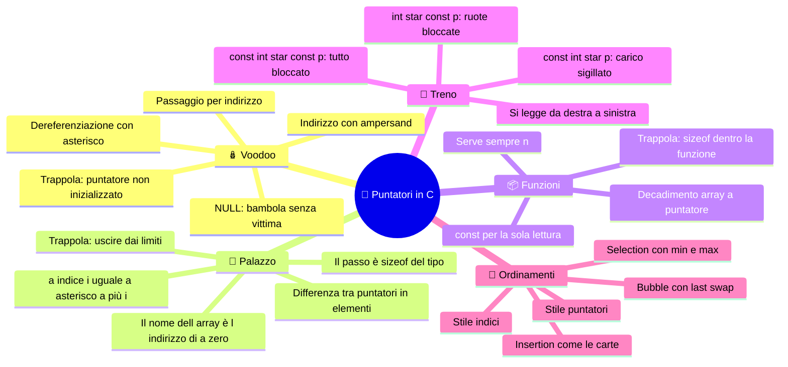

### 🧾 Cheat sheet da stampare

| 🎯 Voglio… | ✍️ Scrivo | 🎭 Metafora |
|---|---|---|
| l'indirizzo di `x` | `&x` | 📍 numero civico |
| il contenuto puntato da `p` | `*p` | 🗡️ pugnalata alla bambola |
| il piano `i` di `a` | `a[i]` oppure `*(a + i)` | 🏢 portone + piano |
| l'indirizzo del piano `i` | `&a[i]` oppure `a + i` | 📍 civico del piano |
| quanti piani tra `p` e `q` | `q - p` | 📏 distanza in elementi |
| quanti elementi ha un array | `sizeof a / sizeof a[0]` | 🧮 solo dove `a` è davvero un array |
| sola lettura di un array | `const int* a` | 📦🔒 carico sigillato |
| puntatore che non si sposta | `int* const p` | 🛞🔒 ruote bloccate |
| puntatore "a vuoto" | `NULL` | 🚫 bambola senza vittima |

### 🛡️ Le 3 trappole in una riga

1. ⚠️ **Puntatore non inizializzato** → usa sempre `&qualcosa` o `NULL` ([dettagli](#it-trap1))
2. ⚠️ **Fuori dai limiti** → gli indici validi vanno da `0` a `n - 1` ([dettagli](#it-trap2))
3. ⚠️ **`sizeof` dentro una funzione** → hai la chiave, non il palazzo: passa `n` ([dettagli](#it-trap3))

### 🏋️ Sfide per il weekend

1. 🔄 **Inverti un array** con due puntatori, `start` e `end`, che si avvicinano scambiandosi i valori
2. 🔍 **Cerca il massimo** in un array e restituisci **un puntatore** all'elemento trovato (e stampa il suo indice con la differenza di puntatori)
3. 🧪 **Contatore di scambi:** modifica i tre ordinamenti per contare quanti scambi fanno su array casuali, e verifica la [tabella del confronto](#it-cap6-compare)
4. 🎓 **Bonus da senior:** scrivi `const int* find(const int* a, size_t n, int target)` che restituisce un puntatore all'elemento o `NULL`. Quale lucchetto del [treno](#it-cap5) stai usando e perché?

[⬆️ Torna su](#it-top) · [📚 Torna all'indice](#it-index)

<a id="it-finale"></a>

## 🎬 Finale

Se sei arrivato fin qui, ora sai che:

- 🪆 un puntatore è **solo una variabile che contiene un indirizzo**
- 🏢 un array è **un palazzo**, e `a[i]` è solo **portone + piano**
- 🚂 `const` ti permette di **sigillare il carico o bloccare le ruote**
- 🔀 gli stessi algoritmi si scrivono **sia con gli indici sia con i puntatori**, e ora sai leggere entrambi

🔮 **Prossima puntata:** finora i nostri palazzi avevano **dimensione decisa a tempo di compilazione**, e vivevano tutti nello stack. Ma cosa succede se il palazzo lo vuoi **costruire mentre il programma gira**? 🏗️ Questo è un altro capitolo… e un'altra avventura. 😉

**Buon coding! 💻🔥**

[⬆️ Torna su](#it-top) · [📚 Torna all'indice](#it-index)

<a href="#TOP">&utrif; top &utrif;</a>

## 🔗 Links
[](https://www.linkedin.com/in/biagio-rosario-greco-77145774/)
[](https://twitter.com/birg_81)
[](mailto:birg81@gmail.com)