[](https://choosealicense.com/licenses/mit/)
[](https://opensource.org/licenses/)
[](http://www.gnu.org/licenses/agpl-3.0)

<a name="TOP"></a>

<a href="#IT"></a>
🤍
<a href="#EN"></a>

---

 <a name="EN"></a>

<!-- English -->

<a id="top-en"></a>

# 🚀 Array Tools: sort and search like a pro

## 🎬 The visual guide to sorting and searching in C, one step at a time

🔥 **Hey, future dev!** You already know how to write a `for` and an `if`: time to level up.
In this guide we'll take a small C project apart piece by piece, and by the end you'll know how to split your code across multiple files, compile it, and pick the right algorithm for the job.

🧑‍💻 The project is tiny, but it packs almost everything you need to start thinking like a programmer: **a reusable library**, **a main program**, **two sorting algorithms** and **two searching algorithms**.

## 🧭 Table of Contents

- 🗺️ [Ch. 1 – The project map](#cap1-en)
- 🧩 [Ch. 2 – Why a `.c` file *and* a `.h` file?](#cap2-en)
- 🛠️ [Ch. 3 – Compiling with a `.h` library](#cap3-en)
- 🫧 [Ch. 4 – Sorting: Bubble Sort vs Selection Sort](#cap4-en)
- 🔎 [Ch. 5 – Searching: Linear vs Binary](#cap5-en)
- 🎯 [Epilogue – Challenges for the next level](#epilogo-en)
- 🎁 [Bonus Track – Everything you never knew about `\a`](#bonus-en)

## 🎮 How to play: the Secret Sequence

🔐 Every chapter ends with a **checkpoint** that hands you **one specific emoji**.
To prove you've read the whole guide, you need to collect all 5 emojis **in the exact order** they show up.

| 🧩 Stage | 📍 Where | 🎫 Emoji to write |
|---|---|---|
| 1️⃣ | End of Ch. 1 | 🗺️ |
| 2️⃣ | End of Ch. 2 | 🧩 |
| 3️⃣ | End of Ch. 3 | 🛠️ |
| 4️⃣ | End of Ch. 4 | 🫧 |
| 5️⃣ | End of Ch. 5 | 🏆 |

- 💬 **At every checkpoint** drop **just** the emoji in the comments (or in the course chat)
- 🔑 **At the very end** you send the **final key**: all 5 emojis in a single comment, in sequence
- ❌ Wrong order = invalid key. No shortcuts! 😉
- 🔔 **Deluxe level:** read the Bonus Track too and stick the secret emoji at the end of your key


<a id="cap1-en"></a>

## 🗺️ Ch. 1 – The project map

### 📁 The three main characters

🎬 Picture a movie set: there's the **director** calling the shots, there's the **kitchen** cooking up the dishes, and there's the **menu** telling the director what can be ordered.
Our project works exactly like that.

| 🎭 Role | 📄 File | 🧠 What's inside |
|---|---|---|
| 🎬 The director | [`main.c`](main.c) | The program: creates the arrays, calls the sorts and searches, prints the results |
| 👨‍🍳 The kitchen | [`array_tools.c`](array_tools.c) | The actual implementation of every function |
| 🍽️ The menu | [`array_tools.h`](array_tools.h) | The list of available functions (the *prototypes*) |

### 🧰 What the `array_tools` library gives you

- 🎲 `loadRandArray`: fills an array with random numbers from 0 to 99
- 📋 `duplicateArray`: makes an identical copy of it
- 🖨️ `printArray`: prints it out nice and tidy
- 🫧 `b_sort`: sorts with Bubble Sort
- 🎯 `s_sort`: sorts with Selection Sort
- 🔁 `swap`: swaps two values (and prints a little trace symbol)
- 🚶 `linSearch`: linear search
- ✂️ `binSearch`: binary search

### 🧠 Mind map

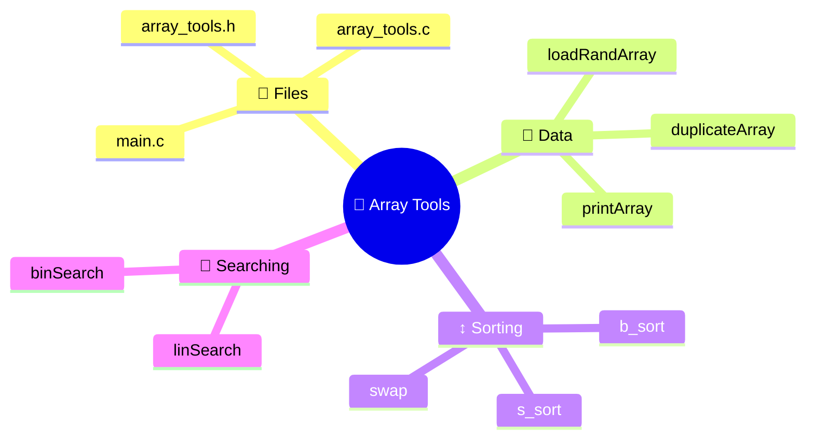

### 🎞️ The plot of `main`

1. 🎲 Creates `a0` and fills it with random numbers
2. 📋 Copies it into `a1`, so both algorithms start from the same data
3. 🫧 Sorts `a0` with Bubble Sort
4. 🎯 Sorts `a1` with Selection Sort
5. ⌨️ Asks the user for a number to look for
6. 🚶 Hunts for it with linear search
7. ✂️ Hunts for it with binary search

💡 **Pro move:** working on a copy (`duplicateArray`) keeps the comparison *fair*.
It's like racing two cars on the same track, not on two different ones.

> 💬 **CHECKPOINT 1/5** – Got the map in your head? Drop a **🗺️** in the comments!
>
> 🔐 Sequence so far: 🗺️ ▫️ ▫️ ▫️ ▫️

⬆️ [Back to the table of contents](#top-en)

<a id="cap2-en"></a>

## 🧩 Ch. 2 – Why a `.c` file *and* a `.h` file?

### 🍽️ The restaurant analogy

🧑‍🍳 When you order at a restaurant you read the **menu**: you know what you can ask for and what you'll get, but you have no clue how it's cooked.
The **kitchen** knows how to make the dishes, but you don't need to walk in there.
C splits things up the exact same way.

| 🏷️ Concept | 📜 [`array_tools.h`](./array_tools.h) | 👨‍🍳 [`array_tools.c`](./array_tools.c) |
|---|---|---|
| 🎯 Function | **Declaration** (name, parameters, return type) | **Definition** (the body with the actual instructions) |
| 🔍 Who reads it | Whoever *uses* the library | Whoever *writes* the library |
| 🧾 Analogy | The menu | The recipe |

### 🤔 Why not just dump everything in `main.c`?

- ♻️ **Reuse:** the same library works in other programs, no copy-paste needed
- 🧱 **Mental order:** each file has one job
- ⚡ **Faster builds:** if you tweak [`main.c`](./main.c), you don't have to recompile the whole library
- 👥 **Teamwork:** one person writes the library, someone else writes the program

### 🔌 Why does the compiler need the `.h`?

🧐 The compiler reads **one `.c` file at a time**.
When it hits `b_sort(a0, N);` in `main.c`, it has to know what function that is, how many parameters it takes and what it returns, but the body lives in another file.
The `#include "array_tools.h"` hands it exactly that info.

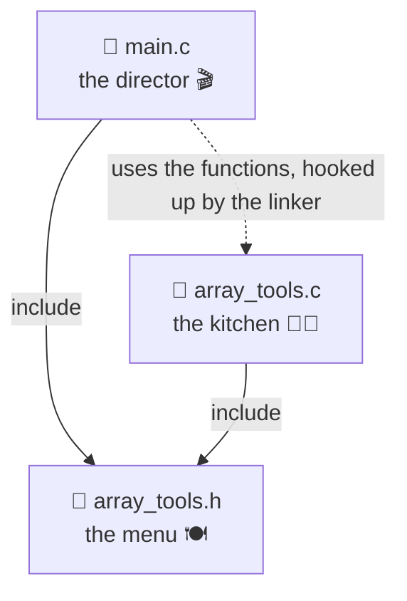

🔁 Notice that **[`array_tools.c`](./array_tools.c) includes its own `.h` too**:
that way the compiler checks that definition and declaration actually match.
Get a type wrong and it'll tell you right away.

### 🧷 The two `#define`s in the project

🎛️ Two `#define`s show up in the project, and they do very different jobs.

#### 1️⃣ The include guard in [`array_tools.h`](./array_tools.h)

```c
#ifndef ARRAY_TOOLS_H
#define ARRAY_TOOLS_H
/* ... prototypes ... */
#endif
```

- 🚪 **How it works:** the first time the preprocessor reads the file, `ARRAY_TOOLS_H` doesn't exist, so it defines it and reads everything. Next time around the macro is already there and the content gets skipped.
- 🛡️ **What it's for:** it stops the same header from being included twice in the same file (which happens easily when headers include each other in a chain).
- 🏨 **Analogy:** it's the "occupied" sign on a bathroom door. If it's lit, nobody else goes in.
- ⚠️ **Honest heads-up:** in this project, repeating a few plain prototypes wouldn't throw an error. The guard becomes **a must** the moment you put a `struct` or a `typedef` in the header, since those can't be defined twice. Better to get into the habit right now.

#### 2️⃣ The `N` constant in `main.c`

```c
#define N 20
```

- 🔢 **What it does:** before compiling, the preprocessor swaps every `N` for `20`
- ✏️ **Why it's handy:** want to work with 50 elements? Change **one number** and the whole program follows along
- 🚫 **No "magic numbers":** `N` reads way better than a random `20` dropped in the middle of the code
- 🧳 **Design detail:** `N` lives in [`main.c`](./main.c), **not** in the library. The `array_tools` functions get the size as a parameter (`size`), so they work with arrays of any length. A reusable library shouldn't make assumptions about your data.

| 🧷 Macro | 📍 Where | 🎯 Purpose | 🧠 Type of use |
|---|---|---|---|
| `ARRAY_TOOLS_H` | `array_tools.h` | Avoid double inclusion | Include guard |
| `N` | [`main.c`](./main.c) | Array size | Symbolic constant |

### 🔬 Little details worth noticing

- 🔒 `const int a[]` in the prototypes is a promise that the function **won't touch** the array: read-only (`printArray`, `linSearch`, `binSearch`). The sorts, on the other hand, do modify it, so no `const` there.
- 🕵️ `swap` is declared in the header, so everyone can see it. A pro touch would be making it `static` inside [`array_tools.c`](./array_tools.c) to keep it hidden as an internal detail.

> 💬 **CHECKPOINT 2/5** – Now you know why the menu and the kitchen are kept apart. Drop a **🧩** in the comments!
>
> 🔐 Sequence so far: 🗺️ 🧩 ▫️ ▫️ ▫️

⬆️ [Back to the table of contents](#top-en)

<a id="cap3-en"></a>

## 🛠️ Ch. 3 – Compiling with a `.h` library

### 🏭 What really happens when you compile

🧱 Compiling isn't one single step, it's an **assembly line**. Each `.c` gets turned into an object file (`.o`), then the **linker** snaps them together like LEGO bricks to build the executable.

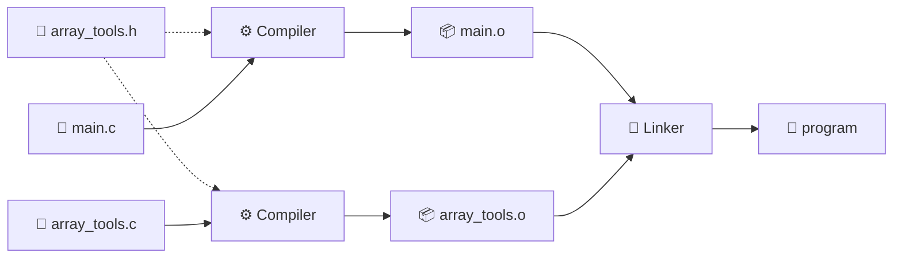

### ⚡ The bare-minimum command

🎯 Put the three files in the same folder, open a terminal in there and type:

```bash
gcc main.c array_tools.c -o program
./program
```

- 📄 `main.c array_tools.c`: the **source** files to compile, **both** of them
- 🏷️ `-o program`: the name of the executable (without it, you'd get `a.out`)
- 🪟 On Windows with MinGW, run `program.exe`

🙋 **What about the `.h`?** It doesn't go in the command. It gets picked up automatically thanks to `#include "array_tools.h"`: the quotes tell the compiler to look for it **in the source file's folder first**.

### 🪜 The step-by-step version (to get the linker)

```bash
gcc -c array_tools.c
gcc -c main.c
gcc main.o array_tools.o -o program
```

- 📦 `-c` means "compile and stop before the linker": it spits out the `.o`
- 🔗 The last command only does the linking
- 🔄 **Real-world perk:** if you only change [`main.c`](./main.c), you recompile just that and redo the link

### 🐞 The classic errors (and how to get out of them)

| 🚨 Message | 🔍 Likely cause | 💊 Fix |
|---|---|---|
| `undefined reference to 'b_sort'` | You forgot [`array_tools.c`](./array_tools.c) in the command | Add it to the source files |
| `fatal error: array_tools.h: No such file` | Wrong folder, or the header lives somewhere else | `cd` into the right folder, or use `-I path` |
| `implicit declaration of function` | The `#include "array_tools.h"` is missing | Include it |
| `multiple definition of ...` | You included a `.c` instead of a `.h` | Only ever include headers |

💡 **Golden rule:** `.c` files get **compiled**, `.h` files get **included**.

> 💬 **CHECKPOINT 3/5** – You made it to compiling! Drop a **🛠️** in the comments!
>
> 🔐 Sequence so far: 🗺️ 🧩 🛠️ ▫️ ▫️

⬆️ [Back to the table of contents](#top-en)

<a id="cap4-en"></a>

## 🫧 Ch. 4 – Sorting: Bubble Sort vs Selection Sort

### 🎯 Same goal, two philosophies

🏁 Both algorithms turn a messy array into a sorted one, but they think in opposite ways. The code is in [`array_tools.c`](array_tools.c), in the `b_sort` and `s_sort` functions.

- 🫧 **Bubble Sort:** *"I compare neighbors and swap them if they're in the wrong order"*. Think of bubbles in a glass of soda: the big ones float up to the top one step at a time.
- 🎯 **Selection Sort:** *"I find the smallest of all and put it where it belongs"*. Think of lining up a class for a photo, shortest to tallest: you pick the shortest kid, move them to the front row, then look for the next one.

### 🫧 How Bubble Sort thinks

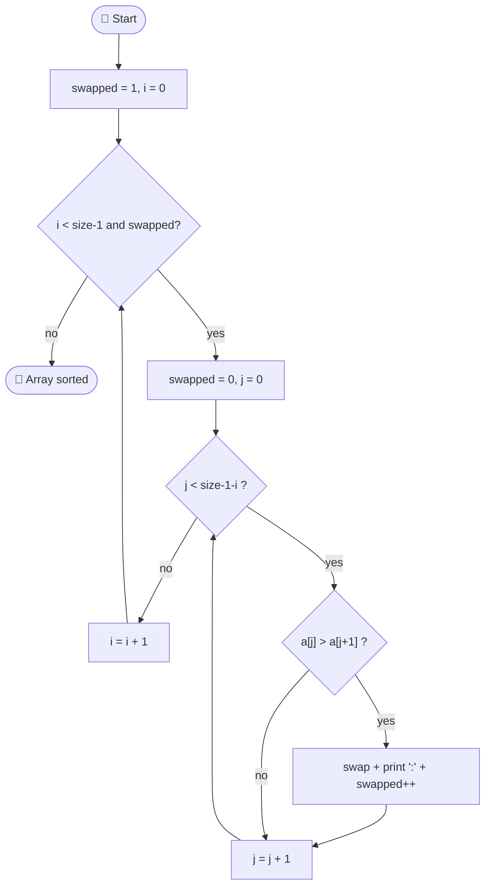

- 🏔️ After each pass, the biggest remaining value is already in its final spot at the end. That's why the inner loop keeps getting shorter (`size - 1 - i`).
- 🛑 **Pro trick:** the `swapped` flag stops the algorithm if a whole pass didn't swap anything. If the array is already sorted, **one single pass** is enough.

### 🎯 How Selection Sort thinks

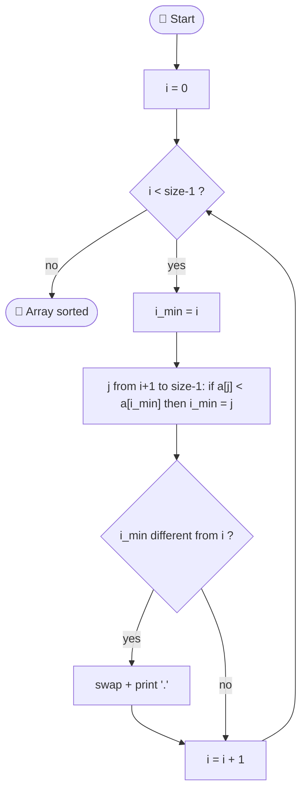

- 🔦 It first **hunts down** the index of the minimum (`i_min`), and only at the end does **one single swap** per pass.
- 🪶 The swap only happens if it's actually needed (`i_min != i`).

### ⚔️ Head-to-head

| 📊 Criterion | 🫧 Bubble Sort | 🎯 Selection Sort |
|---|---|---|
| 🧠 Idea | Swaps neighbors | Picks the minimum and puts it in place |
| ⏱️ Comparisons (average and worst case) | ~ n²/2 | ~ n²/2, **always** |
| 🚀 Best case (already sorted) | **O(n)** thanks to `swapped` | O(n²), has no clue it's done |
| 🔁 Number of swaps | Up to ~ n²/2 | **At most n − 1** |
| 🧩 Stable (keeps equal values in their original order) | ✅ Yes | ❌ No |
| 💾 Extra memory | O(1) | O(1) |
| 🖊️ Trace printed in this project | `:` for every swap | `.` for every swap |

### 🕵️ What the trace tells us

🔬 The `swap` function prints a character at every swap: it's a teaching tool so you can **see** the algorithm at work. In a test run with 20 random numbers we got about **107 swaps** for Bubble Sort versus just **15** for Selection Sort, same starting data.

- 🪙 **If swapping is expensive** (say, moving big objects or writing to slow memory), Selection Sort wins
- 🛡️ **If the data is nearly sorted**, Bubble Sort with the flag can be blazing fast
- 🏭 **In the real world** both are strictly for learning: for big datasets you use O(n log n) algorithms like the ones behind `qsort`. But getting these two is the foundation for getting all the others.

> 💬 **CHECKPOINT 4/5** – You've seen the bubbles and the minimum in action. Drop a **🫧** in the comments!
>
> 🔐 Sequence so far: 🗺️ 🧩 🛠️ 🫧 ▫️

⬆️ [Back to the table of contents](#top-en)

<a id="cap5-en"></a>

## 🔎 Ch. 5 – Searching: Linear vs Binary

### 🕵️ Two detectives, two methods

🔍 The `linSearch` and `binSearch` functions return the **index** of the element they find, or **−1** if it's not there.

- 🚶 **Linear search:** *"I check them one by one, from the start"*. It's like looking for a document in a pile of loose sheets on your desk: you flip through them all until you find it.
- ✂️ **Binary search:** *"I look in the middle and toss out half the problem"*. It's like looking up a word in the dictionary: you open it halfway, figure out if you're before or after, and throw the other half away.

### 🚶 Linear search

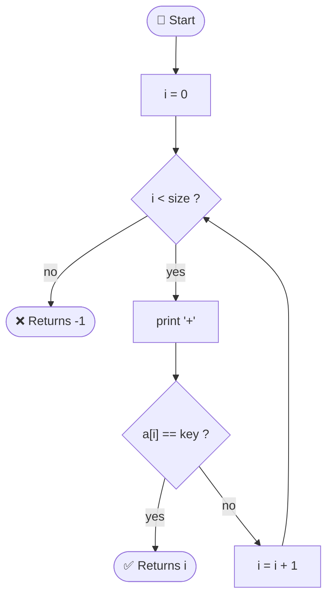

### ✂️ Binary search

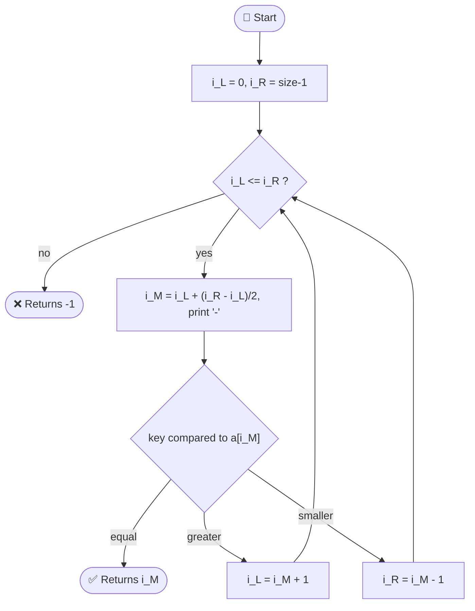

🧮 One line deserves a closer look:

```c
int i_M = i_L + (i_R - i_L) / 2;
```

- 🛡️ Why not `(i_L + i_R) / 2`? Because with really big indexes the sum could **overflow**.
Written this way, the formula is safe: it's a famous classic bug in software history.

### ⚠️ The condition you can't forget

🚨 **Binary search only works on SORTED arrays.** Run it on unsorted data and you'll get wrong answers with no visible error.
That's why in the project `main` runs it on `a1`, already sorted with Selection Sort.
Linear search, on the other hand, works on any array.

### ⚔️ Head-to-head

| 📊 Criterion | 🚶 Linear search | ✂️ Binary search |
|---|---|---|
| 🧠 Idea | Checks every element | Halves the search space at every step |
| 📋 Needs a sorted array | ❌ No | ✅ **Yes** |
| ⏱️ Complexity | O(n) | **O(log n)** |
| 🔢 Max steps with 20 elements | 20 | 5 |
| 🔢 Max steps with 1,000,000 elements | 1,000,000 | about 20 |
| 🖊️ Trace printed | `+` for every comparison | `-` for every step |
| 🎒 When it pays off | Small or unsorted data, a single search | Sorted data and lots of searches |

🤯 **Think about it:** with a million elements, binary search looks at about 20.
It's the difference between scrolling through a whole phone book and just flipping it open in the middle a few times.

### 🧮 The real math to do

🏷️ Sorting isn't free.
If you only need **one search**, sorting first just to use binary might not be worth it.
If you need **thousands**, sorting once pays off big time.
A good programmer always asks: *"how many times am I going to use this data?"*

### 🎬 The program in action

📺 Here's a real run, searching for the number 42 (which wasn't in the array):

```text
Linear search path: ++++++++++++++++++++
Linear Search: Value 42 not found

Binary search path: -----
Binary Search: Value 42 not found
```

- 🚶 20 `+` → linear search checked **every single** element
- ✂️ 5 `-` → binary search reached the same conclusion in **5 steps**
- 🔔 The `\a` character in the "not found" message makes the terminal beep

> 💬 **CHECKPOINT 5/5** – You finished the guide! Drop a **🏆** in the comments!
>
> 🔐 Full sequence: 🗺️ 🧩 🛠️ 🫧 🏆
>
> 🔑 **Final key:** send a single comment with the 5 emojis **in this exact order**. There's still a secret waiting for you in the Bonus Track! 🎁

⬆️ [Back to the table of contents](#top-en)

<a id="epilogo-en"></a>

## 🎯 Epilogue – Challenges for the next level

🔥 Reading is step one, **messing with the code is what makes you grow**.
Try these missions, from easiest to most ambitious:

1. 🟢 **Change `N`** to 50 and watch how the `:`, `.`, `+`, `-` traces change
2. 🟢 **Search for a number that's actually there** (between 0 and 99) and compare the steps of the two searches
3. 🟡 **Bulletproof `scanf`:** if the user types a letter, the variable `k` stays uninitialized. Check the value `scanf` returns.
4. 🟡 **Count the comparisons** in both sorts with a counter, and check the table in Ch. 4
5. 🟠 **Add Insertion Sort:** write the function in `array_tools.c`, add the prototype in `array_tools.h` and use it in `main.c`. You just got a taste of the real perk of splitting code into files.
6. 🔴 **Hide `swap`** by making it `static` and taking it out of the header. What changes for `main.c`?

🌟 **Last thought:** great programmers don't know everything by heart.
They know how to **break problems down**, **measure**, and **pick the right tool**.
Today you did all three. See you next time! 🚀

<a id="bonus-en"></a>

## 🎁 Bonus Track – Everything you never knew about `\a`

🔔 In [`main.c`](main.c) you've seen `\a` inside the "value not found" messages.
Looks like a throwaway detail, but behind that little character there's half a century of computing history.

### 🧬 Profile

| 🏷️ What | 🔍 Detail |
|---|---|
| 📛 Name | **BEL** (Bell), C's *alert* |
| 🔢 ASCII code | **7** |
| ✍️ Ways to write it | `\a`, `\007` (octal), `\x07` (hexadecimal) |
| ⌨️ From the keyboard | `Ctrl + G` |
| 📏 What the C standard says | Triggers an **audible or visual** alert, without moving the print position |

### 🤓 Ten fun facts

1. 📠 **It was a real bell.** On teletypes, the BEL character rang an actual mechanical bell to grab the operator's attention.
2. 🏛️ **It wasn't in original C.** `\a` came in with the ANSI C standard (C89). K&R C didn't have it.
3. 👻 **It's invisible.** The program doesn't print anything you can see: it just sends the byte `0x07`. In this guide's test run, the raw output did contain exactly that byte.
4. 🔬 **You can spot it with `cat -v`.** Try: `echo 42 | ./program | cat -v`. At the end of the message you'll see `^G`, which is the notation for Ctrl+G.
5. 🎛️ **It depends on the terminal.** It might beep, flash the screen (*visual bell*), pop up a notification, or do **absolutely nothing**. The standard only guarantees that the environment will *try* to raise an "alert".
6. 📂 **If you redirect to a file, the byte ends up inside.** With `./program > out.txt` the file holds a control character you can't see but that's definitely there.
7. 🧭 **It doesn't move the cursor.** Unlike `\n` or `\t`, it doesn't change the print position.
8. 🔣 **It has its own Unicode symbol:** U+2407, ␇, "symbol for bell". Don't mix it up with the 🔔 emoji, that's a different thing.
9. 🐚 **It works in the shell too:** `printf '\a'` or `tput bel` and you hear the result right away.
10. 🚰 **Buffering can delay it.** With terminal output, text gets flushed at every `\n`. With output going to a pipe or a file it's accumulated, and the beep only arrives when the buffer is flushed (`fflush`).

### 👨‍👧‍👦 The escape sequence family

| 🧬 Sequence | 🎯 Meaning | 🖼️ Mental image |
|---|---|---|
| `\a` | Alert (bell) | 🔔 The "ding" at the hotel front desk |
| `\b` | Backspace | ⌫ One step back |
| `\f` | Form feed (page break) | 📄 Fresh sheet in the printer |
| `\n` | New line | ↩️ Jump to the next line |
| `\r` | Carriage return | 🧵 The typewriter carriage |
| `\t` | Horizontal tab | ➡️ Jump to the next tab stop |
| `\v` | Vertical tab | ⬇️ Jump down a few lines |

### 🧪 Mini experiments

```bash
printf '\a'
echo 42 | ./program | cat -v
```

- 🎧 The first command tests your terminal's sound
- 🕵️ The second one shows you the hidden character as `^G`

### 🧠 Pro thinking

- 🔇 **A beep on every error is handy for an exercise, annoying in a packed classroom** or in a real program. In serious software the audible signal can be turned off.
- 📢 For error messages, the pros use `stderr` (with `fprintf(stderr, ...)`), so they can keep them separate from regular output.
- ♿ A sound-only alert isn't accessible to everyone: the "Value not found" text in our program is always the main channel, the beep is just a bonus.

### 🏅 Bonus challenge

🎯 Tweak `main.c` so the beep goes off **only if** both searches fail, and move it to one single spot.
You just did a little *refactoring*.

> 🔔 **BONUS CHECKPOINT** – You cracked the secret of `\a`! Add **🔔** at the end of your final key.
>
> 🔑 **Deluxe final key:** 🗺️ 🧩 🛠️ 🫧 🏆 🔔

⬆️ [Back to the table of contents](#top-en)

---

<a href="#IT"></a>
🤍
<a href="#EN"></a>

---

 <a name="IT"></a>

<!-- Italiano -->

<a id="top-it"></a>

# 🚀 Array Tools: ordina e cerca come un pro

## 🎬 La guida visiva per capire ordinamento e ricerca in C, un passo alla volta

🔥 **Ehi, futuro sviluppatore!** Sai già scrivere un `for` e un `if`: è il momento di fare il salto.
In questa guida smonteremo un mini-progetto C pezzo per pezzo, e alla fine saprai dividere il codice in più file, compilarlo, e scegliere l'algoritmo giusto per ogni situazione.

🧑‍💻 Il progetto è piccolo, ma contiene quasi tutto quello che serve per ragionare da programmatore: **una libreria riusabile**, **un programma principale**, **due algoritmi di ordinamento** e **due di ricerca**.

## 🧭 Indice

- 🗺️ [Cap. 1 – La mappa del progetto](#cap1-it)
- 🧩 [Cap. 2 – Perché un file `.c` e un file `.h`?](#cap2-it)
- 🛠️ [Cap. 3 – Compilare con una libreria `.h`](#cap3-it)
- 🫧 [Cap. 4 – Ordinare: Bubble Sort vs Selection Sort](#cap4-it)
- 🔎 [Cap. 5 – Cercare: Lineare vs Binaria](#cap5-it)
- 🎯 [Epilogo – Sfide per il prossimo livello](#epilogo-it)
- 🎁 [Bonus Track – Tutto quello che non sapevi su `\a`](#bonus-it)

## 🎮 Come si gioca: la Sequenza Segreta

🔐 Ogni capitolo si chiude con un **checkpoint** che ti assegna **un'emoji precisa**.
Per dimostrare di aver letto tutta la guida devi raccogliere le 5 emoji **nell'ordine esatto** in cui compaiono.

| 🧩 Tappa | 📍 Dove | 🎫 Emoji da scrivere |
|---|---|---|
| 1️⃣ | Fine del Cap. 1 | 🗺️ |
| 2️⃣ | Fine del Cap. 2 | 🧩 |
| 3️⃣ | Fine del Cap. 3 | 🛠️ |
| 4️⃣ | Fine del Cap. 4 | 🫧 |
| 5️⃣ | Fine del Cap. 5 | 🏆 |

- 💬 **A ogni checkpoint** scrivi nei commenti (o nella chat del corso) **solo** l'emoji indicata
- 🔑 **Alla fine** invii la **chiave finale**: tutte e 5 le emoji in un unico commento, in sequenza
- ❌ Ordine sbagliato = chiave non valida. Niente scorciatoie! 😉
- 🔔 **Livello deluxe:** leggi anche la Bonus Track e aggiungi l'emoji segreta in fondo alla chiave


<a id="cap1-it"></a>

## 🗺️ Cap. 1 – La mappa del progetto

### 📁 I tre protagonisti

🎬 Immagina un set cinematografico: c'è il **regista** che decide cosa succede, c'è la **cucina** che prepara i piatti, e c'è il **menù** che dice al regista cosa può ordinare.
Il nostro progetto funziona così.

| 🎭 Ruolo | 📄 File | 🧠 Cosa contiene |
|---|---|---|
| 🎬 Il regista | [`main.c`](main.c) | Il programma: crea gli array, chiama ordinamenti e ricerche, stampa i risultati |
| 👨‍🍳 La cucina | [`array_tools.c`](array_tools.c) | L'implementazione di tutte le funzioni |
| 🍽️ Il menù | [`array_tools.h`](array_tools.h) | L'elenco delle funzioni disponibili (i *prototipi*) |

### 🧰 Cosa offre la libreria `array_tools`

- 🎲 `loadRandArray`: riempie un array con numeri casuali da 0 a 99
- 📋 `duplicateArray`: ne fa una copia identica
- 🖨️ `printArray`: lo stampa in modo ordinato
- 🫧 `b_sort`: ordina con il Bubble Sort
- 🎯 `s_sort`: ordina con il Selection Sort
- 🔁 `swap`: scambia due valori (e stampa un simbolo di traccia)
- 🚶 `linSearch`: ricerca lineare
- ✂️ `binSearch`: ricerca binaria

### 🧠 Mappa mentale

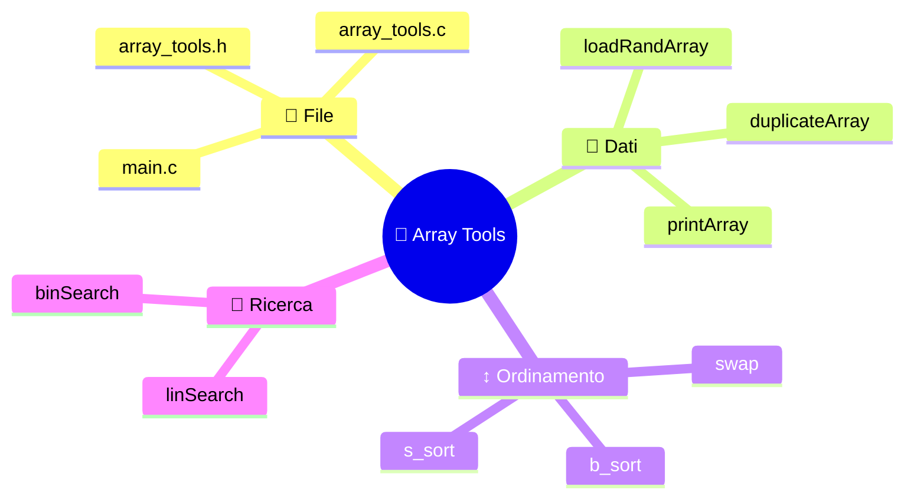

### 🎞️ La trama di `main`

1. 🎲 Crea `a0` e lo riempie di numeri casuali
2. 📋 Ne fa una copia in `a1`, così i due algoritmi partono dagli stessi dati
3. 🫧 Ordina `a0` con Bubble Sort
4. 🎯 Ordina `a1` con Selection Sort
5. ⌨️ Chiede all'utente un numero da cercare
6. 🚶 Lo cerca con la ricerca lineare
7. ✂️ Lo cerca con la ricerca binaria

💡 **Idea da pro:** usare una copia (`duplicateArray`) rende il confronto *equo*.
È come far correre due auto sulla stessa pista, non su due piste diverse.

> 💬 **CHECKPOINT 1/5** – Hai la mappa in testa? Scrivi **🗺️** nei commenti!
>
> 🔐 Sequenza raccolta: 🗺️ ▫️ ▫️ ▫️ ▫️

⬆️ [Torna all'indice](#top-it)

<a id="cap2-it"></a>

## 🧩 Cap. 2 – Perché un file `.c` e un file `.h`?

### 🍽️ L'analogia del ristorante

🧑‍🍳 Quando ordini al ristorante leggi il **menù**: sai cosa puoi chiedere e cosa ricevi, ma non vedi come viene cucinato.
La **cucina** sa come fare i piatti, ma tu non hai bisogno di entrarci.
Nel C è la stessa divisione.

| 🏷️ Concetto | 📜 [`array_tools.h`](./array_tools.h) | 👨‍🍳 [`array_tools.c`](./array_tools.c) |
|---|---|---|
| 🎯 Funzione | **Dichiarazione** (nome, parametri, tipo di ritorno) | **Definizione** (il corpo con le istruzioni) |
| 🔍 Chi lo legge | Chi *usa* la libreria | Chi *scrive* la libreria |
| 🧾 Analogia | Il menù | La ricetta |

### 🤔 Perché non mettere tutto in `main.c`?

- ♻️ **Riuso:** la stessa libreria serve in altri programmi, senza copia-incolla
- 🧱 **Ordine mentale:** ogni file ha un solo compito
- ⚡ **Compilazione più veloce:** se cambi [`main.c`](./main.c), non devi ricompilare tutta la libreria
- 👥 **Lavoro di squadra:** una persona scrive la libreria, un'altra scrive il programma

### 🔌 Perché il compilatore ha bisogno dell'`.h`?

🧐 Il compilatore legge **un file `.c` alla volta**.
Quando in `main.c` trova `b_sort(a0, N);` deve sapere che funzione è, quanti parametri vuole e cosa restituisce, ma il corpo si trova in un altro file.
L'`#include "array_tools.h"` gli consegna proprio queste informazioni.

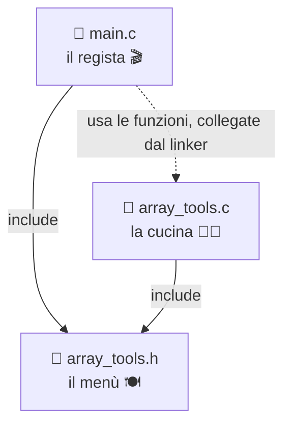

🔁 Nota che **anche [`array_tools.c`](./array_tools.c) include il proprio `.h`**:
così il compilatore verifica che definizione e dichiarazione siano coerenti.
Se sbagli un tipo, te lo dice subito.

### 🧷 I due `#define` del progetto

🎛️ Nel progetto compaiono due usi di `#define`, con scopi molto diversi.

#### 1️⃣ L'include guard in [`array_tools.h`](./array_tools.h)

```c
#ifndef ARRAY_TOOLS_H
#define ARRAY_TOOLS_H
/* ... prototipi ... */
#endif
```

- 🚪 **Come funziona:** la prima volta che il preprocessore legge il file, `ARRAY_TOOLS_H` non esiste, quindi lo definisce e legge tutto. Le volte successive la macro esiste già e il contenuto viene saltato.
- 🛡️ **A cosa serve:** evita che lo stesso header venga incluso due volte nello stesso file (succede facilmente quando più header si includono a catena).
- 🏨 **Analogia:** è il cartello "occupato" sulla porta di una stanza. Se è già acceso, nessun altro entra.
- ⚠️ **Precisazione onesta:** in questo progetto, ripetere dei semplici prototipi non darebbe errore. La guardia diventa **indispensabile** appena nell'header metti `struct` o `typedef`, che non possono essere definiti due volte. È un'abitudine da prendere fin da subito.

#### 2️⃣ La costante `N` in `main.c`

```c
#define N 20
```

- 🔢 **Cosa fa:** prima della compilazione il preprocessore sostituisce ogni `N` con `20`
- ✏️ **Perché è comodo:** vuoi lavorare con 50 elementi? Cambi **un solo numero** e tutto il programma si adegua
- 🚫 **Niente "numeri magici":** `N` si legge meglio di un `20` buttato lì
- 🧳 **Dettaglio di design:** `N` vive in [`main.c`](./main.c), **non** nella libreria. Le funzioni di `array_tools` ricevono la dimensione come parametro (`size`), quindi funzionano con array di qualsiasi lunghezza. Una libreria riusabile non deve fare ipotesi sui dati.

| 🧷 Macro | 📍 Dove | 🎯 Scopo | 🧠 Tipo di uso |
|---|---|---|---|
| `ARRAY_TOOLS_H` | `array_tools.h` | Evitare inclusioni doppie | Include guard |
| `N` | [`main.c`](./main.c) | Dimensione degli array | Costante simbolica |

### 🔬 Piccole finezze da notare

- 🔒 `const int a[]` nei prototipi promette che la funzione **non modifica** l'array: lo leggi e basta (`printArray`, `linSearch`, `binSearch`). Gli ordinamenti, invece, lo modificano e non hanno `const`.
- 🕵️ `swap` è dichiarata nell'header, quindi è visibile a tutti. Un tocco da pro sarebbe renderla `static` dentro [`array_tools.c`](./array_tools.c), per nasconderla come dettaglio interno.

> 💬 **CHECKPOINT 2/5** – Ora sai perché menù e cucina sono separati. Scrivi **🧩** nei commenti!
>
> 🔐 Sequenza raccolta: 🗺️ 🧩 ▫️ ▫️ ▫️

⬆️ [Torna all'indice](#top-it)

<a id="cap3-it"></a>

## 🛠️ Cap. 3 – Compilare con una libreria `.h`

### 🏭 Cosa succede davvero quando compili

🧱 Compilare non è un passaggio unico, è una **catena di montaggio**. Ogni `.c` viene trasformato in un file oggetto (`.o`), poi il **linker** li incolla insieme come mattoncini LEGO per ottenere l'eseguibile.

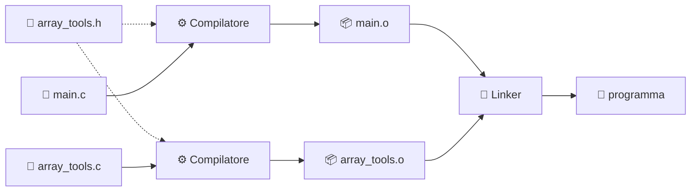

### ⚡ Il comando minimo

🎯 Metti i tre file nella stessa cartella, apri il terminale lì dentro e scrivi:

```bash
gcc main.c array_tools.c -o programma
./programma
```

- 📄 `main.c array_tools.c`: i file **sorgente** da compilare, **entrambi**
- 🏷️ `-o programma`: il nome dell'eseguibile (senza, otterresti `a.out`)
- 🪟 Su Windows con MinGW lancia `programma.exe`

🙋 **E l'`.h`?** Non va scritto nel comando. Viene letto automaticamente grazie a `#include "array_tools.h"`: le virgolette dicono al compilatore di cercarlo **prima nella cartella del file sorgente**.

### 🪜 La versione a gradini (per capire il linker)

```bash
gcc -c array_tools.c
gcc -c main.c
gcc main.o array_tools.o -o programma
```

- 📦 `-c` significa "compila e fermati prima del linker": produce il `.o`
- 🔗 L'ultimo comando fa solo il collegamento
- 🔄 **Vantaggio reale:** se modifichi solo [`main.c`](./main.c), ricompili solo quello e rifai il link

### 🐞 Gli errori classici (e come uscirne)

| 🚨 Messaggio | 🔍 Causa probabile | 💊 Rimedio |
|---|---|---|
| `undefined reference to 'b_sort'` | Hai dimenticato [`array_tools.c`](./array_tools.c) nel comando | Aggiungilo ai sorgenti |
| `fatal error: array_tools.h: No such file` | Sei nella cartella sbagliata, o l'header sta altrove | `cd` nella cartella giusta, oppure usa `-I percorso` |
| `implicit declaration of function` | Manca l'`#include "array_tools.h"` | Includilo |
| `multiple definition of ...` | Hai incluso un `.c` invece di un `.h` | Includi sempre e solo gli header |

💡 **Regola d'oro:** i `.c` si **compilano**, gli `.h` si **includono**.

> 💬 **CHECKPOINT 3/5** – Sei arrivato a compilare! Scrivi **🛠️** nei commenti!
>
> 🔐 Sequenza raccolta: 🗺️ 🧩 🛠️ ▫️ ▫️

⬆️ [Torna all'indice](#top-it)

<a id="cap4-it"></a>

## 🫧 Cap. 4 – Ordinare: Bubble Sort vs Selection Sort

### 🎯 Lo stesso obiettivo, due filosofie

🏁 Entrambi gli algoritmi trasformano un array disordinato in uno ordinato, ma ragionano in modo opposto. Il codice è in [`array_tools.c`](array_tools.c), nelle funzioni `b_sort` e `s_sort`.

- 🫧 **Bubble Sort:** *"Confronto i vicini e li scambio se sono in ordine sbagliato"*. Immagina le bollicine in un bicchiere: quelle grandi risalgono verso la superficie un passo alla volta.
- 🎯 **Selection Sort:** *"Cerco il più piccolo di tutti e lo metto al suo posto"*. Immagina di sistemare una classe per la foto, dal più basso al più alto: scegli il più basso, lo porti in prima fila, poi cerchi il successivo.

### 🫧 Come ragiona il Bubble Sort

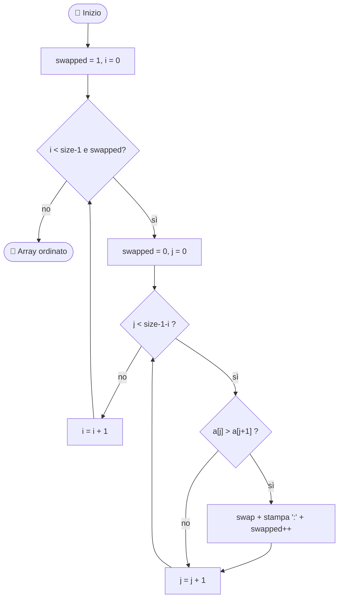

- 🏔️ Dopo ogni passata, il valore più grande rimasto è già al suo posto in fondo. Per questo il ciclo interno si accorcia (`size - 1 - i`).
- 🛑 **Trucco da pro:** il flag `swapped` ferma l'algoritmo se una passata intera non ha fatto scambi. Se l'array è già ordinato, basta **una sola passata**.

### 🎯 Come ragiona il Selection Sort

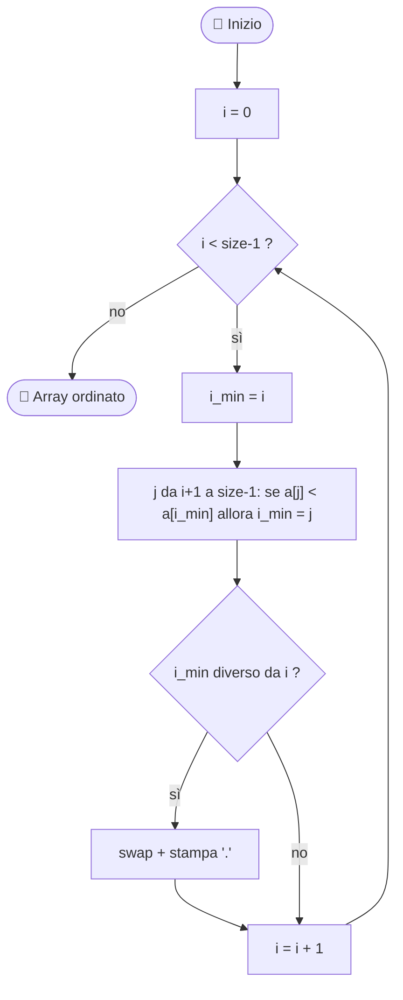

- 🔦 Prima **cerca** l'indice del minimo (`i_min`), e solo alla fine fa **un unico scambio** per passata.
- 🪶 Lo scambio avviene solo se serve (`i_min != i`).

### ⚔️ Il confronto diretto

| 📊 Criterio | 🫧 Bubble Sort | 🎯 Selection Sort |
|---|---|---|
| 🧠 Idea | Scambia i vicini | Sceglie il minimo e lo posiziona |
| ⏱️ Confronti (caso medio e peggiore) | ~ n²/2 | ~ n²/2, **sempre** |
| 🚀 Caso migliore (già ordinato) | **O(n)** grazie a `swapped` | O(n²), non si accorge di nulla |
| 🔁 Numero di scambi | Fino a ~ n²/2 | **Al massimo n − 1** |
| 🧩 Stabile (mantiene l'ordine dei valori uguali) | ✅ Sì | ❌ No |
| 💾 Memoria extra | O(1) | O(1) |
| 🖊️ Traccia stampata in questo progetto | `:` per ogni scambio | `.` per ogni scambio |

### 🕵️ Cosa ci racconta la traccia

🔬 La funzione `swap` stampa un carattere a ogni scambio: è uno strumento didattico per **vedere** il lavoro dell'algoritmo. In un'esecuzione di prova con 20 numeri casuali abbiamo ottenuto circa **107 scambi** per il Bubble Sort contro appena **15** per il Selection Sort, a parità di dati iniziali.

- 🪙 **Se scambiare costa tanto** (ad esempio spostare oggetti grandi o scrivere su memoria lenta), il Selection Sort vince
- 🛡️ **Se i dati sono quasi ordinati**, il Bubble Sort con flag può essere velocissimo
- 🏭 **Nel mondo reale** entrambi sono didattici: per dati grandi si usano algoritmi O(n log n) come quelli dietro `qsort`. Ma capire questi due è la base per capire tutti gli altri.

> 💬 **CHECKPOINT 4/5** – Hai visto le bolle e il minimo in azione. Scrivi **🫧** nei commenti!
>
> 🔐 Sequenza raccolta: 🗺️ 🧩 🛠️ 🫧 ▫️

⬆️ [Torna all'indice](#top-it)

<a id="cap5-it"></a>

## 🔎 Cap. 5 – Cercare: Lineare vs Binaria

### 🕵️ Due detective, due metodi

🔍 Le funzioni `linSearch` e `binSearch` restituiscono l'**indice** dell'elemento trovato, oppure **−1** se non c'è.

- 🚶 **Ricerca lineare:** *"Guardo uno per uno, dall'inizio"*. È come cercare un documento in una pila di fogli sparsi sulla scrivania: li giri tutti finché lo trovi.
- ✂️ **Ricerca binaria:** *"Guardo in mezzo e scarto metà del problema"*. È come cercare una parola nel dizionario: apri a metà, capisci se sei prima o dopo, e butti via l'altra metà.

### 🚶 Ricerca lineare

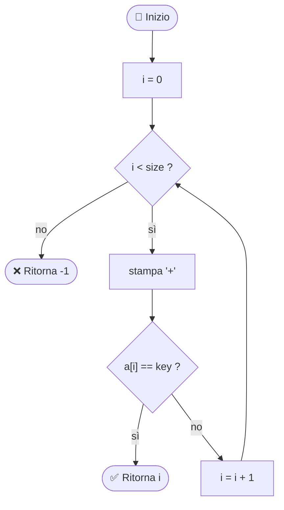

### ✂️ Ricerca binaria

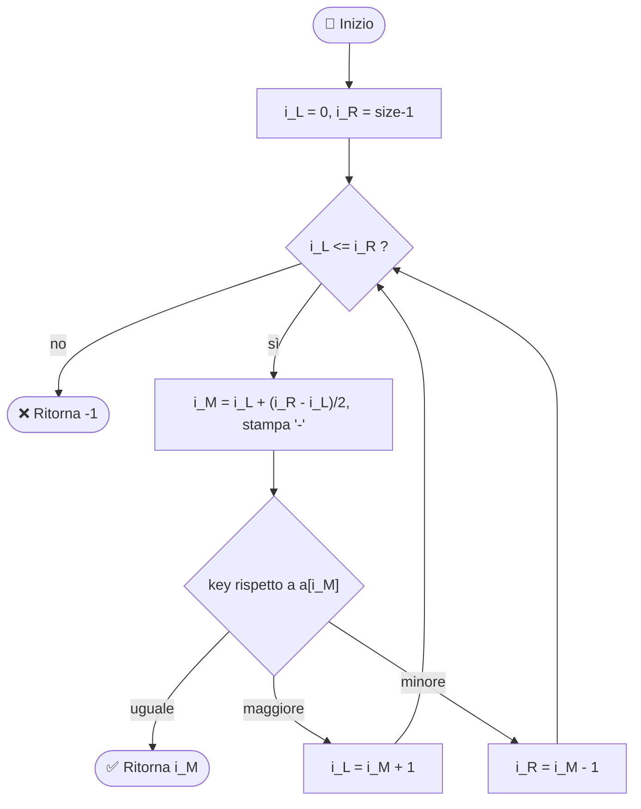

🧮 Una riga merita un'occhiata attenta:

```c
int i_M = i_L + (i_R - i_L) / 2;
```

- 🛡️ Perché non `(i_L + i_R) / 2`? Perché con indici molto grandi la somma potrebbe **andare in overflow**.
Scritta così, la formula è sicura: è un classico bug celebre nella storia del software.

### ⚠️ La condizione che non puoi dimenticare

🚨 **La ricerca binaria funziona solo su array ORDINATI.** Se lo applichi a dati disordinati, ottieni risposte sbagliate senza nessun errore visibile.
Nel progetto, per questo, `main` la esegue su `a1`, già ordinato con Selection Sort.
La ricerca lineare, invece, funziona su qualsiasi array.

### ⚔️ Il confronto diretto

| 📊 Criterio | 🚶 Ricerca lineare | ✂️ Ricerca binaria |
|---|---|---|
| 🧠 Idea | Controlla ogni elemento | Dimezza lo spazio a ogni passo |
| 📋 Richiede array ordinato | ❌ No | ✅ **Sì** |
| ⏱️ Complessità | O(n) | **O(log n)** |
| 🔢 Passi massimi con 20 elementi | 20 | 5 |
| 🔢 Passi massimi con 1.000.000 di elementi | 1.000.000 | circa 20 |
| 🖊️ Traccia stampata | `+` per ogni confronto | `-` per ogni passo |
| 🎒 Quando conviene | Dati pochi o disordinati, una ricerca singola | Dati ordinati e molte ricerche |

🤯 **Pensaci:** con un milione di elementi la binaria ne guarda circa 20.
È la differenza tra scorrere una rubrica intera e aprirla a metà qualche volta.

### 🧮 Il vero conto da fare

🏷️ Ordinare costa.
Se devi fare **una sola ricerca**, ordinare prima per usare la binaria può non convenire.
Se ne devi fare **migliaia**, ordinare una volta sola ripaga ampiamente.
Un buon programmatore si chiede sempre: *"quante volte userò questo dato?"*

### 🎬 Il programma in azione

📺 Ecco un'esecuzione reale, cercando il numero 42 (che nell'array non c'era):

```text
Linear search path: ++++++++++++++++++++
Linear Search: Value 42 not found

Binary search path: -----
Binary Search: Value 42 not found
```

- 🚶 20 `+` → la lineare ha controllato **tutti** gli elementi
- ✂️ 5 `-` → la binaria è arrivata alla stessa conclusione in **5 passi**
- 🔔 Il carattere `\a` nel messaggio di "non trovato" fa suonare il beep del terminale

> 💬 **CHECKPOINT 5/5** – Hai finito la guida! Scrivi **🏆** nei commenti!
>
> 🔐 Sequenza completa: 🗺️ 🧩 🛠️ 🫧 🏆
>
> 🔑 **Chiave finale:** invia un unico commento con le 5 emoji **in questo ordine esatto**. Ti aspetta ancora un segreto nella Bonus Track! 🎁

⬆️ [Torna all'indice](#top-it)

<a id="epilogo-it"></a>

## 🎯 Epilogo – Sfide per il prossimo livello

🔥 Leggere è il primo passo, **modificare il codice è quello che ti fa crescere**.
Prova queste missioni, dalla più facile alla più ambiziosa:

1. 🟢 **Cambia `N`** a 50 e osserva come cambiano le tracce `:`, `.`, `+`, `-`
2. 🟢 **Cerca un numero presente** (tra 0 e 99) e confronta i passi delle due ricerche
3. 🟡 **Blinda `scanf`:** se l'utente scrive una lettera, la variabile `k` resta non inizializzata. Controlla il valore restituito da `scanf`.
4. 🟡 **Conta i confronti** nei due ordinamenti con un contatore, e verifica la tabella del Cap. 4
5. 🟠 **Aggiungi l'Insertion Sort:** scrivi la funzione in `array_tools.c`, aggiungi il prototipo in `array_tools.h` e usala in `main.c`. Hai appena sperimentato il vero vantaggio della divisione in file.
6. 🔴 **Nascondi `swap`** rendendola `static` e togliendola dall'header. Cosa cambia per `main.c`?

🌟 **Ultimo pensiero:** i grandi programmatori non sanno tutto a memoria.
Sanno **dividere i problemi**, **misurare**, e **scegliere lo strumento giusto**.
Tu oggi hai fatto tutte e tre le cose. Alla prossima! 🚀

<a id="bonus-it"></a>

## 🎁 Bonus Track – Tutto quello che non sapevi su `\a`

🔔 Nel [`main.c`](main.c) hai visto `\a` dentro i messaggi di "value not found".
Sembra un dettaglio da niente, ma dietro a quel carattere c'è mezzo secolo di storia dell'informatica.

### 🧬 Identikit

| 🏷️ Cosa | 🔍 Dettaglio |
|---|---|
| 📛 Nome | **BEL** (Bell), l'*alert* del C |
| 🔢 Codice ASCII | **7** |
| ✍️ Modi per scriverlo | `\a`, `\007` (ottale), `\x07` (esadecimale) |
| ⌨️ Dalla tastiera | `Ctrl + G` |
| 📏 Cosa dice lo standard C | Produce un avviso **sonoro o visivo**, senza spostare la posizione di stampa |

### 🤓 Dieci curiosità

1. 📠 **Era un campanello vero.** Nelle telescriventi (*teletype*) il carattere BEL faceva suonare una campanella meccanica per richiamare l'attenzione dell'operatore.
2. 🏛️ **Non c'era nel C originale.** `\a` è stato introdotto con lo standard ANSI C (C89). Il C di K&R non lo prevedeva.
3. 👻 **È invisibile.** Il programma non stampa nulla di visibile: invia solo il byte `0x07`. Nell'esecuzione di prova di questa guida, l'output grezzo conteneva proprio quel byte.
4. 🔬 **Puoi vederlo con `cat -v`.** Prova: `echo 42 | ./programma | cat -v`. Alla fine del messaggio comparirà `^G`, che è la notazione di Ctrl+G.
5. 🎛️ **Dipende dal terminale.** Può fare un suono, far lampeggiare lo schermo (*visual bell*), mostrare una notifica o non fare **assolutamente niente**. Lo standard garantisce solo che l'ambiente tenti un "alert".
6. 📂 **Se reindirizzi su file, il byte ci finisce dentro.** Con `./programma > out.txt` il file contiene un carattere di controllo che non si vede ma c'è.
7. 🧭 **Non muove il cursore.** A differenza di `\n` o `\t`, non cambia la posizione di stampa.
8. 🔣 **Ha un simbolo Unicode dedicato:** U+2407, ␇, "symbol for bell". Non va confuso con l'emoji 🔔, che è un'altra cosa.
9. 🐚 **Funziona anche nella shell:** `printf '\a'` oppure `tput bel` e senti subito il risultato.
10. 🚰 **Il buffering può ritardarlo.** Con l'output su terminale il testo esce a ogni `\n`. Con l'output su pipe o file viene accumulato e il bip arriva solo al momento dello svuotamento del buffer (`fflush`).

### 👨‍👧‍👦 La famiglia delle escape sequence

| 🧬 Sequenza | 🎯 Significato | 🖼️ Immagine mentale |
|---|---|---|
| `\a` | Alert (campanello) | 🔔 Il "ding" alla reception |
| `\b` | Backspace | ⌫ Un passo indietro |
| `\f` | Form feed (cambio pagina) | 📄 Foglio nuovo in stampante |
| `\n` | Nuova riga | ↩️ Vai a capo |
| `\r` | Ritorno a inizio riga | 🧵 Il carrello della macchina da scrivere |
| `\t` | Tabulazione orizzontale | ➡️ Salto fino al prossimo tab |
| `\v` | Tabulazione verticale | ⬇️ Salto di qualche riga |

### 🧪 Mini esperimenti

```bash
printf '\a'
echo 42 | ./programma | cat -v
```

- 🎧 Il primo comando prova il suono del tuo terminale
- 🕵️ Il secondo ti mostra il carattere nascosto come `^G`

### 🧠 Pensiero da pro

- 🔇 **Un bip a ogni errore è comodo per un esercizio, fastidioso in un'aula piena** o in un programma vero. Nei software seri il segnale acustico è disattivabile.
- 📢 Per i messaggi d'errore, i professionisti usano `stderr` (con `fprintf(stderr, ...)`), così possono separarli dal normale output.
- ♿ Un avviso solo sonoro non è accessibile a tutti: il testo "Value not found" nel nostro programma resta sempre il canale principale, il bip è un extra.

### 🏅 Sfida bonus

🎯 Modifica `main.c` in modo che il bip suoni **solo se** entrambe le ricerche falliscono, e spostalo in un unico punto.
Hai appena fatto un piccolo *refactoring*.

> 🔔 **BONUS CHECKPOINT** – Hai trovato il segreto di `\a`! Aggiungi **🔔** in fondo alla tua chiave finale.
>
> 🔑 **Chiave finale deluxe:** 🗺️ 🧩 🛠️ 🫧 🏆 🔔

⬆️ [Torna all'indice](#top-it)

<a href="#TOP">&utrif; top &utrif;</a>

## 🔗 Links
[](https://www.linkedin.com/in/biagio-rosario-greco-77145774/)
[](https://twitter.com/birg_81)
[](mailto:birg81@gmail.com)