[](https://choosealicense.com/licenses/mit/)
[](https://opensource.org/licenses/)
[](http://www.gnu.org/licenses/agpl-3.0)

<a name="TOP"></a>

<a href="#IT"></a>
🤍
<a href="#EN"></a>

---

 <a name="EN"></a>

<!-- English -->

# 🧵 Strings in C: Everything the '\0' Never Told You

> 💬 *"With great power comes great responsibility."* — Uncle Ben, Spider-Man (and with pointers, that power is very real)

| 🎯 Item | 📋 Details |
|---|---|
| 🧰 Requirements | C basics, arrays and pointers, a Linux/macOS terminal with `gcc` |
| ⏱️ Reading time | about 15 minutes |

## 📑 Index

- [🎬 The Hook](#cap00-EN)
- [📍 Chapter 1 – Pointers in 60 Seconds](#cap01-EN)
- [🔗 Chapter 2 – Pointers and Arrays: Twins, Not Clones](#cap02-EN)
- [🧱 Chapter 3 – The String: a char Array with a Terminator](#cap03-EN)
- [🚃 Chapter 4 – char*: the Mine Cart](#cap04-EN)
- [📏 Chapter 5 – Counting Characters: strlength and strlen](#cap05-EN)
- [⌨️ Chapter 6 – scanf and the Space Problem](#cap06-EN)
- [📋 Chapter 7 – Copy and Paste: strcpy and strcat](#cap07-EN)
- [⚖️ Chapter 8 – Comparing and Searching: strcmp and strstr](#cap08-EN)
- [💥 Chapter 9 – Gotchas: When the String Doesn't Fit](#cap09-EN)
- [🏁 Chapter 10 – Let's Go: Compiling and argv](#cap10-EN)
- [🌟 Final Thoughts](#finale-EN)
- [🗺️ Concept Map](#mappa-EN)

<a id="cap00-EN"></a>
## 🎬 The Hook

Hey, team! 👋 Let's get this out of the way: C **has no string type**. No `String`, no `.length()`, no `+` to glue things together. And yet the [program](./main.c) greets you by name, measures it, tweaks it, compares it and searches inside it.

*How does it do that*?

The secret is an invisible character sitting at the end of every word: the `'\0'`.

>By the end of this guide, every line of that code will be crystal clear!

### 🧭 What You'll Take Home

- 🧠 Theory
	- pointers and arrays as the foundation, strings as the goal
	- what `const` means in every position
- 🛠️ Practice
	- the most-used `string.h` functions
	- reading a whole line, compiling, and not shooting yourself in the foot

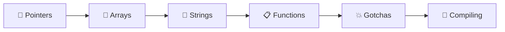

<a id="cap01-EN"></a>

## 📍 Chapter 1 – Pointers in 60 Seconds

In games, the map shows where the treasure is, but **the map is not the treasure**.

A pointer is the **X** on the map: *a variable that holds the address of another variable*.

| 🔣 Symbol | 🏷️ Name | 💬 Meaning |
|---|---|---|
| `&hp` | address-of | "give me the location of `hp`" |
| `int* ptr` | pointer type | "`ptr` is a map to an `int`" |
| `*ptr` | dereference | "go there and grab the loot" |

```c
int hp = 100;		// the treasure: hit points
int* ptr = &hp;		// the map: holds the address of hp
*ptr = 80;			// follow the map and change the treasure
printf("%d\n", hp);	// prints 80
```

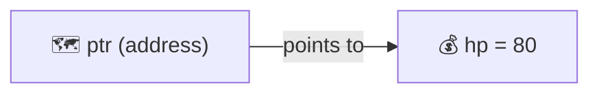

#### Reflection 🦉

*Losing the map doesn't make you lose the gold, but now you have no idea where to dig.*

<a id="cap02-EN"></a>

## 🔗 Chapter 2 – Pointers and Arrays: Twins, Not Clones

In most expressions, an array's name **decays** into the address of its first element. That's why `a[i]` and `*(a + i)` are the same thing.

```c
int loot[3] = {10, 20, 30};
int* p = loot;	// loot decays into &loot[0]
printf("%d %d %d\n", loot[1], *(loot + 1), p[1]);	// 20 20 20
p++;	// moves forward by ONE int, not by one byte
```

### 🔍 Where They Really Differ

| 🔎 Aspect | `int loot[3]` | `int* p` |
|---|---|---|
| What it holds | the 3 integers | an address |
| `sizeof` | 12 bytes (3 × 4) | 8 bytes (64-bit systems) |
| Reassignable (`= ...`) | ❌ | ✅ |
| Incrementable (`++`) | ❌ | ✅ |

*(Sizes are the typical ones on a modern PC.)*

> 💡 Pass an array to a function and **only the pointer** makes it there: the length gets lost along the way. That's exactly why strings carry a terminator around.

#### Reflection 🪁

*An array knows its own size while it stays home; the moment it goes through a function, it's just an address.*

<a id="cap03-EN"></a>
## 🧱 Chapter 3 – The String: a char Array with a Terminator

In C, a string is a sequence of `char`s ending with `'\0'` (the value 0, called **NUL**). The terminator tells everyone: "the word ends here". With `int` arrays you have to track the length separately; with strings, the terminator is enough.

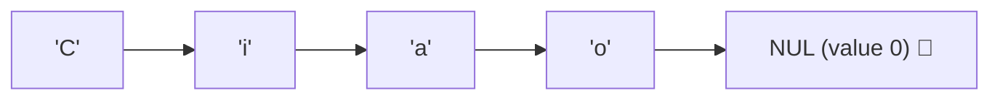

### 🛠️ Four Ways to Create a String

```c
char s1[] = "Ciao";						// 5 bytes: C i a o \0 (size worked out by the compiler)
char s2[10] = "Ciao";					// 10 bytes: after "Ciao", everything is zeroed
char s3[] = {'C', 'i', 'a', 'o', '\0'};	// same as s1, but tedious
char s4[4] = "Ciao";					// WARNING: no room for '\0', this is NOT a string!
```

> 📌 **Golden rule:** an array of `N` chars holds strings of at most `N - 1` characters. One slot is reserved for the terminator, like the driver's seat in a car.

### 🆚 int Arrays vs char Arrays

| 🔎 | `int v[]` | `char s[]` |
|---|---|---|
| Initialization | `{1, 2, 3}` | `"Ciao"` ✅ |
| Where it ends | length tracked separately | at the `'\0'` |
| Printing | `for` loop | `printf("%s", s)` |

An array that is declared but not initialized, like `char name[20];`, holds **garbage**: until you write the terminator, it's not a string.

#### Reflection 🧲

*The whole string library stands on a single zero byte: if it's missing, everything comes crashing down.*

<a id="cap04-EN"></a>

## 🚃 Chapter 4 – char*: the Mine Cart

### 🔤 char* as a String Type

A `char*` pointing at the first character of a string behaves like a string type, even a **variable-length** one: under the hood it's just an address, and the characters end wherever the terminator is, whatever the length.

```c
const char* greeting = "Ciao";
greeting = "Good morning, everyone";	// ok: the pointer changes destination
```

| 🔎 | `char s[] = "Ciao"` | `const char* s = "Ciao"` |
|---|---|---|
| Length | fixed (5 bytes) | variable, changes destination |
| `s[0] = 'X'` | ✅ | ❌ (read-only literal) |
| `s = "other"` | ❌ | ✅ |
| `sizeof(s)` | 5 | 8 |

### ⛏️ The Cart: Two Questions, Four Answers

Picture a mine cart. Two things can be locked or free:

- 🛤️ the **cart on the track**: it can move (the pointer changes address) or it can't;
- 📦 the **cargo**: it can be changed or it's sealed (the characters are modifiable or not).

| 📜 Declaration | 🛤️ Moves | 📦 Cargo editable | 🖼️ Picture |
|---|---|---|---|
| `char* c` | ✅ | ✅ | free cart, free cargo |
| `const char* c` | ✅ | ❌ | sealed cargo |
| `char* const c` | ❌ | ✅ | cart locked on the track |
| `const char* const c` | ❌ | ❌ | parked and sealed |
| `char c[]` | ❌ | ✅ | the cargo is inside the wagon, which doesn't move |

> 💡 **Pro tip:** read right to left. `const` **before** the asterisk seals the cargo; `const` **after** the asterisk locks the cart.

```c
char buffer[] = "GOLD";
const char* a = "iron";	// sealed cargo
a = "copper";					// ok: the cart switches track
// a[0] = 'I';				// compile ERROR
char* const b = buffer;		// cart locked onto buffer
b[0] = 'g';					// ok: you can change the cargo
// b = "x";					// ERROR: the cart doesn't move
```

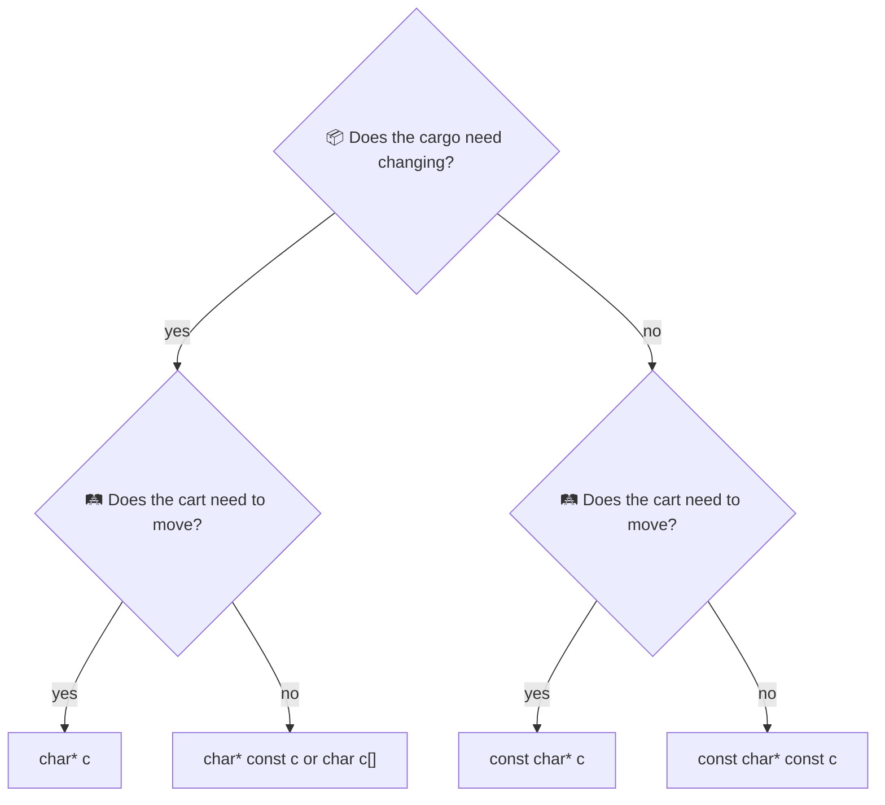

> ⚠️ `char* s = "Ciao";` the compiler accepts it for historical reasons, but writing to that literal crashes the program. With literals, always use `const char*`.

#### Reflection 🥁

*Before touching anything, ask yourself two things: can I move it? Can I change it?*

<a id="cap05-EN"></a>

## 📏 Chapter 5 – Counting Characters: strlength and strlen

### 🔧 The DIY Version

```c
int strlength(const char* str) {
	int len;
	for(len = 0; str[len] != '\0'; len++);	// the body is empty: the for does the counting
	return len;
}
```

You start at 0 and move forward until you hit the terminator. For `"Ciao"`: `len` goes 0, 1, 2, 3, and when it reaches 4 it finds `'\0'`, so it returns **4**. The `const` promises the function won't touch the string; thanks to decay, it accepts both arrays and pointers.

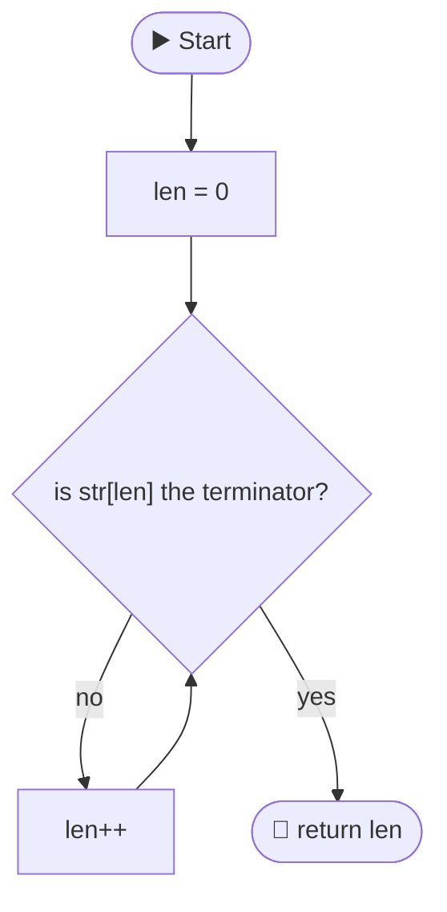

### 📚 The string.h Version

| 🔧 Element | 📝 Value | 💬 Meaning |
|---|---|---|
| Signature | `size_t strlen(const char* s)` | length of the string |
| Return | `size_t` | unsigned integer |
| Parameter | `const char* s` | string to measure, not modified |
| The terminator? | not counted | `"Ciao"` is 4, not 5 |

### ⚖️ sizeof vs strlen

```c
char name[20] = "Marco";
printf("%zu %zu\n", sizeof(name), strlen(name));	// 20 5
```

| 🔎 | `sizeof` | `strlen` |
|---|---|---|
| Measures | the **capacity** (bytes) | the **characters** up to the terminator |
| When | at compile time | at runtime |
| On `char*` | 8 (the map) | the real length |

#### Reflection 🪐

*Capacity is the size of the car; length is how many friends are actually inside.*

<a id="cap06-EN"></a>
## ⌨️ Chapter 6 – scanf and the Space Problem

```c
char name[20];
scanf("%s", name);	// no &: name is already an address
```

If you type `Anna Maria`, you only get `Anna`. The space acts as a border: `Maria` stays queued in the input buffer, like a friend left waiting outside the restaurant.

```text
$ ./main
	Hello, please enter the first name: Anna Maria
	You entered 'Anna' [4 characters]
```

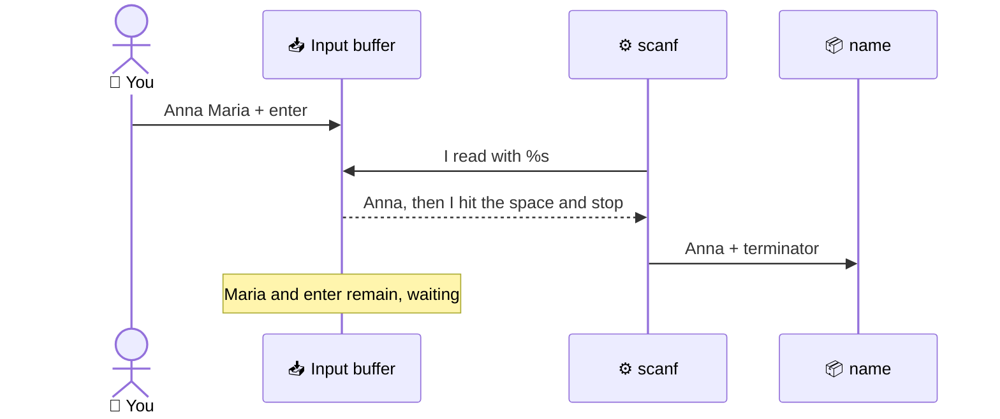

### 🩹 The Fix: %19[^\n]

```c
scanf("%19[^\n]", firstname);	// reads a whole line, 19 characters max
```

| 🔣 Format | 📖 Reads | 🛑 Stops at | 📏 Limit |
|---|---|---|---|
| `%s` | one word | the first space | none ⚠️ |
| `%19s` | one word | the first space | 19 |
| `%19[^\n]` | a whole line | enter | 19 |

`[^\n]` reads as "any character **except** newline". The `19` is `MAX_LEN - 1`: one slot is left for the terminator. For other sizes, change the number: `char city[50]` needs `%49[^\n]`, `char tag[8]` needs `%7[^\n]`. The number has to be written by hand, because inside the quotes `MAX_LEN` doesn't get substituted. The trailing newline stays in the buffer: keep that in mind if you read anything else afterwards.

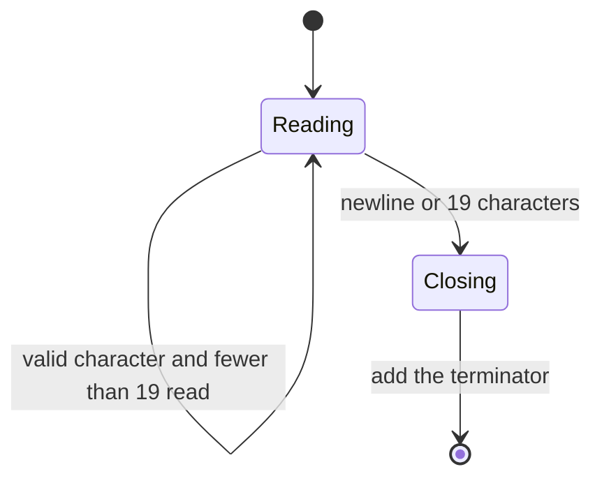

#### Reflection 🦊

*It's not the computer cutting your sentence short: it's the format you gave it that decides where to stop.*

<a id="cap07-EN"></a>
## 📋 Chapter 7 – Copy and Paste: strcpy and strcat

Just like with `int` arrays, `name1 = name0;` copies nothing (in fact, it won't even compile). Strings get dedicated functions, which know where to stop thanks to the terminator.

| 🔧 Function | 📝 Signature | 💬 What it does | ↩️ Returns |
|---|---|---|---|
| `strcpy` | `char* strcpy(char* dest, const char* src)` | copies `src` into `dest`, terminator included | `dest` |
| `strcat` | `char* strcat(char* dest, const char* src)` | appends `src` after the end of `dest` | `dest` |

Notice the `const`s: `src` is sealed (read-only), `dest` isn't (it's the destination, it will be modified). `strcat` finds the terminator of `dest`, overwrites it with the first character of `src` and puts a fresh terminator at the end.

```c
strcpy(name0, firstname);	// name0 = "Marco"
strcpy(name1, name0);		// name1 = "Marco"
strcat(name0, "lisa");		// name0 = "Marcolisa"
strcat(name1, "rita");		// name1 = "Marcorita"
```

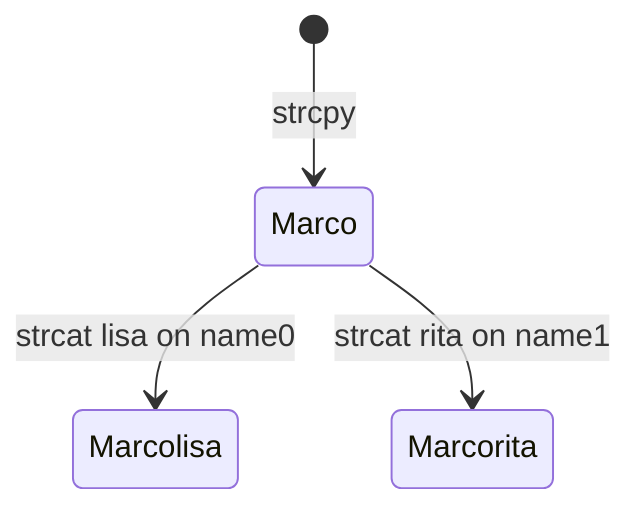

> ⚠️ Neither `strcpy` nor `strcat` checks whether `dest` is big enough: we'll get to that in the gotchas chapter.

#### Reflection 🧩

*Copy-paste only works if the place you paste into is big enough.*

<a id="cap08-EN"></a>
## ⚖️ Chapter 8 – Comparing and Searching: strcmp and strstr

### 🆚 strcmp

With `==` on strings you compare **addresses**, not characters: it's like asking whether two friends live in the same house instead of asking whether they look alike.

```c
if (name0 == name1) { /* ... */ }				// ❌ compares the maps
if (strcmp(name0, name1) == 0) { /* ... */ }	// ✅ compares the characters
```

| 🔧 Signature | `int strcmp(const char* s1, const char* s2)` |
|---|---|

| ↩️ Return | 💬 Meaning | 🎮 Example |
|---|---|---|
| `< 0` | `s1` comes before `s2` | `strcmp("Anna", "Bruno")` |
| `0` | strings are equal | `strcmp("Anna", "Anna")` |
| `> 0` | `s1` comes after `s2` | `strcmp("Zoe", "Anna")` |

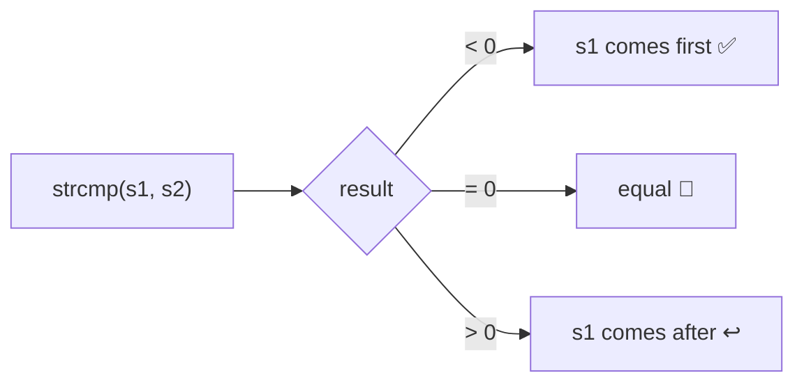

The function compares character by character (ASCII codes) until it finds a difference or a terminator. `"Marcolisa"` versus `"Marcorita"`: the first 5 are equal, then `'l'` (108) against `'r'` (114), so the result is **negative**. On the machine used for this guide it's `-6`, but the standard only guarantees the **sign**: never write `== -1`. Watch out for uppercase too: `'Z'` comes before `'a'`.

### 🔍 strstr

| 🔧 Signature | `char* strstr(const char* haystack, const char* needle)` |
|---|---|
| ↩️ Return | pointer to the **first** occurrence, or `NULL` if there isn't one |

The parameter names come from the idiom "finding a needle in a haystack". The result is a pointer inside the haystack: subtract the starting address and you get the position.

```c
const char* found = strstr(name1, "it");	// name1 = "Marcorita"
if (found != NULL) {
	printf("Found at position %d\n", (int)(found - name1));
}
```

```text
	Found at position 6
```

#### Reflection 🪄

*Comparing means looking inside things, not just asking where they live.*

<a id="cap09-EN"></a>
## 💥 Chapter 9 – Gotchas: When the String Doesn't Fit

### 🎒 The 20-Slot Backpack

`name0` has 20 slots. Your program reads up to 19 characters and then appends `"lisa"`: with a long name, the backpack blows up.

```c
char name0[20];	// 20 slots
strcpy(name0, "Bartolomeo Maria");	// 16 characters + terminator = 17 slots: ok
strcat(name0, "lisa");	// 20 characters + terminator = 21 slots: overflows by one
```

C won't warn you: it writes into the neighboring memory and the result is **undefined behavior** (a crash, corrupted data, or maybe nothing visible at all, which is even worse). Overflows are a classic bug factory, and with a name of 16 or more characters your original code produces one.

```c
if (strlen(name0) + strlen("lisa") < MAX_LEN) {	// the terminator's +1 is already baked into the "<"
	strcat(name0, "lisa");
}
```

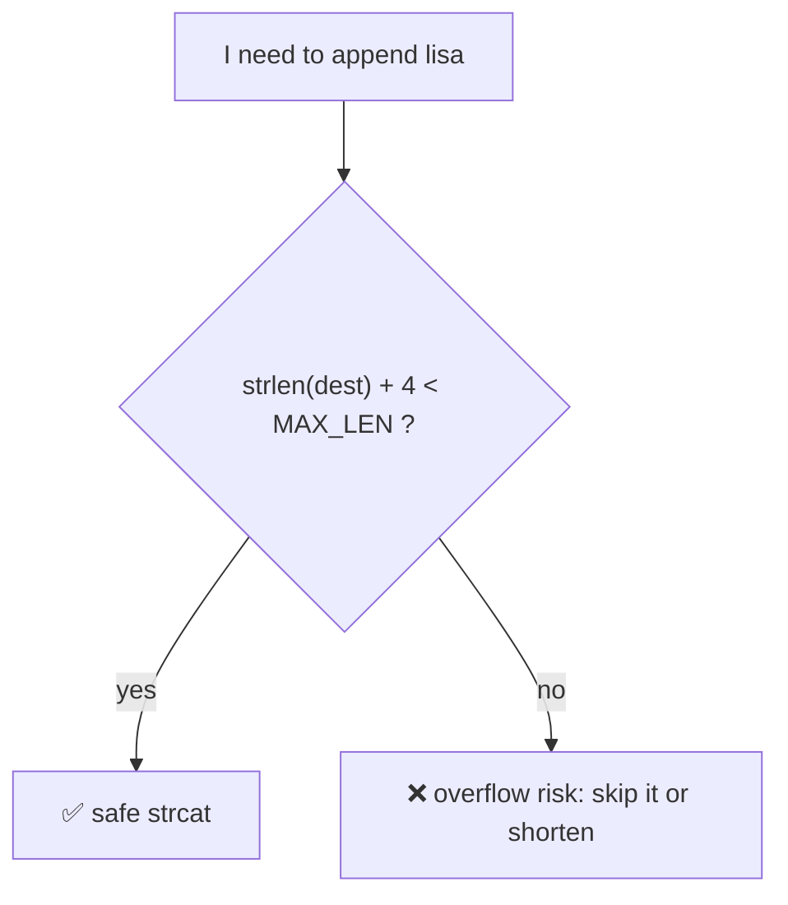

### 🛡️ The "n" Versions

| 🔧 Function | 📝 Signature | 💬 Note |
|---|---|---|
| `strncpy` | `char* strncpy(char* dest, const char* src, size_t n)` | copies at most `n` chars; if `src` has `n` or more, it does **not** add the terminator |
| `strncmp` | `int strncmp(const char* s1, const char* s2, size_t n)` | compares only the first `n` chars, handy for prefixes |

```c
strncpy(name0, firstname, MAX_LEN - 1);
name0[MAX_LEN - 1] = '\0';	// safety terminator, always
if (strncmp(name0, "Mar", 3) == 0) { /* starts with Mar */ }
```

### 🔢 size_t vs int

`strlen` returns a `size_t` (an unsigned integer, often 64-bit). In the hook's code we print it with `%d` **for teaching reasons**: it works because the values are small, but normally you'd use `%zu`. If you compile it, `gcc` may throw a warning at you. Our `strlength`, on the other hand, returns an `int`, so there `%d` is correct.

| 🔣 Type | ✅ Format |
|---|---|
| `int` | `%d` |
| `size_t` | `%zu` |
| `char` | `%c` |
| string | `%s` |

### 🧨 More Gotchas

- ❌ Comparing strings with `==`
- ❌ Forgetting the terminator (`char s[4] = "Ciao";`)
- ❌ Writing to a literal without `const`
- ❌ Using an uninitialized string

#### Reflection 🍄

*When C gets it wrong, it doesn't scream: it lets you carry on, and that's exactly when you need to pay attention.*

<a id="cap10-EN"></a>
## 🏁 Chapter 10 – Let's Go: Compiling and argv

### 🛠️ Compiling in One Command

```bash
gcc main.c -o main	# compiles main.c and creates the "main" executable
./main				# runs it (Linux and macOS)
```

| 🔧 Piece | 💬 Meaning |
|---|---|
| `gcc` | the compiler |
| `main.c` | your source file |
| `-o main` | name of the file to produce |

Optional: `gcc -std=c99 main.c -o main`. The `-std=c99` option tells the compiler to follow the rules of C as of the 1999 version, the one that allows, among other things, `//` comments and variables declared mid-block. You don't strictly need it: `gcc` already has its own default standard. If you see `command not found`, `gcc` isn't installed.

### 🎮 argv: an Array of Strings

`char* argv[]` is an array of pointers to `char`, that is, an **array of strings**: it ties together everything you saw in chapters 2 and 4. `argc` tells you how many elements it holds.

```c
int main(int argc, char* argv[]) {
	for (int i = 0; i < argc; i++) {
		printf("argv[%d] = %s\n", i, argv[i]);
	}
	return 0;
}
```

```text
$ ./main Marco Rossi
	argv[0] = ./main
	argv[1] = Marco
	argv[2] = Rossi
```

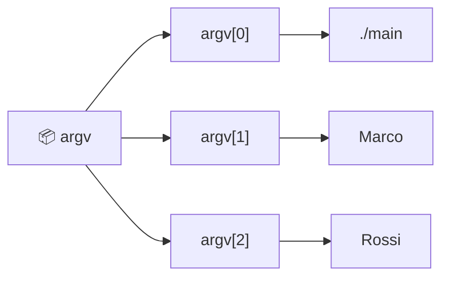

Here `argc` is 3 and `argv[0]` is always the program's name. Your code declares them but doesn't use them: that's normal.

#### Reflection 🛶

*The program gets its words from the outside world like a crew getting orders: one at a time, in line.*

<a id="finale-EN"></a>
## 🌟 Final Thoughts

Now you can reread the hook's code and explain it line by line. The common thread: **a string is a `char` array closed by a terminator, and almost every problem happens when the terminator is missing or the space isn't enough**.

| 🔧 Function | ↩️ Returns | ⚠️ Watch out |
|---|---|---|
| `strlen(s)` | length (`size_t`) | doesn't count the terminator |
| `strcpy(dest, src)` | `dest` | `dest` big enough |
| `strcat(dest, src)` | `dest` | `dest` big enough |
| `strcmp(s1, s2)` | `<0`, `0`, `>0` | never with `==`, never `== -1` |
| `strstr(h, n)` | pointer or `NULL` | check for `NULL` |

Dynamic memory, which you need when the size isn't known in advance, will be the topic of the next episodes. See you there! 🚀

<a id="mappa-EN"></a>

## 🗺️ Concept Map

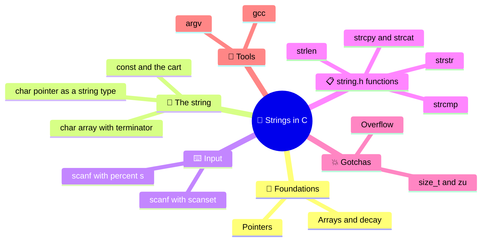

---

<a href="#IT"></a>
🤍
<a href="#EN"></a>

---

 <a name="IT"></A>

<!-- Italiano -->

# 🧵 Stringhe in C: tutto ciò che il '\0' non vi ha mai detto

> 💬 *"Da un grande potere derivano grandi responsabilità."* — Zio Ben, Spider-Man (e coi puntatori il potere è davvero grande)

| 🎯 Voce | 📋 Dettaglio |
|---|---|
| 🧰 Requisiti | Basi di C, array e puntatori, terminale Linux/macOS con `gcc` |
| ⏱️ Tempo di lettura | circa 15 minuti |

## 📑 Indice

- [🎬 Il gancio](#cap00-IT)
- [📍 Capitolo 1 – Puntatori in 60 secondi](#cap01-IT)
- [🔗 Capitolo 2 – Puntatori e array: gemelli, non identici](#cap02-IT)
- [🧱 Capitolo 3 – La stringa: un array di char con il tappo](#cap03-IT)
- [🚃 Capitolo 4 – char*: il carrello della miniera](#cap04-IT)
- [📏 Capitolo 5 – Contare i caratteri: strlength e strlen](#cap05-IT)
- [⌨️ Capitolo 6 – scanf e il problema dello spazio](#cap06-IT)
- [📋 Capitolo 7 – Copiare e incollare: strcpy e strcat](#cap07-IT)
- [⚖️ Capitolo 8 – Confrontare e cercare: strcmp e strstr](#cap08-IT)
- [💥 Capitolo 9 – Trabocchetti: quando la stringa non ci sta](#cap09-IT)
- [🏁 Capitolo 10 – Si parte: compilare e argv](#cap10-IT)
- [🌟 Considerazioni finali](#finale-IT)
- [🗺️ Mappa dei concetti](#mappa-IT)

<a id="cap00-IT"></a>
## 🎬 Il gancio

Ehi, squadra! 👋 Ve lo dico subito: il C **non ha un tipo "stringa"**. Niente `String`, niente `.length()`, niente `+` per incollare. Eppure il [programma](./main.c) vi saluta per nome, lo misura, lo modifica, lo confronta e ci cerca dentro.

*Come fa*?

Il segreto è un carattere invisibile che sta in fondo a ogni parola: il `'\0'`.

>Alla fine di questa guida ogni riga di questo codice sarà trasparente come un cristallo!

### 🧭 Cosa porterete a casa

- 🧠 Teoria
	- puntatori e array come base, stringhe come obiettivo
	- il significato di `const` in tutte le sue posizioni
- 🛠️ Pratica
	- le funzioni di `string.h` più usate
	- leggere una riga intera, compilare e non farsi male

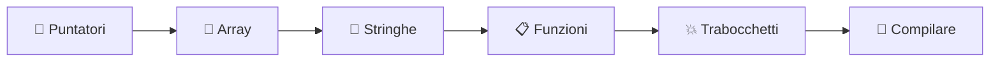

<a id="cap01-IT"></a>

## 📍 Capitolo 1 – Puntatori in 60 secondi

Nei videogiochi la mappa segna dove sta il tesoro, ma **la mappa non è il tesoro**.

Un puntatore è la **X** sulla mappa: *una variabile che contiene l'indirizzo di un'altra variabile*.

| 🔣 Simbolo | 🏷️ Nome | 💬 Significato |
|---|---|---|
| `&hp` | indirizzo di | "dammi la posizione di `hp`" |
| `int* ptr` | tipo puntatore | "`ptr` è una mappa verso un `int`" |
| `*ptr` | dereferenziazione | "vai là e prendi il tesoro" |

```c
int hp = 100;		// il tesoro: i punti vita
int* ptr = &hp;		// la mappa: contiene l'indirizzo di hp
*ptr = 80;			// seguo la mappa e cambio il tesoro
printf("%d\n", hp);	// stampa 80
```

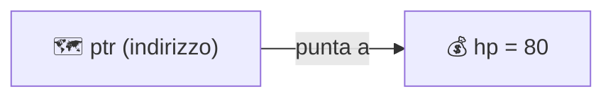

#### Riflessione 🦉

*Perdere la mappa non vi fa perdere l'oro, ma non sapete più dove cercarlo.*

<a id="cap02-IT"></a>

## 🔗 Capitolo 2 – Puntatori e array: gemelli, non identici

Nella maggior parte delle espressioni il nome di un array **decade** nell'indirizzo del suo primo elemento. Per questo `a[i]` e `*(a + i)` sono la stessa cosa.

```c
int loot[3] = {10, 20, 30};
int* p = loot;	// loot decade in &loot[0]
printf("%d %d %d\n", loot[1], *(loot + 1), p[1]);	// 20 20 20
p++;	// avanza di UN int, non di un byte
```

### 🔍 Dove si differenziano davvero

| 🔎 Aspetto | `int loot[3]` | `int* p` |
|---|---|---|
| Cosa contiene | i 3 interi | un indirizzo |
| `sizeof` | 12 byte (3 × 4) | 8 byte (sistemi a 64 bit) |
| Riassegnabile (`= ...`) | ❌ | ✅ |
| Incrementabile (`++`) | ❌ | ✅ |

*(Le dimensioni sono quelle tipiche di un PC moderno.)*

> 💡 Passando un array a una funzione arriva **solo il puntatore**: la lunghezza si perde per strada. È esattamente il motivo per cui le stringhe si portano dietro un tappo.

#### Riflessione 🪁

*Un array sa quanto è grande finché resta a casa; appena esce con una funzione, è solo un indirizzo.*

<a id="cap03-IT"></a>
## 🧱 Capitolo 3 – La stringa: un array di char con il tappo

In C una stringa è una sequenza di `char` che termina con `'\0'` (il valore 0, detto **NUL**). Il tappo dice a tutti: "qui finisce la parola". Con gli array di `int` la lunghezza va tenuta a parte; con le stringhe basta il tappo.

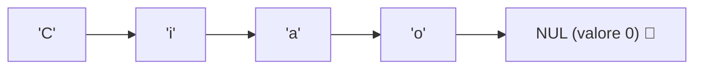

### 🛠️ Quattro modi di creare una stringa

```c
char s1[] = "Ciao";						// 5 byte: C i a o \0 (misura calcolata dal compilatore)
char s2[10] = "Ciao";					// 10 byte: dopo "Ciao" tutto azzerato
char s3[] = {'C', 'i', 'a', 'o', '\0'};	// uguale a s1, ma faticoso
char s4[4] = "Ciao";					// ATTENZIONE: manca il posto per '\0', NON è una stringa!
```

> 📌 **Regola d'oro:** un array di `N` char contiene stringhe lunghe al massimo `N - 1`. Un posto è prenotato per il tappo, come il sedile del guidatore.

### 🆚 Array di int e array di char

| 🔎 | `int v[]` | `char s[]` |
|---|---|---|
| Inizializzazione | `{1, 2, 3}` | `"Ciao"` ✅ |
| Dove finisce | lunghezza tenuta a parte | al `'\0'` |
| Stampa | ciclo `for` | `printf("%s", s)` |

Un array dichiarato e non inizializzato, come `char name[20];`, contiene **spazzatura**: finché non scrivete il tappo, non è una stringa.

#### Riflessione 🧲

*Tutta la libreria delle stringhe si regge su un singolo byte a zero: se manca, crolla tutto.*

<a id="cap04-IT"></a>

## 🚃 Capitolo 4 – char*: il carrello della miniera

### 🔤 char* come tipo stringa

Un `char*` che punta al primo carattere di una stringa si comporta come un tipo stringa, anche **di lunghezza variabile**: i caratteri finiscono dove c'è il tappo, qualunque sia la lunghezza.

```c
const char* greeting = "Ciao";
greeting = "Buongiorno a tutti";	// ok: il puntatore cambia destinazione
```

| 🔎 | `char s[] = "Ciao"` | `const char* s = "Ciao"` |
|---|---|---|
| Lunghezza | fissa (5 byte) | variabile, cambia destinazione |
| `s[0] = 'X'` | ✅ | ❌ (letterale in sola lettura) |
| `s = "altro"` | ❌ | ✅ |
| `sizeof(s)` | 5 | 8 |

### ⛏️ Il carrello: due domande, quattro risposte

Immaginate un carrello della miniera. Due cose possono essere bloccate o libere:

- 🛤️ il **carrello sul binario**: può spostarsi (il puntatore cambia indirizzo) oppure no;
- 📦 il **carico**: può essere cambiato oppure è sigillato (i caratteri sono modificabili o no).

| 📜 Dichiarazione | 🛤️ Si sposta | 📦 Carico modificabile | 🖼️ Immagine |
|---|---|---|---|
| `char* c` | ✅ | ✅ | carrello libero, carico libero |
| `const char* c` | ✅ | ❌ | carico sigillato |
| `char* const c` | ❌ | ✅ | carrello bloccato sul binario |
| `const char* const c` | ❌ | ❌ | fermo e sigillato |
| `char c[]` | ❌ | ✅ | il carico è nel vagone, che non si sposta |

> 💡 **Trucco:** leggete da destra a sinistra. `const` **prima** dell'asterisco sigilla il carico; `const` **dopo** l'asterisco blocca il carrello.

```c
char buffer[] = "ORO";
const char* a = "ferro";	// carico sigillato
a = "rame";					// ok: il carrello cambia binario
// a[0] = 'F';				// ERRORE di compilazione
char* const b = buffer;		// carrello bloccato su buffer
b[0] = 'o';					// ok: il carico si può cambiare
// b = "x";					// ERRORE: il carrello non si muove
```

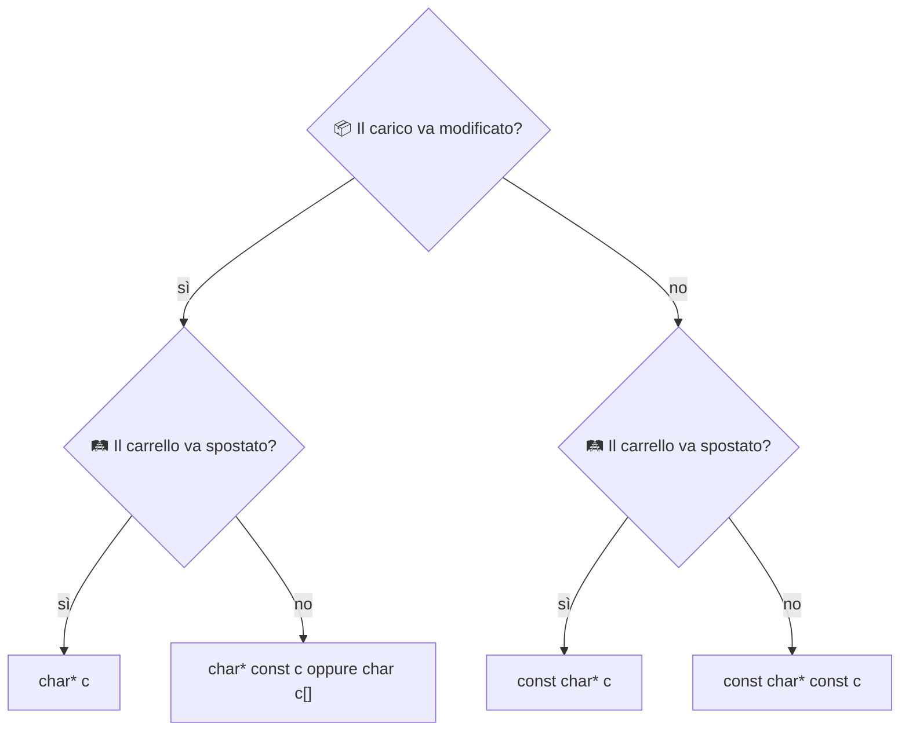

> ⚠️ `char* s = "Ciao";` il compilatore lo accetta per ragioni storiche, ma scrivere su quel letterale manda il programma in crash. Con i letterali, usate sempre `const char*`.

#### Riflessione 🥁

*Prima di toccare qualcosa chiedetevi due cose: posso spostarlo? Posso cambiarlo?*

<a id="cap05-IT"></a>

## 📏 Capitolo 5 – Contare i caratteri: strlength e strlen

### 🔧 La versione fai-da-te

```c
int strlength(const char* str) {
	int len;
	for(len = 0; str[len] != '\0'; len++);	// il corpo è vuoto: conta il for
	return len;
}
```

Si parte da 0 e si avanza finché non si incontra il tappo. Per `"Ciao"`: `len` vale 0, 1, 2, 3 e al quarto passo trova `'\0'`, quindi restituisce **4**. Il `const` promette che la funzione non toccherà la stringa; grazie al decadimento accetta sia array sia puntatori.

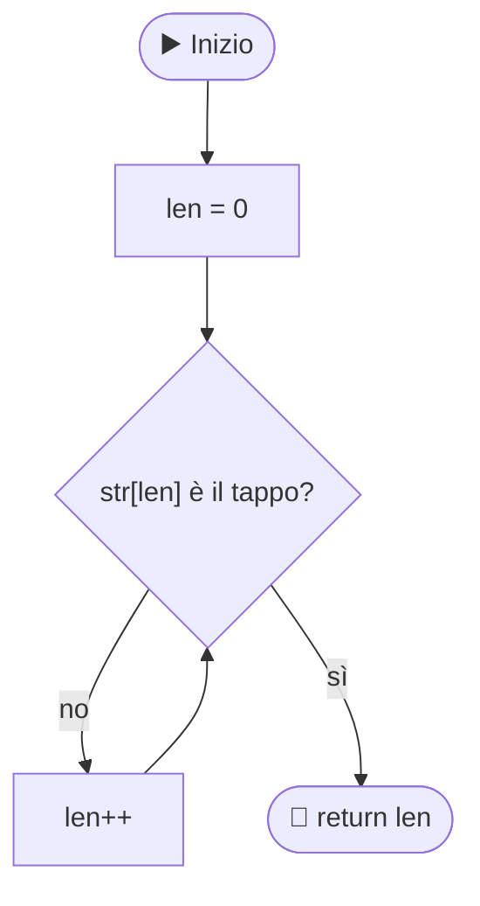

### 📚 La versione di string.h

| 🔧 Elemento | 📝 Valore | 💬 Significato |
|---|---|---|
| Firma | `size_t strlen(const char* s)` | lunghezza della stringa |
| Ritorno | `size_t` | intero senza segno |
| Parametro | `const char* s` | stringa da misurare, non modificata |
| Il tappo? | non contato | `"Ciao"` vale 4, non 5 |

### ⚖️ sizeof contro strlen

```c
char name[20] = "Marco";
printf("%zu %zu\n", sizeof(name), strlen(name));	// 20 5
```

| 🔎 | `sizeof` | `strlen` |
|---|---|---|
| Misura | la **capacità** (byte) | i **caratteri** fino al tappo |
| Quando | in compilazione | a runtime |
| Su `char*` | 8 (la mappa) | la lunghezza vera |

#### Riflessione 🪐

*La capienza è la misura dell'auto, la lunghezza è quanti amici ci sono dentro.*

<a id="cap06-IT"></a>
## ⌨️ Capitolo 6 – scanf e il problema dello spazio

```c
char name[20];
scanf("%s", name);	// niente &: name è già un indirizzo
```

Se scrivete `Anna Maria`, ottenete solo `Anna`. Lo spazio fa da confine: `Maria` resta in coda nel buffer di input, come l'amica che aspetta fuori dal ristorante.

```text
$ ./main
	Hello, please enter the first name: Anna Maria
	You entered 'Anna' [4 characters]
```

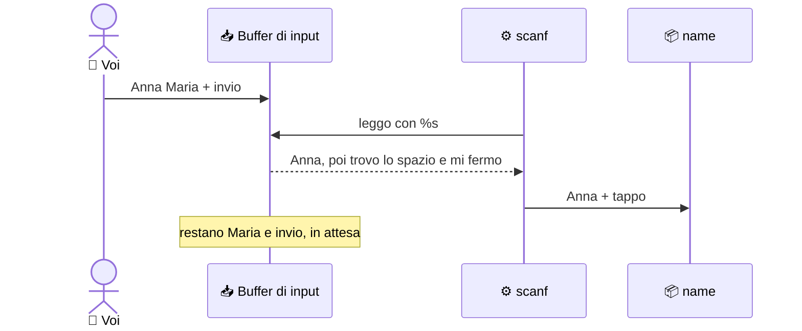

### 🩹 La soluzione: %19[^\n]

```c
scanf("%19[^\n]", firstname);	// legge un'intera riga, massimo 19 caratteri
```

| 🔣 Formato | 📖 Legge | 🛑 Si ferma | 📏 Limite |
|---|---|---|---|
| `%s` | una parola | al primo spazio | nessuno ⚠️ |
| `%19s` | una parola | al primo spazio | 19 |
| `%19[^\n]` | un'intera riga | all'invio | 19 |

`[^\n]` si legge "qualsiasi carattere **tranne** l'invio". Il `19` è `MAX_LEN - 1`: un posto resta per il tappo. Per altre dimensioni cambiate il numero: `char city[50]` vuole `%49[^\n]`, `char tag[8]` vuole `%7[^\n]`. Il numero va scritto a mano, perché dentro le virgolette `MAX_LEN` non viene sostituito. L'invio finale resta nel buffer: ricordatelo se leggete altro dopo.

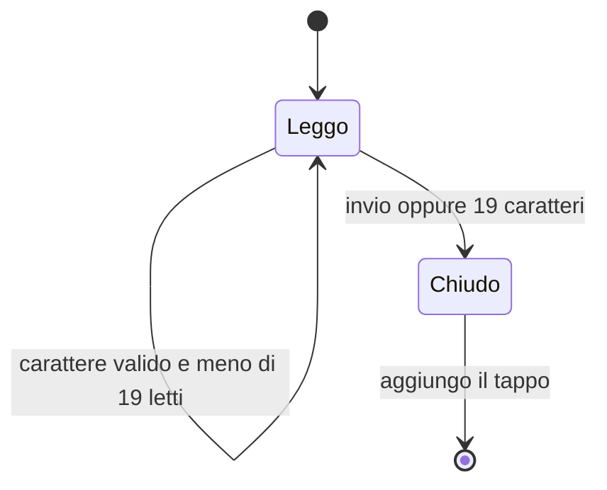

#### Riflessione 🦊

*Non è il computer a tagliare la frase: è il formato che gli avete dato a decidere dove fermarsi.*

<a id="cap07-IT"></a>
## 📋 Capitolo 7 – Copiare e incollare: strcpy e strcat

Come per gli array di `int`, `name1 = name0;` non copia nulla (anzi, non compila). Per le stringhe esistono funzioni dedicate, che sanno dove fermarsi grazie al tappo.

| 🔧 Funzione | 📝 Firma | 💬 Cosa fa | ↩️ Ritorna |
|---|---|---|---|
| `strcpy` | `char* strcpy(char* dest, const char* src)` | copia `src` in `dest`, tappo compreso | `dest` |
| `strcat` | `char* strcat(char* dest, const char* src)` | incolla `src` dopo la fine di `dest` | `dest` |

Notate i `const`: `src` è sigillata (si legge soltanto), `dest` no (è la destinazione, verrà modificata). `strcat` cerca il tappo di `dest`, lo sovrascrive con il primo carattere di `src` e rimette un nuovo tappo in fondo.

```c
strcpy(name0, firstname);	// name0 = "Marco"
strcpy(name1, name0);		// name1 = "Marco"
strcat(name0, "lisa");		// name0 = "Marcolisa"
strcat(name1, "rita");		// name1 = "Marcorita"
```

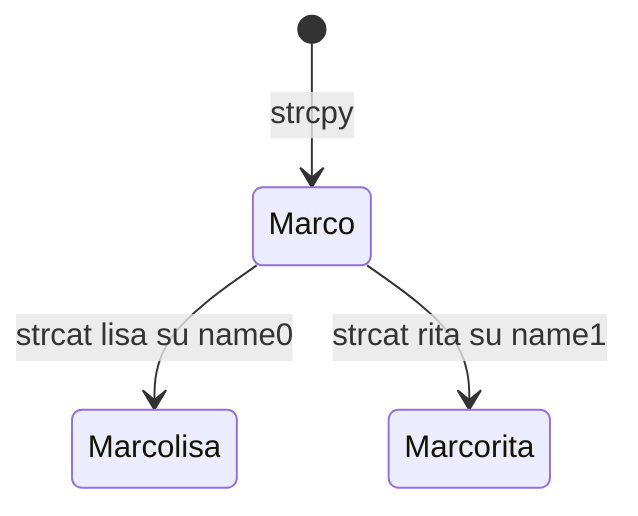

> ⚠️ Né `strcpy` né `strcat` controllano se `dest` è abbastanza grande: lo vedremo nel capitolo dei trabocchetti.

#### Riflessione 🧩

*Un copia-incolla riesce solo se il posto dove incollate è abbastanza grande.*

<a id="cap08-IT"></a>
## ⚖️ Capitolo 8 – Confrontare e cercare: strcmp e strstr

### 🆚 strcmp

Con `==` sulle stringhe confrontate **gli indirizzi**, non i caratteri: come chiedere se due amici abitano nella stessa casa invece di chiedere se si somigliano.

```c
if (name0 == name1) { /* ... */ }				// ❌ confronta le mappe
if (strcmp(name0, name1) == 0) { /* ... */ }	// ✅ confronta i caratteri
```

| 🔧 Firma | `int strcmp(const char* s1, const char* s2)` |
|---|---|

| ↩️ Ritorno | 💬 Significato | 🎮 Esempio |
|---|---|---|
| `< 0` | `s1` viene prima di `s2` | `strcmp("Anna", "Bruno")` |
| `0` | stringhe uguali | `strcmp("Anna", "Anna")` |
| `> 0` | `s1` viene dopo `s2` | `strcmp("Zoe", "Anna")` |

```mermaid
flowchart LR
	A["strcmp(s1, s2)"] --> B{"risultato"}
	B -->|"< 0"| C["s1 viene prima ✅"]
	B -->|"= 0"| D["uguali 🤝"]
	B -->|"> 0"| E["s1 viene dopo ↩️"]
```

La funzione confronta carattere per carattere (codici ASCII) finché trova una differenza o un tappo. `"Marcolisa"` contro `"Marcorita"`: i primi 5 sono uguali, poi `'l'` (108) contro `'r'` (114), quindi risultato **negativo**. Sul PC usato per questa guida è `-6`, ma lo standard garantisce solo il **segno**: non scrivete mai `== -1`. Attenzione anche alle maiuscole: `'Z'` viene prima di `'a'`.

### 🔍 strstr

| 🔧 Firma | `char* strstr(const char* haystack, const char* needle)` |
|---|---|
| ↩️ Ritorno | puntatore alla **prima** occorrenza, oppure `NULL` se non c'è |

Il nome viene da "cercare un ago in un pagliaio". Il risultato è un puntatore dentro il pagliaio: sottraendo l'indirizzo iniziale ottenete la posizione.

```c
const char* found = strstr(name1, "it");	// name1 = "Marcorita"
if (found != NULL) {
	printf("Trovata in posizione %d\n", (int)(found - name1));
}
```

```text
	Trovata in posizione 6
```

#### Riflessione 🪄

*Confrontare significa guardare dentro le cose, non solo chiedere dove abitano.*

<a id="cap09-IT"></a>
## 💥 Capitolo 9 – Trabocchetti: quando la stringa non ci sta

### 🎒 Lo zaino da 20 slot

`name0` ha 20 posti. Il vostro programma legge fino a 19 caratteri e poi aggiunge `"lisa"`: con un nome lungo, lo zaino esplode.

```c
char name0[20];	// 20 slot
strcpy(name0, "Bartolomeo Maria");	// 16 caratteri + tappo = 17 slot: ok
strcat(name0, "lisa");	// 20 caratteri + tappo = 21 slot: sfora di uno
```

Il C non vi avvisa: scrive nella memoria vicina e il risultato è un **comportamento indefinito** (crash, dati corrotti, o magari niente di visibile, il che è peggio). Con un nome di 16 o più caratteri il vostro codice originale sfora.

```c
if (strlen(name0) + strlen("lisa") < MAX_LEN) {	// il +1 del tappo è già nel "<"
	strcat(name0, "lisa");
}
```

```mermaid
flowchart TD
	A["Devo incollare lisa"] --> B{"strlen(dest) + 4 < MAX_LEN ?"}
	B -->|sì| C["✅ strcat sicuro"]
	B -->|no| D["❌ rischio overflow: rinunciare o accorciare"]
```

### 🛡️ Le versioni con la "n"

| 🔧 Funzione | 📝 Firma | 💬 Nota |
|---|---|---|
| `strncpy` | `char* strncpy(char* dest, const char* src, size_t n)` | copia al massimo `n` char; se `src` ne ha `n` o più, **non** mette il tappo |
| `strncmp` | `int strncmp(const char* s1, const char* s2, size_t n)` | confronta solo i primi `n` char, utile per i prefissi |

```c
strncpy(name0, firstname, MAX_LEN - 1);
name0[MAX_LEN - 1] = '\0';	// tappo di sicurezza, sempre
if (strncmp(name0, "Mar", 3) == 0) { /* inizia per Mar */ }
```

### 🔢 size_t contro int

`strlen` restituisce un `size_t` (intero senza segno, spesso a 64 bit). Nel codice del gancio lo stampiamo con `%d` **per esigenze didattiche**: funziona perché i valori sono piccoli, ma di norma si usa `%zu`. Se compilate, `gcc` può avvisarvi con un warning. La nostra `strlength` invece restituisce un `int`, quindi lì `%d` è corretto.

| 🔣 Tipo | ✅ Formato |
|---|---|
| `int` | `%d` |
| `size_t` | `%zu` |
| `char` | `%c` |
| stringa | `%s` |

### 🧨 Altre trappole

- ❌ Confrontare stringhe con `==`
- ❌ Dimenticare il tappo (`char s[4] = "Ciao";`)
- ❌ Scrivere su un letterale senza `const`
- ❌ Usare una stringa non inizializzata

#### Riflessione 🍄

*Quando il C sbaglia non urla: vi lascia andare avanti, ed è lì che dovete fare attenzione.*

<a id="cap10-IT"></a>
## 🏁 Capitolo 10 – Si parte: compilare e argv

### 🛠️ Compilare in un comando

```bash
gcc main.c -o main	# compila main.c e crea l'eseguibile "main"
./main				# lo avvia (Linux e macOS)
```

| 🔧 Pezzo | 💬 Significato |
|---|---|
| `gcc` | il compilatore |
| `main.c` | il vostro sorgente |
| `-o main` | nome del file da produrre |

Facoltativo: `gcc -std=c99 main.c -o main`. L'opzione `-std=c99` dice al compilatore di seguire le regole del C nella versione del 1999, quella che permette tra l'altro commenti `//` e variabili dichiarate a metà blocco. Non serve per forza: `gcc` ha già un suo standard predefinito. Se vedete `command not found`, `gcc` non è installato.

### 🎮 argv: un array di stringhe

`char* argv[]` è un array di puntatori a `char`, cioè un **array di stringhe**: unisce tutto ciò che avete visto nei capitoli 2 e 4. `argc` dice quanti elementi contiene.

```c
int main(int argc, char* argv[]) {
	for (int i = 0; i < argc; i++) {
		printf("argv[%d] = %s\n", i, argv[i]);
	}
	return 0;
}
```

```text
$ ./main Marco Rossi
	argv[0] = ./main
	argv[1] = Marco
	argv[2] = Rossi
```

```mermaid
flowchart LR
	AV["📦 argv"] --> A0["argv[0]"] --> S0["./main"]
	AV --> A1["argv[1]"] --> S1["Marco"]
	AV --> A2["argv[2]"] --> S2["Rossi"]
```

Qui `argc` vale 3 e `argv[0]` è sempre il nome del programma. Il vostro codice li dichiara ma non li usa: è normale.

#### Riflessione 🛶

*Il programma riceve le parole dal mondo esterno come un'equipe riceve i comandi: una per volta, in fila.*

<a id="finale-IT"></a>
## 🌟 Considerazioni finali

Ora potete rileggere il codice del gancio e spiegarlo riga per riga. Il filo conduttore: **una stringa è un array di `char` chiuso dal tappo, e quasi tutti i problemi nascono quando il tappo manca o lo spazio non basta**.

| 🔧 Funzione | ↩️ Ritorna | ⚠️ Attenzione |
|---|---|---|
| `strlen(s)` | lunghezza (`size_t`) | non conta il tappo |
| `strcpy(dest, src)` | `dest` | `dest` abbastanza grande |
| `strcat(dest, src)` | `dest` | `dest` abbastanza grande |
| `strcmp(s1, s2)` | `<0`, `0`, `>0` | mai con `==`, mai `== -1` |
| `strstr(h, n)` | puntatore o `NULL` | controllare `NULL` |

La memoria dinamica, che serve quando la dimensione non si conosce in anticipo, sarà l'argomento delle prossime puntate. Alla prossima! 🚀

<a id="mappa-IT"></a>

## 🗺️ Mappa dei concetti

```mermaid
mindmap
	root((🧵 Stringhe in C))
		📍 Fondamenta
			Puntatori
			Array e decadimento
		🧱 La stringa
			Array di char con tappo
			Puntatore char come tipo stringa
			const e il carrello
		⌨️ Input
			scanf con percento s
			scanf con scanset
		📋 Funzioni di string.h
			strlen
			strcpy e strcat
			strcmp
			strstr
		💥 Trabocchetti
			Overflow
			size_t e zu
		🏁 Strumenti
			gcc
			argv
```

<a href="#TOP">&utrif; top &utrif;</a>

## 🔗 Links
[](https://www.linkedin.com/in/biagio-rosario-greco-77145774/)
[](https://twitter.com/birg_81)
[](mailto:birg81@gmail.com)