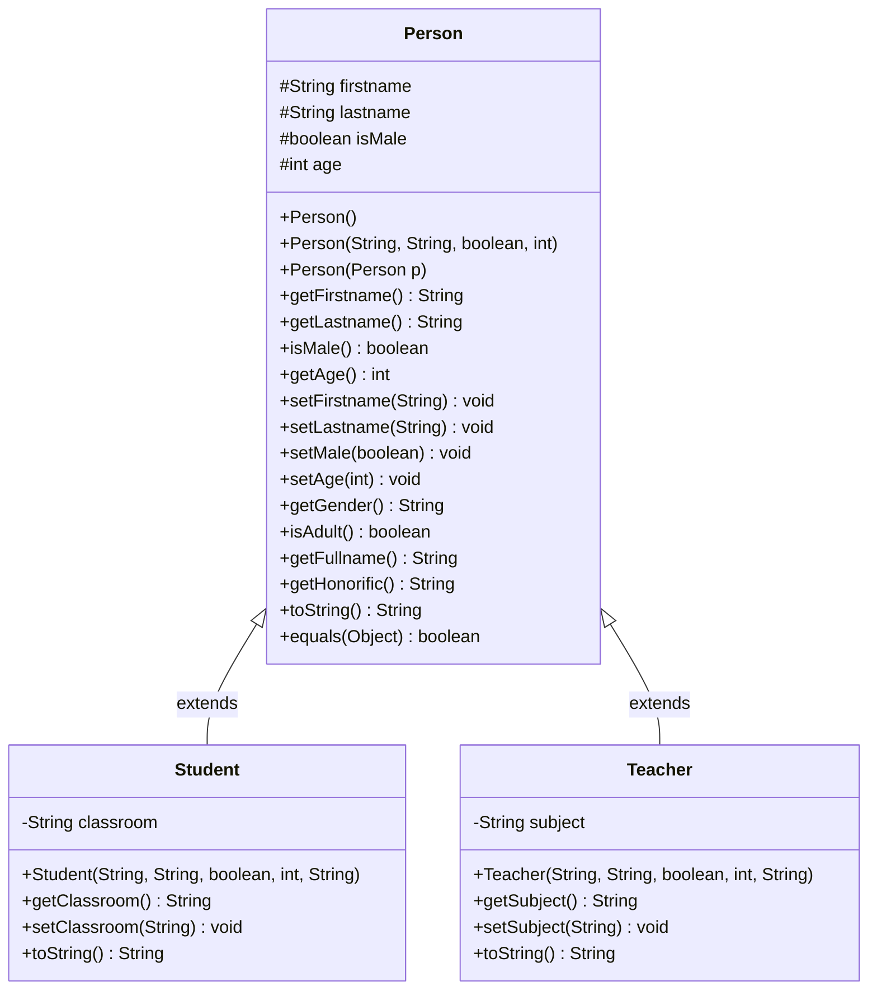
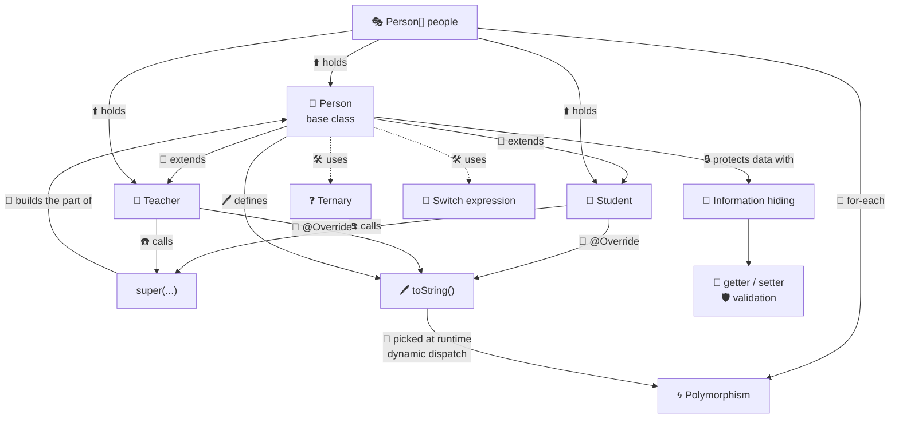
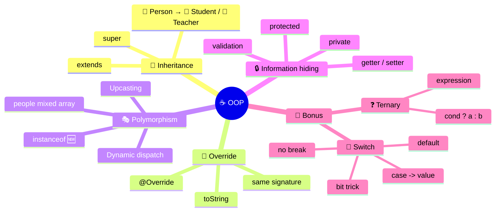
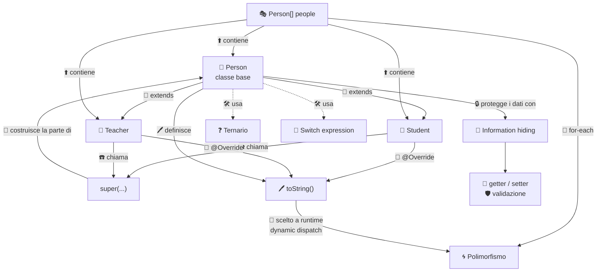
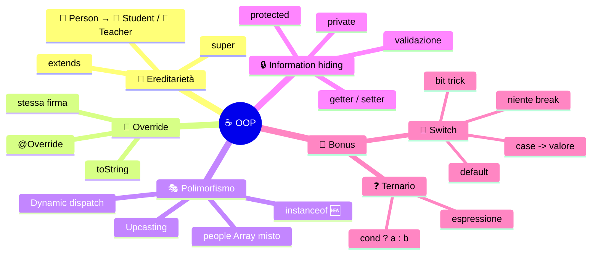

[](https://choosealicense.com/licenses/mit/)
[](https://opensource.org/licenses/)
[](http://www.gnu.org/licenses/agpl-3.0)

<a name="TOP"></a>

<a href="#IT"></a>
🤍
<a href="#EN"></a>

---

 <a name="EN"></A>

<!-- English -->

# 🚀☕ Java OOP Speedrun: from `Person` to a polymorphic array 🎮🧬

> 🎯 **Target**: 👩‍🎓👨‍🎓 folks who already code (loops, arrays, methods) but go 😱 *"inheritance? override? polymorphism? wait, what?"*
> 🧰 **Version**: ☕ Java **17+** (a few goodies need 21 → tagged 🆕)
> ⏱️ **Reading time**: ~15 min 🍕 *(less than a pizza in the oven)*

## 📚 Quick index ⚡

| 🔢 | 📌 Section | 🎁 Takeaway |
|---|---|---|
| 1️⃣ | 📝 The assignment | 🎯 What we're building |
| 2️⃣ | 🧱 [`Person`](./src/model/Person.java) | 🔒 Encapsulation + constructors |
| 3️⃣ | 🧬 [`Student`](./src/model/Student.java) and [`Teacher`](./src/model/Teacher.java) | 👨‍👧 `extends`, `super`, `@Override` |
| 4️⃣ | 🎭 The [`main`](./src/test/Main.java) | 🌀 Polymorphism in action |
| 5️⃣ | 🎁 Bonus: ternary ❓ | ✂️ `if` in one line |
| 6️⃣ | 🎁 Bonus: `switch` 🔀 | 🆕 Switch expression |
| 7️⃣ | 🗺️ Maps | 🧠 UML + mind map |
| 8️⃣ | ⚠️ Gotchas & next level | 🪤 What to improve |

## 1️⃣ 📝 The assignment (generic, teacher-style) 🎓

> 🗣️ *"Model the people living in a school. Start from a generic class and **specialize** it for different roles. Then handle them all together in a **single collection** and print them."*

### ✅ Assignment checklist 📋

- 🧱 Build a **base class** [`Person`](./src/model/Person.java) with personal data 🪪
- 🛡️ **Validate** the input (no `null`, no blank strings, no negative ages) 🚫
- 🧬 Build two **child classes**: [`Student`](./src/model/Student.java) 🎒 and [`Teacher`](./src/model/Teacher.java) 🍎, each with its own field
- ✍️ Each child must **introduce itself its own way** 🗣️
- 🎭 In the [`main`](./src/test/Main.java): **one array**, **three different types** of objects, one loop that prints them 🖨️

### 🧠 Concepts we're "training" 🏋️

| 🏷️ Concept | 🔍 In one line | 📍 Where you see it |
|---|---|---|
| 🧬 **Inheritance** | 👶 the child gets the parent's fields and methods | `extends Person` |
| 🔁 **Override** | 🖊️ the child rewrites an inherited method | `toString()` |
| 🎭 **Polymorphism** | 🌀 same call, different behavior | `println(p)` in the loop |
| 🔒 **Information hiding** | 🙈 protected data, controlled access | `private`/`protected` + setters |
| 📞 **`super`** | ☎️ calling the parent's constructor | `super(...)` |

## 2️⃣ 🧱 `Person`: the foundations 🏗️

### 🔒 2.1 Information hiding (encapsulation) 🙈

Golden rule 🥇: **never touch fields from outside**. You talk to the class through 🚪 **getters** and 🚪 **setters**: they're the bouncers 💂 checking who gets in.

| 🔑 Modifier | 👀 Who sees it | 🎯 When to use it |
|---|---|---|
| 🔴 `private` | 🏠 the class itself only | ✅ sane default |
| 🟡 `protected` | 🏠 class + 👶 **children** + 📦 same package | 🧬 when children need access |
| 🟢 `public` | 🌍 everyone | 🚪 public API |

```java
protected String firstname, lastname;	// 🟡 children read them directly
protected boolean isMale;
protected int age;
```

> 💡 **Pro tip** 😎: we made them `protected` **on purpose**, to show that `Student.toString()` can use `lastname` and `age` without going through getters. It works ✅, but it kinda "leaks" encapsulation 🕳️ (see section 8).

### 🏭 2.2 Three constructors, three ways to be born 👶

| 🏷️ Constructor | 🧾 Signature | 🎯 What it's for |
|---|---|---|
| 🎛️ **Full** | `Person(String, String, boolean, int)` | 🛡️ validates and assigns |
| 📋 **Copy** | `Person(Person p)` | 🧬 clones another person (handles `null` 🕳️) |
| 🕳️ **Default** | `Person()` | 🤖 fallback values |

```java
public Person() {
	this("Gennaro", "Esposito", true, 16);	// 🔗 delegates to the full constructor
}
```

- 🔗 `this(...)` = **calls another constructor of the same class** → ✨ validation lives in **one single place** (**DRY** principle 🧽)
- 🛡️ The full one sanitizes with the **ternary**: `age >= 0 ? age : 16` ✅

### 🧰 2.3 Bulletproof setters 🛡️

```java
public void setAge(int age) {
	if(age >= 0)			// 🚧 dirty input? ignored!
		this.age = age;
}
```

- ✅ Valid input → 💾 saved
- ❌ Invalid input → 🙅 nothing changes (the object stays **always consistent** 🧘)

### 🧮 2.4 "Derived" methods 🧪

| 🏷️ Method | 🔙 Returns | 🧠 Logic |
|---|---|---|
| `getGender()` | 🚻 `"m"` / `"f"` | ❓ ternary |
| `isAdult()` | ✅/❌ | `age >= 18` |
| `getFullname()` | 🪪 text | `"%s %s".formatted(...)` |
| `getHonorific()` | 🎩 `"il sig."`… | 🔀 switch + bit trick |

## 3️⃣ 🧬 `Student` and `Teacher`: the family grows 👨‍👩‍👧‍👦

### 🧾 3.1 The inheritance recipe 🍳

1. 🧬 `class Student extends Person` → "I'm a Person **plus** extra stuff" ➕
2. 🆕 Add **your own field** (`private String classroom`) 🔒
3. ☎️ In the constructor, **first line**: `super(...)` → the parent builds its own part 👶
4. ✍️ Then init your field (with validation 🛡️)
5. 🔁 **Override** whatever you want to change

```java
public Student(String firstname, String lastname, boolean isMale, int age, String classroom) {
	super(firstname, lastname, isMale, age);								// 📞 FIRST LINE, always!
	this.classroom = classroom != null && !classroom.isBlank() ? classroom.strip() : "6Z";
}
```

> ⚠️ Forget `super(...)` and Java quietly tries `super()` with no args 🤖 → and if `Person()` didn't exist: 💥 compile error.

### 🔁 3.2 Overriding `toString()` 🖊️

Every Java class inherits from 👑 `Object`, which already has a `toString()`. `Person` **rewrites** it, then `Student`/`Teacher` **rewrite it again** 🔄. *(String literals stay in Italian: that's the real program output 🇮🇹)*

| 🧑 Class | 🗣️ What it prints | 🎨 Trick used |
|---|---|---|
| 🧱 `Person` | `Sono il sig. Gennaro Esposito, ed ho 16 anni.` | 🎩 `getHonorific()` |
| 🎒 `Student` | `Ciao, sono Alfano Antonio, ho 17 anni; sono studente di 4X` | ❓ ternaries for `"ssa"` and `"corso universitario"` |
| 🍎 `Teacher` | `Sono la prof.ssa Barretta Barbara (29 anni), docente di …` | 🔀 switch expression |

### ✅ 3.3 Override cheat rules 📏

- 🔤 Same **signature** (name + parameters) ✔️
- 🏷️ **Always** slap on `@Override` 🏷️ → if you botch the signature, the compiler **yells** 📢 instead of pretending nothing happened
- 🔓 You can't **shrink** visibility (`public` → `private` ❌)

> 🧐 **Heads up**: in `Student` and `Teacher` the `@Override` on `toString()` is missing. It works anyway 🤷, but pros **add it** ✅.

### 🔐 3.4 Who sees what? 👁️

| 🧬 Field | 🧱 `Person` | 🎒 `Student` | 🍎 `Teacher` | 🎭 `Main` (other package) |
|---|:---:|:---:|:---:|:---:|
| `firstname`, `age`… 🟡 | ✅ | ✅ direct | ✅ direct | ❌ getters only |
| `classroom` 🔴 | ❌ | ✅ | ❌ | ❌ getters only |
| `subject` 🔴 | ❌ | ❌ | ✅ | ❌ getters only |

## 4️⃣ 🎭 The `main`: polymorphism kicks in 💡

```java
Person[] people = {
	new Person(),
	new Student("Antonio", "Alfano", true, 17, "4X"),
	new Teacher("Barbara", "Barretta", false, 29, "Computer Science")
};
for(Person p: people)
	System.out.println(p);
```

### 🪄 4.1 What's really going on? 🔬

| 🧩 Concept | 🔍 Explanation |
|---|---|
| 📦 **Static type** | 🏷️ `Person[]` → the compiler sees "persons" |
| 🧬 **Dynamic type** | 🎯 at runtime each element is a `Person`, `Student` or `Teacher` |
| ⬆️ **Upcasting** | 🆗 a `Student` **is a** `Person` → implicit assignment, zero casts |
| 🔀 **Dynamic dispatch** | 🧠 the JVM picks `toString()` **by the real type**, not the declared one |

```text
println(people[0]) → Person.toString()   🧱
println(people[1]) → Student.toString()  🎒
println(people[2]) → Teacher.toString()  🍎
```

> 🤯 The loop **has no clue** (and doesn't care 😎) who's in front of it: **it just asks**. That's polymorphism: 🎭 *one interface, many behaviors*.

### ⚠️ 4.2 The flip side 🪙

```java
Person p = new Student("Antonio", "Alfano", true, 17, "4X");
p.getClassroom();							// ❌ won't compile: Person doesn't have it!
if(p instanceof Student s)					// 🆕 pattern matching (Java 16+)
	System.out.println(s.getClassroom());	// ✅ now we're talking
```

- 🔍 The compiler checks the **declared type** → it only sees `Person`'s methods
- 🔑 `instanceof` with a pattern = **check + cast in one shot** 🥊

## 5️⃣ 🎁 Bonus track #1: the ternary operator ❓

### ✂️ 5.1 Syntax 🧾

```java
condition ? valueIfTrue : valueIfFalse
```

| 🔢 | 🧩 Piece | 🎯 Role |
|---|---|---|
| 1️⃣ | `condition` | ✅ must be `boolean` |
| 2️⃣ | `?` | 👉 "then…" |
| 3️⃣ | `: ` | 👉 "else…" |

> 💎 It's **an expression** (it produces a value 🎁), not a statement like `if`. So you can drop it **right of an `=`** or inside a `return` ✅.

### 🔄 5.2 From the real code 🧑‍💻

| 📍 Where | 🐢 `if` version | 🐇 Ternary version |
|---|---|---|
| `getGender()` | `if(isMale) return "m"; else return "f";` | `return isMale ? "m" : "f";` |
| 🛡️ age in the constructor | `if(age>=0) this.age=age; else this.age=16;` | `this.age = age >= 0 ? age : 16;` |
| 🎒 `studGender` | `if(!isMale) s="ssa"; else s="";` | `!isMale ? "ssa" : ""` |

### 🧪 5.3 The "string validation" combo 🛡️

```java
this.firstname = firstname != null && !firstname.isBlank() ? firstname.strip() : "Gennaro";
```

- 🧠 **Precedence**: `&&` first, then `?:` ✅ → read it as `(null-check && not-blank) ? cleaned : default`
- ⛓️ **Short-circuit** (`&&`): if `firstname == null`, `isBlank()` **never gets called** → no `NullPointerException` 💥🙅

### 🚦 5.4 When yes, when no 🧭

| ✅ Use it when… | ❌ Skip it when… |
|---|---|
| 🎯 you pick **between two values** | 🌀 you nest it (`a ? b : c ? d : e`) → 😵 unreadable |
| 📏 it fits on one line | 🛠️ you need to do **actions** (prints, mutations) → use `if` |

## 6️⃣ 🎁 Bonus track #2: the `switch` 🔀

### 🆕 6.1 Old vs new 👴👶

| 🏷️ | 👴 Classic switch | 🆕 Switch expression (Java 14+) |
|---|---|---|
| ➡️ Syntax | `case 1:` | `case 1 ->` |
| 🪂 `break` | ✅ mandatory (or else… *fall-through* 🕳️) | ❌ **not needed** |
| 🎁 Returns a value | ❌ | ✅ works as an expression |
| 🛡️ Exhaustiveness | ❌ | ✅ the compiler checks it |

### 🧩 6.2 The `getHonorific()` trick 🎩✨

We need **4 cases** (male/female × adult/minor). Instead of 2 nested `if`s 🪆, we **encode it in 2 bits** 🔢:

```java
return switch((isMale ? 2 : 0) | (isAdult() ? 1 : 0)) {
	case 0 -> "la sig.na";		// 👧 F, minor
	case 1 -> "la sig.ra";		// 👩 F, adult
	case 2 -> "il sig.ino";		// 👦 M, minor
	case 3 -> "il sig.";		// 👨 M, adult
	default -> "";				// 🛟 safety net
};
```

| 🚹🚺 `isMale` (bit 1️⃣) | 🔞 `isAdult` (bit 0️⃣) | 🔢 Binary | 🎯 Value | 🎩 Result |
|:---:|:---:|:---:|:---:|---|
| ❌ | ❌ | `00` | 0 | 👧 la sig.na |
| ❌ | ✅ | `01` | 1 | 👩 la sig.ra |
| ✅ | ❌ | `10` | 2 | 👦 il sig.ino |
| ✅ | ✅ | `11` | 3 | 👨 il sig. |

- 🔧 `|` (bitwise OR) **merges** the two bits into a 0–3 number 🎰
- 🛟 `default` is **mandatory** on an `int` (the compiler can't know only 0–3 comes out) 🤷
- 🤝 A ternary **inside** a switch = combo of everything you've learned 🏆

### 🧠 6.3 Other forms 🆕 (keep them in your pocket)

| ✨ Feature | 📜 Example | ☕ Version |
|---|---|---|
| 🧷 Multiple labels | `case 6, 7 -> "weekend";` | 14+ |
| 📦 Block with `yield` | `case 1 -> { ...; yield "x"; }` | 14+ |
| 🎯 Pattern matching | `case Student s -> s.getClassroom();` | 🆕 21 |

## 7️⃣ 🗺️ Maps: see it all at a glance 👀

### 🧬 7.1 UML Class Diagram 🏛️

🔑 **Legend**:
- `#` = 🟡 `protected`
- `-` = 🔴 `private`
- `+` = 🟢 `public`
- hollow arrow ⬆️ = **"extends"** (`extends`)



### 🔀 7.2 Concept map: how the ideas connect 🕸️



### 🧠 7.3 Summary mind map 🌳



## 8️⃣ ⚠️ Gotchas & Next Level 🪤🆙

### 🔍 8.1 Stuff to fix (code reviewer eyes 🧐)

| 🪤 Problem | 💥 Why it hurts | 🛠️ Fix |
|---|---|---|
| ⚖️ `equals()` compares `toString()` | 🎭 two different people with the same printout count as "equal"; reword the message and equality changes 😬 | 🔎 compare the **fields** (first name, last name, gender, age) |
| 🧬 `equals()` without `hashCode()` | 💥 breaks in `HashSet`/`HashMap` | 🤝 **always** implement them as a pair |
| 🟡 `protected` fields | 🕳️ children can "*break*" the validation rules | 🔴 `private` + use getters (and setters) |
| 📋 Duplicated switch in `Teacher` and `Person` | 🧽 not [DRY](https://en.wikipedia.org/wiki/Don%27t_repeat_yourself) | 🧩 helper method `protected int roleCode()` |
| 🗂️ `Person` is instantiable | 🤔 does a "generic person" even make sense? | 🧠 consider `abstract class` or `sealed` 🆕 |

### 🏆 8.2 Challenges for you 🎮

- 🥉 **Easy**: add `@Override` and a new `email` field with validation 📧
- 🥈 **Medium**: rewrite `equals()` on the fields + `hashCode()` with `Objects.hash(...)` 🔢
- 🥇 **Hard**: in the `main`, use `switch` with **pattern matching** 🆕 to print `classroom` or `subject` depending on the type 🎯

```java
for(Person p: people) {
	String extra = switch(p) {				// 🆕 Java 21
		case Student s	->	"Classe: " + s.getClassroom();
		case Teacher t	->	"Materia: " + t.getSubject();
		default			->	"Nessun ruolo";
	};
	System.out.println(extra);
}
```

## 🏁 [TL;DR](https://en.wikipedia.org/wiki/TL;DR) time ⚡🧠

| 🧩 Topic | 🔑 Remember that… |
|---|---|
| 🧬 Inheritance | 👶 `extends` + `super(...)` as the **first line** |
| 🔁 Override | 🏷️ same signature + `@Override` |
| 🎭 Polymorphism | 🧠 the **real** runtime type wins, not the declared one |
| 🔒 Information hiding | 🚪 protected data, access via validated methods |
| ❓ Ternary | ✂️ pick between **two values**, never nested |
| 🔀 Switch | 🆕 `->`, no `break`, returns a value |

> 🎤 **Mic drop** 🔥: *"Write code that talks to **Person**, and let the objects figure out **how** to behave."* 💪😎🚀

✍️ *Guide for Java OOP classes · made to be read, tried and… broken (then fixed)* 🔧🎉


---

<a href="#IT"></a>
🤍
<a href="#EN"></a>

---

 <a name="IT"></A>

<!-- Italiano -->

# 🚀☕ Java OOP Speedrun: da `Person` a un array polimorfico 🎮🧬

> 🎯 **Target**: 👩‍🎓👨‍🎓 gente che sa già programmare (cicli, array, metodi) ma che 😱 *"ereditarietà? override? polimorfismo? ma di che parli?"*
> 🧰 **Versione**: ☕ Java **17+** (alcune chicche sono da 21 → le segno con 🆕)
> ⏱️ **Tempo di lettura**: ~15 min 🍕 *(meno di una pizza in forno)*

## 📚 Indice lampo ⚡

| 🔢 | 📌 Sezione | 🎁 Cosa ti porti a casa |
|---|---|---|
| 1️⃣ | 📝 La consegna | 🎯 Cosa dobbiamo costruire |
| 2️⃣ | 🧱 [`Person`](./src/model/Person.java) | 🔒 Incapsulamento + costruttori |
| 3️⃣ | 🧬 [`Student`](./src/model/Student.java) e [`Teacher`](./src/model/Teacher.java) | 👨‍👧 `extends`, `super`, `@Override` |
| 4️⃣ | 🎭 Il [`main`](./src/test/Main.java) | 🌀 Polimorfismo in azione |
| 5️⃣ | 🎁 Bonus: ternario ❓ | ✂️ `if` in una riga |
| 6️⃣ | 🎁 Bonus: `switch` 🔀 | 🆕 Switch expression |
| 7️⃣ | 🗺️ Mappe | 🧠 UML + mappa mentale |
| 8️⃣ | ⚠️ Trappole & next level | 🪤 Cosa migliorare |

## 1️⃣ 📝 La consegna (generica, tipo prof) 🎓

> 🗣️ *"Modella le persone che vivono in una scuola. Parti da una classe generica e **specializzala** per ruoli diversi. Poi gestisci tutti insieme in una **collezione unica** e stampali."*

### ✅ Checklist della consegna 📋

- 🧱 Crea una **classe base** [`Person`](./src/model/Person.java) con dati anagrafici 🪪
- 🛡️ **Valida** i dati (niente `null`, niente stringhe vuote, niente età negative) 🚫
- 🧬 Crea due **classi figlie**: [`Student`](./src/model/Student.java) 🎒 e [`Teacher`](./src/model/Teacher.java) 🍎, ognuna con un campo suo
- ✍️ Ogni figlia deve **presentarsi a modo suo** 🗣️
- 🎭 Nel [`main`](./src/test/Main.java): **un solo array**, **tre tipi diversi** di oggetti, un ciclo che li stampa 🖨️

### 🧠 Concetti che stiamo "allenando" 🏋️

| 🏷️ Concetto | 🔍 In una frase | 📍 Dove lo vedi |
|---|---|---|
| 🧬 **Ereditarietà** | 👶 la figlia riceve campi e metodi del padre | `extends Person` |
| 🔁 **Override** | 🖊️ la figlia riscrive un metodo ereditato | `toString()` |
| 🎭 **Polimorfismo** | 🌀 stessa chiamata, comportamento diverso | `println(p)` nel ciclo |
| 🔒 **Information hiding** | 🙈 dati protetti, accesso controllato | `private`/`protected` + setter |
| 📞 **`super`** | ☎️ chiamare il costruttore del padre | `super(...)` |

## 2️⃣ 🧱 `Person`: le fondamenta 🏗️

### 🔒 2.1 Information hiding (incapsulamento) 🙈

Regola d'oro 🥇: **i campi non si toccano da fuori**. Ci si parla con 🚪 **getter** e 🚪 **setter**, che fanno da buttafuori 💂 e controllano chi entra.

| 🔑 Modificatore | 👀 Chi lo vede | 🎯 Quando usarlo |
|---|---|---|
| 🔴 `private` | 🏠 solo la classe stessa | ✅ default sano |
| 🟡 `protected` | 🏠 classe + 👶 **figlie** + 📦 stesso package | 🧬 quando le figlie devono accedere |
| 🟢 `public` | 🌍 tutti | 🚪 API pubblica |

```java
protected String firstname, lastname;	// 🟡 le figlie li leggono direttamente
protected boolean isMale;
protected int age;
```

> 💡 **Nota da pro** 😎: qui li abbiamo messi `protected` **apposta**, per far vedere che `Student.toString()` può usare `lastname` e `age` senza passare dai getter. Funziona ✅, ma "buca" un po' l'incapsulamento 🕳️ (vedi sezione 8).

### 🏭 2.2 Tre costruttori, tre modi di nascere 👶

| 🏷️ Costruttore | 🧾 Firma | 🎯 A cosa serve |
|---|---|---|
| 🎛️ **Completo** | `Person(String, String, boolean, int)` | 🛡️ valida e assegna |
| 📋 **Copia** | `Person(Person p)` | 🧬 clona un'altra persona (gestisce `null` 🕳️) |
| 🕳️ **Default** | `Person()` | 🤖 valori di fallback |

```java
public Person() {
	this("Gennaro", "Esposito", true, 16);	// 🔗 delega al costruttore completo
}
```

- 🔗 `this(...)` = **chiama un altro costruttore della stessa classe** → ✨ la validazione vive in **un solo posto** (principio **DRY** 🧽)
- 🛡️ Il completo usa il **ternario** per sanificare: `età >= 0 ? età : 16` ✅

### 🧰 2.3 Setter "blindati" 🛡️

```java
public void setAge(int age) {
	if(age >= 0)			// 🚧 input sporco? ignorato!
		this.age = age;
}
```

- ✅ Dato valido → 💾 si salva
- ❌ Dato invalido → 🙅 non cambia niente (l'oggetto resta **sempre coerente** 🧘)

### 🧮 2.4 Metodi "derivati" 🧪

| 🏷️ Metodo | 🔙 Ritorna | 🧠 Logica |
|---|---|---|
| `getGender()` | 🚻 `"m"` / `"f"` | ❓ ternario |
| `isAdult()` | ✅/❌ | `age >= 18` |
| `getFullname()` | 🪪 testo | `"%s %s".formatted(...)` |
| `getHonorific()` | 🎩 `"il sig."`… | 🔀 switch + bit-trick |

## 3️⃣ 🧬 `Student` e `Teacher`: la famiglia si allarga 👨‍👩‍👧‍👦

### 🧾 3.1 Ricetta dell'ereditarietà 🍳

1. 🧬 `class Student extends Person` → "sono una Person **e in più** altro" ➕
2. 🆕 Aggiungi il **campo tuo** (`private String classroom`) 🔒
3. ☎️ Nel costruttore **come prima riga**: `super(...)` → il padre costruisce la sua parte 👶
4. ✍️ Poi inizializza il tuo campo (con validazione 🛡️)
5. 🔁 Fai **override** dei metodi che vuoi cambiare

```java
public Student(String firstname, String lastname, boolean isMale, int age, String classroom) {
	super(firstname, lastname, isMale, age);								// 📞 PRIMA RIGA, sempre!
	this.classroom = classroom != null && !classroom.isBlank() ? classroom.strip() : "6Z";
}
```

> ⚠️ Se dimentichi `super(...)`, Java prova a chiamare `super()` senza argomenti 🤖 → e se `Person()` non esistesse: 💥 errore di compilazione.

### 🔁 3.2 Override di `toString()` 🖊️

Tutte le classi Java ereditano da 👑 `Object`, che ha già `toString()`. `Person` lo **riscrive**, e `Student`/`Teacher` lo **riscrivono ancora** 🔄.

| 🧑 Classe | 🗣️ Cosa stampa | 🎨 Trucco usato |
|---|---|---|
| 🧱 `Person` | `Sono il sig. Gennaro Esposito, ed ho 16 anni.` | 🎩 `getHonorific()` |
| 🎒 `Student` | `Ciao, sono Alfano Antonio, ho 17 anni; sono studente di 4X` | ❓ ternari per `"ssa"` e `"corso universitario"` |
| 🍎 `Teacher` | `Sono la prof.ssa Barretta Barbara (29 anni), docente di …` | 🔀 switch expression |

### ✅ 3.3 Mini-regole dell'override 📏

- 🔤 Stessa **firma** (nome + parametri) ✔️
- 🏷️ Metti **sempre** `@Override` 🏷️ → se sbagli firma, il compilatore ti **urla** 📢 invece di fare finta di niente
- 🔓 Non puoi **ridurre** la visibilità (da `public` a `private` ❌)

> 🧐 **Occhio**: nel codice di `Student` e `Teacher` manca `@Override` su `toString()`. Funziona lo stesso 🤷, ma da pro **va messo** ✅.

### 🔐 3.4 Chi vede cosa? 👁️

| 🧬 Campo | 🧱 `Person` | 🎒 `Student` | 🍎 `Teacher` | 🎭 `Main` (altro package) |
|---|:---:|:---:|:---:|:---:|
| `firstname`, `age`… 🟡 | ✅ | ✅ diretto | ✅ diretto | ❌ solo getter |
| `classroom` 🔴 | ❌ | ✅ | ❌ | ❌ solo getter |
| `subject` 🔴 | ❌ | ❌ | ✅ | ❌ solo getter |

## 4️⃣ 🎭 Il `main`: il polimorfismo si accende 💡

```java
Person[] people = {
	new Person(),
	new Student("Antonio", "Alfano", true, 17, "4X"),
	new Teacher("Barbara", "Barretta", false, 29, "Computer Science")
};
for(Person p: people)
	System.out.println(p);
```

### 🪄 4.1 Cosa succede, davvero? 🔬

| 🧩 Concetto | 🔍 Spiegazione |
|---|---|
| 📦 **Tipo statico** | 🏷️ `Person[]` → il compilatore vede "persone" |
| 🧬 **Tipo dinamico** | 🎯 a runtime ogni elemento è `Person`, `Student` o `Teacher` |
| ⬆️ **Upcasting** | 🆗 un `Student` **è una** `Person` → assegnazione implicita, zero cast |
| 🔀 **Dynamic dispatch** | 🧠 la JVM sceglie `toString()` **in base al tipo reale**, non a quello dichiarato |

```text
println(people[0]) → Person.toString()   🧱
println(people[1]) → Student.toString()  🎒
println(people[2]) → Teacher.toString()  🍎
```

> 🤯 Il ciclo **non sa** (e non gli frega 😎) chi ha davanti: **chiede e basta**. Questo è il polimorfismo: 🎭 *una interfaccia, mille comportamenti*.

### ⚠️ 4.2 Il rovescio della medaglia 🪙

```java
Person p = new Student("Antonio", "Alfano", true, 17, "4X");
p.getClassroom();							// ❌ non compila: Person non ce l'ha!
if(p instanceof Student s)					// 🆕 pattern matching (Java 16+)
	System.out.println(s.getClassroom());	// ✅ ora sì
```

- 🔍 Il compilatore guarda il **tipo dichiarato** → vede solo i metodi di `Person`
- 🔑 `instanceof` con pattern = **controllo + cast in un colpo solo** 🥊

## 5️⃣ 🎁 Bonus track #1: l'operatore ternario ❓

### ✂️ 5.1 Sintassi 🧾

```java
condizione ? valoreSeVero : valoreSeFalso
```

| 🔢 | 🧩 Pezzo | 🎯 Ruolo |
|---|---|---|
| 1️⃣ | `condizione` | ✅ deve essere `boolean` |
| 2️⃣ | `?` | 👉 "allora…" |
| 3️⃣ | `: ` | 👉 "altrimenti…" |

> 💎 È **un'espressione** (produce un valore 🎁), non uno statement come `if`. Quindi puoi metterla **a destra di un `=`** o dentro un `return` ✅.

### 🔄 5.2 Dal codice vero 🧑‍💻

| 📍 Dove | 🐢 Versione `if` | 🐇 Versione ternaria |
|---|---|---|
| `getGender()` | `if(isMale) return "m"; else return "f";` | `return isMale ? "m" : "f";` |
| 🛡️ età nel costruttore | `if(age>=0) this.age=age; else this.age=16;` | `this.age = age >= 0 ? age : 16;` |
| 🎒 `studGender` | `if(!isMale) s="ssa"; else s="";` | `!isMale ? "ssa" : ""` |

### 🧪 5.3 Combo "validazione stringa" 🛡️

```java
this.firstname = firstname != null && !firstname.isBlank() ? firstname.strip() : "Gennaro";
```

- 🧠 **Precedenza**: prima `&&`, poi `?:` ✅ → si legge `(null-check && non-vuota) ? pulita : default`
- ⛓️ **Corto circuito** (`&&`): se `firstname == null`, `isBlank()` **non viene mai chiamato** → niente `NullPointerException` 💥🙅

### 🚦 5.4 Quando sì, quando no 🧭

| ✅ Usalo se… | ❌ Evitalo se… |
|---|---|
| 🎯 scegli **tra due valori** | 🌀 lo annidi (`a ? b : c ? d : e`) → 😵 illeggibile |
| 📏 sta in una riga | 🛠️ devi fare **azioni** (stampe, modifiche) → usa `if` |

## 6️⃣ 🎁 Bonus track #2: lo `switch` 🔀

### 🆕 6.1 Vecchio vs nuovo 👴👶

| 🏷️ | 👴 Switch classico | 🆕 Switch expression (Java 14+) |
|---|---|---|
| ➡️ Sintassi | `case 1:` | `case 1 ->` |
| 🪂 `break` | ✅ obbligatorio (se no… *fall-through* 🕳️) | ❌ **non serve** |
| 🎁 Restituisce un valore | ❌ | ✅ si usa come espressione |
| 🛡️ Esaustività | ❌ | ✅ il compilatore controlla |

### 🧩 6.2 Il trucco del `getHonorific()` 🎩✨

Servono **4 casi** (maschio/femmina × adulto/minorenne). Invece di 2 `if` annidati 🪆, **codifichiamo in 2 bit** 🔢:

```java
return switch((isMale ? 2 : 0) | (isAdult() ? 1 : 0)) {
	case 0 -> "la sig.na";		// 👧 F, minorenne
	case 1 -> "la sig.ra";		// 👩 F, adulta
	case 2 -> "il sig.ino";		// 👦 M, minorenne
	case 3 -> "il sig.";		// 👨 M, adulto
	default -> "";				// 🛟 rete di sicurezza
};
```

| 🚹🚺 `isMale` (bit 1️⃣) | 🔞 `isAdult` (bit 0️⃣) | 🔢 Binario | 🎯 Valore | 🎩 Risultato |
|:---:|:---:|:---:|:---:|---|
| ❌ | ❌ | `00` | 0 | 👧 la sig.na |
| ❌ | ✅ | `01` | 1 | 👩 la sig.ra |
| ✅ | ❌ | `10` | 2 | 👦 il sig.ino |
| ✅ | ✅ | `11` | 3 | 👨 il sig. |

- 🔧 `|` (OR bit a bit) **combina** i due bit in un numero 0–3 🎰
- 🛟 `default` è **obbligatorio** su un `int` (il compilatore non può sapere che esce solo 0–3) 🤷
- 🤝 Il ternario **dentro** lo switch = combo di tutto quello che hai imparato 🏆

### 🧠 6.3 Altre forme 🆕 (da tenere a mente)

| ✨ Feature | 📜 Esempio | ☕ Versione |
|---|---|---|
| 🧷 Più etichette | `case 6, 7 -> "weekend";` | 14+ |
| 📦 Blocco con `yield` | `case 1 -> { ...; yield "x"; }` | 14+ |
| 🎯 Pattern matching | `case Student s -> s.getClassroom();` | 🆕 21 |

## 7️⃣ 🗺️ Le mappe: vedi tutto in un colpo d'occhio 👀

### 🧬 7.1 UML Class Diagram 🏛️

🔑 **Legenda**:
- `#` = 🟡 `protected`
- `-` = 🔴 `private`
- `+` = 🟢 `public`
- freccia vuota ⬆️ = **"estende"** (`extends`)


### 🔀 7.2 Mappa concettuale: come si collegano le idee 🕸️



### 🧠 7.3 Mappa mentale riassuntiva 🌳



## 8️⃣ ⚠️ Trappole & Next Level 🪤🆙

### 🔍 8.1 Cose da sistemare (occhio da code reviewer 🧐)

| 🪤 Problema | 💥 Perché è un guaio | 🛠️ Soluzione |
|---|---|---|
| ⚖️ `equals()` confronta `toString()` | 🎭 due persone diverse con la stessa stampa risultano "uguali"; cambi la frase e cambia l'uguaglianza 😬 | 🔎 confronta i **campi** (nome, cognome, sesso, età) |
| 🧬 `equals()` senza `hashCode()` | 💥 si rompe in `HashSet`/`HashMap` | 🤝 implementali **sempre in coppia** |
| 🟡 Campi `protected` | 🕳️ le figlie possono "*rompere*" le regole di validazione | 🔴 `private` + usa i getter (e i setter) |
| 📋 Switch duplicato in `Teacher` e `Person` | 🧽 non [DRY](https://it.wikipedia.org/wiki/Don%27t_repeat_yourself) | 🧩 metodo helper `protected int roleCode()` |
| 🗂️ `Person` è istanziabile | 🤔 ha senso una "persona generica"? | 🧠 valuta `abstract class` o `sealed` 🆕 |

### 🏆 8.2 Sfide per te 🎮

- 🥉 **Easy**: aggiungi `@Override` e un nuovo campo `email` con validazione 📧
- 🥈 **Medium**: riscrivi `equals()` sui campi + `hashCode()` con `Objects.hash(...)` 🔢
- 🥇 **Hard**: nel `main`, usa `switch` con **pattern matching** 🆕 per stampare `classroom` o `subject` a seconda del tipo 🎯

```java
for(Person p: people) {
	String extra = switch(p) {				// 🆕 Java 21
		case Student s	->	"Classe: " + s.getClassroom();
		case Teacher t	->	"Materia: " + t.getSubject();
		default			->	"Nessun ruolo";
	};
	System.out.println(extra);
}
```

## 🏁 [TL;DR](https://it.wikipedia.org/wiki/TL;DR) finale ⚡🧠

| 🧩 Tema | 🔑 Ricordati che… |
|---|---|
| 🧬 Ereditarietà | 👶 `extends` + `super(...)` come **prima riga** |
| 🔁 Override | 🏷️ stessa firma + `@Override` |
| 🎭 Polimorfismo | 🧠 conta il tipo **reale** a runtime, non quello dichiarato |
| 🔒 Information hiding | 🚪 dati protetti, accesso via metodi validati |
| ❓ Ternario | ✂️ scelta tra **due valori**, mai annidato |
| 🔀 Switch | 🆕 `->`, niente `break`, restituisce un valore |

> 🎤 **Mic drop** 🔥: *"Scrivi codice che parla con **Person**, e lascia che siano gli oggetti a sapere **come** comportarsi."* 💪😎🚀

✍️ *Guida per le lezioni di Java OOP · pensata per essere letta, provata e… rotta (poi riparata)* 🔧🎉


<a href="#TOP">&utrif; top &utrif;</a>

## 🔗 Links
[](https://www.linkedin.com/in/biagio-rosario-greco-77145774/)
[](https://twitter.com/birg_81)
[](mailto:birg81@gmail.com)
