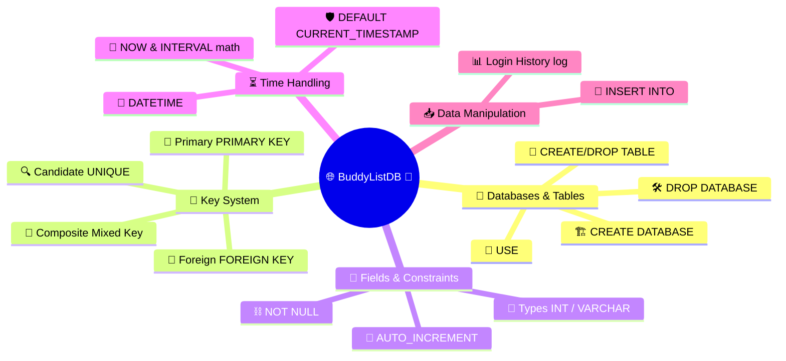
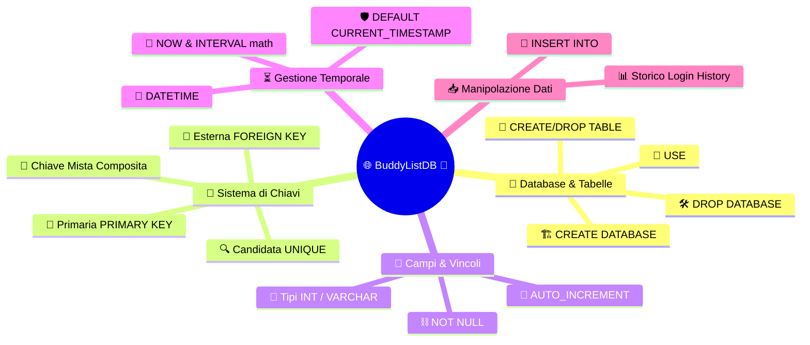

[](https://choosealicense.com/licenses/mit/)
[](https://opensource.org/licenses/)
[](http://www.gnu.org/licenses/agpl-3.0)

<a name="TOP"></a>

<a href="#IT"></a>
🤍
<a href="#EN"></a>

---

 <a name="EN"></A>

<!-- English -->

# 🚀💻 The Holy Bible of SQL and MySQL: An Epic Trip into the Heart of Data! 🔥✨

## 🌟 Introduction: Hey Everybody, Successful Developers! 🎙️👋

🎧 Welcome to this spectacular ride 🎢 deep into the guts of **SQL** and **MySQL**!

🧠⚡ As a veteran programmer 🧔‍♂️ who has watched servers crash at dawn 🌅, I'm telling you that understanding how databases 🗄️ breathe is the key 🔑 to becoming a true **Master of Code** 👑!

Today 🗓️ we'll go through the code of our glorious `BuddyListDB` 🌐 line by line 📜 to turn you into living legends 🦸‍♂️ of data! 🚀💾

## 🏰 1. Databases and Tables: Building and Destroying Digital Kingdoms 🔨💥

🤖 Before writing a single line of code ⌨️, we need to understand how to build 🏗️ and tear down 🗑️ the playing field! 🏟️

### 💣 `DROP DATABASE` & `CREATE DATABASE` 🌍

* 🔥 **Dropping a DB:** `DROP DATABASE IF EXISTS BuddyListDB;` 🛑 wipes the slate clean 🧹 if the database already exists 👻, avoiding catastrophic errors 💥!
* 🏗️ **Creating a DB:** `CREATE DATABASE IF NOT EXISTS BuddyListDB;` 🌟 lays the foundations 🧱 of our digital building 🏢 only if it isn't already there 🧐.
* 🚪 **Entering the DB:** `USE BuddyListDB;` 🗝️ opens the front door 🏠 to tell it: *"Hey MySQL, we're working in here!"* 🎯

### 🧹 `DROP TABLE` & `CREATE TABLE` 📦

* 🗑️ **Dropping a Table:** `DROP TABLE IF EXISTS UsersList;` 🧨 erases the old structure 🏚️ to make room for the new design ✨.
* 🧱 **Creating a Table:** `CREATE TABLE IF NOT EXISTS UsersList(...)` 🏗️ defines the columns 🧬 and the rules of engagement ⚔️ for our data 📊!

## 🔑 2. Cosmic Keys: Primary, Foreign and Candidate (Who's the Boss?) 👑🕵️‍♂️

🕵️‍♂️ In the database multiverse 🌌, keys 🗝️ are the fundamental laws 📜 that hold everything up 🏗️ without causing disasters 💥!

* 🔍 **Candidate Key:** It's any column 🧬 that could uniquely identify 🆔 a row! In our code 💻, the email (`email VARCHAR(48) NOT NULL UNIQUE KEY`) 📧 is a candidate key because **there can't be two users with the same email** 👯‍♂️❌!
* 👑 **Primary Key:** The queen 👸 of keys! 🎯 Every table **must** have one (`id INT PRIMARY KEY AUTO_INCREMENT`) 🆔. It's 100% unique 💯, can never be empty (`NULL`) 🕳️❌ and is used to find a record 🕵️‍♂️ at the speed of light ⚡!
* 🔗 **Foreign Key:** It's the Einstein-Rosen 🌀 bridge 🌉 that connects two different tables 🤝! In our script 📜, `user_fk` in the `LoginHistory` table looks the user's id 🧑‍💻 dead in the eye 👀 to know *who* made the login 🚪!

### 📊 Key Comparison Table ⚖️

| 🗝️ Key Type | 🎯 Main Goal | 🛑 Can be NULL? | 👯‍♂️ Allows Duplicates? |
| --- | --- | --- | --- |
| **🔍 Candidate** | Potentially identify a row 🧬 | ❌ No (if `NOT NULL`) | ❌ No (if `UNIQUE`) |
| **👑 Primary** | Uniquely identify every record 🆔 | ❌ Never! 🚫 | ❌ Never! 🚫 |
| **🔗 Foreign** | Link relationships between tables 🌉 | ⚠️ Depends (often No) | ✅ Yes (multiple logins for the same user) 🔄 |

## 🧱 3. Fields, Constraints and the Power of `NOT NULL` ⛓️⚠️

🧬 Fields (or columns) 📏 are the drawers 🗄️ of our digital desk 💻!

* 📝 **Field Types:** In our script we see `INT` 🔢 for whole numbers (like IDs) and `VARCHAR(48)` 🔤 for variable-length text strings 📜 (like email 📧 and password 🔑).
* ⛓️ **The `NOT NULL` Constraint:** It tells the database: *"Listen up 🎧, no messing around here 🛑! This field has to be filled in no matter what 📋, or I'll block everything!"* 🚫💻
* 🚀 **`AUTO_INCREMENT`:** A MySQL superpower 🦸‍♂️ that bumps the ID number up on its own 📈 (+1, +2, +3...) without you lifting a finger 🤌!

## 🧩 4. The Magic of the Composite Primary Key (When the FK Becomes a PK) ⚡🔄

🧐 **Big question for a Senior Developer!** 🧔‍♂️ *Under what conditions can we build a primary key out of a foreign key?* 🤔
👇 Check out this beauty 💎 in the code:

```sql
PRIMARY KEY (user_fk, login_at),
FOREIGN KEY (user_fk) REFERENCES Users(id)
```

⚡ It happens when we create a **Composite Primary Key** (or mixed key) 🧩!

* 🤝 A user (`user_fk`) can log in **many times** over time (`login_at`) 📅. So `user_fk` alone **can't** be a primary key (it would repeat) 🔄.
* 🎯 But the **pairing** of *who* logged in (`user_fk`) and *when* they did it (`login_at`) makes a pair that's **one of a kind** 🌍!
* 🛠️ And that's how the foreign key `user_fk`, combined with a timestamp, becomes an official part of the **primary key** of the `LoginHistory` table 👑🔗!

## ⏳ 5. Database Chrononauts: Handling DATETIME, Defaults and Intervals ⏰🚀

🕰️ Handling time ⏳ in databases is seriously awesome 🌟! Let's see how our code time-travels 🚀:

* 📅 **`DATETIME`:** Stores the exact date and time ⌚ (e.g. `YYYY-MM-DD HH:MM:SS`) 🗓️.
* 🛡️ **`DEFAULT CURRENT_TIMESTAMP`:** An automatic lifesaver 🛟! If you don't specify the date 📆 when you insert a row, MySQL slaps the current date and time right in there 📥, down to the millisecond ⚡!
* 🌀 **Time Arithmetic (`NOW() - INTERVAL`):**
* `NOW() - INTERVAL 1 DAY` ⏪ (One day ago) 📅
* `NOW() - INTERVAL 1 WEEK` ⏪ (One week ago) 🗓️
* `NOW() - INTERVAL 1 MONTH` ⏪ (One month ago) 🌙
* `NOW() - INTERVAL 1 YEAR` ⏪ (One year ago) 🪐
* `NOW() - INTERVAL 1 YEAR - INTERVAL 2 MONTH - INTERVAL 4 DAY` 🚀 (Extreme trip to the past: 1 year, 2 months and 4 days ago!) ⏳🧙‍♂️

## 📥 6. Inserting Data: Grocery Shopping at the Record Market (`INSERT INTO`) 🛒📝

🛒 To fill up our empty tables 🍽️ we use the `INSERT INTO` command ✍️, which is like filling your shopping cart 🛍️ at the data supermarket 🏢!

* 👥 **Populating Users (`UsersList`):**

```sql
INSERT INTO UsersList (email, passwd) VALUES
    ('amministratore@buddylist.it', 'Admin001!'),
    ('gennaro.esposito@example.com', 'Gennaro123!');
```

🎯 We list the columns in parentheses 📋 and fire off the matching values (`VALUES`) 🎯!
* 🚪 **Populating Logins (`LoginHistory`):**
We can insert past dates computed with intervals 🕰️ or lean on the default value (`NOW()`) ⚡ by simply leaving out the `login_at` column 🕳️✨!

## 🗺️ 7. Database Mind Map 🧠📊

🎨 To lock every concept into your long-term memory 💾, here's an epic mind map made with **Mermaid** 🗺️✨!



## 🎯 Conclusion and Super Vision 🌟👨‍💻

🎉 Folks, you've just climbed to the summit 🏔️ of the fundamental theory of SQL and MySQL 🚀! You've learned to build digital worlds 🌍, tie them together with magic keys 🗝️, bend time ⏳ and populate tables like real pros 💻✨!

💬 *Before I say goodbye and leave you to write stellar code 🌠:*

*Is there any other nuance, command or particular query 🧐 you'd like to dig into together to make this guide even more perfect for your needs?* 🎯👇


---

<a href="#IT"></a>
🤍
<a href="#EN"></a>

---

 <a name="IT"></A>

<!-- Italiano -->

# 🚀💻 La Sacra Bibbia di SQL e MySQL: Viaggio Epico nel Cuore dei Dati! 🔥✨

## 🌟 Introduzione: Salve a Tutti, Developer di Successo! 🎙️👋

🎧 Benvenuti in questo viaggio spettacolare 🎢 dentro le viscere di **SQL** e **MySQL**!

🧠⚡ Come un programmatore veterano 🧔‍♂️ che ha visto crashare server all'alba 🌅, vi dico che capire come respirano i database 🗄️ è la chiave 🔑 per diventare dei veri **Master of Code** 👑!

Oggi 🗓️ analizzeremo riga per riga 📜 il codice del nostro glorioso `BuddyListDB` 🌐 per trasformarvi in leggende viventi 🦸‍♂️ dei dati! 🚀💾

## 🏰 1. Database e Tabelle: Costruire e Distruggere Regni Digitali 🔨💥

🤖 Prima di scrivere una sola riga di codice ⌨️, dobbiamo capire come si crea 🏗️ e si distrugge 🗑️ il terreno di gioco! 🏟️

### 💣 `DROP DATABASE` & `CREATE DATABASE` 🌍

* 🔥 **Eliminare un DB:** `DROP DATABASE IF EXISTS BuddyListDB;` 🛑 serve a fare piazza pulita 🧹 se il database esiste già 👻, evitando errori catastrofici 💥!
* 🏗️ **Creare un DB:** `CREATE DATABASE IF NOT EXISTS BuddyListDB;` 🌟 alza le fondamenta 🧱 del nostro palazzo digitale 🏢 solo se non è già presente 🧐.
* 🚪 **Entrare nel DB:** `USE BuddyListDB;` 🗝️ apre la porta di casa 🏠 per dirgli: *"Ehi MySQL, lavoriamo qui dentro!"* 🎯

### 🧹 `DROP TABLE` & `CREATE TABLE` 📦

* 🗑️ **Eliminare una Tabella:** `DROP TABLE IF EXISTS UsersList;` 🧨 cancella la vecchia struttura 🏚️ per fare spazio al nuovo design ✨.
* 🧱 **Creare una Tabella:** `CREATE TABLE IF NOT EXISTS UsersList(...)` 🏗️ definisce le colonne 🧬 e le regole di ingaggio ⚔️ dei nostri dati 📊!

## 🔑 2. Chiavi Cosmiche: Primarie, Esterne e Candidate (Chi è il Boss?) 👑🕵️‍♂️

🕵️‍♂️ Nel multiverso 🌌 dei database, le chiavi 🗝️ sono le leggi fondamentali 📜 che tengono tutto in piedi 🏗️ senza fare disastri 💥!

* 🔍 **Chiave Candidata (Candidate Key):** È qualsiasi colonna 🧬 che potrebbe identificare univocamente 🆔 una riga! Nel nostro codice 💻, l'email (`email VARCHAR(48) NOT NULL UNIQUE KEY`) 📧 è una chiave candidata perché **non possono esserci due utenti con la stessa email** 👯‍♂️❌!
* 👑 **Chiave Primaria (Primary Key):** È la regina 👸 delle chiavi! 🎯 Ogni tabella **deve** averne una (`id INT PRIMARY KEY AUTO_INCREMENT`) 🆔. È unica al 100% 💯, non può mai essere vuota (`NULL`) 🕳️❌ e serve a trovare un record 🕵️‍♂️ alla velocità della luce ⚡!
* 🔗 **Chiave Esterna (Foreign Key):** È il ponte 🌉 di Einstein-Rosen 🌀 che collega due tabelle diverse 🤝! Nel nostro script 📜, `user_fk` nella tabella `LoginHistory` guarda dritto negli occhi 👀 l'id dell'utente 🧑‍💻 per sapere *chi* ha fatto il login 🚪!

### 📊 Tabella Comparativa delle Chiavi ⚖️

| 🗝️ Tipo di Chiave | 🎯 Obiettivo Principale | 🛑 Può essere NULL? | 👯‍♂️ Ammette Duplicati? |
| --- | --- | --- | --- |
| **🔍 Candidata** | Identificare potenzialmente una riga 🧬 | ❌ No (se `NOT NULL`) | ❌ No (se `UNIQUE`) |
| **👑 Primaria** | Identificare univocamente ogni record 🆔 | ❌ Mai! 🚫 | ❌ Mai! 🚫 |
| **🔗 Esterna** | Collegare relazioni tra tabelle 🌉 | ⚠️ Dipende (spesso No) | ✅ Sì (più login per lo stesso utente) 🔄 |

## 🧱 3. Campi, Vincoli e il Potere del `NOT NULL` ⛓️⚠️

🧬 I campi (o colonne) 📏 sono i cassetti 🗄️ della nostra scrivania digitale 💻!

* 📝 **Tipi di Campo:** Nel nostro script vediamo `INT` 🔢 per i numeri interi (come gli ID) e `VARCHAR(48)` 🔤 per le stringhe di testo 📜 a lunghezza variabile (come email 📧 e password 🔑).
* ⛓️ **Il Vincolo `NOT NULL`:** Dice al database: *"Ascolta 🎧, qui non si scherza 🛑! Questo campo deve essere riempito per forza 📋, altrimenti ti blocco tutto!"* 🚫💻
* 🚀 **`AUTO_INCREMENT`:** Un superpotere 🦸‍♂️ di MySQL che incrementa il numero ID da solo 📈 (+1, +2, +3...) senza che tu debba muovere un dito 🤌!

## 🧩 4. La Magia della Chiave Primaria Mista (Quando la FK diventa PK) ⚡🔄

🧐 **Domandona da Senior Developer!** 🧔‍♂️ *In quali condizioni possiamo creare una chiave primaria a partire da una chiave esterna?* 🤔
👇 Guardate questa meraviglia 💎 nel codice:

```sql
PRIMARY KEY (user_fk, login_at),
FOREIGN KEY (user_fk) REFERENCES Users(id)
```

⚡ Succede quando creiamo una **Chiave Primaria Composita** (o mista) 🧩!

* 🤝 Un utente (`user_fk`) può fare **molti login** nel corso del tempo (`login_at`) 📅. Quindi `user_fk` da solo **non** può essere una chiave primaria (si ripeterebbe) 🔄.
* 🎯 Ma l'**accoppiata** tra *chi* si è loggato (`user_fk`) e *quando* lo ha fatto (`login_at`) forma una coppia **unica al mondo** 🌍!
* 🛠️ Ecco che la chiave esterna `user_fk`, unita a un timestamp, diventa parte ufficiale della **chiave primaria** della tabella `LoginHistory` 👑🔗!

## ⏳ 5. Crononauti del Database: Gestione del DATETIME, Default e Intervalli ⏰🚀

🕰️ Gestire il tempo ⏳ nei database è una figata pazzesca 🌟! Vediamo come il nostro codice viaggia nel tempo 🚀:

* 📅 **`DATETIME`:** Memorizza data e ora esatte ⌚ (es. `YYYY-MM-DD HH:MM:SS`) 🗓️.
* 🛡️ **`DEFAULT CURRENT_TIMESTAMP`:** Un salvagente automatico 🛟! Se non specifichi la data 📆 quando inserisci una riga, MySQL ci schiaffa dentro 📥 la data e l'ora attuali al millisecondo ⚡!
* 🌀 **Aritmetica Temporale (`NOW() - INTERVAL`):**
* `NOW() - INTERVAL 1 DAY` ⏪ (Un giorno fa) 📅
* `NOW() - INTERVAL 1 WEEK` ⏪ (Una settimana fa) 🗓️
* `NOW() - INTERVAL 1 MONTH` ⏪ (Un mese fa) 🌙
* `NOW() - INTERVAL 1 YEAR` ⏪ (Un anno fa) 🪐
* `NOW() - INTERVAL 1 YEAR - INTERVAL 2 MONTH - INTERVAL 4 DAY` 🚀 (Viaggio nel passato estremo di 1 anno, 2 mesi e 4 giorni fa!) ⏳🧙‍♂️

## 📥 6. Inserire Dati: La Spesa al Mercato dei Record (`INSERT INTO`) 🛒📝

🛒 Per riempire le nostre tabelle vuote 🍽️ usiamo il comando `INSERT INTO` ✍️, che è come riempire il carrello della spesa 🛍️ al supermercato dei dati 🏢!

* 👥 **Popolamento Utenti (`UsersList`):**

```sql
INSERT INTO UsersList (email, passwd) VALUES
    ('amministratore@buddylist.it', 'Admin001!'),
    ('gennaro.esposito@example.com', 'Gennaro123!');
```

🎯 Specifichiamo le colonne tra parentesi 📋 e spariamo i valori corrispondenti (`VALUES`) 🎯!
* 🚪 **Popolamento Accessi (`LoginHistory`):**
Possiamo inserire sia date passate calcolate con gli intervalli 🕰️ sia sfruttare il valore di default (`NOW()`) ⚡ semplicemente omettendo la colonna `login_at` 🕳️✨!

## 🗺️ 7. Mappa Mentale del Database 🧠📊

🎨 Per fissare ogni concetto nella memoria a lungo termine 💾, ecco a voi una mappa mentale epica creata con **Mermaid** 🗺️✨!



## 🎯 Conclusione e Super Visione 🌟👨‍💻

🎉 Ragazzi, avete appena scalato la vetta 🏔️ della teoria fondamentale di SQL e MySQL 🚀! Avete imparato a costruire mondi digitali 🌍, legarli con chiavi magiche 🗝️, manipolare il tempo ⏳ e popolare tabelle come veri professionisti 💻✨!

💬 *Prima di salutarvi e lasciarvi a scrivere codice stellare 🌠:*

*C'è qualche altra sfumatura, comando o query particolare 🧐 che vorreste approfondire insieme per rendere questa guida ancora più perfetta per le vostre esigenze?* 🎯👇

<a href="#TOP">&utrif; top &utrif;</a>

## 🔗 Links
[](https://www.linkedin.com/in/biagio-rosario-greco-77145774/)
[](https://twitter.com/birg_81)
[](mailto:birg81@gmail.com)