[](https://choosealicense.com/licenses/mit/)
[](https://opensource.org/licenses/)
[](http://www.gnu.org/licenses/agpl-3.0)

<a name="TOP"></a>

<a href="#IT"></a>
🤍
<a href="#EN"></a>

---

 <a name="EN"></A>

<!-- English -->

# 🐍 Python for Rebels:

## from C, Java and JavaScript to Python in one long ride

> 🎙️ *"You've already tamed curly braces, semicolons and declared types. Now you're about to find out you can do more by typing less."*

| 🎯 Who it's for | 📦 What you need | 🐍 Version | ⏱️ Reading time |
|---|---|---|---|
| Students who already know C/C++, Java/C#, JavaScript | Python installed and an editor | Python 3.10 or newer | about 40 minutes |

## 📑 Index

- [🎬 The hook: why Python?](#hook-EN)
- [🚀 Chapter 1 · Python 101](#cap01-EN)
- [✂️ Chapter 2 · Bye-bye `;`, `()` and `{}`](#cap02-EN)
- [💬 Chapter 3 · Comments and string-comments](#cap03-EN)
- [📦 Chapter 4 · Variables and types](#cap04-EN)
- [🔤 Chapter 5 · Strings](#cap05-EN)
- [🖨️ Chapter 6 · `print()` and `input()`](#cap06-EN)
- [⚖️ Chapter 7 · Operators and logic](#cap07-EN)
- [🔀 Chapter 8 · Branching: `if`, ternary and `match`](#cap08-EN)
- [📋 Chapter 9 · Lists: arrays on steroids](#cap09-EN)
- [🗂️ Chapter 10 · Tuples, sets and dictionaries](#cap10-EN)
- [⚗️ Chapter 11 · Conversions, comprehensions, `any`/`all`](#cap11-EN)
- [🔁 Chapter 12 · Loops](#cap12-EN)
- [⚙️ Chapter 13 · Functions and procedures](#cap13-EN)
- [🚨 Chapter 14 · Errors: `try`, `except`, `raise`](#cap14-EN)
- [📚 Chapter 15 · Modules and `import`](#cap15-EN)
- [🏆 Final thoughts](#fine-EN)
- [🗺️ The map of everything you've learned](#mappa-EN)

<a id="hook-EN"></a>
## 🎬 The hook: why Python?

Picture yourself at a pizzeria with your friends. In Java you'd order like this: *"Good evening, I'd like a pizza, margherita, of type Pizza, named Margherita, thank you, end of order;"*. In Python you say: *"One margherita."* And you get the exact same pizza. 🍕

The classic "Hello, world" says it all:

**C**
```C
#include <stdio.h>
int main() {
	printf("Hello\n");
	return 0;
}
```

**Java**
```java
public class Main {
	public static void main(String[] args) {
		System.out.println("Hello");
	}
}
```

**JavaScript**

```JavaScript
console.log("Hello");
```

🐍 **Python**

```python
print("Hello")
```

Python bets everything on **readability**: the code reads almost like a sentence. Its unwritten motto is *"if it looks like pseudocode, it's probably valid Python"*.

### 🗾 Our roadmap

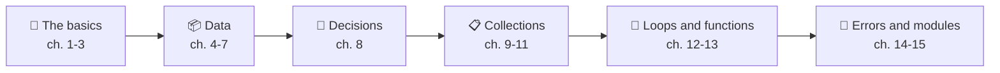

> 💡 **Golden rule of the ride:** every time you read "in C you do it like this", ask yourself *"how many lines does Python save me?"*.

<a id="cap01-EN"></a>
## 🚀 Chapter 1 · Python 101

### 🧱 What kind of language is it?

Python is **interpreted**: the interpreter reads your code, translates it into *bytecode* and runs it on a virtual machine, a bit like Java, except you never have to fire up a compiler by hand.

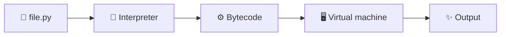

| Feature | C/C++ | Java/C# | JavaScript | 🐍 Python |
|---|---|---|---|---|
| Execution | compiled to machine code | compiled to bytecode | interpreted/JIT | interpreted (bytecode) |
| Types | static | static | dynamic | dynamic but strong |
| `main` required | yes | yes | no | **no** |

### ▶️ Three ways to run code

1. **REPL**: type `python3` in the terminal and try lines one at a time (the prompt is `>>>`).
2. **Script**: save a `game.py` file and run `python3 game.py`.
3. **Editor/IDE**: VS Code or PyCharm, hit the "Run" button.

```python
# The shortest program ever: no main, no class
print("Player one ready!")
```

> 🎮 **Real-life comparison:** the REPL is the *practice mode* of a video game: try whatever moves you like. The script is the *real match*.

#### Reflection 🦊
*Python doesn't ask permission to get going: write one line and it runs. The rest of the ride is about doing it right.*

<a id="cap02-EN"></a>
## ✂️ Chapter 2 · Bye-bye `;`, `()` and `{}`

### 🔚 End of line, conditions, blocks

In Python a **line ends when you hit Enter**, and a block is defined by **indentation**, not curly braces. Three swaps to remember:

| In C/Java/JS | In 🐍 Python |
|---|---|
| `;` at the end of a statement | nothing: just start a new line |
| `( )` around the condition | nothing (you can use them, but you don't need to) |
| `{ }` for the block | `:` at the end of the line + **indentation** |

Let's compare the same check:

```c
if (hp <= 0) {
	printf("Game over");
	lives--;
}
```

```python
if hp <= 0:
	print("Game over")
	lives -= 1
```

### 📐 The rules of the game

- ✅ After `if`, `for`, `while`, `def`, `else`... you always put `:`.
- ✅ Every line in the same block has **the same indentation**.
- ❌ Inconsistent indentation: `IndentationError`. Mixing tabs and spaces: `TabError`.
- 🧱 Empty block? Use `pass`, the "placeholder".

```python
if lives == 0:
	print("Game over")
	if score > 100:
		print("...but what a record!")		# block inside a block
else:
	pass								# nothing to do here
```

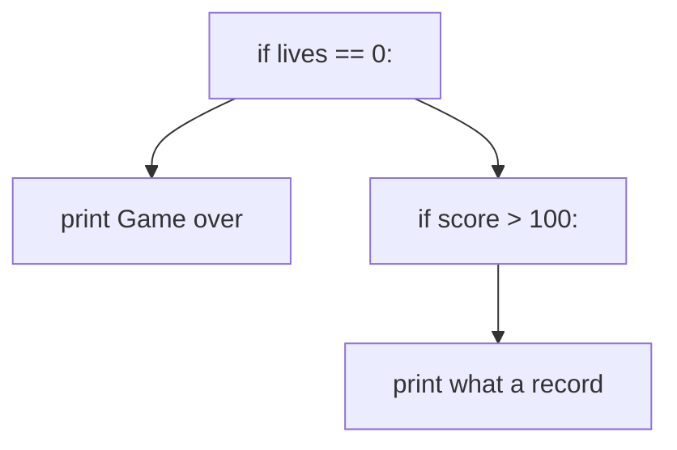

> 📏 **PEP 8 note:** the official style guide recommends **4 spaces** per level. In this guide we use the **tab**, which works perfectly as long as you're *consistent*: all tabs or all spaces, never mixed.

> 🚗 **Real-life comparison:** indentation is like highway lanes. Change lanes without signaling and your code (like the traffic) goes haywire.

Multiple statements on the same line? You can with `;`, but please don't. Got a super long line? Break it inside `( )`, `[ ]` or `{ }`, or use `\`.

#### Reflection 🧩
*Other languages let you lay out your code however you like, Python makes you do it its way: the upside is that everybody's code looks like it was written by the same hand.*

<a id="cap03-EN"></a>
## 💬 Chapter 3 · Comments and string-comments

### 📝 Single-line comment

A comment starts with `#` and runs to the end of the line. No `//` here.

```python
# Damage calculation
damage = 25		# end-of-line comment
```

### 📜 Multiline comment: the trick

Python **doesn't have** `/* ... */`. What you do instead is use a **multiline string** (triple quotes) and just leave it hanging there without assigning it: the interpreter evaluates it and throws it away.

```python
"""
This is a string, but I'm using it as a comment.
It can span as many lines as I want.
"""
```

If the string is the **first statement** of a function or module, it's called a **docstring** and becomes the official documentation:

```python
def heal(player):
	"""Returns the player with 20 extra health points."""
	return player + 20
```

| Language | Single line | Multiline |
|---|---|---|
| C/Java/JS | `//` | `/* ... */` |
| 🐍 Python | `#` | `""" ... """` (unassigned string) |

> 💡 **Pro-programmer tip:** comment the *why*, not the *what*. `x += 1 # add 1` is noise; `# loyalty bonus` is information.

#### Reflection 🪄
*A useful comment is a sticky note left for future-you: three months from now you'll be the one saying thanks.*

<a id="cap04-EN"></a>
## 📦 Chapter 4 · Variables and types

### 🏷️ A variable is a label, not a box

In C a variable is a **box with a fixed type**. In Python it's a **label** (a name) stuck onto an object. That's why you don't have to declare the type: the object carries it.

```python
player_name = "Luna"		# str
level = 7					# int
health = 86.5				# float
is_alive = True			# bool
shield = None				# NoneType: "no value" (like null)
```

| Type | Example | Equivalent elsewhere |
|---|---|---|
| `int` | `42` | `int`/`long` (here with no size limit!) |
| `float` | `3.14` | `double` |
| `bool` | `True`, `False` | `true`/`false` (capital first letter!) |
| `str` | `"hello"` | `String`, `char*` |
| `NoneType` | `None` | `null`, `NULL` |

### 🔄 The type can change during its lifetime

The label can be moved onto another object:

```python
score = 10				# int
score = "ten"			# now it's a str: Python doesn't complain
print(type(score))	# <class 'str'>
```

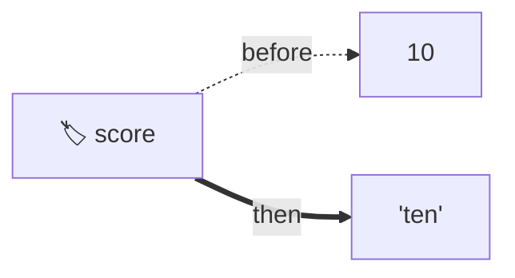

Heads up though: Python is **strongly typed**. It won't quietly mix types, unlike JavaScript:

```python
print("5" + 3)		# TypeError! (in JS you'd get "53")
print(int("5") + 3)	# 8, with an explicit conversion
```

### 🔧 Casting and basic conversions

| Function | What it does | Example | Result |
|---|---|---|---|
| `int()` | to integer | `int("42")` | `42` |
| `float()` | to decimal | `float("3.5")` | `3.5` |
| `str()` | to string | `str(10)` | `"10"` |
| `bool()` | to boolean | `bool(0)` | `False` |

### 🗑️ Deleting a variable

```python
temp = 99
del temp
print(temp)	# NameError: the label doesn't exist anymore
```

### 🎁 Handy extras

```python
x = y = 0				# same value for two names
hp, mp = 100, 50		# multiple assignment
MAX_LEVEL = 99			# CONSTANT by convention only (uppercase)
```

> 📛 **Convention:** names are written in `snake_case` (`player_name`), not `camelCase`.

#### Reflection 🧪
*Dynamic typing doesn't mean "no types": it means the check moves from compile time to run time. More freedom, more responsibility.*

<a id="cap05-EN"></a>
## 🔤 Chapter 5 · Strings

### ✍️ Single, double and triple quotes

```python
a = 'Hello'
b = "It's a me!"		# double quotes to use ' inside
c = 'He said "stop"'		# single quotes to use " inside
story = """First line
Second line
Third line"""				# multiline string
```

There's no `char` type: a single character is just a string of length 1.

### 🔗 Concatenating, interpolating, multiplying

```python
name = "Luna"
level = 7

greeting = "Hi " + name					# concatenation
msg = f"{name} is at level {level}"		# f-string: interpolation
bar = "=" * 20						# the * operator: repeats the string
print(f"Damage: {12.3456:.1f}")		# Damage: 12.3
```

| Language | Interpolation |
|---|---|
| C | `sprintf(buf, "%s is at level %d", name, level)` |
| Java | `String.format("%s is at level %d", name, level)` |
| JavaScript | `` `${name} is at level ${level}` `` |
| 🐍 Python | `f"{name} is at level {level}"` |

> 🍕 **Real-life example:** `"🍕" * 3` prints three pizzas, like ordering "x3" off the menu.

### 🧰 Four things to know

- 🔒 Strings are **immutable**: `name[0] = "X"` raises a `TypeError`.
- 📏 `len(name)` gives the length, `name[0]` the first character, `name[-1]` the last.
- ✂️ Slicing works here too: `name[1:3]` gives `"un"`.
- 🧼 Handy methods: `upper()`, `lower()`, `strip()`, `split()`, `replace()`.

```python
print("  hello  ".strip().upper())	# HELLO
print("a,b,c".split(","))				# ['a', 'b', 'c']
```

#### Reflection 🎻
*F-strings are like a script with blanks to fill in: write the scene and let the values play their part.*

<a id="cap06-EN"></a>
## 🖨️ Chapter 6 · `print()` and `input()`

### 📢 `print()`: automatic newline, but tweakable

| Language | Print with newline |
|---|---|
| C | `printf("Hello\n");` |
| Java | `System.out.println("Hello");` |
| C# | `Console.WriteLine("Hello");` |
| JavaScript | `console.log("Hello");` |
| 🐍 Python | `print("Hello")` |

The special parameters are `end` (what to put at the end) and `sep` (what to put between items):

```python
print("Loading", end="")		# no newline
print(".", end="")
print(" done!")				# Loading. done!

print("A", "B", "C", sep=" | ")	# A | B | C
print("Score:", 100)				# Score: 100 (separated by a space)
```

### ⌨️ `input()`: always a string

```python
name = input("What's your name? ")
age = int(input("How old are you? "))	# casting is a must
print(f"In 5 years you'll be {age + 5}")
```

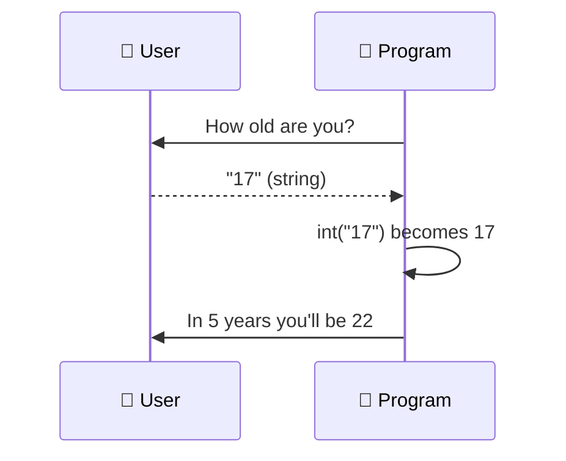

> 🎯 **Classic gotcha:** `input()` **always returns `str`**. Forget `int()` and `"17" + 5` will blow up.

#### Reflection 🔔
*The conversation between program and user follows one rule: everything coming from the keyboard is text, until you decide what it means.*

<a id="cap07-EN"></a>
## ⚖️ Chapter 7 · Operators and logic

### ➕ Arithmetic: watch out for division

| Operator | Meaning | Example | Result |
|---|---|---|---|
| `/` | division, **always decimal** | `7 / 2` | `3.5` |
| `//` | integer division | `7 // 2` | `3` |
| `%` | remainder | `7 % 2` | `1` |
| `**` | power | `2 ** 5` | `32` |

There's no `++` or `--`: you write `x += 1` and `x -= 1`.

### 🧠 Logical operators: in plain words

| C/Java/JS | 🐍 Python |
|---|---|
| `&&` | `and` |
| `\|\|` | `or` |
| `!` | `not` |

```python
has_key = True
door_open = False
if has_key and not door_open:
	print("You can open the door")
```

They **short-circuit**: `a and b` doesn't evaluate `b` if `a` is already false.

### 🔗 Chained comparison: `0 < x < n`

In C, `0 < x < 10` is syntactically valid but **wrong**: it evaluates `(0 < x)`, which is 0 or 1, then compares that to 10. In Python it works like in math class.

```c
if (x > 0 && x < 10) {			// C: you need two comparisons
	...
}
```

```python
if 0 < x < 10:					# Python: like on the blackboard
	print("You're in range")
```

```python
speed = 90
print(0 < speed <= 130)		# True: within the highway limit 🚗
```

### 🔍 More handy operators

- `in` / `not in`: membership (`"a" in "casa"` gives `True`).
- `==` compares **values**, `is` compares **identity** (same object). You use `is None`.
- **Truthy/falsy:** `0`, `""`, `[]`, `{}`, `None` count as `False` in conditions; everything else counts as `True`.

```python
items = []
if not items:				# true if the list is empty
	print("Empty backpack")
```

#### Reflection 🧭
*Writing `0 < x < 10` like in a math notebook proves a language can speak the language of the people using it.*

<a id="cap08-EN"></a>
## 🔀 Chapter 8 · Branching: `if`, ternary and `match`

### 🌳 `if` / `elif` / `else`

`else if` becomes `elif`. No parentheses, no braces.

```python
hp = 35
if hp > 70:
	status = "healthy"
elif hp > 30:
	status = "wounded"
else:
	status = "critical"
```

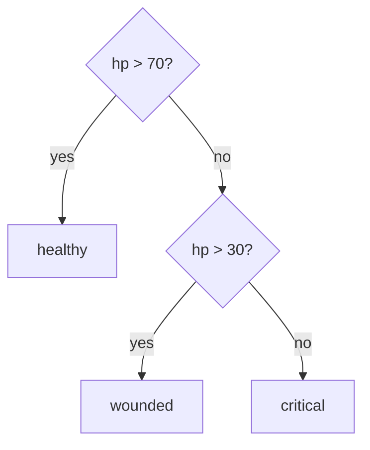

### ❓ The ternary operator: here Python flips the order

```javascript
const status = hp > 30 ? "alive" : "critical";	// C, Java, JS: condition ? a : b
```

```python
status = "alive" if hp > 30 else "critical"	# Python: a if condition else b
```

It reads like a sentence: *"alive if hp is greater than 30, otherwise critical"*.

### 🎛️ `match` / `case`: the "evolved sibling" of `switch`

Available since Python 3.10. Key differences:

| Aspect | `switch` (C/Java/JS) | `match` (🐍 Python) |
|---|---|---|
| `break` | required | **not needed** |
| Fall-through | yes (bug factory) | no |
| Fallback case | `default` | `case _` |
| Multiple values | `case 1: case 2:` | `case 1 \| 2:` |
| What it matches | values only | values, tuples, structures |

```python
command = "sprint"
match command:
	case "jump":
		print("You jump!")
	case "run" | "sprint":		# several alternatives in the same case
		print("You run!")
	case _:							# the "default"
		print("Unknown command")
```

With tuples, `match` gets seriously powerful:

```python
position = (0, 5)
match position:
	case (0, 0):
		print("You're at the origin")
	case (0, y):						# grabs y automatically
		print(f"You're on the Y axis, at height {y}")
	case (x, y) if x == y:		# with a guard
		print("You're on the diagonal")
```

> 🎮 **Real-life example:** `match` is a video game menu: every button has its own action and none of them "leaks" into the next.

#### Reflection 🚦
*A good `match` is a road sign: every direction is clear and nobody ends up in the next lane by accident.*

<a id="cap09-EN"></a>
## 📋 Chapter 9 · Lists: arrays on steroids

### 💪 Why "on steroids"?

A C/Java array is a row of slots that are **all the same type and fixed in size**. A Python list has three superpowers:

1. 🎭 **Heterogeneous:** it can hold different types.
2. 📏 **Dynamic:** it grows and shrinks as you like.
3. ✏️ **Mutable:** you can change, add and remove elements.

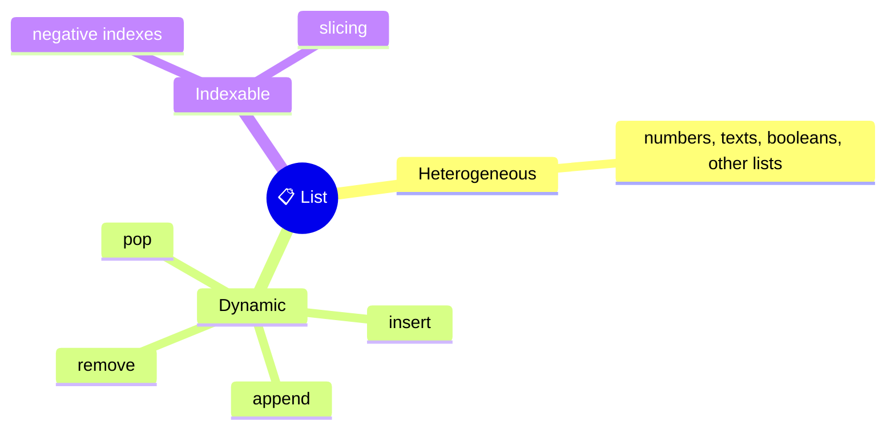

> 🎒 **Real-life comparison:** an array is an egg carton (12 slots, eggs only). A list is a **video game backpack**: you stash sword, potions, map, and when you need room you just make some.

```python
backpack = ["sword", 3, 2.5, True, ["potion", "map"]]	# everything together

backpack.append("torch")			# adds at the end
backpack.insert(0, "shield")		# adds at position 0
backpack.remove(3)				# removes the value 3
last = backpack.pop()				# removes and returns the last one
print(len(backpack))				# current length
```

### ✂️ Negative indexes and slicing

| Element | `"A"` | `"B"` | `"C"` | `"D"` |
|---|---|---|---|---|
| Index | 0 | 1 | 2 | 3 |
| Negative index | -4 | -3 | -2 | -1 |

```python
letters = ["A", "B", "C", "D"]
print(letters[-1])		# D: the last one, no len - 1 math
print(letters[1:3])		# ['B', 'C']: from 1 up to 3, excluded
print(letters[:2])		# ['A', 'B']
print(letters[::2])		# ['A', 'C']: every other element
print(letters[::-1])		# ['D', 'C', 'B', 'A']: reversed
```

### ✖️ `*`, `in` and a warning

```python
zeros = [0] * 5				# [0, 0, 0, 0, 0]
print("sword" in backpack)	# True or False
```

> ⚠️ **Gotcha:** `b = a` **doesn't copy** the list, it just gives it a second name. To copy, use `b = a.copy()` or `b = a[:]`.

#### Reflection 🪂
*A list isn't a rigid container but a stretchy backpack. Just remember that when two names point to the same backpack, both see it change.*

<a id="cap10-EN"></a>
## 🗂️ Chapter 10 · Tuples, sets and dictionaries

### 🧰 The four collections side by side

| Collection | Syntax | Ordered | Mutable | Duplicates | Typical use |
|---|---|---|---|---|---|
| `list` | `[1, 2]` | ✅ | ✅ | ✅ | general-purpose list |
| `tuple` | `(1, 2)` | ✅ | ❌ | ✅ | coordinates, fixed data |
| `set` | `{1, 2}` | ❌ | ✅ | ❌ | unique elements |
| `dict` | `{"a": 1}` | ✅ (insertion) | ✅ | unique keys | key/value pairs |

### 📌 Tuples: "sealed" lists

```python
spawn_point = (10, 25)
x, y = spawn_point			# unpacking
spawn_point[0] = 99			# TypeError: tuples can't be modified
```

#### 🔄 Swapping variables

```c
int tmp = a;			// C: you need a helper variable
a = b;
b = tmp;
```

```python
a, b = b, a			# Python: one line, thanks to tuples
```

### 🎟️ Sets: the guest list

Every element appears **only once**. Perfect for weeding out duplicates and for set algebra.

```python
team_a = {"Luna", "Marco", "Sara"}
team_b = {"Sara", "Paolo"}
print(team_a | team_b)		# union
print(team_a & team_b)		# intersection: {'Sara'}
print(team_a - team_b)		# difference
empty_set = set()			# a bare {} creates a dict!
```

### 📖 Dictionaries: the phone book

```python
hero = {"name": "Luna", "level": 7, "class": "mage"}
print(hero["name"])			# Luna
hero["level"] = 8				# update
hero["gold"] = 120			# adds a new key
print(hero.get("pet", "none"))	# default value if the key is missing
del hero["class"]				# removes a pair
print("name" in hero)			# True: `in` checks the KEYS
```

### 🔎 The `in` operator on `[]`, `()`, `{}`

```python
print(3 in [1, 2, 3])		# True
print(3 in (1, 2, 3))		# True
print(3 in {1, 2, 3})		# True, and blazing fast on sets
print("a" in {"a": 1})		# True: it looks at the keys
```

### ✖️ The `*` operator: who accepts it?

| Type | `*` allowed? | Example |
|---|---|---|
| `str` | ✅ | `"ab" * 3` gives `"ababab"` |
| `list` | ✅ | `[0] * 3` gives `[0, 0, 0]` |
| `tuple` | ✅ | `(1, 2) * 2` gives `(1, 2, 1, 2)` |
| `set` | ❌ | `TypeError` (no duplicates allowed) |
| `dict` | ❌ | `TypeError` (keys are unique) |

#### Reflection 🗝️
*Each collection answers a different question: "in what order?", "can it change?", "any duplicates?", "how do I find it?". Picking the right one is half the program.*

<a id="cap11-EN"></a>
## ⚗️ Chapter 11 · Conversions, comprehensions, `any` and `all`

### 🔁 Converting between collections

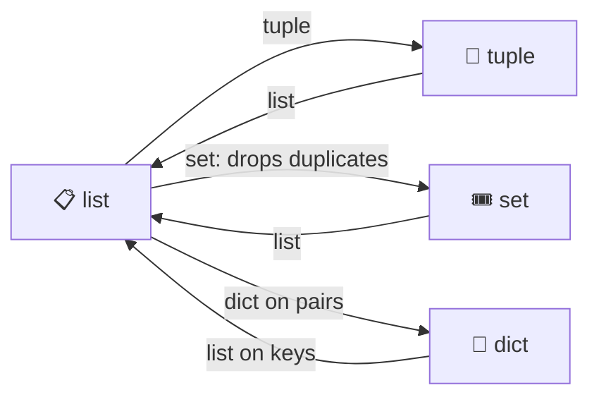

```python
nums = [3, 1, 3, 2, 1]
print(set(nums))				# {1, 2, 3}: duplicates gone
print(tuple(nums))			# (3, 1, 3, 2, 1)
print(sorted(set(nums)))		# [1, 2, 3]: unique and sorted
pairs = [("hp", 100), ("mp", 50)]
print(dict(pairs))			# {'hp': 100, 'mp': 50}
print(list("ciao"))			# ['c', 'i', 'a', 'o']
```

### ⚡ List comprehension: the loop inside the list

Where in C/Java you'd fill an array with a loop, in Python you write one line:

```java
int[] squares = new int[5];
for (int i = 0; i < 5; i++) {
	squares[i] = i * i;
}
```

```python
squares = [i * i for i in range(5)]		# [0, 1, 4, 9, 16]
```

Mental template: `[ what_I_produce for element in source if condition ]`.

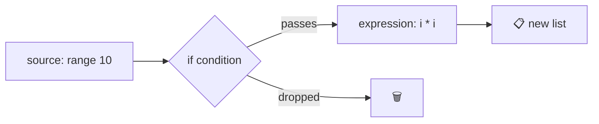

#### 🎯 With `if` and with `if/else`

```python
evens = [n for n in range(10) if n % 2 == 0]			# filters: [0, 2, 4, 6, 8]
labels = ["even" if n % 2 == 0 else "odd" for n in range(4)]	# transforms
# ['even', 'odd', 'even', 'odd']
```

> 🧠 **Burn this in:** `if` **after** the `for` *filters*; `if/else` **before** the `for` *picks the value*.

#### 📖 Dictionary and set comprehensions

```python
squares_map = {n: n * n for n in range(4)}		# {0: 0, 1: 1, 2: 4, 3: 9}
initials = {name[0] for name in ["Luna", "Lia", "Marco"]}	# {'L', 'M'}
```

Even two nested loops fit on one line:

```python
pairs = [(x, y) for x in range(2) for y in range(2)]	# [(0,0), (0,1), (1,0), (1,1)]
```

### 🕵️ `any()` and `all()`

- `any(...)`: true if **at least one** is true (a generalized "or").
- `all(...)`: true if **all of them** are true (a generalized "and").

```python
scores = [45, 80, 92]
print(any(s > 90 for s in scores))		# True: there's a champ
print(all(s >= 50 for s in scores))		# False: 45 doesn't make the cut
```

> 👫 **Real-life example:** to decide whether to go out with your friends, `any(friends_free)` is enough to get going, `all(friends_free)` is what you need for the group photo.

#### Reflection 🧬
*Comprehension is a way of thinking: instead of saying "how" to build a list, you say "what" it contains.*

<a id="cap12-EN"></a>
## 🔁 Chapter 12 · Loops

### 🔄 `while`

Same as other languages, minus the parentheses. **There's no `do...while`**: you fake it with `while True` and `break`.

```python
energy = 3
while energy > 0:
	print(f"Running... energy {energy}")
	energy -= 1
```

```python
while True:						# Python's "do-while"
	answer = input("Continue? (y/n) ")
	if answer == "n":
		break
```

### 🔢 `for` and `range`

Python's `for` **doesn't have** the `for (int i = 0; i < n; i++)` form. It iterates over a **sequence**:

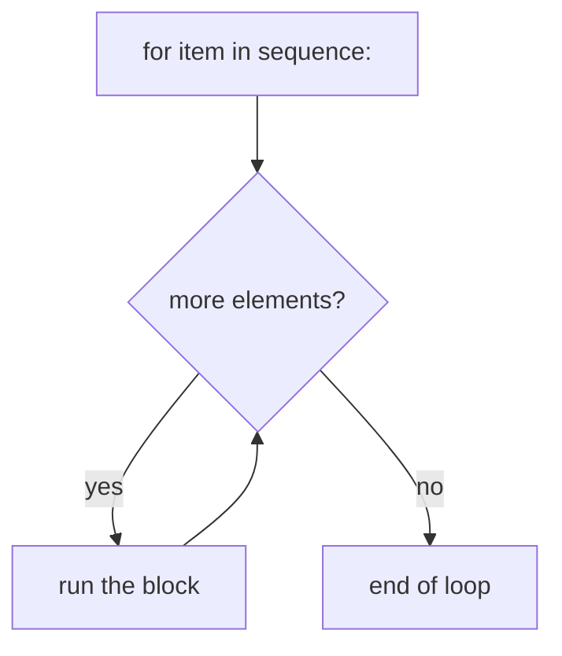

| Call | Produces |
|---|---|
| `range(5)` | 0, 1, 2, 3, 4 |
| `range(2, 6)` | 2, 3, 4, 5 |
| `range(0, 10, 3)` | 0, 3, 6, 9 |
| `range(5, 0, -1)` | 5, 4, 3, 2, 1 |

```python
for lap in range(1, 4):
	print(f"Lap {lap}")
```

### 🔍 Iterating over collections

```python
for item in ["sword", "map"]:				# list
	print(item)
for letter in "ciao":					# string
	print(letter)
for tag in {"rpg", "indie"}:				# set (order not guaranteed)
	print(tag)

hero = {"name": "Luna", "level": 7}
for key in hero:						# keys
	print(key)
for key, value in hero.items():			# key and value together
	print(f"{key} = {value}")
```

### 🧲 `enumerate` and `zip`

```python
friends = ["Luna", "Marco", "Sara"]
cars = ["Fiat 500", "Mini", "Golf"]

for i, name in enumerate(friends, start=1):	# numbers the elements
	print(i, name)						# 1 Luna, 2 Marco, 3 Sara

for friend, car in zip(friends, cars):		# two lists in parallel
	print(f"{friend} drives a {car}")
```

### ⛔ `break`, `continue` and the mysterious `else`

- `break` exits the loop, `continue` jumps to the next round.
- `else` on a loop fires **only if the loop wasn't cut short by `break`**.

```python
for guest in ["Luna", "Marco"]:
	if guest == "Paolo":
		print("Paolo's here!")
		break
else:
	print("Paolo didn't show up at the party")	# printed: no break happened
```

#### Reflection 🎡
*Python doesn't ask you to count laps with an index: it asks you to look at the elements. Less arithmetic, fewer off-by-one errors.*

<a id="cap13-EN"></a>
## ⚙️ Chapter 13 · Functions and procedures

### 🧱 `def`: one keyword for functions and procedures

No `void`, no return types. A **function** returns a value with `return`; a **procedure** (no `return`) implicitly returns `None`.

```python
def double(n):				# function
	return n * 2

def greet(name):			# procedure: does something, returns nothing
	print(f"Hi {name}!")
```

You can return **multiple values** at once: under the hood it's a tuple.

```python
def min_max(values):
	return min(values), max(values)

lowest, highest = min_max([4, 9, 1])	# 1 and 9
```

### 🍔 Default values and named arguments

> 🍔 **Comparison:** ordering at a fast-food joint: "one burger" comes with fries by default, but you can say *"no onions, double cheese"* in any order, as long as you name the ingredients.

```python
def attack(target, damage=10, critical=False):
	if critical:
		damage *= 2
	print(f"You hit {target} for {damage}")

attack("orc")						# You hit orc for 10
attack("orc", critical=True)			# You hit orc for 20
attack(damage=50, target="troll")		# order swapped: You hit troll for 50
```

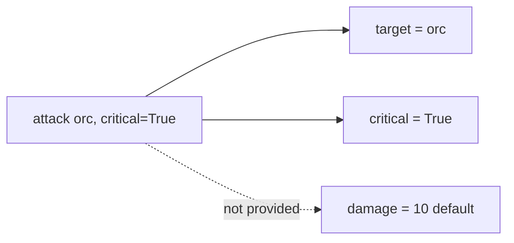

Golden rules:

- 📌 Parameters with defaults go **after** the ones without.
- 📌 **Positional** arguments first, then **named** ones.
- ⚠️ Don't use lists or dictionaries as defaults (`def f(x=[])`): they're shared across calls. Use `None`.

### 🎒 `*args` and `**kwargs`

- `*args` collects extra positional arguments into a **tuple**.
- `**kwargs` collects extra named arguments into a **dictionary**.

```python
def party_score(*args):
	return sum(args)

print(party_score(10, 20, 30))		# 60

def create_character(name, **kwargs):
	print(name, kwargs)

create_character("Luna", level=7, pet="fox")
# Luna {'level': 7, 'pet': 'fox'}
```

The same asterisk, in a call, "unpacks": `party_score(*[1, 2, 3])`.

#### Reflection 🛠️
*A well-written function works like a good menu: plenty of options, but whoever has no preferences orders without thinking.*

<a id="cap14-EN"></a>
## 🚨 Chapter 14 · Errors: `try`, `except`, `raise`

### 🩹 Handling the unexpected

Instead of `catch`, Python uses `except`; instead of `throw`, it uses `raise`.

```python
try:
	age = int(input("How old are you? "))
except ValueError:
	print("Enter a number!")
else:
	print(f"You're {age} years old")		# only if there were NO errors
finally:
	print("End of the check")			# always runs
```

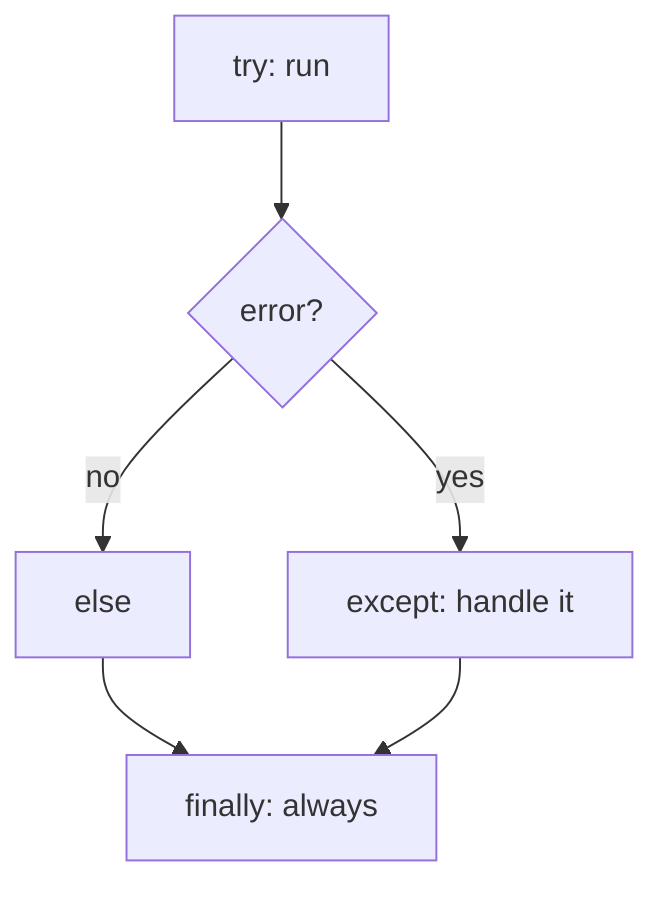

### 📋 The most common exceptions

| Exception | When it happens | Example |
|---|---|---|
| `ValueError` | right type, wrong content | `int("ciao")` |
| `TypeError` | wrong type | `"5" + 3` |
| `ZeroDivisionError` | division by zero | `10 / 0` |
| `IndexError` | index out of range | `[1, 2][5]` |
| `KeyError` | missing key | `{"a": 1}["b"]` |
| `NameError` | nonexistent variable | `print(unknown)` |

You can catch multiple errors and read the message:

```python
try:
	result = 10 / int(input("Divide by: "))
except (ValueError, ZeroDivisionError) as error:
	print(f"Problem: {error}")
```

### 🚩 `raise`: throwing an error on purpose

```python
def set_level(level):
	if not 1 <= level <= 99:
		raise ValueError("Level must be between 1 and 99")
	return level
```

> 🏎️ **Real-life comparison:** `try/except` is the airbag. You don't need it while everything's fine, but when you do, it saves your skin.

#### Reflection 🧯
*Errors aren't enemies: they're messages. A well-handled exception turns a crash into a conversation.*

<a id="cap15-EN"></a>
## 📚 Chapter 15 · Modules and `import`

### 🧱 Every `.py` file is a module

Building a "library" just means saving functions in a file and importing it somewhere else. No headers, no `package` to declare.

```python
# File: game_utils.py
import random

MAX_HEALTH = 100

def roll_dice(sides=6):
	return random.randint(1, sides)

def heal(health, amount=20):
	return min(health + amount, MAX_HEALTH)
```

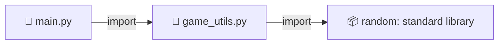

### 📥 Ways to import

```python
import game_utils					# use: game_utils.roll_dice()
import game_utils as gu				# alias: gu.roll_dice()
from game_utils import roll_dice		# use directly: roll_dice()
from game_utils import heal as restore	# alias for a single name

from game_utils import (				# several items over multiple lines
	roll_dice,
	heal,
	MAX_HEALTH,
)
```

| Syntax | Pros | Cons |
|---|---|---|
| `import module` | clear, tidy names | longer to type |
| `from module import x` | short code | name clashes possible |
| `from module import *` | super quick | ❌ not recommended: you can't tell what's coming in |

> 🔤 **Comparisons:** `#include` (C), `import` (Java), `using` (C#), `import ... from` (JS). Python uses a single keyword and also tells you *what* to grab.

### 🚪 `if __name__ == "__main__":`

Every module has a `__name__` variable. If you run it directly it's `"__main__"`, if you import it it's the file's name. That way you can keep test code that **doesn't fire** when the file gets imported.

```python
# At the bottom of game_utils.py
if __name__ == "__main__":
	print("Dice test:", roll_dice())
```

> ⚠️ **Mind the name:** don't call one of your own files `random.py` or `math.py`: it would shadow the standard library.

#### Reflection 🏁
*A file is a building block: written well once, reused forever. That's how small scripts grow into real projects.*

<a id="fine-EN"></a>
## 🏆 Final thoughts

We've crossed a whole ecosystem: from a one-line program all the way to reusable modules. If you read carefully, you can now read other people's Python code and write your own. 🎉

| 🎯 Concept | ⚔️ Old school | 🐍 Python style |
|---|---|---|
| Blocks | `{ }` | `:` + indentation |
| Logic | `&&`, `\|\|`, `!` | `and`, `or`, `not` |
| Range | `x > 0 && x < n` | `0 < x < n` |
| Swap | temp variable | `a, b = b, a` |
| Ternary | `c ? a : b` | `a if c else b` |
| Filling arrays | `for` loop | comprehension |
| Switch | `switch/break` | `match/case` |
| Errors | `try/catch` | `try/except` |

> 💬 *"Readability counts."* That's the principle behind it all: if code reads well, it's easy to write and quick to fix.

### 🔭 Next stops

In the next chapters of the ride we'll tackle **classes and objects**, **reading and writing files**, **virtual environments** and **pip**.

<a id="mappa-EN"></a>
## 🗺️ The map of everything you've learned

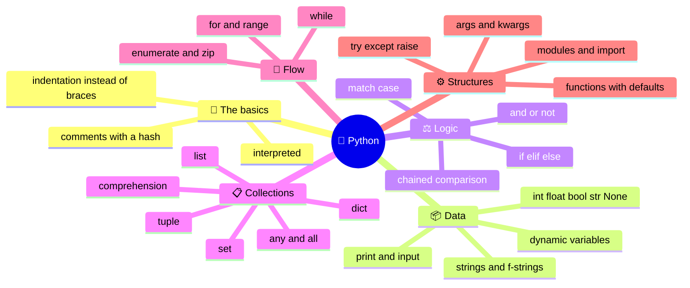

🎬 ***And that's a wrap!***
*every pro programmer was once a beginner who never quit trying*! 🚀

---

<a href="#IT"></a>
🤍
<a href="#EN"></a>

---

 <a name="IT"></A>

<!-- Italiano -->

# 🐍 Python for Rebels:

## da C, Java e JavaScript a Python in un solo, lungo viaggio

> 🎙️ *"Avete già domato le parentesi graffe, i punti e virgola e i tipi dichiarati. Ora scoprirete che si può fare di più scrivendo di meno."*

| 🎯 Per chi è | 📦 Cosa serve | 🐍 Versione | ⏱️ Lettura |
|---|---|---|---|
| Studenti che conoscono C/C++, Java/C#, JavaScript | Python installato e un editor | Python 3.10 o superiore | circa 40 minuti |

## 📑 Indice

- [🎬 Il gancio: perché Python?](#hook-IT)
- [🚀 Capitolo 1 · L'ABC di Python](#cap01-IT)
- [✂️ Capitolo 2 · Addio a `;`, `()` e `{}`](#cap02-IT)
- [💬 Capitolo 3 · Commenti e stringhe-commento](#cap03-IT)
- [📦 Capitolo 4 · Variabili e tipi](#cap04-IT)
- [🔤 Capitolo 5 · Stringhe](#cap05-IT)
- [🖨️ Capitolo 6 · `print()` e `input()`](#cap06-IT)
- [⚖️ Capitolo 7 · Operatori e logica](#cap07-IT)
- [🔀 Capitolo 8 · Selezioni: `if`, ternario e `match`](#cap08-IT)
- [📋 Capitolo 9 · Liste: gli array dopati](#cap09-IT)
- [🗂️ Capitolo 10 · Tuple, set e dizionari](#cap10-IT)
- [⚗️ Capitolo 11 · Conversioni, comprehension, `any`/`all`](#cap11-IT)
- [🔁 Capitolo 12 · Cicli](#cap12-IT)
- [⚙️ Capitolo 13 · Funzioni e procedure](#cap13-IT)
- [🚨 Capitolo 14 · Errori: `try`, `except`, `raise`](#cap14-IT)
- [📚 Capitolo 15 · Moduli e `import`](#cap15-IT)
- [🏆 Considerazioni finali](#fine-IT)
- [🗺️ La mappa di tutto ciò che hai imparato](#mappa-IT)

<a id="hook-IT"></a>
## 🎬 Il gancio: perché Python?

Immaginate di essere in pizzeria con gli amici. In Java ordinate così: *"Buonasera, vorrei una pizza, margherita, di tipo Pizza, con nome Margherita, grazie, fine ordine;"*. In Python dite: *"Una margherita."* E arriva lo stesso la pizza. 🍕

Il classico "Hello, world" lo dimostra:

**C**
```C
#include <stdio.h>
int main() {
	printf("Hello\n");
	return 0;
}
```

**Java**
```java
public class Main {
	public static void main(String[] args) {
		System.out.println("Hello");
	}
}
```

**JavaScript**

```JavaScript
console.log("Hello");
```

🐍 **Python**

```python
print("Hello")
```

Python punta tutto sulla **leggibilità**: il codice si legge quasi come una frase. Il suo motto non scritto è *"se sembra pseudocodice, probabilmente è Python valido"*.

### 🗾 Il nostro itinerario

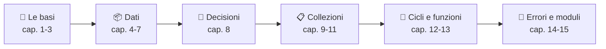

> 💡 **Regola d'oro del viaggio:** ogni volta che leggete "in C si fa così", chiedetevi *"quante righe mi risparmia Python?"*.

<a id="cap01-IT"></a>
## 🚀 Capitolo 1 · L'ABC di Python

### 🧱 Che tipo di linguaggio è?

Python è **interpretato**: l'interprete legge il codice, lo traduce in *bytecode* e lo esegue su una macchina virtuale, un po' come Java ma senza che dobbiate lanciare un compilatore a mano.

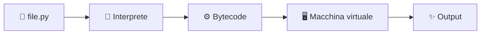

| Caratteristica | C/C++ | Java/C# | JavaScript | 🐍 Python |
|---|---|---|---|---|
| Esecuzione | compilato in codice macchina | compilato in bytecode | interpretato/JIT | interpretato (bytecode) |
| Tipi | statici | statici | dinamici | dinamici ma forti |
| `main` obbligatorio | sì | sì | no | **no** |

### ▶️ Tre modi per eseguire codice

1. **REPL**: scrivete `python3` nel terminale e provate le righe una alla volta (il prompt è `>>>`).
2. **Script**: salvate un file `game.py` e lanciate `python3 game.py`.
3. **Editor/IDE**: VS Code o PyCharm, con il tasto "Run".

```python
# Il programma più corto del mondo: nessun main, nessuna classe
print("Player one ready!")
```

> 🎮 **Paragone di vita reale:** il REPL è la modalità *allenamento* di un videogioco: provate mosse a piacere. Lo script è la *partita vera*.

#### Riflessione 🦊
*Python non vi chiede il permesso di partire: scrivete una riga e funziona. Il resto del viaggio serve a farlo bene.*

<a id="cap02-IT"></a>
## ✂️ Capitolo 2 · Addio a `;`, `()` e `{}`

### 🔚 Fine riga, condizioni, blocchi

In Python la **riga finisce quando va a capo** e un blocco è definito dall'**indentazione**, non da graffe. Tre sostituzioni da ricordare:

| In C/Java/JS | In 🐍 Python |
|---|---|
| `;` a fine istruzione | niente: basta andare a capo |
| `( )` attorno alla condizione | niente (si possono usare, ma non servono) |
| `{ }` per il blocco | `:` alla fine della riga + **indentazione** |

Confrontiamo lo stesso controllo:

```c
if (hp <= 0) {
	printf("Game over");
	lives--;
}
```

```python
if hp <= 0:
	print("Game over")
	lives -= 1
```

### 📐 Le regole del gioco

- ✅ Dopo `if`, `for`, `while`, `def`, `else`... va sempre `:`.
- ✅ Tutte le righe dello stesso blocco hanno **la stessa indentazione**.
- ❌ Indentazione incoerente: `IndentationError`. Mescolare tab e spazi: `TabError`.
- 🧱 Blocco vuoto? Usate `pass`, il "segnaposto".

```python
if lives == 0:
	print("Game over")
	if score > 100:
		print("...ma che record!")		# blocco dentro un blocco
else:
	pass								# niente da fare qui
```

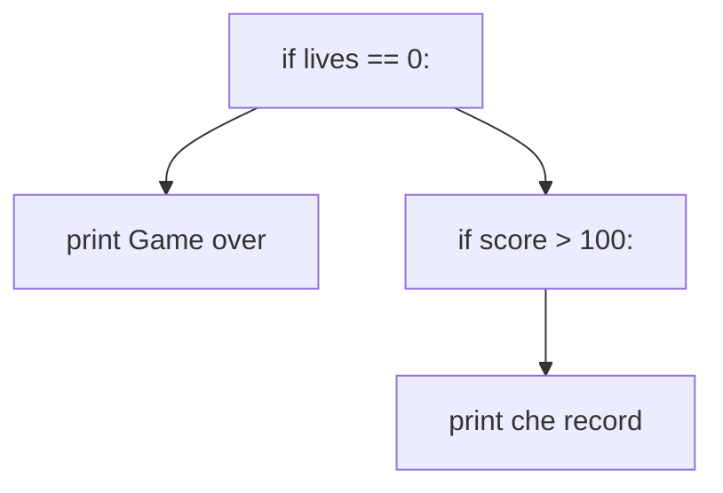

> 📏 **Nota PEP 8:** la guida di stile ufficiale consiglia **4 spazi** per livello. In questa guida usiamo il **tab**, che funziona benissimo purché siate *coerenti*: o tutti tab o tutti spazi, mai mescolati.

> 🚗 **Paragone:** l'indentazione è come le corsie di un'autostrada. Se cambiate corsia senza segnalarlo, il codice (come il traffico) va in tilt.

Più istruzioni sulla stessa riga? Si può con `;`, ma è sconsigliato. Una riga molto lunga? Si spezza dentro `( )`, `[ ]` o `{ }` oppure con `\`.

#### Riflessione 🧩
*Gli altri linguaggi vi lasciano libertà di impaginare, Python vi obbliga: il risultato è che il codice di tutti sembra scritto dalla stessa mano.*

<a id="cap03-IT"></a>
## 💬 Capitolo 3 · Commenti e stringhe-commento

### 📝 Commento su singola riga

Il commento inizia con `#` e arriva a fine riga. Niente `//`.

```python
# Calcolo dei danni
damage = 25		# commento a fine riga
```

### 📜 Commento multilinea: il trucco

Python **non ha** `/* ... */`. Si usa però una **stringa multilinea** (tre apici) lasciata lì senza assegnarla: l'interprete la valuta e la scarta.

```python
"""
Questa è una stringa, ma la uso come commento.
Può occupare quante righe voglio.
"""
```

Se la stringa è la **prima istruzione** di una funzione o di un modulo, prende il nome di **docstring** e diventa la documentazione ufficiale:

```python
def heal(player):
	"""Restituisce il giocatore con 20 punti vita in più."""
	return player + 20
```

| Linguaggio | Riga singola | Multilinea |
|---|---|---|
| C/Java/JS | `//` | `/* ... */` |
| 🐍 Python | `#` | `""" ... """` (stringa non assegnata) |

> 💡 **Consiglio da programmatore pro:** commentate il *perché*, non il *cosa*. `x += 1 # aggiungo 1` è rumore; `# bonus fedeltà` è informazione.

#### Riflessione 🪄
*Un commento utile è un biglietto lasciato al "voi" del futuro: tra tre mesi sarete voi stessi a ringraziarvi.*

<a id="cap04-IT"></a>
## 📦 Capitolo 4 · Variabili e tipi

### 🏷️ Una variabile è un'etichetta, non una scatola

In C una variabile è una **scatola con un tipo fisso**. In Python è un'**etichetta** (un nome) che si attacca a un oggetto. Per questo non serve dichiarare il tipo: è l'oggetto ad averlo.

```python
player_name = "Luna"		# str
level = 7					# int
health = 86.5				# float
is_alive = True			# bool
shield = None				# NoneType: "nessun valore" (come null)
```

| Tipo | Esempio | Equivalente altrove |
|---|---|---|
| `int` | `42` | `int`/`long` (qui senza limite di grandezza!) |
| `float` | `3.14` | `double` |
| `bool` | `True`, `False` | `true`/`false` (maiuscola iniziale!) |
| `str` | `"ciao"` | `String`, `char*` |
| `NoneType` | `None` | `null`, `NULL` |

### 🔄 Il tipo può cambiare durante la vita

L'etichetta si può spostare su un altro oggetto:

```python
score = 10				# int
score = "ten"			# ora è str: Python non protesta
print(type(score))	# <class 'str'>
```

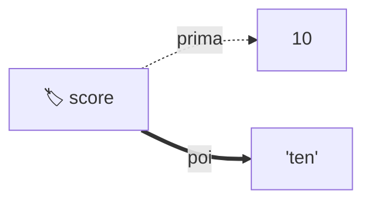

Attenzione però: Python è **fortemente tipizzato**. Non mescola tipi in silenzio, a differenza di JavaScript:

```python
print("5" + 3)		# TypeError! (in JS darebbe "53")
print(int("5") + 3)	# 8, con la conversione esplicita
```

### 🔧 Casting e conversioni di base

| Funzione | Cosa fa | Esempio | Risultato |
|---|---|---|---|
| `int()` | a intero | `int("42")` | `42` |
| `float()` | a decimale | `float("3.5")` | `3.5` |
| `str()` | a stringa | `str(10)` | `"10"` |
| `bool()` | a booleano | `bool(0)` | `False` |

### 🗑️ Eliminare una variabile

```python
temp = 99
del temp
print(temp)	# NameError: l'etichetta non esiste più
```

### 🎁 Extra utili

```python
x = y = 0				# stesso valore a due nomi
hp, mp = 100, 50		# assegnazione multipla
MAX_LEVEL = 99			# COSTANTE solo per convenzione (maiuscolo)
```

> 📛 **Convenzione:** i nomi si scrivono in `snake_case` (`player_name`), non in `camelCase`.

#### Riflessione 🧪
*Tipo dinamico non significa "nessun tipo": significa che il controllo si sposta dalla compilazione al momento dell'esecuzione. Più libertà, più responsabilità.*

<a id="cap05-IT"></a>
## 🔤 Capitolo 5 · Stringhe

### ✍️ Apici singoli, doppi e tripli

```python
a = 'Hello'
b = "It's a me!"		# doppi apici per usare ' dentro
c = 'Disse "stop"'		# apici singoli per usare " dentro
story = """Prima riga
Seconda riga
Terza riga"""				# stringa multilinea
```

Non esiste il tipo `char`: un carattere è una stringa di lunghezza 1.

### 🔗 Concatenare, interpolare, moltiplicare

```python
name = "Luna"
level = 7

greeting = "Ciao " + name					# concatenazione
msg = f"{name} è al livello {level}"		# f-string: interpolazione
bar = "=" * 20						# operatore * : ripete la stringa
print(f"Danno: {12.3456:.1f}")		# Danno: 12.3
```

| Linguaggio | Interpolazione |
|---|---|
| C | `sprintf(buf, "%s è al livello %d", name, level)` |
| Java | `String.format("%s è al livello %d", name, level)` |
| JavaScript | `` `${name} è al livello ${level}` `` |
| 🐍 Python | `f"{name} è al livello {level}"` |

> 🍕 **Esempio reale:** `"🍕" * 3` stampa tre pizze, come ordinare "x3" nel menu.

### 🧰 Quattro cose da sapere

- 🔒 Le stringhe sono **immutabili**: `name[0] = "X"` genera `TypeError`.
- 📏 `len(name)` dà la lunghezza, `name[0]` il primo carattere, `name[-1]` l'ultimo.
- ✂️ Lo slicing funziona anche qui: `name[1:3]` dà `"un"`.
- 🧼 Metodi comodi: `upper()`, `lower()`, `strip()`, `split()`, `replace()`.

```python
print("  hello  ".strip().upper())	# HELLO
print("a,b,c".split(","))				# ['a', 'b', 'c']
```

#### Riflessione 🎻
*Le f-string sono come una sceneggiatura con buchi da riempire: scrivete la scena e lasciate che i valori recitino la loro parte.*

<a id="cap06-IT"></a>
## 🖨️ Capitolo 6 · `print()` e `input()`

### 📢 `print()`: a capo automatico, ma regolabile

| Linguaggio | Stampa con a capo |
|---|---|
| C | `printf("Hello\n");` |
| Java | `System.out.println("Hello");` |
| C# | `Console.WriteLine("Hello");` |
| JavaScript | `console.log("Hello");` |
| 🐍 Python | `print("Hello")` |

I parametri speciali sono `end` (cosa mettere in fondo) e `sep` (cosa mettere tra gli elementi):

```python
print("Loading", end="")		# niente a capo
print(".", end="")
print(" done!")				# Loading. done!

print("A", "B", "C", sep=" | ")	# A | B | C
print("Score:", 100)				# Score: 100 (separati da spazio)
```

### ⌨️ `input()`: sempre una stringa

```python
name = input("Come ti chiami? ")
age = int(input("Quanti anni hai? "))	# casting obbligatorio
print(f"Tra 5 anni avrai {age + 5} anni")
```

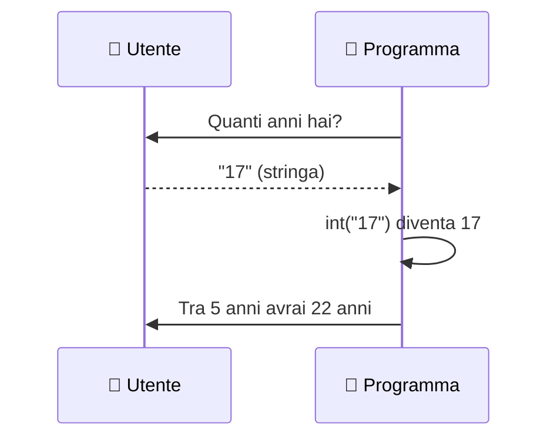

> 🎯 **Trappola classica:** `input()` restituisce **sempre `str`**. Se dimenticate `int()`, `"17" + 5` darà errore.

#### Riflessione 🔔
*La conversazione tra programma e utente ha una regola: tutto ciò che arriva dalla tastiera è testo, finché non decidete voi cosa significa.*

<a id="cap07-IT"></a>
## ⚖️ Capitolo 7 · Operatori e logica

### ➕ Aritmetica: attenzione alla divisione

| Operatore | Significato | Esempio | Risultato |
|---|---|---|---|
| `/` | divisione **sempre decimale** | `7 / 2` | `3.5` |
| `//` | divisione intera | `7 // 2` | `3` |
| `%` | resto | `7 % 2` | `1` |
| `**` | potenza | `2 ** 5` | `32` |

Non esistono `++` e `--`: si scrive `x += 1` e `x -= 1`.

### 🧠 Operatori logici: a parole

| C/Java/JS | 🐍 Python |
|---|---|
| `&&` | `and` |
| `\|\|` | `or` |
| `!` | `not` |

```python
has_key = True
door_open = False
if has_key and not door_open:
	print("Puoi aprire la porta")
```

Sono a **corto circuito**: `a and b` non valuta `b` se `a` è già falso.

### 🔗 Il confronto concatenato: `0 < x < n`

In C `0 < x < 10` è sintatticamente valido ma **sbagliato**: valuta `(0 < x)` che vale 0 o 1, poi lo confronta con 10. In Python funziona come in matematica.

```c
if (x > 0 && x < 10) {			// C: servono due confronti
	...
}
```

```python
if 0 < x < 10:					# Python: come sulla lavagna
	print("Sei nel range")
```

```python
speed = 90
print(0 < speed <= 130)		# True: dentro il limite in autostrada 🚗
```

### 🔍 Altri operatori comodi

- `in` / `not in`: appartenenza (`"a" in "casa"` dà `True`).
- `==` confronta i **valori**, `is` confronta l'**identità** (stesso oggetto). Si usa `is None`.
- **Truthy/falsy:** `0`, `""`, `[]`, `{}`, `None` valgono `False` nelle condizioni; tutto il resto vale `True`.

```python
items = []
if not items:				# vero se la lista è vuota
	print("Zaino vuoto")
```

#### Riflessione 🧭
*Scrivere `0 < x < 10` come in un quaderno di matematica è la prova che un linguaggio può parlare la lingua di chi lo usa.*

<a id="cap08-IT"></a>
## 🔀 Capitolo 8 · Selezioni: `if`, ternario e `match`

### 🌳 `if` / `elif` / `else`

`else if` diventa `elif`. Niente parentesi, niente graffe.

```python
hp = 35
if hp > 70:
	status = "healthy"
elif hp > 30:
	status = "wounded"
else:
	status = "critical"
```

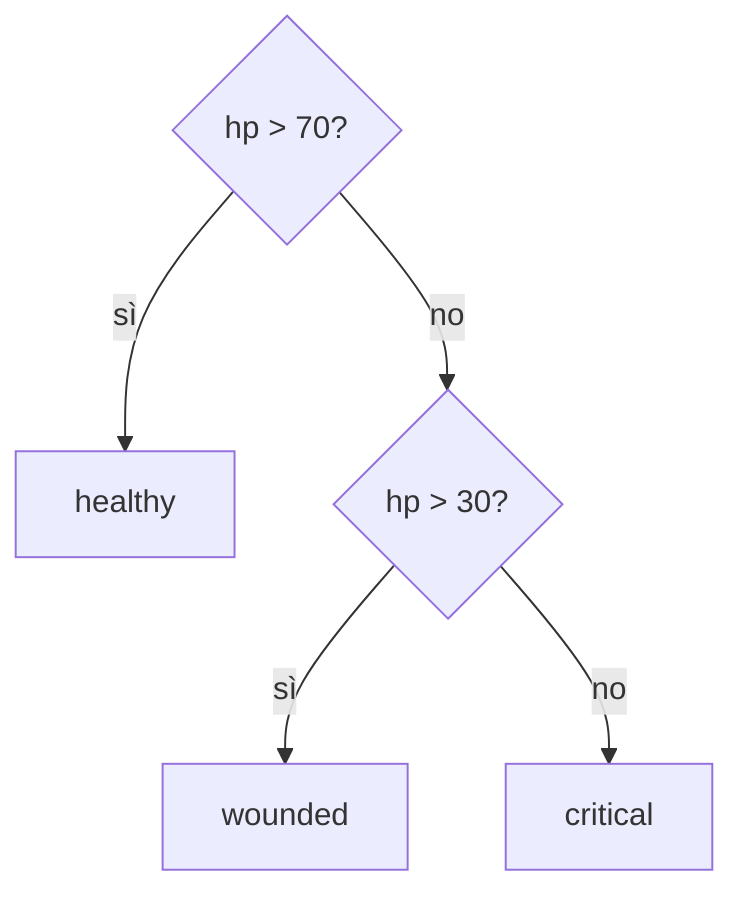

### ❓ L'operatore ternario: qui Python cambia ordine

```javascript
const status = hp > 30 ? "alive" : "critical";	// C, Java, JS: condizione ? a : b
```

```python
status = "alive" if hp > 30 else "critical"	# Python: a if condizione else b
```

Si legge come una frase: *"alive se hp è maggiore di 30, altrimenti critical"*.

### 🎛️ `match` / `case`: il "fratello evoluto" dello `switch`

Disponibile da Python 3.10. Differenze importanti:

| Aspetto | `switch` (C/Java/JS) | `match` (🐍 Python) |
|---|---|---|
| `break` | necessario | **non serve** |
| Fall-through | sì (fonte di bug) | no |
| Caso predefinito | `default` | `case _` |
| Più valori | `case 1: case 2:` | `case 1 \| 2:` |
| Cosa confronta | solo valori | valori, tuple, strutture |

```python
command = "sprint"
match command:
	case "jump":
		print("Salti!")
	case "run" | "sprint":		# più alternative nello stesso caso
		print("Corri!")
	case _:							# il "default"
		print("Comando sconosciuto")
```

Con le tuple il `match` diventa potentissimo:

```python
position = (0, 5)
match position:
	case (0, 0):
		print("Sei all'origine")
	case (0, y):						# estrae y automaticamente
		print(f"Sei sull'asse Y, a quota {y}")
	case (x, y) if x == y:		# con una guardia
		print("Sei sulla diagonale")
```

> 🎮 **Esempio reale:** il `match` è il menu di un videogioco: ogni tasto ha la sua azione e nessuna "cade" nella successiva.

#### Riflessione 🚦
*Un buon `match` è un cartello stradale: ogni direzione è chiara e nessuno finisce per sbaglio nella corsia accanto.*

<a id="cap09-IT"></a>
## 📋 Capitolo 9 · Liste: gli array dopati

### 💪 Perché "dopati"?

Un array di C/Java è una fila di caselle **tutte dello stesso tipo e di grandezza fissa**. La lista di Python ha tre superpoteri:

1. 🎭 **Eterogenea:** può contenere tipi diversi.
2. 📏 **Dinamica:** si allunga e si accorcia a piacimento.
3. ✏️ **Modificabile:** gli elementi si cambiano, si aggiungono, si tolgono.

```mermaid
mindmap
	root((📋 Lista))
		Eterogenea
			numeri, testi, booleani, altre liste
		Dinamica
			append
			insert
			pop
			remove
		Indicizzabile
			indici negativi
			slicing
```

> 🎒 **Paragone di vita reale:** un array è un portauova (12 buchi, solo uova). La lista è lo **zaino di un videogioco**: ci metti spada, pozioni, mappa e quando serve fai spazio.

```python
backpack = ["sword", 3, 2.5, True, ["potion", "map"]]	# tutto insieme

backpack.append("torch")			# aggiunge in fondo
backpack.insert(0, "shield")		# aggiunge in posizione 0
backpack.remove(3)				# toglie il valore 3
last = backpack.pop()				# toglie e restituisce l'ultimo
print(len(backpack))				# lunghezza attuale
```

### ✂️ Indici negativi e slicing

| Elemento | `"A"` | `"B"` | `"C"` | `"D"` |
|---|---|---|---|---|
| Indice | 0 | 1 | 2 | 3 |
| Indice negativo | -4 | -3 | -2 | -1 |

```python
letters = ["A", "B", "C", "D"]
print(letters[-1])		# D: l'ultimo, senza calcolare len - 1
print(letters[1:3])		# ['B', 'C']: dal 1 al 3 escluso
print(letters[:2])		# ['A', 'B']
print(letters[::2])		# ['A', 'C']: un elemento ogni due
print(letters[::-1])		# ['D', 'C', 'B', 'A']: invertita
```

### ✖️ `*`, `in` e un avviso

```python
zeros = [0] * 5				# [0, 0, 0, 0, 0]
print("sword" in backpack)	# True o False
```

> ⚠️ **Trappola:** `b = a` **non copia** la lista, le dà un secondo nome. Per copiare usate `b = a.copy()` oppure `b = a[:]`.

#### Riflessione 🪂
*Una lista non è un contenitore rigido ma uno zaino elastico. Ricordate però che quando due nomi puntano allo stesso zaino, entrambi lo vedono cambiare.*

<a id="cap10-IT"></a>
## 🗂️ Capitolo 10 · Tuple, set e dizionari

### 🧰 Le quattro collezioni a confronto

| Collezione | Sintassi | Ordinata | Modificabile | Duplicati | Uso tipico |
|---|---|---|---|---|---|
| `list` | `[1, 2]` | ✅ | ✅ | ✅ | elenco generico |
| `tuple` | `(1, 2)` | ✅ | ❌ | ✅ | coordinate, dati fissi |
| `set` | `{1, 2}` | ❌ | ✅ | ❌ | elementi unici |
| `dict` | `{"a": 1}` | ✅ (inserimento) | ✅ | chiavi uniche | coppie chiave/valore |

### 📌 Tuple: liste "sigillate"

```python
spawn_point = (10, 25)
x, y = spawn_point			# spacchettamento (unpacking)
spawn_point[0] = 99			# TypeError: le tuple non si modificano
```

#### 🔄 Lo scambio di variabili

```c
int tmp = a;			// C: serve una variabile d'appoggio
a = b;
b = tmp;
```

```python
a, b = b, a			# Python: una riga sola, grazie alle tuple
```

### 🎟️ Set: l'elenco degli invitati

Ogni elemento compare **una volta sola**. Perfetto per togliere i doppioni e per l'algebra degli insiemi.

```python
team_a = {"Luna", "Marco", "Sara"}
team_b = {"Sara", "Paolo"}
print(team_a | team_b)		# unione
print(team_a & team_b)		# intersezione: {'Sara'}
print(team_a - team_b)		# differenza
empty_set = set()			# {} da solo crea un dict!
```

### 📖 Dizionari: la rubrica del telefono

```python
hero = {"name": "Luna", "level": 7, "class": "mage"}
print(hero["name"])			# Luna
hero["level"] = 8				# modifica
hero["gold"] = 120			# aggiunge una nuova chiave
print(hero.get("pet", "none"))	# valore di default se manca la chiave
del hero["class"]				# elimina una coppia
print("name" in hero)			# True: `in` controlla le CHIAVI
```

### 🔎 L'operatore `in` su `[]`, `()`, `{}`

```python
print(3 in [1, 2, 3])		# True
print(3 in (1, 2, 3))		# True
print(3 in {1, 2, 3})		# True, e velocissimo sui set
print("a" in {"a": 1})		# True: guarda le chiavi
```

### ✖️ L'operatore `*`: chi lo accetta?

| Tipo | `*` valido? | Esempio |
|---|---|---|
| `str` | ✅ | `"ab" * 3` dà `"ababab"` |
| `list` | ✅ | `[0] * 3` dà `[0, 0, 0]` |
| `tuple` | ✅ | `(1, 2) * 2` dà `(1, 2, 1, 2)` |
| `set` | ❌ | `TypeError` (i duplicati non esistono) |
| `dict` | ❌ | `TypeError` (le chiavi sono uniche) |

#### Riflessione 🗝️
*Ogni collezione risponde a una domanda diversa: "in che ordine?", "è cambiabile?", "ci sono doppioni?", "come lo trovo?". Scegliere bene vale metà del programma.*

<a id="cap11-IT"></a>
## ⚗️ Capitolo 11 · Conversioni, comprehension, `any` e `all`

### 🔁 Conversioni tra collezioni

```mermaid
flowchart LR
	L["📋 list"] -->|tuple| T["📌 tuple"]
	T -->|list| L
	L -->|set: toglie i doppioni| S["🎟️ set"]
	S -->|list| L
	L -->|"dict su coppie"| D["📖 dict"]
	D -->|list su chiavi| L
```

```python
nums = [3, 1, 3, 2, 1]
print(set(nums))				# {1, 2, 3}: doppioni spariti
print(tuple(nums))			# (3, 1, 3, 2, 1)
print(sorted(set(nums)))		# [1, 2, 3]: unici e ordinati
pairs = [("hp", 100), ("mp", 50)]
print(dict(pairs))			# {'hp': 100, 'mp': 50}
print(list("ciao"))			# ['c', 'i', 'a', 'o']
```

### ⚡ List comprehension: il ciclo dentro la lista

Quando in C/Java riempireste un array con un ciclo, in Python scrivete una riga:

```java
int[] squares = new int[5];
for (int i = 0; i < 5; i++) {
	squares[i] = i * i;
}
```

```python
squares = [i * i for i in range(5)]		# [0, 1, 4, 9, 16]
```

Schema mentale: `[ cosa_produco for elemento in sorgente if condizione ]`.

```mermaid
flowchart LR
	A["sorgente: range 10"] --> B{"if condizione"}
	B -->|passa| C["espressione: i * i"]
	B -->|scartato| X["🗑️"]
	C --> D["📋 nuova lista"]
```

#### 🎯 Con `if` e con `if/else`

```python
evens = [n for n in range(10) if n % 2 == 0]			# filtra: [0, 2, 4, 6, 8]
labels = ["even" if n % 2 == 0 else "odd" for n in range(4)]	# trasforma
# ['even', 'odd', 'even', 'odd']
```

> 🧠 **Memorizzatelo:** `if` **dopo** il `for` *filtra*; `if/else` **prima** del `for` *sceglie il valore*.

#### 📖 Dictionary e set comprehension

```python
squares_map = {n: n * n for n in range(4)}		# {0: 0, 1: 1, 2: 4, 3: 9}
initials = {name[0] for name in ["Luna", "Lia", "Marco"]}	# {'L', 'M'}
```

Anche due cicli annidati stanno in una riga:

```python
pairs = [(x, y) for x in range(2) for y in range(2)]	# [(0,0), (0,1), (1,0), (1,1)]
```

### 🕵️ `any()` e `all()`

- `any(...)`: vero se **almeno uno** è vero (un "o" generalizzato).
- `all(...)`: vero se **tutti** sono veri (un "e" generalizzato).

```python
scores = [45, 80, 92]
print(any(s > 90 for s in scores))		# True: c'è un campione
print(all(s >= 50 for s in scores))		# False: 45 non passa
```

> 👫 **Esempio reale:** per decidere se uscire con gli amici, `any(amici_liberi)` basta per partire, `all(amici_liberi)` serve per la foto di gruppo.

#### Riflessione 🧬
*La comprehension è un modo di pensare: invece di dire "come" costruire una lista, dite "cosa" contiene.*

<a id="cap12-IT"></a>
## 🔁 Capitolo 12 · Cicli

### 🔄 `while`

Come negli altri linguaggi, ma senza parentesi. **Non esiste `do...while`**: si simula con `while True` e `break`.

```python
energy = 3
while energy > 0:
	print(f"Corro... energia {energy}")
	energy -= 1
```

```python
while True:						# il "do-while" di Python
	answer = input("Continuare? (s/n) ")
	if answer == "n":
		break
```

### 🔢 `for` e `range`

Il `for` di Python **non ha** la forma `for (int i = 0; i < n; i++)`. Itera su una **sequenza**:

```mermaid
flowchart TD
	S["for item in sequenza:"] --> N{"altri elementi?"}
	N -->|sì| B["esegui il blocco"]
	B --> N
	N -->|no| E["fine ciclo"]
```

| Chiamata | Genera |
|---|---|
| `range(5)` | 0, 1, 2, 3, 4 |
| `range(2, 6)` | 2, 3, 4, 5 |
| `range(0, 10, 3)` | 0, 3, 6, 9 |
| `range(5, 0, -1)` | 5, 4, 3, 2, 1 |

```python
for lap in range(1, 4):
	print(f"Giro {lap}")
```

### 🔍 Iterare sulle collezioni

```python
for item in ["sword", "map"]:				# lista
	print(item)
for letter in "ciao":					# stringa
	print(letter)
for tag in {"rpg", "indie"}:				# set (ordine non garantito)
	print(tag)

hero = {"name": "Luna", "level": 7}
for key in hero:						# chiavi
	print(key)
for key, value in hero.items():			# chiave e valore insieme
	print(f"{key} = {value}")
```

### 🧲 `enumerate` e `zip`

```python
friends = ["Luna", "Marco", "Sara"]
cars = ["Fiat 500", "Mini", "Golf"]

for i, name in enumerate(friends, start=1):	# numera gli elementi
	print(i, name)						# 1 Luna, 2 Marco, 3 Sara

for friend, car in zip(friends, cars):		# due liste in parallelo
	print(f"{friend} guida una {car}")
```

### ⛔ `break`, `continue` e il misterioso `else`

- `break` esce dal ciclo, `continue` salta al giro successivo.
- `else` su un ciclo scatta **solo se il ciclo non è stato interrotto da `break`**.

```python
for guest in ["Luna", "Marco"]:
	if guest == "Paolo":
		print("Paolo c'è!")
		break
else:
	print("Paolo non è venuto alla festa")	# stampato: nessun break
```

#### Riflessione 🎡
*Python non vi chiede di contare i giri con un indice: vi chiede di guardare gli elementi. Meno aritmetica, meno errori "di uno".*

<a id="cap13-IT"></a>
## ⚙️ Capitolo 13 · Funzioni e procedure

### 🧱 `def`: una sola parola per funzioni e procedure

Non ci sono `void` né tipi di ritorno. Una **funzione** restituisce un valore con `return`; una **procedura** (nessun `return`) restituisce implicitamente `None`.

```python
def double(n):				# funzione
	return n * 2

def greet(name):			# procedura: fa qualcosa, non restituisce niente
	print(f"Ciao {name}!")
```

Si possono restituire **più valori** insieme: in realtà è una tupla.

```python
def min_max(values):
	return min(values), max(values)

lowest, highest = min_max([4, 9, 1])	# 1 e 9
```

### 🍔 Valori di default e argomenti con nome

> 🍔 **Paragone:** ordinare un menu al fast food: "un panino" arriva con le patatine di default, ma potete dire *"senza cipolla, con doppio formaggio"* in qualsiasi ordine, purché citiate gli ingredienti per nome.

```python
def attack(target, damage=10, critical=False):
	if critical:
		damage *= 2
	print(f"Colpisci {target} per {damage}")

attack("orc")						# Colpisci orc per 10
attack("orc", critical=True)			# Colpisci orc per 20
attack(damage=50, target="troll")		# ordine cambiato: Colpisci troll per 50
```

```mermaid
flowchart LR
	C["attack orc, critical=True"] --> T["target = orc"]
	C --> K["critical = True"]
	C -. non indicato .-> D["damage = 10 default"]
```

Regole d'oro:

- 📌 I parametri con default vanno **dopo** quelli senza.
- 📌 Prima gli argomenti **posizionali**, poi quelli **con nome**.
- ⚠️ Non usate liste o dizionari come default (`def f(x=[])`): sono condivisi tra le chiamate. Usate `None`.

### 🎒 `*args` e `**kwargs`

- `*args` raccoglie argomenti posizionali extra in una **tupla**.
- `**kwargs` raccoglie argomenti con nome extra in un **dizionario**.

```python
def party_score(*args):
	return sum(args)

print(party_score(10, 20, 30))		# 60

def create_character(name, **kwargs):
	print(name, kwargs)

create_character("Luna", level=7, pet="fox")
# Luna {'level': 7, 'pet': 'fox'}
```

Lo stesso asterisco, in chiamata, "spacchetta": `party_score(*[1, 2, 3])`.

#### Riflessione 🛠️
*Una funzione ben scritta si usa come un buon menu: tante opzioni, ma chi non ha preferenze ordina senza pensarci.*

<a id="cap14-IT"></a>
## 🚨 Capitolo 14 · Errori: `try`, `except`, `raise`

### 🩹 Gestire l'imprevisto

Invece di `catch`, Python usa `except`; invece di `throw`, usa `raise`.

```python
try:
	age = int(input("Quanti anni hai? "))
except ValueError:
	print("Inserisci un numero!")
else:
	print(f"Hai {age} anni")		# solo se NON ci sono stati errori
finally:
	print("Fine del controllo")	# sempre eseguito
```

```mermaid
flowchart TD
	T["try: esegui"] --> Q{"errore?"}
	Q -->|no| E["else"]
	Q -->|sì| X["except: gestisci"]
	E --> F["finally: sempre"]
	X --> F
```

### 📋 Le eccezioni più comuni

| Eccezione | Quando succede | Esempio |
|---|---|---|
| `ValueError` | valore giusto nel tipo, sbagliato nel contenuto | `int("ciao")` |
| `TypeError` | tipo non adatto | `"5" + 3` |
| `ZeroDivisionError` | divisione per zero | `10 / 0` |
| `IndexError` | indice fuori range | `[1, 2][5]` |
| `KeyError` | chiave mancante | `{"a": 1}["b"]` |
| `NameError` | variabile inesistente | `print(unknown)` |

Si possono catturare più errori e leggere il messaggio:

```python
try:
	result = 10 / int(input("Dividi per: "))
except (ValueError, ZeroDivisionError) as error:
	print(f"Problema: {error}")
```

### 🚩 `raise`: sollevare un errore di proposito

```python
def set_level(level):
	if not 1 <= level <= 99:
		raise ValueError("Il livello deve stare tra 1 e 99")
	return level
```

> 🏎️ **Paragone di vita reale:** `try/except` è l'airbag. Non serve finché tutto va bene, ma quando serve vi salva.

#### Riflessione 🧯
*Gli errori non sono nemici: sono messaggi. Un'eccezione ben gestita trasforma un crash in una conversazione.*

<a id="cap15-IT"></a>
## 📚 Capitolo 15 · Moduli e `import`

### 🧱 Ogni file `.py` è un modulo

Creare una "libreria" significa salvare funzioni in un file e importarlo altrove. Nessun header, nessun `package` da dichiarare.

```python
# File: game_utils.py
import random

MAX_HEALTH = 100

def roll_dice(sides=6):
	return random.randint(1, sides)

def heal(health, amount=20):
	return min(health + amount, MAX_HEALTH)
```

```mermaid
flowchart LR
	M["📄 main.py"] -->|import| G["📄 game_utils.py"]
	G -->|import| R["📦 random: libreria standard"]
```

### 📥 I modi per importare

```python
import game_utils					# usa: game_utils.roll_dice()
import game_utils as gu				# alias: gu.roll_dice()
from game_utils import roll_dice		# usa direttamente: roll_dice()
from game_utils import heal as restore	# alias per un singolo nome

from game_utils import (				# più elementi su più righe
	roll_dice,
	heal,
	MAX_HEALTH,
)
```

| Sintassi | Pro | Contro |
|---|---|---|
| `import modulo` | nomi chiari e ordinati | più lungo da scrivere |
| `from modulo import x` | codice breve | rischio di conflitti di nomi |
| `from modulo import *` | rapidissimo | ❌ sconsigliato: non si sa cosa arriva |

> 🔤 **Confronti:** `#include` (C), `import` (Java), `using` (C#), `import ... from` (JS). Python usa un'unica parola e dice anche *cosa* prendere.

### 🚪 `if __name__ == "__main__":`

Ogni modulo ha una variabile `__name__`. Se lo lanciate direttamente vale `"__main__"`, se lo importate vale il nome del file. Così potete avere codice di prova che **non parte** quando il file viene importato.

```python
# In fondo a game_utils.py
if __name__ == "__main__":
	print("Test del dado:", roll_dice())
```

> ⚠️ **Occhio al nome:** non chiamate un vostro file `random.py` o `math.py`: oscurerebbe la libreria standard.

#### Riflessione 🏁
*Un file è un mattoncino: scritto bene una volta, riusato all'infinito. È così che i piccoli script diventano progetti.*

<a id="fine-IT"></a>
## 🏆 Considerazioni finali

Abbiamo attraversato un intero ecosistema: dal programma di una riga fino ai moduli riusabili. Se avete letto con attenzione, ora sapete leggere codice Python altrui e scriverne di vostro. 🎉

| 🎯 Concetto | ⚔️ Vecchio stile | 🐍 Stile Python |
|---|---|---|
| Blocchi | `{ }` | `:` + indentazione |
| Logica | `&&`, `\|\|`, `!` | `and`, `or`, `not` |
| Range | `x > 0 && x < n` | `0 < x < n` |
| Swap | variabile temporanea | `a, b = b, a` |
| Ternario | `c ? a : b` | `a if c else b` |
| Riempire array | ciclo `for` | comprehension |
| Switch | `switch/break` | `match/case` |
| Errori | `try/catch` | `try/except` |

> 💬 *"Leggibilità conta."* È il principio che ha guidato tutto: se il codice si legge bene, si scrive bene e si corregge in fretta.

### 🔭 Prossime tappe

Nei prossimi capitoli del viaggio affronteremo **classi e oggetti**, **lettura e scrittura di file**, **ambienti virtuali** e **pip**.

<a id="mappa-IT"></a>
## 🗺️ La mappa di tutto ciò che hai imparato

```mermaid
mindmap
	root((🐍 Python))
		🚀 Le basi
			interpretato
			indentazione al posto delle graffe
			commenti con cancelletto
		📦 Dati
			variabili dinamiche
			int float bool str None
			stringhe e f-string
			print e input
		⚖️ Logica
			and or not
			confronto concatenato
			if elif else
			match case
		📋 Collezioni
			list
			tuple
			set
			dict
			comprehension
			any e all
		🔁 Flusso
			while
			for e range
			enumerate e zip
		⚙️ Strutture
			funzioni con default
			args e kwargs
			try except raise
			moduli e import
```

🎬 ***E con questo è tutto!***
*ogni programmatore pro è stato un principiante che non ha smesso di provare*! 🚀

<a href="#TOP">&utrif; top &utrif;</a>

## 🔗 Links
[](https://www.linkedin.com/in/biagio-rosario-greco-77145774/)
[](https://twitter.com/birg_81)
[](mailto:birg81@gmail.com)