[](https://choosealicense.com/licenses/mit/)
[](https://opensource.org/licenses/)
[](http://www.gnu.org/licenses/agpl-3.0)

<a name="TOP"></a>

<a href="#IT"></a>
🤍
<a href="#EN"></a>

---

 <a name="EN"></a>

<!-- English -->

# 🚀⚽ Persistent Python: Libraries, Files & JSON

### 🎩 Professor Pallone's Guide: Code, Science and a Pinch of Madness

> 🎬 **Hey folks, welcome aboard!** Today our programs stop having the memory of a goldfish 🐟: we're gonna **split our code into libraries**, **save data to files** and **load it back the next time we run**. Buckle up, here we go! 🏁

#### 📌 Requirements:
* Python **3.10+** (`main.py` uses `match/case`) 🐍
* a solid grip on the basics (variables, loops, functions, lists, dictionaries) 🧱.

#### 📂 Example files:

| 📄 File | 🎯 Role |
|---|---|
| [main.py](./main.py) | 🕹️ Main program: menu and user interaction |
| [SoccersTools.py](./SoccersTools.py) | 🧰 Library: functions to load, save and manage players |
| [soccerplayers.json](./soccerplayers.json) | 💾 Data store: created by the program on the first save |

<a id="en-index"></a>

## 🗺️ Index

1. [👋 Welcome: the road map](#en-welcome)
2. [📦 Libraries in Python and `import`](#en-libraries)
	- [🧩 What a module really is](#en-module)
	- [🚪 Ways to import stuff](#en-import-styles)
	- [🛡️ `__name__` and `__main__`](#en-name-main)
3. [📝 Text files: `r`, `w`, `a`](#en-text-files)
	- [🔓 `open()` and `close()`](#en-open-close)
	- [🎛️ The modes](#en-modes)
	- [🛠️ The main methods](#en-file-methods)
	- [✅ The `with` statement](#en-with)
4. [🧾 The JSON format](#en-json)
5. [🔁 Python vs JSON and `load`, `loads`, `dump`, `dumps`](#en-python-vs-json)
6. [🔬 Breaking down the example](#en-analysis)
	- [💾 `soccerplayers.json`](#en-analysis-json)
	- [🧰 `SoccersTools.py`](#en-analysis-tools)
	- [🕹️ `main.py`](#en-analysis-main)
7. [🏛️ Persistence: your file as a first database](#en-persistence)
8. [🐞 Bugs, upgrades, exercises and the final challenge](#en-challenges)

<a id="en-welcome"></a>

## 👋 1. Welcome: the road map

🧠 A program that keeps its data only in **RAM** loses everything the moment it closes.
To make data **persistent** we write it to **disk**.
Here's today's route:

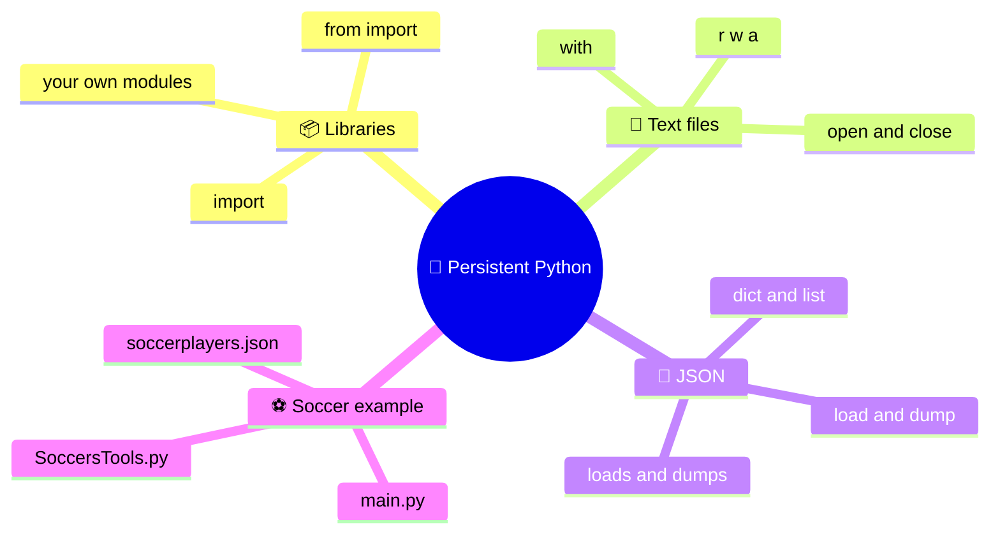

### 🎯 Goals:

- 📦 Chop a program into **reusable modules**.
- 📝 Read, write and append text to files the safe way.
- 🧾 Save Python structures as **JSON** and read them back.
- 🔬 Understand, line by line, how the soccer players' address book works.

#### 🗝️ Professor's Whisper:

> if you only read the headings you'll never become a real programmer, so take your time and read it all, because code rewards the curious 🦄 and punishes anyone who skips lines.

#### 📜 *Opening verses:*

*🐟 The goldfish forgets in the blink of an eye,*

*💾 but a file remembers and won't say goodbye!*

<a id="en-libraries"></a>

## 📦 2. Libraries in Python and `import`

<a id="en-module"></a>

### 🧩 2.1 What a module really is

🔑 In Python **every `.py` file is a module**.
A **library** is a bunch of modules, usually bundled into a **package** (a folder with the modules inside).

| 🏷️ Term | 📖 Meaning | 🌰 Example |
|---|---|---|
| 🧩 Module | A single `.py` file | [SoccersTools.py](./SoccersTools.py) |
| 📦 Package | Folder of modules (usually with `__init__.py`) | `my_lib/` |
| 📚 Library | A set of modules/packages with a purpose | `json`, `os`, `requests` |
| 🏛️ Standard library | Library that ships with Python | `json`, `math`, `random` |

#### ✨ Making a library is dead simple:
Write some functions in a file and give it a sensible name.

[SoccersTools.py](./SoccersTools.py) (our library)

```python
def delSoccer(sList: list, idx: int) -> bool:
	if not 0 <= idx < len(sList):
		return False
	del sList[idx]
	return True
```

📥 Then you import it wherever you need it:

```python
# main.py  (the main program)
from SoccersTools import delSoccer
```

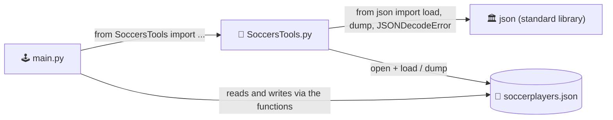

#### 🔍 Where does Python look for modules?
In this order: the folder of the running script, then the paths in `sys.path` (standard library and installed packages). That's why `main.py` finds `SoccersTools.py` **as long as they live in the same folder** 📁.

📏 **Rules of thumb for module names**:

- ✅ No spaces or dashes (`my-module.py` can't be imported with `import`).
- ✅ Don't reuse the name of a standard module (your own `json.py` would shadow the real one 😱).
- 💡 **PEP 8** suggests `snake_case` (`soccers_tools.py`, `load_soccers`). The example uses `camelCase`: it works fine, but a consistent style always wins.

<a id="en-import-styles"></a>

### 🚪 2.2 Ways to import stuff

| 🧪 Syntax | 📖 What it does | 🌰 Usage |
|---|---|---|
| `import module` | Imports the module, you use it with a prefix | `module.function()` |
| `import module as m` | Same as above, with an alias | `m.function()` |
| `from module import a, b` | Brings only `a` and `b` into your namespace | `a()` |
| `from module import (a, b,`<br>`c)` | Same, spread over several lines with parentheses | used in [main.py](./main.py) |
| `from module import *` | Imports everything: ⚠️ not recommended, it pollutes your names | avoid |

```python
import json							# 1) whole module
print(json.dumps([1, 2]))

import json as j					# 2) with an alias
print(j.dumps([1, 2]))

from json import dumps			# 3) only what you need
print(dumps([1, 2]))
```

🧾 In our [main.py](./main.py) the import spans several lines, grouped by topic 🧹:

```python
from SoccersTools import (
	loadSoccers, saveSoccers,
	newInputSoccer,	addNewSoccer,
	printSoccers, findSoccersByName,
	updateSoccer,
	delSoccer
)
```

💡 The **parentheses** let you break lines inside the `import` without using the backslash `\`.

<a id="en-name-main"></a>

### 🛡️ 2.3 `__name__` and `__main__`

🧪 When you import a module, Python **runs all of its code** once.
If the module contains "live" statements (not just definitions), they'd fire right at the `import`! 😬

```python
# my_module.py
def greet():
	print("Hello!")

if __name__ == "__main__":   # true only if the file is run directly
	greet()
```

| ▶️ How the file is used | 🏷️ Value of `__name__` |
|---|---|
| `python my_module.py` | `"__main__"` |
| `import my_module` | `"my_module"` |

⚠️ Our [main.py](./main.py) doesn't have this "guard", but nobody imports it: it's the entry point.
For a sturdier program it's a good habit to add it.

#### 🗝️ **Professor's Whisper:**
> [`SoccersTools.py`](./SoccersTools.py) only contains definitions and no live code, so it can be imported with zero side effects, and that's the real superpower of a well-made library 🛸.

📜 *Module rhyme:*
*📦 One file, one function, one name,*
*🔁 import it, reuse it, play the game!*

<a id="en-text-files"></a>

## 📝 3. Text files: `r`, `w`, `a`

<a id="en-open-close"></a>

### 🔓 3.1 `open()` and `close()`

🧭 A file's life has **three phases**: **open** 🔓, **use** ✍️, **close** 🔒.

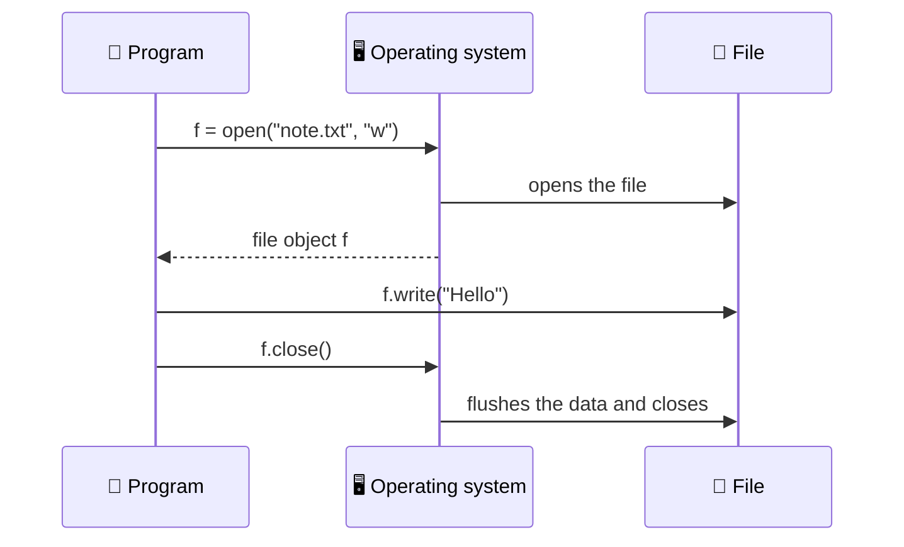

✍️ **Writing**:

```python
f = open('note.txt', 'w', encoding='utf-8')		# 🔓 open
f.write('Hello world\n')						# ✍️ use
f.close()										# 🔒 close
```

📖 **Reading**:

```python
f = open('note.txt', 'r', encoding='utf-8')
content = f.read()
f.close()
print(content)
```

🔒 **Why is `close()` such a big deal?**

- 💧 It flushes the buffers: without closing, some data might **never make it** to disk.
- 🧯 It frees the resource: the operating system caps how many files can be open at once.
- 🚧 Other programs may not be able to touch a file that's still open.

🌐 **`encoding='utf-8'`**: **always** set it for text with accents, `€` and emoji.
Otherwise Python falls back to the system's default encoding (which changes from PC to PC 🎲).

<a id="en-modes"></a>

### 🎛️ 3.2 The modes

| 🔤 Mode | 📖 Name | 🗂️ File doesn't exist | 📂 File exists | 📍 Position |
|---|---|---|---|---|
| `'r'` | 📖 Read (default) | ❌ `FileNotFoundError` | ✅ opens | start |
| `'w'` | ✍️ Write | 🆕 gets created | 💥 **wiped** and rewritten | start |
| `'a'` | ➕ Append | 🆕 gets created | ✅ adds **at the end** | end |
| `'x'` | 🛑 Exclusive | 🆕 gets created | ❌ `FileExistsError` | start |

🔧 You can combine suffixes: `'+'` (read **and** write, e.g. `'r+'`), `'b'` (binary, e.g. `'rb'`), `'t'` (text, the default).

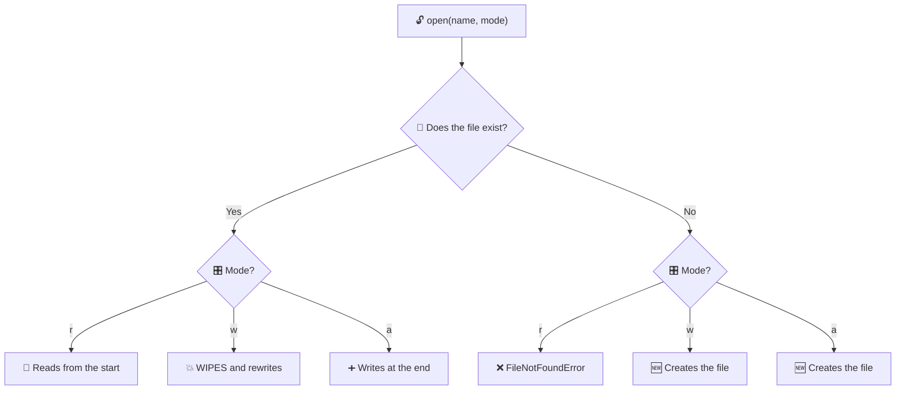

⚠️ **Watch out for `'w'`!** It opens the file and **wipes it right away**, before you've written a single character.
If the program crashes halfway, the old content is gone 💣.

➕ **Append example**:

```python
with open('log.txt', 'a', encoding='utf-8') as f:
	f.write('New log line\n')
	f.write('Another line\n')
```

<a id="en-file-methods"></a>

### 🛠️ 3.3 The main methods

| 🧰 Method | 📖 What it does | 🌰 Example |
|---|---|---|
| `f.read()` | 📜 Reads **everything** into one string | `text = f.read()` |
| `f.read(n)` | ✂️ Reads `n` characters | `f.read(10)` |
| `f.readline()` | 📄 Reads **one line** (with `\n`) | `line = f.readline()` |
| `f.readlines()` | 📚 List of all the lines | `lines = f.readlines()` |
| `for line in f:` | 🔁 Loops over the lines, **memory-friendly** | `for line in f: ...` |
| `f.write(s)` | ✍️ Writes a **string** (doesn't add `\n`) | `f.write('hi\n')` |
| `f.writelines(list)` | 📝 Writes a sequence of strings | `f.writelines(lines)` |
| `f.seek(pos)` | 🧭 Moves the cursor | `f.seek(0)` |
| `f.flush()` | 🚿 Forces the write to disk | `f.flush()` |
| `f.close()` | 🔒 Closes the file | `f.close()` |

```python
with open('note.txt', 'r', encoding='utf-8') as f:
	for number, line in enumerate(f, start=1):
		print(number, line.strip())				# strip() removes the trailing \n
```

🧱 **The catch with plain text**: if we saved players as `Totti;10;F;Roma`, we'd have to **invent our own** separators, handle type conversions (`"10"` → `10`) and deal with names that contain `;` 🤯. **JSON** solves exactly that [(chapter 4)](#en-json).

<a id="en-with"></a>

### ✅ 3.4 The `with` statement

😱 **The problem**: if something blows up between `open()` and `close()`, `close()` **never runs**.

```python
f = open('data.txt', 'r', encoding='utf-8')
number = int(f.read())		# 💥 not a number? ValueError
f.close()					# ❌ never reached
```

🩹 The "by hand" fix is `try/finally`:

```python
f = open('data.txt', 'r', encoding='utf-8')
try:
	number = int(f.read())
finally:
	f.close()				# ✅ ALWAYS runs
```

🦸 The elegant fix is **`with`**, a *context manager* that closes the file **automatically**, even when an error happens:

```python
with open('data.txt', 'r', encoding='utf-8') as f:
	number = int(f.read())
# 🔒 here the file is already closed, whatever happened
print(f.closed)				# True
```

| ⚔️ Showdown | 😓 `open` + `close` | 😎 `with` |
|---|---|---|
| Automatic closing | ❌ | ✅ |
| Safe with exceptions | ❌ (needs `try/finally`) | ✅ |
| Lines of code | more | fewer |
| Readability | so-so | high |

📌 That's exactly what `loadSoccers` and `saveSoccers` do in [SoccersTools.py](./SoccersTools.py).

#### 🗝️ Professor's Whisper:
> after the `with` block the variable `f` still exists, but the file object is closed 🧿 and any read will give you `ValueError: I/O operation on closed file`.

📜 *File rhyme:*
*🔓 Open with care, write with grace,*
*✅ use `with` and it closes in its place!*

<a id="en-json"></a>

## 🧾 4. The JSON format

📖 **JSON** (*JavaScript Object Notation*) is a **text-based** format for structured data.
Humans can read it 👀, it doesn't care about the programming language 🌍 and pretty much everything supports it: web, apps, databases, APIs.

📐 **Syntax rules**:

- 🔤 Strings use **double quotes only** `"..."`.
- 🧱 Two structures: **object** `{ "key": value }` and **array** `[ v1, v2 ]`.
- 🗝️ Object **keys** are always **strings**.
- 🚫 No trailing commas, no comments.
- 🔢 Allowed types: string, number, boolean (`true`/`false`), `null`, object, array.

🌰 A tiny example:

```json
{
	"fullname": "Francesco Totti",
	"n": 10,
	"position": "F",
	"team": "Roma",
	"retired": true,
	"agent": null
}
```

🔗 **How it maps to Python types** (the `json` module does it for you):

| 🧾 JSON | 🐍 Python |
|---|---|
| `object` `{}` | `dict` |
| `array` `[]` | `list` |
| `string` `"hello"` | `str` |
| integer `number` `10` | `int` |
| decimal `number` `1.5` | `float` |
| `true` / `false` | `True` / `False` |
| `null` | `None` |

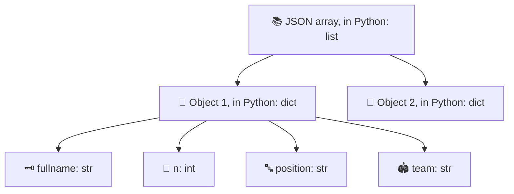

#### 🗝️ Professor's Whisper:
> our data store is an **array of objects**, i.e. in Python a **list of dictionaries**, and it's the most common structure for small data sets 🪐.

<a id="en-python-vs-json"></a>

## 🔁 5. Python vs JSON and `load`, `loads`, `dump`, `dumps`

### 🥊 5.1 Python dictionaries and lists vs JSON data

⚡ **Key idea**: a `dict` or a `list` are **objects in memory**; JSON is **text** (a string or a file). They look alike, but they're **not the same thing**.

| 🔍 Aspect | 🐍 Python (object in RAM) | 🧾 JSON (text) |
|---|---|---|
| Nature | Live, editable object | String or file |
| Strings | `'a'` or `"a"` | only `"a"` |
| Booleans | `True` / `False` | `true` / `false` |
| "No value" | `None` | `null` |
| Dictionary keys | any *hashable* type (`1`, `(1,2)`...) | **strings only** |
| Sequences | `list`, `tuple`, `set` | arrays only |
| Trailing comma | ✅ allowed | ❌ forbidden |
| Comments | ✅ `#` | ❌ |

#### ⚠️ Gotchas you gotta know:

```python
import json

d = {1: 'one', 'ok': True, 'nothing': None, 'tuple': (1, 2)}
print(json.dumps(d))
# {"1": "one", "ok": true, "nothing": null, "tuple": [1, 2]}
```

- 🔢 The key `1` becomes `"1"`.
- 📦 The tuple `(1, 2)` becomes an array, and on the way back it'll be a **list**.
- 🚫 A `set` can't be serialized: `TypeError`.

### 🧠 5.2 The four functions

#### 🔤 Memory trick:
the final **`s`** stands for **String** 🧵.
No `s` means you're working with a **file**; with the `s` you're working with a **string**.

| 🧰 Function | ➡️ Direction | 📥 Takes | 📤 Returns | 🌰 Typical use |
|---|---|---|---|---|
| `load(f)` | 📄 → 🐍 | open file object | Python object | reading a `.json` |
| `loads(s)` | 🧵 → 🐍 | JSON string | Python object | an API response |
| `dump(obj, f)` | 🐍 → 📄 | object + open file | `None` (writes to the file) | saving to a `.json` |
| `dumps(obj)` | 🐍 → 🧵 | Python object | JSON string | printing, sending over the network |

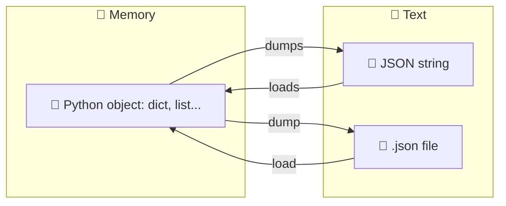

💻 **One example at a time**:

```python
import json

player = {"fullname": "Diego Armando Maradona", "n": 10, "position": "F", "team": "Napoli"}

# 🐍 → 🧵  dumps: from object to string
text = json.dumps(player)
print(text)					# {"fullname": "Diego Armando Maradona", "n": 10, ...}

# 🧵 → 🐍  loads: from string to object
back_again = json.loads(text)
print(back_again["team"])			# Napoli

# 🐍 → 📄  dump: from object to file
with open('player.json', 'w', encoding='utf-8') as f:
	json.dump(player, f)

# 📄 → 🐍  load: from file to object
with open('player.json', 'r', encoding='utf-8') as f:
	copy = json.load(f)
```

🎚️ **Handy parameters** (work for both `dump` and `dumps`):

| ⚙️ Parameter | 📖 Effect | 🌰 In the project |
|---|---|---|
| `indent` | 🧹 Indentation for readable output (number or string) | `indent = '\t'` |
| `ensure_ascii` | 🔤 If `False`, keeps real accents and emoji instead of `\u00e8` | `ensure_ascii = False` |
| `sort_keys` | 🔠 Sorts keys alphabetically | not used |
| `default` | 🛟 Function to convert non-serializable types | not used |

🚨 **Classic errors**:

| 💥 Exception | 🕵️ When |
|---|---|
| `json.JSONDecodeError` | 📄 The text isn't valid JSON (empty file, trailing comma, single quotes...) |
| `TypeError` | 🧊 The object contains a non-serializable type (e.g. a `set`) |
| `FileNotFoundError` | 🔍 The file you want to read with `load` doesn't exist |

#### 🗝️ Professor's Whisper:
> `JSONDecodeError` is a subclass of `ValueError`, so an `except ValueError` will catch it 🦖 but it's better to be precise, like `loadSoccers` does.

📜 *Rhyme of the four:*
*🧵 Add an `s` and you're dealing with a string,*
*📄 drop the `s` and a file's the thing!*

<a id="en-analysis"></a>

## 🔬 6. Breaking down the example

🏗️ The app is a menu-driven **soccer players' address book**, with **CRUD** features (Create, Read, Update, Delete) and JSON persistence.

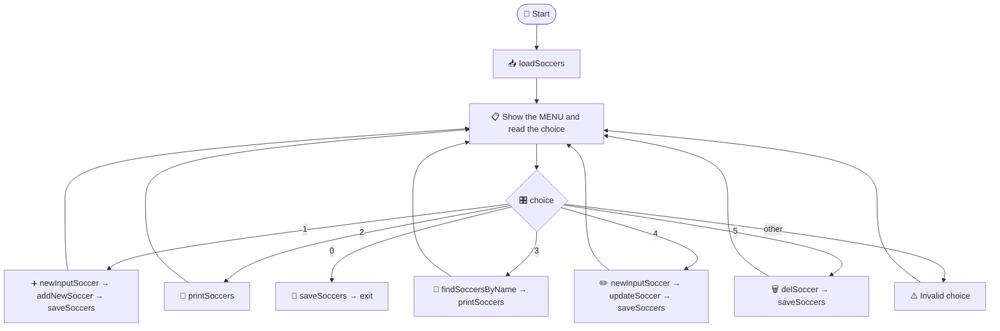

<a id="en-analysis-json"></a>

### 💾 6.1 [soccerplayers.json](./soccerplayers.json)

📂 You **don't write this file by hand**: the program creates it on the first save (until then, the link above leads nowhere 🙈). Here's what it looks like after a few inserts:

```json
[
	{
		"fullname": "Gianluigi Buffon",
		"n": 1,
		"position": "G",
		"team": "Juventus"
	},
	{
		"fullname": "Paolo Maldini",
		"n": 3,
		"position": "D",
		"team": "Milan"
	}
]
```

🔎 Things to notice:

- 📚 The root is an **array**: in Python a `list`.
- 🧱 Every element is an **object**: in Python a `dict` with 4 keys.
- 🔢 `n` is a **number** (no quotes) because the code converts it with `int()`.
- 🧹 The **tab** indentation comes from `indent = '\t'`.

<a id="en-analysis-tools"></a>

### 🧰 6.2 [SoccersTools.py](./SoccersTools.py)

📋 **Function overview**:

| 🧩 Function | 📥 Parameters | 📤 Returns | 💥 Side effect |
|---|---|---|---|
| `loadSoccers` | `fname` | `list` | 📄 reads the file |
| `saveSoccers` | `fname`, `sList` | nothing | 💾 overwrites the file |
| `newInputSoccer` | none | `dict` | ⌨️ asks the user for data |
| `addNewSoccer` | `sList`, `soccer` | `bool` | ➕ changes the list |
| `printSoccers` | `sList` | nothing | 🖨️ prints to screen |
| `findSoccersByName` | `sList`, `name` | `list` | none |
| `updateSoccer` | `sList`, `idx`, `soccer` | `bool` | ✏️ changes the list |
| `delSoccer` | `sList`, `idx` | `bool` | 🗑️ changes the list |

#### 📥 `loadSoccers`: reading with a safety net

```python
from json import load, dump, JSONDecodeError

def loadSoccers(fname:str) -> list:
	try:
		with open(fname, 'r', encoding = 'utf-8') as f:
			return load(f)
	except (FileNotFoundError, JSONDecodeError):
		return []
```

- 🏷️ `fname:str` and `-> list` are **type hints**: they document the types but don't enforce them.
- 🔓 `with open(..., 'r')` opens for reading and closes on its own; `load(f)` turns the JSON into a list of dictionaries.
- 🥅 A `return` inside the `with` is safe: the file still gets closed.
- 🛟 If the file **doesn't exist** (first run) or is **empty/corrupted**, you get an **empty list**: the program always starts.

#### 💾 `saveSoccers`: readable output

```python
def saveSoccers(fname:str, sList:list):
	with open(fname, 'w', encoding = 'utf-8', newline = '\n') as f:
		dump(sList, f, indent = '\t', ensure_ascii = False)
```

- ✍️ Mode `'w'`: the file gets **rewritten from scratch** on every save.
- 🧵 `newline = '\n'`: forces Unix-style line endings even on Windows, so the files are identical on every system.
- 🧹 `indent = '\t'` makes the JSON neat; `ensure_ascii = False` keeps accents and emoji intact.

#### ⌨️ `newInputSoccer`: building a dictionary

```python
def newInputSoccer() -> dict:
	soccer:dict = {}
	soccer['fullname'] = input('Insert name: ').strip()
	soccer['n'] = int(input('Insert jersey number: '))
	soccer['position'] = input(
'''
(F)orward
(M)idfielder
(D)efender
(G)oalkeeper

insert position: '''
	).strip()
	soccer['team'] = input('Insert Team: ').strip()
	return soccer
```

- 🧼 `.strip()` trims leading and trailing spaces.
- 🔢 `int(...)` converts the jersey number: type text and you get a `ValueError` ⚠️ (see chapter 8).
- 📜 **Triple quotes** `'''...'''` allow multi-line strings, perfect for menus.
- 🧱 The **insertion order** of the keys (`fullname`, `n`, `position`, `team`) is preserved by dictionaries and drives the table header.

#### ➕ `addNewSoccer`: no duplicates

```python
def addNewSoccer(sList:list, soccer:dict) -> bool:
	if soccer in sList:
		return False
	sList.append(soccer)
	return True
```

- 🔁 `soccer in sList` compares **dictionaries by equality**: it's a duplicate only if **all four** fields match.
- ✅ Returns `True` if it added the player, `False` otherwise: the caller decides what to do.
- 🧬 The list is modified **in place** (same object as in `main.py`), so there's no need to return it.

#### 📃 `printSoccers`: table-style printing

```python
def printSoccers(sList: list):
	if not sList:
		print("(Empty List)")
		return

	print("#", *sList[0].keys(), sep="\t")
	print("-" * 40)

	for i, s in enumerate(sList):
		print(i, *s.values(), sep="\t")
```

- 🪣 `if not sList` is true for an empty list: an *early return* with a message.
- 💥 `*sList[0].keys()` **unpacks** the keys as separate arguments to `print`; `sep="\t"` separates them with tabs.
- ➖ `"-" * 40` repeats the dash 40 times.
- 🔢 `enumerate` gives you the **index** `i`, which the user needs to edit or remove a player.

#### 🔎 `findSoccersByName`: flexible search

```python
def findSoccersByName(sList: list, name: str) -> list:
	name = "".join(name.lower().split())
	return [
		s for s in sList if name in "".join(s["fullname"].lower().split())
	]
```

- 🪄 `"".join(x.lower().split())` lowercases and **strips every space**: `"  Del Piero "` becomes `"delpiero"`.
- 🧩 `name in ...` is a **substring** search: `"pier"` finds `"Alessandro Del Piero"`.
- 📚 The **list comprehension** builds the filtered list in a single expression.

#### ✏️ `updateSoccer`: editing with checks

```python
def updateSoccer(sList:list, idx:int, soccer:dict) -> bool:
	if not 0 <= idx < len(sList) or any(soccer == s for i, s in enumerate(sList) if i != idx):
		return False
	sList[idx] = soccer
	return True
```

- 🔗 `0 <= idx < len(sList)` is a **chained comparison**: it checks the index is valid.
- 🕵️ `any(... for ... if i != idx)` checks whether the new player **matches another** element, skipping the one being edited.
- ❌ If the index is invalid **or** there's a duplicate, it returns `False` without touching anything.

#### 🗑️ `delSoccer`: removal

```python
def delSoccer(sList:list, idx:int) -> bool:
	if not 0 <= idx < len(sList):
		return False
	del sList[idx]
	return True
```

- 🚧 The bounds check avoids an `IndexError` and **rejects negative indexes** (which in plain Python would count from the end).

<a id="en-analysis-main"></a>

### 🕹️ 6.3 [main.py](./main.py)

🧱 **A 4-block structure**:

1. 📦 **Import** the functions from the library.
2. 🔧 **Constants**: `SOCCERS_FILE` (JSON path) and `MENU` (menu text).
3. 📥 **Initial load**: `soccers = loadSoccers(SOCCERS_FILE)`.
4. 🔁 **Main loop** `while choice != 0` with `match/case`.

```python
SOCCERS_FILE = './soccerplayers.json'
soccers = loadSoccers(SOCCERS_FILE)

choice:int = -1

while choice != 0:
	choice = int(input(MENU))
	match choice:
		case 0:
			saveSoccers(SOCCERS_FILE, soccers)
			break
		case 1:
			soccer = newInputSoccer()
			if addNewSoccer(soccers, soccer):
				saveSoccers(SOCCERS_FILE, soccers)
			else:
				print(f"ERROR: Player {soccer['fullname']} already exists")
```

🔎 **Stuff worth noticing**:

- 🔤 The **UPPERCASE** in `SOCCERS_FILE` flags a **constant** (by convention).
- 📍 `'./'` means the **current working directory**, not necessarily the script's folder ⚠️.
- 🎰 `match/case` (Python 3.10+) is Python's "switch"; `case _:` is the default branch.
- 🛑 The `break` inside `case 0` exits the `while`.
- 💬 **f-strings** `f"...{variable}..."` drop values into text; inside the braces we use single quotes because the outer string uses double ones.
- 🔄 **"Load, change, save" pattern**: after every operation that changes the data, we call `saveSoccers`.

🎬 **What happens when you add a player**:

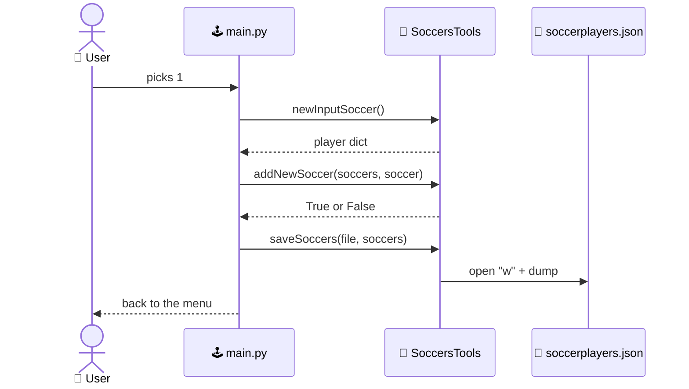

> 🗝️ **Professor's Whisper:** `soccers` is a **mutable** list passed to the functions **by reference**, so `addNewSoccer`, `updateSoccer` and `delSoccer` change it directly 🍄 with no need for a `return`.

<a id="en-persistence"></a>

## 🏛️ 7. Persistence: your file as a first database

🧠 **RAM** and **disk** play different roles:

| 🧬 Feature | 🧠 RAM (variables) | 💾 Disk (files) |
|---|---|---|
| Lifespan | ⏳ Until the program closes | ♾️ Permanent |
| Speed | ⚡ Blazing | 🐢 Slower |
| Example | `soccers` (list) | `soccerplayers.json` |

🔄 **The data cycle** in our program:

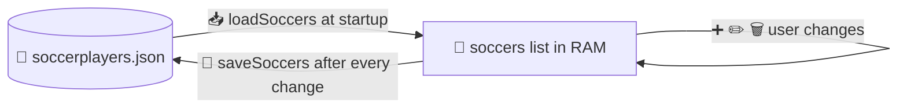

🔗 **CRUD mapping**:

| 🧱 Operation | 🎛️ Menu entry | 🧩 Function |
|---|---|---|
| ➕ **C**reate | 1. Add new player | `newInputSoccer` + `addNewSoccer` |
| 📖 **R**ead | 2. List / 3. Search | `printSoccers`, `findSoccersByName` |
| ✏️ **U**pdate | 4. Edit player | `updateSoccer` |
| 🗑️ **D**elete | 5. Remove player | `delSoccer` |

✅ **What's great about this approach**:

- 🪶 Zero dependencies: just the standard library and a file.
- 👀 JSON is readable and you can even edit it with a plain text editor.
- 🧪 Perfect for prototypes, small tools and **learning** database basics.

⚠️ **Limits you should know about**:

| 🚧 Limit | 📖 Explanation | 🛟 Next step |
|---|---|---|
| 🔁 Full rewrite | Every save rewrites the **whole** file | database (SQLite) |
| 👥 Concurrency | Two programs writing at once overwrite each other | database with transactions |
| 💣 Crash during `'w'` | The file may end up empty or half-written | atomic write (temp file + `os.replace`) |
| 🔎 No indexes | Searches scan the whole list | database with indexes |
| 📐 No schema | Nothing stops wrong fields from sneaking in | validation or a database |

🌱 **Natural evolution**: text file → **JSON** → **SQLite** (`import sqlite3`, already in the standard library) → database server.

#### 🗝️ Professor's Whisper:
> a JSON store is a great training ground, but when the data grows or you get more than one user, the next step is a real database 🔮 and you'll get there with your ideas already straight.

<a id="en-challenges"></a>

## 🐞 8. Bugs, upgrades, exercises and the final challenge

🕵️ Even the best code can be improved: time for a **bug hunt** on the example.

### 🐛 8.1 What could be better

| 🔢 # | 🐞 Problem | 📍 Where | 💡 Possible fix |
|---|---|---|---|
| 1 | 💥 Non-numeric input crashes the program | `int(input(...))` in [main.py](./main.py) and in `newInputSoccer` | `try/except ValueError` |
| 2 | 🤥 Wrong message: with an invalid index it says "already exists" | `case 4` in [main.py](./main.py) | check the index **first** and tell the two errors apart |
| 3 | 🧭 After a **search** the indexes shown are those of the filtered list, not the real ones | `case 3` + `printSoccers` | return the original index too |
| 4 | 🔤 The position isn't validated (any text goes) | `newInputSoccer` | accept only `F`, `M`, `D`, `G` (uppercase) |
| 5 | 📍 `'./soccerplayers.json'` depends on the launch folder | `SOCCERS_FILE` | use `pathlib` with `Path(__file__).parent` |
| 6 | 🛡️ The `if __name__ == "__main__":` guard is missing | [main.py](./main.py) | wrap the program in a `main()` function |
| 7 | 🔁 `saveSoccers` in `case 0` is redundant (we already save after every change) | `case 0` | remove it, or keep it to be safe |
| 8 | 🏷️ `camelCase` naming instead of `snake_case` | [SoccersTools.py](./SoccersTools.py) | follow PEP 8 |

🩹 **Fix example for item 1** (safe numeric input):

```python
def inputInt(prompt: str) -> int:
	while True:
		try:
			return int(input(prompt))
		except ValueError:
			print('Please insert a valid integer number.')

# usage
choice = inputInt(MENU)
```

🛡️ **Safer writing example** (the "crash during `'w'`" item):

```python
import os
from json import dump

def saveSoccersSafe(fname: str, sList: list):
	tmp = fname + '.tmp'
	with open(tmp, 'w', encoding = 'utf-8', newline = '\n') as f:
		dump(sList, f, indent = '\t', ensure_ascii = False)
	os.replace(tmp, fname)   # atomic swap: either the old or the new file
```

### 🏋️ 8.2 Exercises

| 🎚️ Level | 📝 Exercise |
|---|---|
| 🟢 Easy | Add the menu entry **"6. Count players"** that prints how many there are. |
| 🟢 Easy | Write a program that appends a line with date and time to `log.txt` (mode `'a'`) at every launch. |
| 🟡 Medium | Validate the position: keep asking until the user enters `F`, `M`, `D` or `G`. |
| 🟡 Medium | Add a search by **team** (`findSoccersByTeam`) in [SoccersTools.py](./SoccersTools.py). |
| 🟠 Tough | Fix bug #3: after a search, the user must be able to edit/remove using the **correct** index. |
| 🔴 Challenge | Forbid two players with the **same jersey number on the same team**. |
| 🔴 Challenge | Replace the JSON file with **SQLite** while keeping the library's same functions. |

### 🧠 8.3 Quick recap

- 📦 Every `.py` is a **module**; you bring it in with `import` or `from ... import`.
- 📝 `open()` + `close()` → better to go with `with open(...) as f`.
- 🎛️ `'r'` reads, `'w'` **wipes** and writes, `'a'` appends at the end.
- 🧾 JSON is **text**; `dict`/`list` are **objects**.
- 🧵 `load`/`dump` work with **files**; `loads`/`dumps` with **strings**.
- 🔄 Data pattern: **load → change → save**.

### 🏆 8.4 Final challenge: the treasure hunt

🎉 **Congrats, you made it to the end!** But did you *really* read it all? 😏

🕵️ Throughout the guide I hid **8 rare emoji**, **one per chapter** (from chapter 1 to 8).
You'll find them at the end of the **"Professor's Whispers"** 🗝️, in the quote boxes.

📣 **How to hand in your proof**: post a comment with the **sequence of the 8 emoji, in chapter order** (first to eighth), with no spaces or other symbols.

#### 🗝️ Professor's Whisper:
> the task is almost over, but there's one last emoji left to find 🐙, and that's exactly why nobody should scroll through the page too fast.

🎤 *Closing verses:*
*⚽ Code's the pitch, and data's the ball,*
*💾 save it right and you'll win it all!*

🙌 Thanks for following the lesson.
See you next time, **and remember: whoever doesn't close their files leaves the doors wide open!** 🚪

---

<a href="#IT"></a>
🤍
<a href="#EN"></a>

---

 <a name="IT"></A>

<!-- Italiano -->

# 🚀⚽ Python Persistente: Librerie, File e JSON

### 🎩 La guida del Professor Pallone, tra codice, scienza e un pizzico di follia

> 🎬 **Ciao ragazzi, benvenuti!** Oggi i nostri programmi smettono di avere la memoria di un pesce rosso 🐟: impareremo a **organizzare il codice in librerie**, a **salvare i dati su file** e a **riprenderli al prossimo avvio**. Allacciate le cinture, si parte! 🏁

#### 📌 Requisiti:
* Python **3.10+** (il `main.py` usa `match/case`) 🐍
* conoscenza delle basi (variabili, cicli, funzioni, liste, dizionari) 🧱.

#### 📂 File dell'esempio:

| 📄 File | 🎯 Ruolo |
|---|---|
| [main.py](./main.py) | 🕹️ Programma principale: menu e interazione con l'utente |
| [SoccersTools.py](./SoccersTools.py) | 🧰 Libreria: funzioni per caricare, salvare e gestire i giocatori |
| [soccerplayers.json](./soccerplayers.json) | 💾 Archivio dati: viene creato dal programma al primo salvataggio |

<a id="it-indice"></a>

## 🗺️ Indice

1. [👋 Benvenuti: la mappa del viaggio](#it-benvenuti)
2. [📦 Librerie in Python e `import`](#it-librerie)
	- [🧩 Che cos'è un modulo](#it-modulo)
	- [🚪 I modi di importare](#it-modi-import)
	- [🛡️ `__name__` e `__main__`](#it-name-main)
3. [📝 File di testo: `r`, `w`, `a`](#it-file-testo)
	- [🔓 `open()` e `close()`](#it-open-close)
	- [🎛️ Le modalità](#it-modalita)
	- [🛠️ I metodi principali](#it-metodi-file)
	- [✅ Il costrutto `with`](#it-with)
4. [🧾 Il formato JSON](#it-json)
5. [🔁 Python vs JSON e `load`, `loads`, `dump`, `dumps`](#it-python-vs-json)
6. [🔬 Analisi dell'esempio](#it-analisi)
	- [💾 `soccerplayers.json`](#it-analisi-json)
	- [🧰 `SoccersTools.py`](#it-analisi-tools)
	- [🕹️ `main.py`](#it-analisi-main)
7. [🏛️ Persistenza: il file come primo database](#it-persistenza)
8. [🐞 Bug, miglioramenti, esercizi e prova finale](#it-sfide)

<a id="it-benvenuti"></a>

## 👋 1. Benvenuti: la mappa del viaggio

🧠 Un programma che tiene i dati solo in **RAM** perde tutto alla chiusura.
Per renderli **persistenti** li scriviamo su **disco**.
Il percorso di oggi è questo:

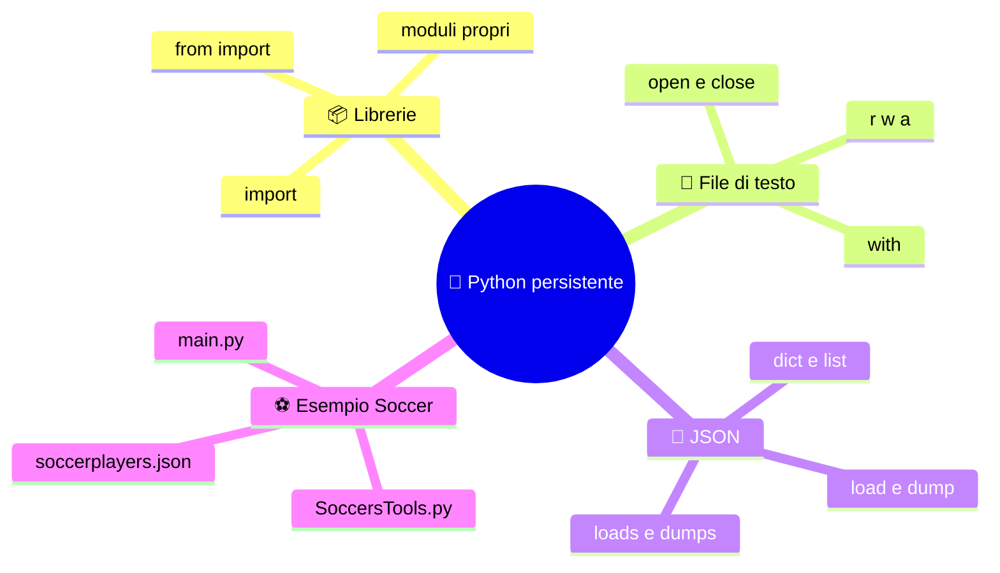

### 🎯 Obiettivi:

- 📦 Spezzare un programma in **moduli riutilizzabili**.
- 📝 Leggere, scrivere e aggiungere testo ai file in sicurezza.
- 🧾 Salvare strutture Python in **JSON** e rileggerle.
- 🔬 Capire riga per riga come funziona la rubrica dei calciatori.

#### 🗝️ Sussurro del Professore:

> chi legge solo i titoli non diventa mai un vero programmatore, quindi leggete tutto con calma, perché il codice premia i curiosi 🦄 e punisce chi salta le righe.

#### 📜 *Versi di apertura:*

*🐟 Il pesce rosso scorda in un lampo,*

*💾 il file invece ricorda ogni stampo!*

<a id="it-librerie"></a>

## 📦 2. Librerie in Python e `import`

<a id="it-modulo"></a>

### 🧩 2.1 Che cos'è un modulo

🔑 In Python **ogni file `.py` è un modulo**.
Una **libreria** è un insieme di moduli, spesso raccolti in un **package** (una cartella con dentro i moduli).

| 🏷️ Termine | 📖 Significato | 🌰 Esempio |
|---|---|---|
| 🧩 Modulo | Un singolo file `.py` | [SoccersTools.py](./SoccersTools.py) |
| 📦 Package | Cartella di moduli (di solito con `__init__.py`) | `mia_lib/` |
| 📚 Libreria | Insieme di moduli/package con uno scopo | `json`, `os`, `requests` |
| 🏛️ Standard library | Libreria inclusa con Python | `json`, `math`, `random` |

#### ✨ Creare una libreria è semplicissimo:
Scrivi funzioni in un file e dagli un nome sensato.

[SoccersTools.py](./SoccersTools.py) (la nostra libreria)

```python
def delSoccer(sList: list, idx: int) -> bool:
	if not 0 <= idx < len(sList):
		return False
	del sList[idx]
	return True
```

📥 Poi la importi dove ti serve:

```python
# main.py  (il programma principale)
from SoccersTools import delSoccer
```


#### 🔍 Dove cerca Python i moduli?
Nell'ordine: cartella dello script in esecuzione, poi i percorsi in `sys.path` (standard library e pacchetti installati). Per questo `main.py` trova `SoccersTools.py` **se stanno nella stessa cartella** 📁.

📏 **Regole pratiche per i nomi dei moduli**:

- ✅ Niente spazi né trattini (`mio-modulo.py` non è importabile con `import`).
- ✅ Evita nomi uguali a moduli standard (un tuo `json.py` oscura quello vero 😱).
- 💡 Lo stile **PEP 8** consiglia `snake_case` (`soccers_tools.py`, `load_soccers`). L'esempio usa `camelCase`: è funzionante, ma uno stile coerente è sempre meglio.

<a id="it-modi-import"></a>

### 🚪 2.2 I modi di importare

| 🧪 Sintassi | 📖 Cosa fa | 🌰 Uso |
|---|---|---|
| `import modulo` | Importa il modulo, si usa col prefisso | `modulo.funzione()` |
| `import modulo as m` | Come sopra con un alias | `m.funzione()` |
| `from modulo import a, b` | Importa solo `a` e `b` nel tuo spazio dei nomi | `a()` |
| `from modulo import (a, b,`<br>`c)` | Come sopra, su più righe con le parentesi | usato in [main.py](./main.py) |
| `from modulo import *` | Importa tutto: ⚠️ sconsigliato, inquina i nomi | evitare |

```python
import json						# 1) intero modulo
print(json.dumps([1, 2]))

import json as j				# 2) con alias
print(j.dumps([1, 2]))

from json import dumps			# 3) solo ciò che serve
print(dumps([1, 2]))
```

🧾 Nel nostro [main.py](./main.py) l'import è su più righe, raggruppato per argomento 🧹:

```python
from SoccersTools import (
	loadSoccers, saveSoccers,
	newInputSoccer,	addNewSoccer,
	printSoccers, findSoccersByName,
	updateSoccer,
	delSoccer
)
```

💡 Le **parentesi** permettono di andare a capo dentro l'`import` senza usare il backslash `\`.

<a id="it-name-main"></a>

### 🛡️ 2.3 `__name__` e `__main__`

🧪 Quando importi un modulo, Python **esegue tutto il suo codice** una volta.
Se il modulo contiene istruzioni "attive" (non solo definizioni), partirebbero all'`import`! 😬

```python
# mio_modulo.py
def saluta():
	print("Ciao!")

if __name__ == "__main__":   # vero solo se il file è lanciato direttamente
	saluta()
```

| ▶️ Come viene usato il file | 🏷️ Valore di `__name__` |
|---|---|
| `python mio_modulo.py` | `"__main__"` |
| `import mio_modulo` | `"mio_modulo"` |

⚠️ Il nostro [main.py](./main.py) non ha questo "guardiano", ma nessuno lo importa: è il punto di ingresso.
Per un programma più robusto è buona abitudine inserirlo.

#### 🗝️ **Sussurro del Professore:**
> [`SoccersTools.py`](./SoccersTools.py) contiene solo definizioni e nessun codice attivo, quindi si importa senza effetti collaterali, e questa è la vera forza di una libreria ben fatta 🛸.

📜 *Rima del modulo:*
*📦 Un file, una funzione, un nome,*
*🔁 importa e riusa, senza far più... il come!*

<a id="it-file-testo"></a>

## 📝 3. File di testo: `r`, `w`, `a`

<a id="it-open-close"></a>

### 🔓 3.1 `open()` e `close()`

🧭 Il ciclo di vita di un file ha **tre fasi**: **apri** 🔓, **usa** ✍️, **chiudi** 🔒.

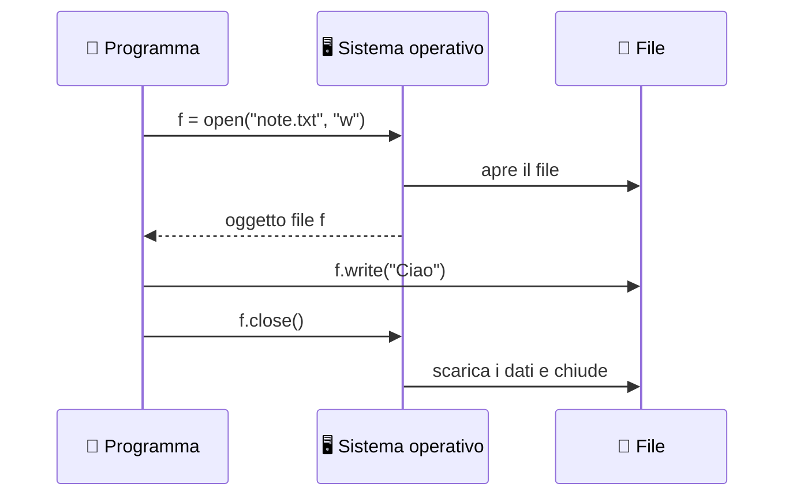

✍️ **Scrivere**:

```python
f = open('note.txt', 'w', encoding='utf-8')		# 🔓 apri
f.write('Ciao mondo\n')							# ✍️ usa
f.close()										# 🔒 chiudi
```

📖 **Leggere**:

```python
f = open('note.txt', 'r', encoding='utf-8')
contenuto = f.read()
f.close()
print(contenuto)
```

🔒 **Perché `close()` è fondamentale?**

- 💧 Svuota i buffer: senza chiusura alcuni dati potrebbero **non arrivare mai** su disco.
- 🧯 Libera la risorsa: il sistema operativo ha un numero limite di file aperti.
- 🚧 Altri programmi potrebbero non riuscire ad accedere al file ancora aperto.

🌐 **`encoding='utf-8'`**: indicalo **sempre** per testo con accenti, `€` ed emoji.
Senza, Python usa la codifica predefinita del sistema (che cambia da PC a PC 🎲).

<a id="it-modalita"></a>

### 🎛️ 3.2 Le modalità

| 🔤 Modo | 📖 Nome | 🗂️ File inesistente | 📂 File esistente | 📍 Posizione |
|---|---|---|---|---|
| `'r'` | 📖 Read (predefinita) | ❌ `FileNotFoundError` | ✅ si apre | inizio |
| `'w'` | ✍️ Write | 🆕 viene creato | 💥 **svuotato** e riscritto | inizio |
| `'a'` | ➕ Append | 🆕 viene creato | ✅ si aggiunge **in coda** | fine |
| `'x'` | 🛑 Exclusive | 🆕 viene creato | ❌ `FileExistsError` | inizio |

🔧 Si possono combinare suffissi: `'+'` (lettura **e** scrittura, es. `'r+'`), `'b'` (binario, es. `'rb'`), `'t'` (testo, predefinito).

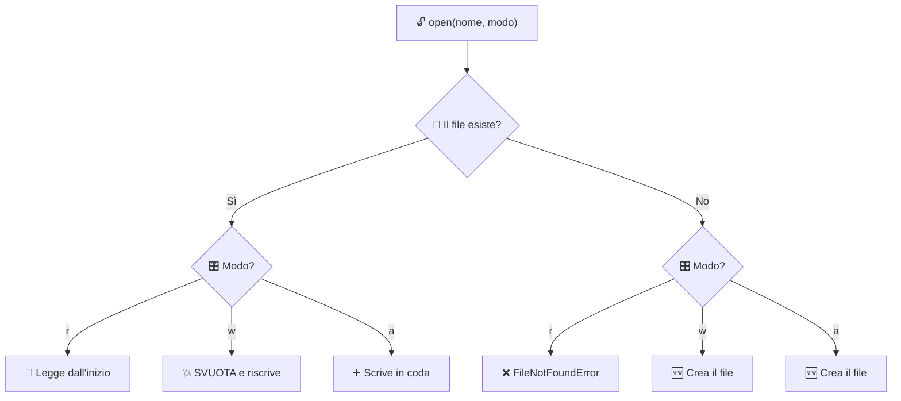

⚠️ **Attenzione al `'w'`!** Apre il file e lo **svuota subito**, prima ancora che tu scriva qualcosa.
Se il programma si blocca a metà, il vecchio contenuto è perso 💣.

➕ **Esempio di append**:

```python
with open('log.txt', 'a', encoding='utf-8') as f:
	f.write('Nuova riga di log\n')
	f.write('Un\'altra riga\n')
```

<a id="it-metodi-file"></a>

### 🛠️ 3.3 I metodi principali

| 🧰 Metodo | 📖 Cosa fa | 🌰 Esempio |
|---|---|---|
| `f.read()` | 📜 Legge **tutto** in un'unica stringa | `testo = f.read()` |
| `f.read(n)` | ✂️ Legge `n` caratteri | `f.read(10)` |
| `f.readline()` | 📄 Legge **una riga** (con `\n`) | `riga = f.readline()` |
| `f.readlines()` | 📚 Lista di tutte le righe | `righe = f.readlines()` |
| `for riga in f:` | 🔁 Itera le righe, **efficiente** in memoria | `for riga in f: ...` |
| `f.write(s)` | ✍️ Scrive una **stringa** (non aggiunge `\n`) | `f.write('ciao\n')` |
| `f.writelines(lista)` | 📝 Scrive una sequenza di stringhe | `f.writelines(righe)` |
| `f.seek(pos)` | 🧭 Sposta il cursore | `f.seek(0)` |
| `f.flush()` | 🚿 Forza la scrittura su disco | `f.flush()` |
| `f.close()` | 🔒 Chiude il file | `f.close()` |

```python
with open('note.txt', 'r', encoding='utf-8') as f:
	for numero, riga in enumerate(f, start=1):
		print(numero, riga.strip())				# strip() toglie lo \n finale
```

🧱 **Limite del testo semplice**: se salvassimo i giocatori come `Totti;10;F;Roma`, dovremmo **inventare noi** separatori, conversioni di tipo (`"10"` → `10`) e gestire i casi con `;` nel nome 🤯. Il **JSON** risolve proprio questo [(capitolo 4)](#it-json).

<a id="it-with"></a>

### ✅ 3.4 Il costrutto `with`

😱 **Il problema**: se tra `open()` e `close()` avviene un errore, `close()` **non viene mai eseguito**.

```python
f = open('dati.txt', 'r', encoding='utf-8')
numero = int(f.read())		# 💥 se non è un numero: ValueError
f.close()					# ❌ mai raggiunto
```

🩹 La soluzione "a mano" è `try/finally`:

```python
f = open('dati.txt', 'r', encoding='utf-8')
try:
	numero = int(f.read())
finally:
	f.close()				# ✅ eseguito SEMPRE
```

🦸 La soluzione elegante è **`with`**, un *context manager* che chiude il file **automaticamente**, anche in caso di errore:

```python
with open('dati.txt', 'r', encoding='utf-8') as f:
	numero = int(f.read())
# 🔒 qui il file è già chiuso, qualunque cosa sia successa
print(f.closed)				# True
```

| ⚔️ Confronto | 😓 `open` + `close` | 😎 `with` |
|---|---|---|
| Chiusura automatica | ❌ | ✅ |
| Sicuro con le eccezioni | ❌ (serve `try/finally`) | ✅ |
| Righe di codice | più numerose | meno |
| Leggibilità | media | alta |

📌 È proprio ciò che fanno `loadSoccers` e `saveSoccers` in [SoccersTools.py](./SoccersTools.py).

#### 🗝️ Sussurro del Professore:
> dopo il blocco `with` la variabile `f` esiste ancora, ma l'oggetto file è chiuso 🧿 e qualsiasi lettura darà `ValueError: I/O operation on closed file`.

📜 *Rima del file:*
*🔓 Apri con cura, scrivi con grazia,*
*✅ col `with` si chiude, e nessuno si strazia!*

<a id="it-json"></a>

## 🧾 4. Il formato JSON

📖 **JSON** (*JavaScript Object Notation*) è un formato **testuale** per rappresentare dati strutturati.
È leggibile da umani 👀, indipendente dal linguaggio 🌍 e supportato da quasi tutto: web, app, database, API.

📐 **Regole di sintassi**:

- 🔤 Le stringhe usano **solo virgolette doppie** `"..."`.
- 🧱 Due strutture: **oggetto** `{ "chiave": valore }` e **array** `[ v1, v2 ]`.
- 🗝️ Le **chiavi** degli oggetti sono sempre **stringhe**.
- 🚫 Niente virgola finale, niente commenti.
- 🔢 Tipi ammessi: stringa, numero, booleano (`true`/`false`), `null`, oggetto, array.

🌰 Un piccolo esempio:

```json
{
	"fullname": "Francesco Totti",
	"n": 10,
	"position": "F",
	"team": "Roma",
	"retired": true,
	"agent": null
}
```

🔗 **Corrispondenza con i tipi Python** (la fa il modulo `json` da solo):

| 🧾 JSON | 🐍 Python |
|---|---|
| `object` `{}` | `dict` |
| `array` `[]` | `list` |
| `string` `"ciao"` | `str` |
| `number` intero `10` | `int` |
| `number` decimale `1.5` | `float` |
| `true` / `false` | `True` / `False` |
| `null` | `None` |

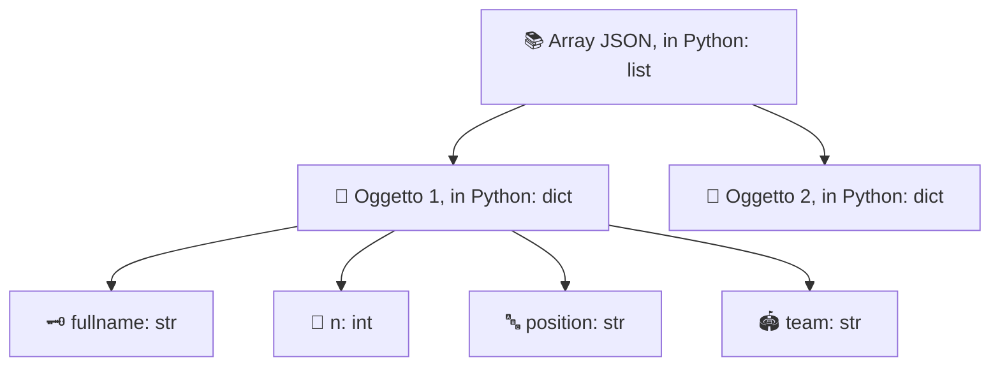

#### 🗝️ Sussurro del Professore:
> il nostro archivio è un **array di oggetti**, cioè in Python una **lista di dizionari**, ed è la struttura più comune per piccole basi di dati 🪐.

<a id="it-python-vs-json"></a>

## 🔁 5. Python vs JSON e `load`, `loads`, `dump`, `dumps`

### 🥊 5.1 Dizionari e liste Python contro dati JSON

⚡ **Concetto chiave**: un `dict` o una `list` sono **oggetti in memoria**; il JSON è **testo** (una stringa o un file). Si assomigliano, ma **non sono la stessa cosa**.

| 🔍 Aspetto | 🐍 Python (oggetto in RAM) | 🧾 JSON (testo) |
|---|---|---|
| Natura | Oggetto vivo, modificabile | Stringa o file |
| Stringhe | `'a'` oppure `"a"` | solo `"a"` |
| Booleani | `True` / `False` | `true` / `false` |
| Assenza di valore | `None` | `null` |
| Chiavi dei dizionari | qualsiasi tipo *hashable* (`1`, `(1,2)`...) | **solo stringhe** |
| Sequenze | `list`, `tuple`, `set` | solo array |
| Virgola finale | ✅ permessa | ❌ vietata |
| Commenti | ✅ `#` | ❌ |

#### ⚠️ Trabocchetti da conoscere:

```python
import json

d = {1: 'uno', 'ok': True, 'nulla': None, 'tupla': (1, 2)}
print(json.dumps(d))
# {"1": "uno", "ok": true, "nulla": null, "tupla": [1, 2]}
```

- 🔢 La chiave `1` diventa `"1"`.
- 📦 La tupla `(1, 2)` diventa un array, e al ritorno sarà una **lista**.
- 🚫 Un `set` non è serializzabile: `TypeError`.

### 🧠 5.2 Le quattro funzioni

#### 🔤 Trucco mnemonico:
la **`s`** finale sta per **String** 🧵.
Senza `s` si lavora con un **file**; con la `s` con una **stringa**.

| 🧰 Funzione | ➡️ Direzione | 📥 Riceve | 📤 Restituisce | 🌰 Uso tipico |
|---|---|---|---|---|
| `load(f)` | 📄 → 🐍 | oggetto file aperto | oggetto Python | leggere un `.json` |
| `loads(s)` | 🧵 → 🐍 | stringa JSON | oggetto Python | risposta di un'API |
| `dump(obj, f)` | 🐍 → 📄 | oggetto + file aperto | `None` (scrive nel file) | salvare su `.json` |
| `dumps(obj)` | 🐍 → 🧵 | oggetto Python | stringa JSON | stampare, inviare in rete |

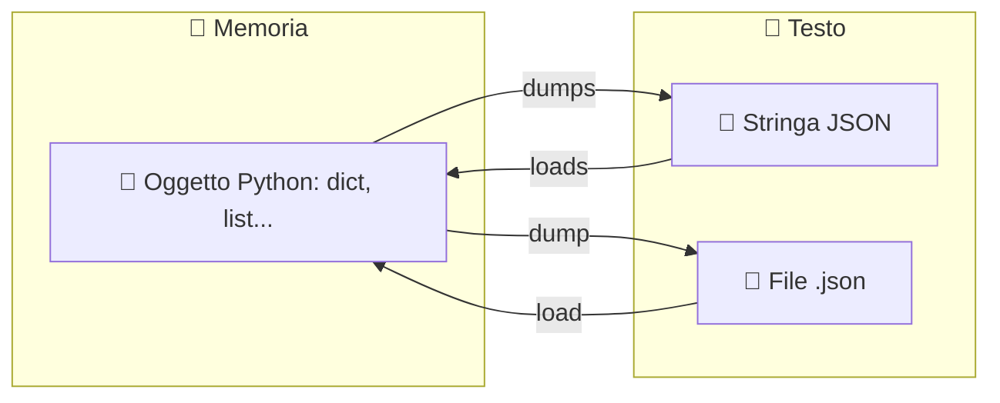

💻 **Esempi uno per uno**:

```python
import json

giocatore = {"fullname": "Diego Armando Maradona", "n": 10, "position": "F", "team": "Napoli"}

# 🐍 → 🧵  dumps: da oggetto a stringa
testo = json.dumps(giocatore)
print(testo)					# {"fullname": "Diego Armando Maradona", "n": 10, ...}

# 🧵 → 🐍  loads: da stringa a oggetto
di_nuovo = json.loads(testo)
print(di_nuovo["team"])			# Napoli

# 🐍 → 📄  dump: da oggetto a file
with open('giocatore.json', 'w', encoding='utf-8') as f:
	json.dump(giocatore, f)

# 📄 → 🐍  load: da file a oggetto
with open('giocatore.json', 'r', encoding='utf-8') as f:
	copia = json.load(f)
```

🎚️ **Parametri utili** (valgono per `dump` e `dumps`):

| ⚙️ Parametro | 📖 Effetto | 🌰 Nel progetto |
|---|---|---|
| `indent` | 🧹 Rientri per un output leggibile (numero o stringa) | `indent = '\t'` |
| `ensure_ascii` | 🔤 Se `False`, mantiene accenti ed emoji reali, non `\u00e8` | `ensure_ascii = False` |
| `sort_keys` | 🔠 Ordina le chiavi alfabeticamente | non usato |
| `default` | 🛟 Funzione per convertire tipi non serializzabili | non usato |

🚨 **Errori tipici**:

| 💥 Eccezione | 🕵️ Quando |
|---|---|
| `json.JSONDecodeError` | 📄 Il testo non è JSON valido (file vuoto, virgola finale, apici singoli...) |
| `TypeError` | 🧊 L'oggetto contiene un tipo non serializzabile (es. un `set`) |
| `FileNotFoundError` | 🔍 Il file da leggere con `load` non esiste |

#### 🗝️ Sussurro del Professore:
> `JSONDecodeError` è una sottoclasse di `ValueError`, quindi un `except ValueError` la cattura 🦖 ma è meglio essere precisi, come fa `loadSoccers`.

📜 *Rima delle quattro:*
*🧵 Con la `s` ragioni di stringa,*
*📄 senza la `s` il file ti stringa!*

<a id="it-analisi"></a>

## 🔬 6. Analisi dell'esempio

🏗️ L'applicazione è una **rubrica di calciatori** a menu, con funzioni **CRUD** (Create, Read, Update, Delete) e persistenza su JSON.

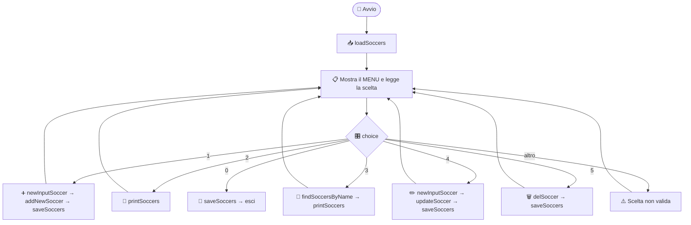

<a id="it-analisi-json"></a>

### 💾 6.1 [soccerplayers.json](./soccerplayers.json)

📂 Questo file **non va scritto a mano**: lo crea il programma al primo salvataggio (finché non esiste, il link qui sopra non porta a nulla 🙈). Ecco come appare dopo qualche inserimento:

```json
[
	{
		"fullname": "Gianluigi Buffon",
		"n": 1,
		"position": "G",
		"team": "Juventus"
	},
	{
		"fullname": "Paolo Maldini",
		"n": 3,
		"position": "D",
		"team": "Milan"
	}
]
```

🔎 Osservazioni:

- 📚 La radice è un **array**: in Python una `list`.
- 🧱 Ogni elemento è un **oggetto**: in Python un `dict` con 4 chiavi.
- 🔢 `n` è un **numero** (senza virgolette) perché il codice lo converte con `int()`.
- 🧹 I rientri a **tabulazione** derivano da `indent = '\t'`.

<a id="it-analisi-tools"></a>

### 🧰 6.2 [SoccersTools.py](./SoccersTools.py)

📋 **Panoramica delle funzioni**:

| 🧩 Funzione | 📥 Parametri | 📤 Ritorna | 💥 Effetto collaterale |
|---|---|---|---|
| `loadSoccers` | `fname` | `list` | 📄 legge il file |
| `saveSoccers` | `fname`, `sList` | niente | 💾 sovrascrive il file |
| `newInputSoccer` | nessuno | `dict` | ⌨️ chiede dati all'utente |
| `addNewSoccer` | `sList`, `soccer` | `bool` | ➕ modifica la lista |
| `printSoccers` | `sList` | niente | 🖨️ stampa a schermo |
| `findSoccersByName` | `sList`, `name` | `list` | nessuno |
| `updateSoccer` | `sList`, `idx`, `soccer` | `bool` | ✏️ modifica la lista |
| `delSoccer` | `sList`, `idx` | `bool` | 🗑️ modifica la lista |

#### 📥 `loadSoccers`: lettura con rete di sicurezza

```python
from json import load, dump, JSONDecodeError

def loadSoccers(fname:str) -> list:
	try:
		with open(fname, 'r', encoding = 'utf-8') as f:
			return load(f)
	except (FileNotFoundError, JSONDecodeError):
		return []
```

- 🏷️ `fname:str` e `-> list` sono **type hints**: documentano i tipi, ma non li impongono.
- 🔓 `with open(..., 'r')` apre in lettura e chiude da solo; `load(f)` converte il JSON in lista di dizionari.
- 🥅 `return` dentro il `with` è sicuro: il file viene comunque chiuso.
- 🛟 Se il file **non esiste** (primo avvio) o è **vuoto/corrotto**, si restituisce una **lista vuota**: il programma parte sempre.

#### 💾 `saveSoccers`: scrittura leggibile

```python
def saveSoccers(fname:str, sList:list):
	with open(fname, 'w', encoding = 'utf-8', newline = '\n') as f:
		dump(sList, f, indent = '\t', ensure_ascii = False)
```

- ✍️ Modo `'w'`: il file viene **riscritto da zero** a ogni salvataggio.
- 🧵 `newline = '\n'`: forza gli a capo in stile Unix anche su Windows, per file identici su ogni sistema.
- 🧹 `indent = '\t'` rende il JSON ordinato; `ensure_ascii = False` conserva accenti ed emoji.

#### ⌨️ `newInputSoccer`: costruire un dizionario

```python
def newInputSoccer() -> dict:
	soccer:dict = {}
	soccer['fullname'] = input('Insert name: ').strip()
	soccer['n'] = int(input('Insert jersey number: '))
	soccer['position'] = input(
'''
(F)orward
(M)idfielder
(D)efender
(G)oalkeeper

insert position: '''
	).strip()
	soccer['team'] = input('Insert Team: ').strip()
	return soccer
```

- 🧼 `.strip()` elimina spazi iniziali e finali.
- 🔢 `int(...)` converte il numero di maglia: se si digita testo scatta `ValueError` ⚠️ (vedi capitolo 8).
- 📜 Le **triple virgolette** `'''...'''` permettono stringhe su più righe, ideali per i menu.
- 🧱 L'**ordine di inserimento** delle chiavi (`fullname`, `n`, `position`, `team`) è mantenuto dai dizionari e determina l'intestazione della tabella.

#### ➕ `addNewSoccer`: niente doppioni

```python
def addNewSoccer(sList:list, soccer:dict) -> bool:
	if soccer in sList:
		return False
	sList.append(soccer)
	return True
```

- 🔁 `soccer in sList` confronta i **dizionari per uguaglianza**: sono doppioni solo se **tutti e quattro** i campi coincidono.
- ✅ Restituisce `True` se ha aggiunto, `False` altrimenti: il chiamante decide cosa fare.
- 🧬 La lista viene modificata **in place** (stesso oggetto di `main.py`), quindi non serve ritornarla.

#### 📃 `printSoccers`: stampa tabellare

```python
def printSoccers(sList: list):
	if not sList:
		print("(Empty List)")
		return

	print("#", *sList[0].keys(), sep="\t")
	print("-" * 40)

	for i, s in enumerate(sList):
		print(i, *s.values(), sep="\t")
```

- 🪣 `if not sList` è vero per una lista vuota: *early return* con messaggio.
- 💥 `*sList[0].keys()` **spacchetta** le chiavi come argomenti separati di `print`; `sep="\t"` le separa con tabulazioni.
- ➖ `"-" * 40` ripete il trattino 40 volte.
- 🔢 `enumerate` fornisce l'**indice** `i`, che l'utente usa per modificare o rimuovere.

#### 🔎 `findSoccersByName`: ricerca flessibile

```python
def findSoccersByName(sList: list, name: str) -> list:
	name = "".join(name.lower().split())
	return [
		s for s in sList if name in "".join(s["fullname"].lower().split())
	]
```

- 🪄 `"".join(x.lower().split())` rende minuscolo e **rimuove tutti gli spazi**: `"  Del Piero "` diventa `"delpiero"`.
- 🧩 `name in ...` è una ricerca per **sottostringa**: `"pier"` trova `"Alessandro Del Piero"`.
- 📚 La **list comprehension** costruisce la lista filtrata in una sola espressione.

#### ✏️ `updateSoccer`: modifica con controlli

```python
def updateSoccer(sList:list, idx:int, soccer:dict) -> bool:
	if not 0 <= idx < len(sList) or any(soccer == s for i, s in enumerate(sList) if i != idx):
		return False
	sList[idx] = soccer
	return True
```

- 🔗 `0 <= idx < len(sList)` è un **confronto concatenato**: verifica che l'indice sia valido.
- 🕵️ `any(... for ... if i != idx)` controlla se il nuovo giocatore **coincide con un altro** elemento, escludendo quello che si sta modificando.
- ❌ Se l'indice non è valido **oppure** c'è un doppione, restituisce `False` senza toccare nulla.

#### 🗑️ `delSoccer`: rimozione

```python
def delSoccer(sList:list, idx:int) -> bool:
	if not 0 <= idx < len(sList):
		return False
	del sList[idx]
	return True
```

- 🚧 Il controllo sui limiti evita `IndexError` e **rifiuta gli indici negativi** (che in Python normale conterebbero dalla fine).

<a id="it-analisi-main"></a>

### 🕹️ 6.3 [main.py](./main.py)

🧱 **Struttura in 4 blocchi**:

1. 📦 **Import** delle funzioni dalla libreria.
2. 🔧 **Costanti**: `SOCCERS_FILE` (percorso del JSON) e `MENU` (testo del menu).
3. 📥 **Caricamento** iniziale: `soccers = loadSoccers(SOCCERS_FILE)`.
4. 🔁 **Ciclo principale** `while choice != 0` con `match/case`.

```python
SOCCERS_FILE = './soccerplayers.json'
soccers = loadSoccers(SOCCERS_FILE)

choice:int = -1

while choice != 0:
	choice = int(input(MENU))
	match choice:
		case 0:
			saveSoccers(SOCCERS_FILE, soccers)
			break
		case 1:
			soccer = newInputSoccer()
			if addNewSoccer(soccers, soccer):
				saveSoccers(SOCCERS_FILE, soccers)
			else:
				print(f"ERROR: Player {soccer['fullname']} already exists")
```

🔎 **Punti da notare**:

- 🔤 La **MAIUSCOLA** di `SOCCERS_FILE` segnala una **costante** (per convenzione).
- 📍 `'./'` indica la **cartella corrente di esecuzione**, non necessariamente quella dello script ⚠️.
- 🎰 `match/case` (Python 3.10+) è lo "switch" di Python; `case _:` è il caso predefinito.
- 🛑 Il `break` dentro `case 0` esce dal `while`.
- 💬 Le **f-string** `f"...{variabile}..."` inseriscono valori nel testo; dentro le graffe con apici singoli, perché la stringa esterna usa i doppi.
- 🔄 **Pattern "carica, modifica, salva"**: dopo ogni operazione che cambia i dati, si chiama `saveSoccers`.

🎬 **Cosa succede quando aggiungi un giocatore**:

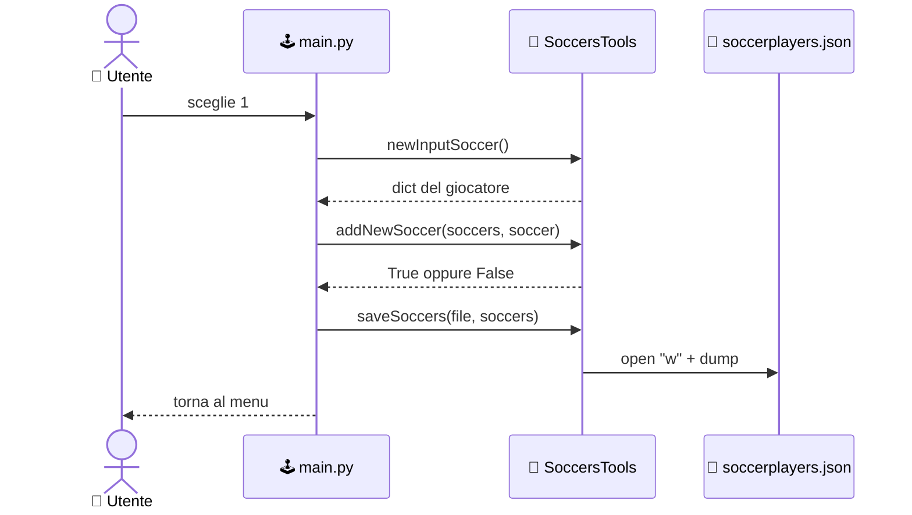

> 🗝️ **Sussurro del Professore:** `soccers` è una lista **mutabile** passata alle funzioni **per riferimento**, quindi `addNewSoccer`, `updateSoccer` e `delSoccer` la modificano direttamente 🍄 senza bisogno di `return`.

<a id="it-persistenza"></a>

## 🏛️ 7. Persistenza: il file come primo database

🧠 **RAM** e **disco** hanno ruoli diversi:

| 🧬 Caratteristica | 🧠 RAM (variabili) | 💾 Disco (file) |
|---|---|---|
| Durata | ⏳ Fino alla chiusura del programma | ♾️ Permanente |
| Velocità | ⚡ Altissima | 🐢 Più lenta |
| Esempio | `soccers` (lista) | `soccerplayers.json` |

🔄 **Il ciclo dei dati** nel nostro programma:

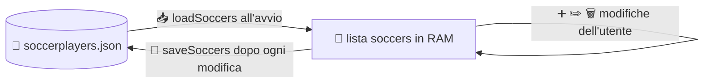

🔗 **Corrispondenza CRUD**:

| 🧱 Operazione | 🎛️ Voce di menu | 🧩 Funzione |
|---|---|---|
| ➕ **C**reate | 1. Add new player | `newInputSoccer` + `addNewSoccer` |
| 📖 **R**ead | 2. List / 3. Search | `printSoccers`, `findSoccersByName` |
| ✏️ **U**pdate | 4. Edit player | `updateSoccer` |
| 🗑️ **D**elete | 5. Remove player | `delSoccer` |

✅ **Pregi di questo approccio**:

- 🪶 Zero dipendenze: bastano standard library e un file.
- 👀 Il JSON è leggibile e modificabile anche con un editor di testo.
- 🧪 Ideale per prototipi, piccoli strumenti e per **imparare** i concetti di base di dati.

⚠️ **Limiti da conoscere**:

| 🚧 Limite | 📖 Spiegazione | 🛟 Prossimo passo |
|---|---|---|
| 🔁 Riscrittura totale | Ogni salvataggio riscrive **tutto** il file | database (SQLite) |
| 👥 Concorrenza | Due programmi che scrivono insieme si sovrascrivono | database con transazioni |
| 💣 Crash durante il `'w'` | Il file può restare vuoto o a metà | scrittura atomica (file temporaneo + `os.replace`) |
| 🔎 Nessun indice | Le ricerche scorrono tutta la lista | database con indici |
| 📐 Nessuno schema | Nessuno impedisce campi sbagliati | validazione o database |

🌱 **Evoluzione naturale**: file di testo → **JSON** → **SQLite** (`import sqlite3`, già nella standard library) → database server.

#### 🗝️ Sussurro del Professore:
> un archivio JSON è un'ottima palestra, ma quando i dati crescono o gli utenti diventano più d'uno, il passo successivo è un vero database 🔮 e voi ci sarete arrivati con le idee già chiare.

<a id="it-sfide"></a>

## 🐞 8. Bug, miglioramenti, esercizi e prova finale

🕵️ Anche il codice migliore si può migliorare: ecco una **caccia ai bug** sull'esempio.

### 🐛 8.1 Cosa si può migliorare

| 🔢 # | 🐞 Problema | 📍 Dove | 💡 Idea di soluzione |
|---|---|---|---|
| 1 | 💥 Input non numerico fa crashare il programma | `int(input(...))` in [main.py](./main.py) e in `newInputSoccer` | `try/except ValueError` |
| 2 | 🤥 Messaggio errato: con indice non valido dice "already exists" | `case 4` di [main.py](./main.py) | controllare l'indice **prima** e distinguere i due errori |
| 3 | 🧭 Dopo una **ricerca** gli indici mostrati sono quelli della lista filtrata, non quelli reali | `case 3` + `printSoccers` | restituire anche l'indice originale |
| 4 | 🔤 La posizione non è validata (si accetta qualsiasi testo) | `newInputSoccer` | accettare solo `F`, `M`, `D`, `G` (maiuscole) |
| 5 | 📍 `'./soccerplayers.json'` dipende dalla cartella di lancio | `SOCCERS_FILE` | usare `pathlib` con `Path(__file__).parent` |
| 6 | 🛡️ Manca il guardiano `if __name__ == "__main__":` | [main.py](./main.py) | racchiudere il programma in una funzione `main()` |
| 7 | 🔁 `saveSoccers` nel `case 0` è ridondante (si salva già a ogni modifica) | `case 0` | rimuoverlo o tenerlo per sicurezza |
| 8 | 🏷️ Stile dei nomi `camelCase` invece di `snake_case` | [SoccersTools.py](./SoccersTools.py) | adeguarsi a PEP 8 |

🩹 **Esempio di correzione del punto 1** (input numerico sicuro):

```python
def inputInt(prompt: str) -> int:
	while True:
		try:
			return int(input(prompt))
		except ValueError:
			print('Please insert a valid integer number.')

# uso
choice = inputInt(MENU)
```

🛡️ **Esempio di scrittura più sicura** (punto "crash durante il `'w'`"):

```python
import os
from json import dump

def saveSoccersSafe(fname: str, sList: list):
	tmp = fname + '.tmp'
	with open(tmp, 'w', encoding = 'utf-8', newline = '\n') as f:
		dump(sList, f, indent = '\t', ensure_ascii = False)
	os.replace(tmp, fname)   # sostituzione atomica: o il vecchio o il nuovo file
```

### 🏋️ 8.2 Esercizi

| 🎚️ Livello | 📝 Esercizio |
|---|---|
| 🟢 Facile | Aggiungi la voce di menu **"6. Conta i giocatori"** che stampa quanti ce ne sono. |
| 🟢 Facile | Scrivi un programma che aggiunge una riga con data e ora a `log.txt` (modo `'a'`) a ogni avvio. |
| 🟡 Medio | Valida la posizione: ripeti la domanda finché l'utente non inserisce `F`, `M`, `D` o `G`. |
| 🟡 Medio | Aggiungi la ricerca per **squadra** (`findSoccersByTeam`) in [SoccersTools.py](./SoccersTools.py). |
| 🟠 Impegnativo | Risolvi il bug #3: dopo la ricerca, l'utente deve poter modificare/rimuovere con l'indice **corretto**. |
| 🔴 Sfida | Impedisci due giocatori con lo **stesso numero di maglia nella stessa squadra**. |
| 🔴 Sfida | Sostituisci il file JSON con **SQLite** mantenendo le stesse funzioni della libreria. |

### 🧠 8.3 Ripasso lampo

- 📦 Ogni `.py` è un **modulo**; si importa con `import` o `from ... import`.
- 📝 `open()` + `close()` → meglio `with open(...) as f`.
- 🎛️ `'r'` legge, `'w'` **svuota** e scrive, `'a'` aggiunge in coda.
- 🧾 JSON è **testo**; `dict`/`list` sono **oggetti**.
- 🧵 `load`/`dump` lavorano con **file**; `loads`/`dumps` con **stringhe**.
- 🔄 Pattern dei dati: **carica → modifica → salva**.

### 🏆 8.4 Prova finale: la caccia al tesoro

🎉 **Complimenti, sei arrivato in fondo!** Ma l'hai letta davvero tutta? 😏

🕵️ Nel corso della guida ho nascosto **8 emoji rare**, **una per ogni capitolo** (dal capitolo 1 all'8).
Le trovi alla fine dei **"Sussurri del Professore"** 🗝️, nei riquadri a citazione.

📣 **Come consegnare la prova**: scrivi nei commenti la **sequenza delle 8 emoji, nell'ordine dei capitoli** (dal primo all'ottavo), senza spazi né altri simboli.

#### 🗝️ Sussurro del Professore:
> il compito è quasi finito, ma resta un'ultima emoji da trovare 🐙, ed è per questo che nessuno dovrebbe scorrere la pagina troppo in fretta.

🎤 *Versi di chiusura:*
*⚽ Il codice è un campo, i dati il pallone,*
*💾 salvali bene, e vinci il torneone!*

🙌 Grazie per aver seguito la lezione.
Alla prossima, **e ricordate: chi non chiude i file lascia le porte aperte!** 🚪

<a href="#TOP">&utrif; top &utrif;</a>

## 🔗 Links
[](https://www.linkedin.com/in/biagio-rosario-greco-77145774/)
[](https://twitter.com/birg_81)
[](mailto:birg81@gmail.com)