[](https://choosealicense.com/licenses/mit/)
[](https://opensource.org/licenses/)
[](http://www.gnu.org/licenses/agpl-3.0)

<a name="TOP"></a>

<a href="#IT"></a>
🤍
<a href="#EN"></a>

---

 <a name="EN"></A>

<!-- English -->

# 🐍 Python OOP: from the Java You Know to Boss Level 🎮

> 💬 *"Explicit is better than implicit."*
> 🧙 Tim Peters, *The Zen of Python*

## 📑 Table of Contents

- [🎬 Introduction](#hook-EN)
- [🗺️ Preface: how to use this guide](#intro-EN)
- [🏗️ Chapter 1: Classes, objects and the famous `self`](#cap01-EN)
- [🧪 Chapter 2: Instance and class attributes and methods](#cap02-EN)
- [🔒 Chapter 3: Encapsulation and naming](#cap03-EN)
- [🎛️ Chapter 4: Getters, setters and `@property`](#cap04-EN)
- [🪞 Chapter 5: Representing, converting and comparing](#cap05-EN)
- [🧬 Chapter 6: Inheritance and `super()`](#cap06-EN)
- [🎭 Chapter 7: Polymorphism, duck typing and abstract classes](#cap07-EN)
- [🕸️ Chapter 8: Multiple inheritance, composition and modules](#cap08-EN)
- [🏁 Final thoughts](#fine-EN)
- [🧭 Concept map](#mappa-EN)

<a id="hook-EN"></a>

## 🎬 Introduction

You're in the lobby with your friends, Saturday night, one click away from the match. 🎮 Everyone has their own character: same sheet, different stats. That's it: **a class is the character sheet, an object is the character in the match**.

You already know this from Java and C#. So why a guide? Because Python does something weird: **nobody stops you**. No `private` slamming the door in your face, no `new`, no `interface`, no mandatory `@Override`. Python trusts you, and trust has to be earned. 😎

We won't redo OOP theory here: we'll look at **where Python does the same things differently**, and where it does things Java and C# simply don't. By the end you'll write classes, hierarchies and modules on your own.

<a id="intro-EN"></a>

## 🗺️ Preface: how to use this guide

The trip follows a teaching route: first the single object, then how to protect it, then how to print and compare it, and finally how to make it evolve with inheritance.

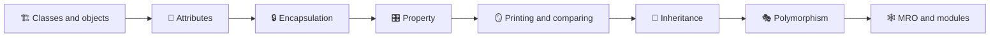

<a id="cap01-EN"></a>

## 🏗️ Chapter 1: Classes, objects and the famous `self`

### 🧱 The first example: the [Point](./es-0_geometry/model.py)

A class in Python is declared with `class`; initialization happens in `__init__`. Here's a [`Point`](./es-0_geometry/model.py) on the Cartesian plane:

```python
class Point:
	def __init__(self, x: float = 0.0, y: float = 0.0):
		self.__x: float = x	# private attribute (we'll see it in chapter 3)
		self.__y: float = y

	def dist(self, p: 'Point' = None) -> float:
		if p is None:	# no argument: distance from the origin
			p = Point(0, 0)
		return ((self.__x - p.__x)**2 + (self.__y - p.__y)**2)**.5

p1 = Point(4, 3)	# no "new": you call the class like a function
p2 = Point()		# uses the default values: P(0, 0)
print(p1.dist())	# 5.0
```

### 🔍 What changes compared to Java and C#

| 🔍 Concept | ☕ Java / C# | 🐍 Python |
|---|---|---|
| Creating an object | `new Point(4, 3)` | `Point(4, 3)` |
| Constructor | method named like the class | `__init__` |
| Reference to the instance | `this` (implicit) | `self` (**explicit**, first parameter) |
| Multiple constructors | overloading | a single `__init__` with default values |
| Declaring fields | in the class body | created by assigning `self.name = ...` |

> 🧠 **The key point:** `this` in Java exists "by magic", `self` in Python is a real parameter. `self` is not a reserved word: it's a convention so strong that you never, ever rename it.

### 🎛️ Why `self` is explicit

When you write `p1.dist(p2)`, Python translates it into `Point.dist(p1, p2)`: the object on the left of the dot becomes the first argument. That's why the method declares `self` and then `p`.

```python
p1.dist(p2)	# the usual form
Point.dist(p1, p2)	# equivalent form: here's where self went
```

### 🛠️ What happens with `Point(4, 3)`

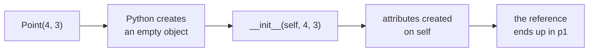

⚙️ To be precise, under the hood the object is created by `__new__` and `__init__` **initializes** it. For your own classes, `__init__` is more than enough.

⚠️ Two gotchas for ex-Java programmers: forgetting `self` in the definition (`def dist(p)` blows up at runtime) and forgetting `self.` in front of attributes (`x = 3` creates a local variable, not an attribute).

#### Reflection 🦊
*An object is just a bag of attributes with some methods glued on: `self` is the string tying them together.*

<a id="cap02-EN"></a>

## 🧪 Chapter 2: Instance and class attributes and methods

### 🎮 One attribute per object, or one for everybody?

Think of an online game: every player has their own nickname, but the **number of connected players** is just one, shared.

```python
class Player:
	count: int = 0	# CLASS attribute: just one, shared

	def __init__(self, nickname: str):
		self.nickname = nickname				# INSTANCE attribute: one per object
		Player.count += 1

	@staticmethod
	def is_valid_nickname(text: str) -> bool:	# no self, no cls
		return 3 <= len(text) <= 12

	@classmethod
	def guest(cls) -> 'Player':					# cls is the class itself
		return cls('guest')

a = Player('Luna')
b = Player.guest()
print(Player.count)	# 2
print(Player.is_valid_nickname('xy'))	# False
```

### 📋 Three kinds of methods

| 🧩 Kind | 🏷️ Decorator | 📥 First parameter | 🎯 When to use it | ☕ In Java/C# |
|---|---|---|---|---|
| Instance | none | `self` | works on the object's data | regular method |
| Class | `@classmethod` | `cls` | alternative constructors, shared data | kind of a `static` factory |
| Static | `@staticmethod` | none | utility function tied to the class | `static` |

- 🏭 The `@classmethod` is perfect for **alternative constructors**, since Python has no overloading: `Player.guest()`, `Point.from_string('4,3')`.
- 🧰 The `@staticmethod` is a plain function that lives in the class just to keep things tidy.
	- 🔹 If it needs neither `self` nor `cls`, it can be static.
	- 🔹 Python also has free functions at module level: they're often the better choice.

### 🔎 How Python looks up an attribute

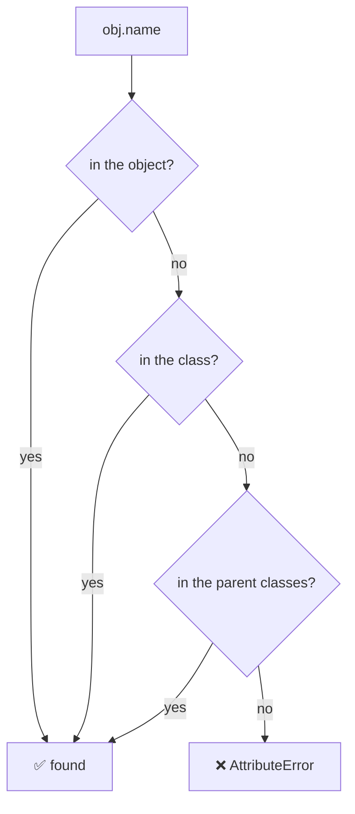

### ⚠️ Two classic traps

1. **`self.count += 1` does not modify the class attribute**: it reads the class value, then creates a brand-new instance attribute with the same name that "shadows" it. To change the shared data, write `Player.count += 1`.
2. **A list as a class attribute is shared by everybody**: a proper bug factory. If every player needs their own inventory, create the list in `__init__` with `self.items = []`.

```python
class Bag:
	items = []			# WRONG: all Bags share the same list

class GoodBag:
	def __init__(self):
		self.items = []	# RIGHT: one list per object
```

#### Reflection 🐙
*Always ask yourself: does this piece of data belong to each object or to the whole class? That's where you write it.*

<a id="cap03-EN"></a>

## 🔒 Chapter 3: Encapsulation and naming

### 🚗 No `private`: how do you protect a piece of data?

In Java and C# the compiler stops you from touching a `private` field. In Python **there are no access modifiers**: you rely on naming conventions. Like in a car: you can pop the hood, but there's a sign saying "don't touch". 🚗

> 💬 *"We are all consenting adults here."*
> 🧙 A saying from the Python community

| 🔓 Form | 🏷️ Level | 🛡️ What really happens | ☕ Equivalent |
|---|---|---|---|
| `x` | public | no restriction | `public` |
| `_x` | protected (by convention) | no restriction, it's a "don't touch" sign | `protected` |
| `__x` | private (name mangling) | Python renames it internally to `_ClassName__x` | `private` |

### 🧬 Name mangling in plain words

With two leading underscores Python **changes the name** of the attribute, putting the class name in front. The goal: stop a subclass from accidentally creating an attribute with the same name as one in the parent class. It's not security: it's name hygiene. 🧼

An important consequence: **inside the class** `Point`, the code `p.__x` works even if `p` is another `Point`, because the name gets transformed in the same way. It's the same rule as Java, where an object can read the `private` fields of another object of the **same** class. From a different class, though, that name can no longer be found.

### 🏷️ Naming the methods that read data

How do you read an attribute? It depends on the level:

| 📦 Attribute | 👀 How you read it | 🏷️ Method name |
|---|---|---|
| public `x` | directly: `p.x` | no method needed |
| protected `_x` | method or property | `x()` or `get_x()` |
| private `__x` | only through a method | `x()`, `get_x()` or property |

Our [`Point`](./es-0_geometry/model.py) uses the short name:

```python
class Point:
	def __init__(self, x: float = 0.0, y: float = 0.0):
		self.__x: float = x
		self.__y: float = y

	def x(self) -> float:	# getter with the same name as the attribute
		return self.__x

	def y(self) -> float:
		return self.__y
```

And here's why it's needed: the line has to know the coordinates of a point, but from inside [`Line`](./es-0_geometry/model.py) the name `p.__x` would be transformed into `p._Line__x`, which doesn't exist.

```python
class Line:
	def __init__(self, m: float = 0.0, q: float = 0.0):
		self.__m = float(m)	# slope
		self.__q = float(q)	# intercept

	def is_parallel(self, r: 'Line') -> bool:
		return self.__m == r.__m	# ok: r is a Line, same class

	def dist(self, p: 'Point' = None) -> float:
		if p is None:
			p = Point(0, 0)
		return abs(self.__m * p.x() + self.__q - p.y()) / ((1 + self.__m**2)**.5)
```

Notice the difference: `r.__m` is fine (same class), while for the point you go through the getters `p.x()` and `p.y()`.

### 🎯 Rule of thumb

- 🟢 Data that can change freely? Public.
- 🟡 Data meant for subclasses? With `_`.
- 🔴 Data that must stay hidden or risks a name clash? With `__`.
- ⚙️ Data that needs validating? Go through a property (chapter 4).

#### Reflection 🦉
*In Python, privacy is a trust deal written into names, not a padlock.*

<a id="cap04-EN"></a>

## 🎛️ Chapter 4: *Getters*, *setters* and `@property`

### ☕ The Java style, which works in Python too

You can write `get_xxx()` and `set_xxx()` exactly like in Java:

```python
class Wallet:
	def __init__(self, coins: int = 0):
		self.__coins: int = 0
		self.set_coins(coins)

	def get_coins(self) -> int:
		return self.__coins

	def set_coins(self, value: int) -> None:
		if value >= 0:	# validation: no negative coins
			self.__coins = value
```

It works, but it's wordy: `w.set_coins(w.get_coins() + 5)`. Python has something sleeker.

### ✨ `@property`: looks like an attribute, behaves like a method

```python
class Wallet:
	def __init__(self, coins: int = 0):
		self.__coins: int = 0
		self.coins = coins	# goes through the setter!

	@property
	def coins(self) -> int:	# getter
		return self.__coins

	@coins.setter
	def coins(self, value: int) -> None:	# setter
		if value >= 0:
			self.__coins = value

w = Wallet(10)
w.coins += 5	# attribute syntax, but it runs getter and setter
print(w.coins)	# 15
```

🎁 The cool part: you can start with a public attribute and turn it into a property **later**, without changing a single line of the code that uses it. In Java you'd be forced to rewrite every caller.

| 🔍 Aspect | ☕ Java | 🔷 C# | 🐍 Python |
|---|---|---|---|
| Syntax | `getX()` / `setX()` | `public int X { get; set; }` | `@property` + `@x.setter` |
| Call | `p.getX()` | `p.X` | `p.x` |
| Read-only | getter only | `{ get; }` | property without setter |

A property **without a setter** is read-only: assigning to it raises `AttributeError`.

### 🧍 The pattern of the [`Person`](./es-1_people/model.py) class

In our example, [`Person`](./es-1_people/model.py) has a property with validation for every attribute. Note the trick in `__init__`: first you assign a **safe value**, then you go through the setter.

```python
class Person:
	def __init__(self, firstname: str = 'Ciro', lastname: str = 'De Rosa', age: int = 17, isMale: bool = True):
		self._firstname: str = 'Ciro'	# safe starting value
		self._age: int = 17
		self.firstname = firstname	# now it goes through the setter and may be rejected
		self.age = age

	@property
	def age(self) -> int:
		return self._age

	@age.setter
	def age(self, value: int) -> None:
		if isinstance(value, int) and not isinstance(value, bool) and value > 0:
			self._age = value	# otherwise: silent discard
```

Why `not isinstance(value, bool)`? Because in Python `True` is an `int` (it equals 1): without the check, `age = True` would sail through. 🤯

### 🚦 What happens when the data is not valid

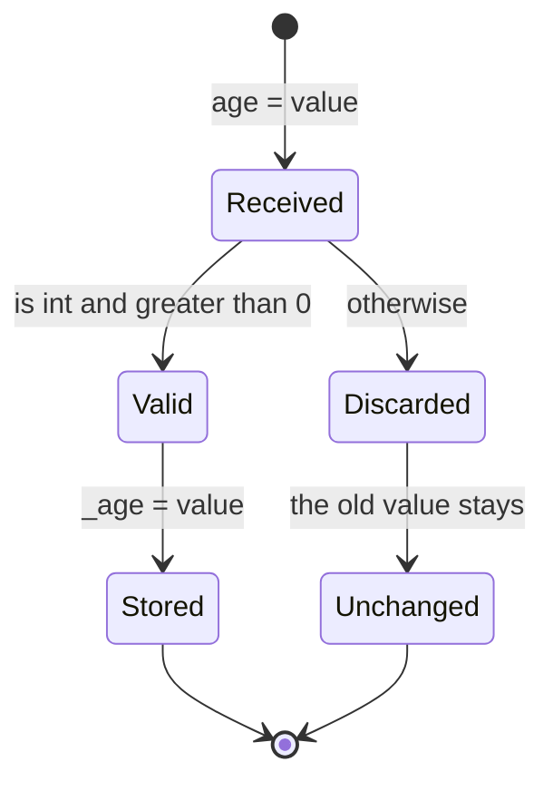

⚠️ In our example the setter **silently discards**: easy to read, risky in real programs, because an error goes unnoticed. The best practice is to raise an exception:

```python
	@age.setter
	def age(self, value: int) -> None:
		if not isinstance(value, int) or isinstance(value, bool) or value <= 0:
			raise ValueError(f'invalid age: {value!r}')
		self._age = value
```

#### Reflection 🐢
*A property is a promise: from the outside it looks like plain data, but there's a bouncer behind it checking IDs.*

<a id="cap05-EN"></a>

## 🪞 Chapter 5: Representing, converting and comparing

### 🖨️ `__str__` and `__repr__`

When you do `print(p1)`, Python calls `__str__`: it's the `toString()` of Java and the `ToString()` of C#.

| 🪞 Method | 👥 For whom | 🎯 Goal | 📟 Called by |
|---|---|---|---|
| `__str__` | the user | readable text | `print()`, `str()`, f-strings |
| `__repr__` | the developer | unambiguous text, ideally rebuildable | console, debugger, inside lists |

```python
class Point:
	def __str__(self) -> str:
		return f'P({self.__x:g}, {self.__y:g})'	# :g strips useless zeros

	def __repr__(self) -> str:
		return f'Point({self.__x!r}, {self.__y!r})'
```

💡 If you only define `__repr__`, `print` will use it too.
If you only define `__str__`, *lists of objects will keep showing the ugly* `<Point object at 0x...>`.

### 📦 From object to dictionary with `vars()`

`vars(obj)` returns the dictionary of the instance attributes (it's the same as `obj.__dict__`). With clean keys you get straight to JSON, which you already know how to write:

```python
import json

person = Person('Anna', 'Di Maio', 27, False)
data = vars(person)	# {'_firstname': 'Anna', '_lastname': 'Di Maio', ...}
clean = {k.lstrip('_'): v for k, v in data.items()}	# strips the underscores
print(json.dumps(clean, indent='\t'))
```

Output:

```json
{
	"firstname": "Anna",
	"lastname": "Di Maio",
	"age": 27,
	"isMale": false
}
```

- ⚠️ `vars()` doesn't make a copy: changing the dictionary changes the object. If you want a copy, use `dict(vars(p))`.
- 🔁 The reverse trip works: `Person(**clean)` rebuilds the object, because the keys match the parameter names.
- 🔒 For attributes with `__` the keys contain the class name (a mangling side effect): a good reason to use `_x` in objects you plan to serialize.

### ⚖️ Comparing: `__eq__`, `__lt__`, `__hash__`

By default `==` compares the object's **identity**, like Java's `==` on references. To compare contents, you override `__eq__`:

```python
class Point:
	def __eq__(self, other: object) -> bool:
		if not isinstance(other, Point):
			return NotImplemented	# let Python decide
		return self.__x == other.__x and self.__y == other.__y

	def __hash__(self) -> int:	# required together with __eq__
		return hash((self.__x, self.__y))

	def __lt__(self, other: 'Point') -> bool:
		return self.dist() < other.dist()	# closer to the origin = smaller
```

| ☕ Java / C# | 🐍 Python | 🎯 Used for |
|---|---|---|
| `toString()` | `__str__` | printing |
| `equals()` | `__eq__` | `a == b` |
| `hashCode()` | `__hash__` | using the object in a `set` and as a `dict` key |
| `compareTo()` | `__lt__` | `<`, `sorted()`, `min()`, `max()` |

🍕 Picture a set of points: with consistent `__eq__` and `__hash__`, two identical `P(4, 3)` points count as **just one**. With `__lt__` you can write `sorted(points)`.

> 📌 **Golden rule:** if two objects are equal according to `__eq__`, they must have the same `__hash__`. If you define `__eq__` without `__hash__`, Python makes the object unhashable.

#### Reflection 🦄
*Objects have a secret vocabulary: double-underscore methods are the words Python uses to make them talk.*

<a id="cap06-EN"></a>

## 🧬 Chapter 6: Inheritance and `super()`

### 👨‍🏫 Person, Student, Teacher

The setup is the one you know: a parent class with what everybody has in common, and two children adding their own stuff.

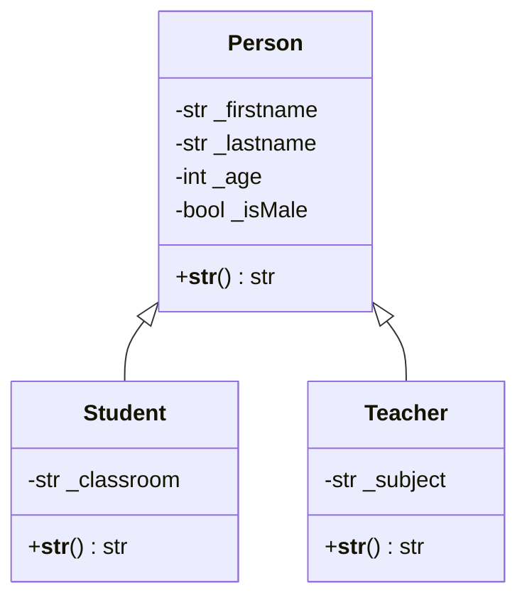

| 🔍 Aspect | ☕ Java / 🔷 C# | 🐍 Python |
|---|---|---|
| Declaring inheritance | `extends` / `:` | `class Student(Person):` |
| Calling the parent constructor | `super(...)` / `base(...)` | `super().__init__(...)` |
| Calling a parent method | `super.m()` / `base.M()` | `super().m()` |
| Overriding a method | `@Override` / `override` | just rewrite it, no keyword |

### 🚀 The subclasses

```python
class Student(Person):
	def __init__(self, firstname: str = 'Paola', lastname: str = 'Cuomo', age: int = 15, isMale: bool = False, classroom: str = '4X'):
		super().__init__(firstname, lastname, age, isMale)	# first the "Person" part
		self._classroom: str = '4X'
		self.classroom = classroom	# then the specific part, via setter

	def __str__(self) -> str:
		return f'[Student] {super().__str__()}, classroom: {self._classroom}'
```

[`Teacher`](./es-1_people/model.py) has the same structure, with `subject` instead of `classroom` and `[Teacher]` in the text.

⚠️ **Difference from Java:** in Python the parent constructor is **not** called automatically. If you forget `super().__init__(...)`, the parent class's attributes simply don't exist.

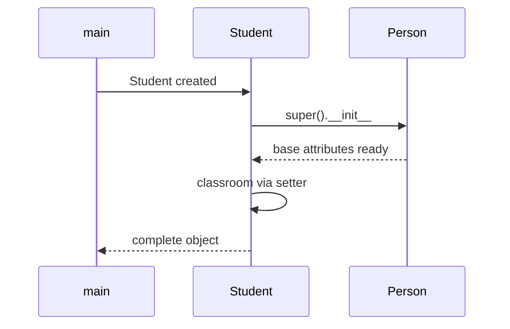

### 🎮 Keyword arguments and default values

With lots of default parameters, **keyword arguments** are a lifesaver: `Student(age = 16, firstname = 'Luca', classroom = '4G')` sets only what you need, in whatever order you like.

```python
people: list[Person] = [
	Person(),
	Person('Anna', 'Di Maio', 27, False),
	Student(age = 16, firstname = 'Luca', classroom = '4G'),
	Student('Sofia', 'Rossi', 17, isMale = False, classroom = '5B'),
	Teacher(subject = 'Math', age = 45, lastname = 'Bianchi'),
	Teacher('El', 'Verdi', -5, False, subject = 'Physics'),
]

for p in people:
	print(p)
print()
print('-' * 15)
print(f'\n{vars(people[0])}')
```

Output:

```text
Ciro De Rosa (♂), age: 17
Anna Di Maio (♀), age: 27
[Student] Luca Cuomo (♀), age: 16, classroom: 4G
[Student] Sofia Rossi (♀), age: 17, classroom: 5B
[Teacher] Anna Bianchi (♀), age: 45, subject: Math
[Teacher] Ciro Verdi (♀), age: 17, subject: Physics

---------------

{'_firstname': 'Ciro', '_lastname': 'De Rosa', '_age': 17, '_isMale': True}
```

### 🕵️ The last line is a riddle

`Teacher('El', 'Verdi', -5, False, ...)` produces **Ciro** and **17 years old**: why?

1. `'El'` has only 2 letters, and the setter demands more than 2 characters: discarded.
2. `-5` is not greater than 0: discarded.
3. What's left are the safe values assigned in `Person.__init__`, i.e. `'Ciro'` and `17`, **not** the `Teacher` defaults (`'Anna'`, 32).

The "safe value, then setter" pattern works, but surprises like this are one more reason to prefer `ValueError`.

#### Reflection 🐝
*A child inherits everything and can override what it doesn't like, but it must always call home with `super()`.*

<a id="cap07-EN"></a>
## 🎭 Chapter 7: Polymorphism, duck typing and abstract classes

### 🐉 Same message, different behaviors

In an RPG every enemy attacks, but each one does it in its own way: that's the polymorphism you already know. What's new in Python are **abstract classes** with the `abc` module and **duck typing**.

```python
from abc import ABC, abstractmethod

class Enemy(ABC):	# ABC: abstract base class
	def __init__(self, name: str, hp: int):
		self.name = name
		self.hp = hp

	@abstractmethod
	def attack(self) -> int:	# children MUST override it
		...

class Goblin(Enemy):
	def attack(self) -> int:
		return 5

class Dragon(Enemy):
	def attack(self) -> int:
		return 50

party = [Goblin('Grub', 10), Dragon('Smaug', 500)]
for enemy in party:
	print(f'{enemy.name} hits for {enemy.attack()}')
```

Output:

```text
Grub hits for 5
Smaug hits for 50
```

If you try `Enemy('x', 1)`, Python raises `TypeError`: a class with abstract methods can't be instantiated, just like in Java and C#.

| 🔍 Aspect | ☕ Java / 🔷 C# | 🐍 Python |
|---|---|---|
| Abstract class | `abstract class` | inherits from `ABC` |
| Abstract method | `abstract` | `@abstractmethod` |
| Interface | `interface` | doesn't exist: you use an ABC with only abstract methods |
| Check | at compile time | **at instantiation**, at runtime |

### 🦆 Duck typing

> 💬 *"If it walks like a duck and quacks like a duck, it's a duck."*

Python doesn't ask that an object **descend** from a certain class: it asks that it **can do** what you ask of it. A trap with the right method works fine even if it doesn't inherit from `Enemy`:

```python
class Trap:	# no relation to Enemy
	def attack(self) -> int:
		return 20

for thing in [Goblin('Grub', 10), Trap()]:
	print(thing.attack())	# works with both
```

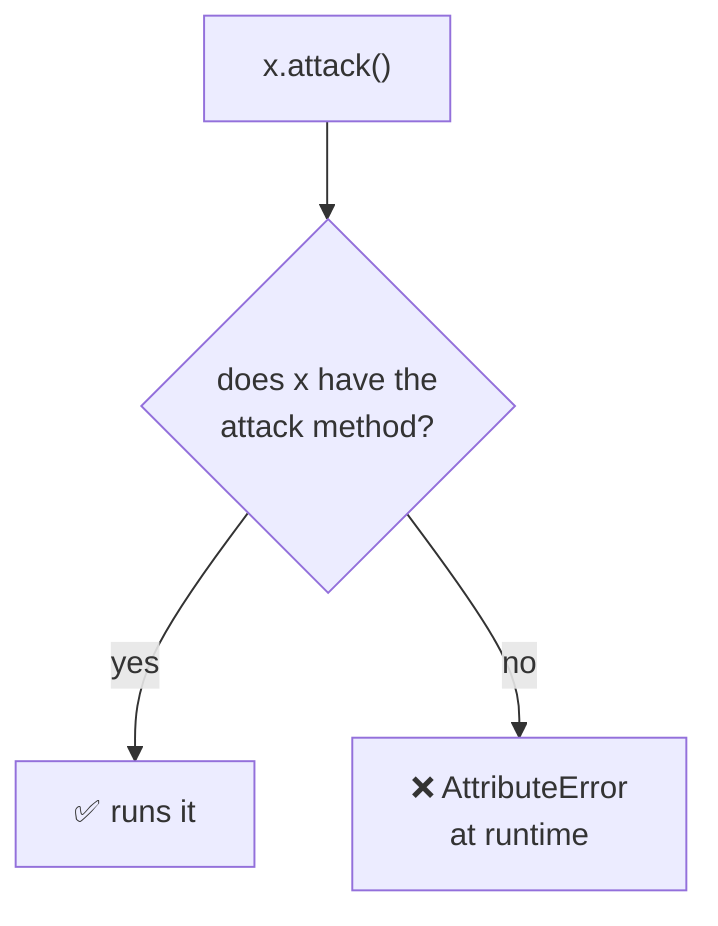

⚖️ **Pros and cons.** Duck typing makes code flexible and lightweight, but errors only show up when the code runs. ABCs and type hints exist precisely to bring back a bit of discipline where it's needed.

### 🔎 Checking types: `isinstance` and `issubclass`

```python
isinstance(party[0], Goblin)	# True
isinstance(party[0], Enemy)	# True: a Goblin is also an Enemy
issubclass(Dragon, Enemy)	# True: works on classes, not on objects
type(party[0]) == Enemy	# False: type() only looks at the exact type
```

- ✅ Use `isinstance` to check types: it respects inheritance.
- ⚠️ Avoid `type(x) == ...` except in specific cases.
- 🧠 It's what we already used in the setters: `isinstance(value, str)`.

### 🧭 Which tool should you pick?

| 🎯 Situation | 🛠️ Tool |
|---|---|
| I want to force the children to override a method | `ABC` class + `@abstractmethod` |
| I just need the object to be able to do one thing | duck typing |
| I have to handle two types differently | `isinstance` |

#### Reflection 🦋
*It doesn't matter who you are by birth, but what you can do when someone calls on you.*

<a id="cap08-EN"></a>

## 🕸️ Chapter 8: Multiple inheritance, composition and modules

### 💎 More parents: the diamond

Java and C# allow just one parent class (plus interfaces). **Python allows more than one**:

```python
class A:
	def hello(self) -> str:
		return 'A'

class B(A):
	def hello(self) -> str:
		return 'B>' + super().hello()

class C(A):
	def hello(self) -> str:
		return 'C>' + super().hello()

class D(B, C):	# two parents
	def hello(self) -> str:
		return 'D>' + super().hello()

print(D().hello())	# D>B>C>A
```

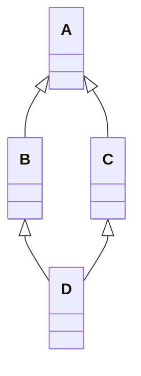

### 🧮 MRO: the lookup order

With several parents, who answers first? Python computes the **Method Resolution Order** (MRO) and always follows it:

```python
print([c.__name__ for c in D.mro()])	# ['D', 'B', 'C', 'A', 'object']
```

- 📌 `super()` doesn't mean "my father", but **"the next one in the MRO"**: that's why `B` calls `C` and not `A` directly.
- 🧩 Every class is visited **only once**, so `A` doesn't run twice.
- 🌳 `object` is the root of all classes, like `Object` in Java.

⚠️ Multiple inheritance is powerful but tricky. Use it for **mixins**, small classes that add a single capability, and otherwise don't go overboard.

### 🔗 Composition: "has a" beats "is a"

A car **has an** engine, it **isn't an** engine. 🚗

```python
class Engine:
	def __init__(self, hp: int):
		self.hp = hp

	def start(self) -> str:
		return 'Vroom!'

class Car:
	def __init__(self, model: str, hp: int):
		self.model = model
		self.engine = Engine(hp)	# composition: the car contains an Engine

	def start(self) -> str:
		return f'{self.model}: {self.engine.start()}'	# delegates to the component
```

| 🧬 Inheritance | 🔗 Composition |
|---|---|
| "is a" relationship | "has a" relationship |
| strong, rigid coupling | loose, composable coupling |
| `Student` is a `Person` | `Car` has an `Engine` |

> 🎯 **Rule:** if you can say "is a", inherit; if you have to say "has a" or "uses a", compose.

### 📦 Organizing code: packages and namespaces

In Java you have `package`, in C# `namespace`. In Python **a `.py` file is a module and a folder is a package**. Your examples already do it: `main.py` imports from `model.py`.

```text
game/
	__init__.py	# makes the folder a package (can be empty)
	main.py
	model/
		__init__.py
		geometry.py
		people.py
```

```python
from model import Point, Line	# import only what you need
from model.people import Student	# import from a submodule

if __name__ == '__main__':	# runs only if the file is launched directly
	print(Point(4, 3))
```

| 🔍 Concept | ☕ Java | 🔷 C# | 🐍 Python |
|---|---|---|---|
| Unit of code | package | namespace | module and package |
| Importing | `import a.b.C;` | `using A.B;` | `from a.b import C` |
| Mapping to disk | folders | free | folders and files |

### ✨ A taste of dataclasses

For classes that are just "data containers", `@dataclass` writes `__init__`, `__repr__` and `__eq__` for you, no boilerplate:

```python
from dataclasses import dataclass

@dataclass
class Coin:
	value: int
	currency: str = 'EUR'

print(Coin(2))	# Coin(value=2, currency='EUR')
```

#### Reflection 🐳
*Choose your family tree carefully: an object that holds another one often stands stronger than a whole genealogy.*

<a id="fine-EN"></a>
## 🏁 Final thoughts

You started from a `Point` and ended up with diamonds, MRO and packages. Recap:

- 🏗️ A class is written with `class`, initialized with `__init__`, and uses an **explicit** `self`.
- 🧪 Class and instance attributes must not be mixed up.
- 🔒 Privacy by convention: `x`, `_x`, `__x`, with getters named however you like (`x()`, `get_x()`, property).
- 🎛️ `@property` blends convenience and control.
- 🪞 `__str__`, `__repr__`, `__eq__`, `__hash__`, `__lt__` and `vars()` make objects talk to Python and to JSON.
- 🧬 `super()` is a must to initialize the parent class.
- 🎭 Duck typing and `abc` live side by side: flexibility where you need it, rules where you need them.
- 🕸️ Prefer composition over multiple inheritance, whenever possible.

📚 **What we left out** (for the next level): metaclasses, descriptors, `__slots__`, `__getattr__`, advanced decorators and `Protocol`. You don't need them to write code on your own, but they'll be waiting when you want to go further.

> 💬 *The best way to learn is to break the code and figure out why it broke.* 🔧 Try it: remove a `super()`, build a diamond, discard a value in the setter. Then read what the error says.

<a id="mappa-EN"></a>
## 🧭 Concept map

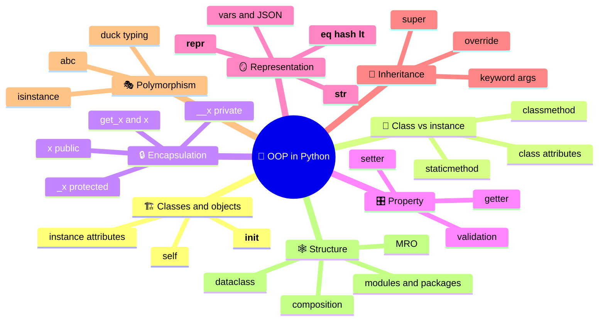

---

<a href="#IT"></a>
🤍
<a href="#EN"></a>

---

 <a name="IT"></A>

<!-- Italiano -->

# 🐍 Python OOP: dal Java che conoscete al Livello Boss 🎮

> 💬 *"Explicit is better than implicit."*
> 🧙 Tim Peters, *The Zen of Python*

## 📑 Indice

- [🎬 Il gancio](#gancio-IT)
- [🗺️ Prefazione: come usare questa guida](#intro-IT)
- [🏗️ Capitolo 1: Classi, oggetti e il famoso `self`](#cap01-IT)
- [🧪 Capitolo 2: Attributi e metodi di istanza e di classe](#cap02-IT)
- [🔒 Capitolo 3: Incapsulamento e naming](#cap03-IT)
- [🎛️ Capitolo 4: Getter, setter e `@property`](#cap04-IT)
- [🪞 Capitolo 5: Rappresentare, convertire e confrontare](#cap05-IT)
- [🧬 Capitolo 6: Ereditarietà e `super()`](#cap06-IT)
- [🎭 Capitolo 7: Polimorfismo, duck typing e classi astratte](#cap07-IT)
- [🕸️ Capitolo 8: Ereditarietà multipla, composizione e moduli](#cap08-IT)
- [🏁 Considerazioni finali](#finali-IT)
- [🧭 Mappa dei concetti](#mappa-IT)

<a id="gancio-IT"></a>

## 🎬 Introduzione

Siete in lobby con gli amici, sabato sera, a un passo dalla partita. 🎮 Ognuno ha il suo personaggio: stessa scheda, ma statistiche diverse. Ecco, **una classe è la scheda del personaggio, un oggetto è il personaggio in partita**.

Questo lo sapete già da Java e C#. Allora perché una guida? Perché in Python succede una cosa strana: **nessuno vi blocca**. Niente `private` che vi sbatte la porta in faccia, niente `new`, niente `interface`, niente `@Override` obbligatorio. Python dà fiducia, e la fiducia va meritata. 😎

In questa guida non rifaremo la teoria dell'OOP: vedremo **dove Python fa le stesse cose in modo diverso** e dove invece fa cose che Java e C# non fanno. Alla fine scriverete classi, gerarchie e moduli in autonomia.

<a id="intro-IT"></a>

## 🗺️ Prefazione: come usare questa guida

Il viaggio segue un itinerario didattico: prima l'oggetto singolo, poi come proteggerlo, poi come stamparlo e confrontarlo, infine come farlo evolvere con l'ereditarietà.

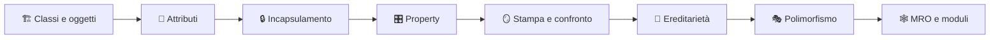

<a id="cap01-IT"></a>

## 🏗️ Capitolo 1: Classi, oggetti e il famoso `self`

### 🧱 Il primo esempio: il [Punto](./es-0_geometry/model.py)

Una classe in Python si dichiara con `class`; l'inizializzazione si fa in `__init__`. Ecco un [`Point`](./es-0_geometry/model.py) sul piano cartesiano:

```python
class Point:
	def __init__(self, x: float = 0.0, y: float = 0.0):
		self.__x: float = x	# attributo privato (lo vedremo nel capitolo 3)
		self.__y: float = y

	def dist(self, p: 'Point' = None) -> float:
		if p is None:	# senza argomento: distanza dall'origine
			p = Point(0, 0)
		return ((self.__x - p.__x)**2 + (self.__y - p.__y)**2)**.5

p1 = Point(4, 3)	# niente "new": si chiama la classe come una funzione
p2 = Point()		# usa i valori di default: P(0, 0)
print(p1.dist())	# 5.0
```

### 🔍 Cosa cambia rispetto a Java e C#

| 🔍 Concetto | ☕ Java / C# | 🐍 Python |
|---|---|---|
| Creare un oggetto | `new Point(4, 3)` | `Point(4, 3)` |
| Costruttore | metodo con il nome della classe | `__init__` |
| Riferimento all'istanza | `this` (implicito) | `self` (**esplicito**, primo parametro) |
| Più costruttori | overload | un solo `__init__` con valori di default |
| Dichiarare i campi | nel corpo della classe | si creano assegnando `self.nome = ...` |

> 🧠 **Il punto chiave:** `this` in Java esiste "per magia", `self` in Python è un parametro vero. `self` non è una parola riservata: è una convenzione talmente forte che non va mai cambiata.

### 🎛️ Perché `self` è esplicito

Quando scrivete `p1.dist(p2)`, Python lo traduce in `Point.dist(p1, p2)`: l'oggetto a sinistra del punto diventa il primo argomento. Per questo il metodo dichiara `self` e poi `p`.

```python
p1.dist(p2)	# forma abituale
Point.dist(p1, p2)	# forma equivalente: ecco dov'è finito self
```

### 🛠️ Che cosa succede con `Point(4, 3)`

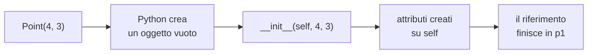

⚙️ A voler essere precisi, l'oggetto lo crea `__new__` e `__init__` lo **inizializza**. Per le vostre classi `__init__` basta e avanza.

⚠️ Attenzione a due errori da ex programmatori Java: dimenticare `self` nella definizione (`def dist(p)` fallisce a runtime) e dimenticare `self.` davanti agli attributi (`x = 3` crea una variabile locale, non un attributo).

#### Riflessione 🦊
*Un oggetto è solo un contenitore di attributi con dei metodi attaccati: `self` è il filo che li lega.*

<a id="cap02-IT"></a>

## 🧪 Capitolo 2: Attributi e metodi di istanza e di classe

### 🎮 Un attributo per oggetto, o uno per tutti?

Pensate a un videogioco online: ogni giocatore ha il proprio nickname, ma il **numero di giocatori connessi** è uno solo, condiviso.

```python
class Player:
	count: int = 0	# attributo di CLASSE: uno solo, condiviso

	def __init__(self, nickname: str):
		self.nickname = nickname				# attributo di ISTANZA: uno per oggetto
		Player.count += 1

	@staticmethod
	def is_valid_nickname(text: str) -> bool:	# niente self, niente cls
		return 3 <= len(text) <= 12

	@classmethod
	def guest(cls) -> 'Player':					# cls è la classe stessa
		return cls('guest')

a = Player('Luna')
b = Player.guest()
print(Player.count)	# 2
print(Player.is_valid_nickname('xy'))	# False
```

### 📋 Tre tipi di metodo

| 🧩 Tipo | 🏷️ Decoratore | 📥 Primo parametro | 🎯 Quando si usa | ☕ In Java/C# |
|---|---|---|---|---|
| Istanza | nessuno | `self` | lavora sui dati dell'oggetto | metodo normale |
| Classe | `@classmethod` | `cls` | costruttori alternativi, dati condivisi | quasi un `static` factory |
| Statico | `@staticmethod` | nessuno | funzione di utilità legata alla classe | `static` |

- 🏭 Il `@classmethod` è perfetto per i **costruttori alternativi**, visto che Python non ha l'overload: `Player.guest()`, `Point.from_string('4,3')`.
- 🧰 Il `@staticmethod` è una funzione normale che abita nella classe solo per ordine.
	- 🔹 Se non ha bisogno di `self` né di `cls`, può essere statico.
	- 🔹 In Python esistono anche funzioni libere nel modulo: spesso sono una scelta migliore.

### 🔎 Come Python cerca un attributo

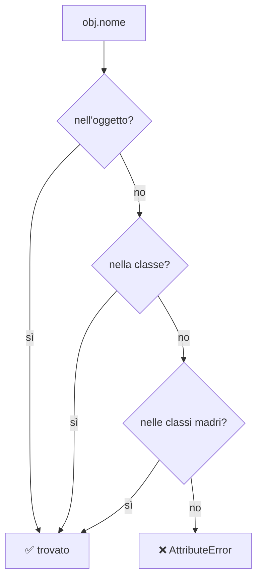

### ⚠️ Due trappole classiche

1. **`self.count += 1` non modifica l'attributo di classe**: legge il valore della classe, poi crea un nuovo attributo di istanza con lo stesso nome che lo "oscura". Per modificare il dato condiviso scrivete `Player.count += 1`.
2. **Una lista come attributo di classe è condivisa da tutti**. Se ogni giocatore deve avere il suo inventario, create la lista in `__init__` con `self.items = []`.

```python
class Bag:
	items = []			# SBAGLIATO: tutti i Bag condividono la stessa lista

class GoodBag:
	def __init__(self):
		self.items = []	# GIUSTO: una lista per ogni oggetto
```

#### Riflessione 🐙
*Chiedetevi sempre: questo dato appartiene a ogni oggetto o a tutta la classe? Da lì dipende dove lo scrivete.*

<a id="cap03-IT"></a>

## 🔒 Capitolo 3: Incapsulamento e naming

### 🚗 Senza `private`: come si protegge un dato?

In Java e C# il compilatore vi impedisce di toccare un campo `private`. In Python **non esistono modificatori di accesso**: si usano convenzioni sui nomi. Come in un'auto: potete aprire il cofano, ma c'è un cartello che dice "non toccare". 🚗

> 💬 *"We are all consenting adults here."*
> 🧙 Un detto della comunità Python

| 🔓 Forma | 🏷️ Livello | 🛡️ Cosa succede davvero | ☕ Equivalente |
|---|---|---|---|
| `x` | pubblico | nessuna restrizione | `public` |
| `_x` | protetto (per convenzione) | nessuna restrizione, è un cartello "non toccare" | `protected` |
| `__x` | privato (name mangling) | Python lo rinomina internamente in `_NomeClasse__x` | `private` |

### 🧬 Il name mangling in parole semplici

Con due underscore iniziali Python **cambia il nome** dell'attributo, aggiungendo davanti il nome della classe. Scopo: evitare che una sottoclasse crei per sbaglio un attributo con lo stesso nome della classe madre. Non è sicurezza: è igiene dei nomi. 🧼

Una conseguenza importante: **all'interno della classe** `Point`, il codice `p.__x` funziona anche se `p` è un altro `Point`, perché il nome viene trasformato nello stesso modo. È la stessa regola di Java, dove un oggetto può leggere i `private` di un altro oggetto della **stessa** classe. Invece da una classe diversa quel nome non si trova più.

### 🏷️ Naming dei metodi per leggere i dati

Come si legge un attributo? Dipende dal livello:

| 📦 Attributo | 👀 Come si legge | 🏷️ Nome del metodo |
|---|---|---|
| pubblico `x` | direttamente: `p.x` | nessun metodo necessario |
| protetto `_x` | metodo o property | `x()` oppure `get_x()` |
| privato `__x` | solo tramite metodo | `x()`, `get_x()` o property |

Il nostro [`Point`](./es-0_geometry/model.py) usa il nome breve:

```python
class Point:
	def __init__(self, x: float = 0.0, y: float = 0.0):
		self.__x: float = x
		self.__y: float = y

	def x(self) -> float:	# getter con lo stesso nome dell'attributo
		return self.__x

	def y(self) -> float:
		return self.__y
```

Ed ecco perché serve: la retta deve conoscere le coordinate di un punto, ma da dentro [`Line`](./es-0_geometry/model.py) il nome `p.__x` verrebbe trasformato in `p._Line__x`, che non esiste.

```python
class Line:
	def __init__(self, m: float = 0.0, q: float = 0.0):
		self.__m = float(m)	# coefficiente angolare
		self.__q = float(q)	# intercetta

	def is_parallel(self, r: 'Line') -> bool:
		return self.__m == r.__m	# ok: r è una Line, stessa classe

	def dist(self, p: 'Point' = None) -> float:
		if p is None:
			p = Point(0, 0)
		return abs(self.__m * p.x() + self.__q - p.y()) / ((1 + self.__m**2)**.5)
```

Notate la differenza: `r.__m` va bene (stessa classe), per il punto invece si passa dai getter `p.x()` e `p.y()`.

### 🎯 Regola pratica

- 🟢 Dato che può cambiare liberamente? Pubblico.
- 🟡 Dato pensato per le sottoclassi? Con `_`.
- 🔴 Dato che deve restare nascosto o che rischia di entrare in conflitto? Con `__`.
- ⚙️ Dato da validare? Passate da una property (capitolo 4).

#### Riflessione 🦉
*In Python la privacy è un patto di fiducia scritto nei nomi, non un lucchetto.*

<a id="cap04-IT"></a>

## 🎛️ Capitolo 4: *Getter*, *setter* e `@property`

### ☕ Lo stile Java, che in Python funziona

Potete scrivere `get_xxx()` e `set_xxx()` esattamente come in Java:

```python
class Wallet:
	def __init__(self, coins: int = 0):
		self.__coins: int = 0
		self.set_coins(coins)

	def get_coins(self) -> int:
		return self.__coins

	def set_coins(self, value: int) -> None:
		if value >= 0:	# validazione: niente monete negative
			self.__coins = value
```

Funziona, ma è verboso: `w.set_coins(w.get_coins() + 5)`. Python ha qualcosa di più elegante.

### ✨ `@property`: sembra un attributo, si comporta da metodo

```python
class Wallet:
	def __init__(self, coins: int = 0):
		self.__coins: int = 0
		self.coins = coins	# passa dal setter!

	@property
	def coins(self) -> int:	# getter
		return self.__coins

	@coins.setter
	def coins(self, value: int) -> None:	# setter
		if value >= 0:
			self.__coins = value

w = Wallet(10)
w.coins += 5	# sintassi da attributo, ma esegue getter e setter
print(w.coins)	# 15
```

🎁 Il bello: potete partire con un attributo pubblico e trasformarlo in property **dopo**, senza cambiare una riga del codice che lo usa. In Java sareste costretti a riscrivere i chiamanti.

| 🔍 Aspetto | ☕ Java | 🔷 C# | 🐍 Python |
|---|---|---|---|
| Sintassi | `getX()` / `setX()` | `public int X { get; set; }` | `@property` + `@x.setter` |
| Chiamata | `p.getX()` | `p.X` | `p.x` |
| Sola lettura | solo getter | `{ get; }` | property senza setter |

Una property **senza setter** è di sola lettura: assegnarla solleva `AttributeError`.

### 🧍 Il pattern della classe [`Person`](./es-1_people/model.py)

Nel nostro esempio [`Person`](./es-1_people/model.py) ogni attributo ha una property con validazione. Notate la tecnica in `__init__`: prima si assegna un **valore sicuro**, poi si passa dal setter.

```python
class Person:
	def __init__(self, firstname: str = 'Ciro', lastname: str = 'De Rosa', age: int = 17, isMale: bool = True):
		self._firstname: str = 'Ciro'	# valore sicuro di partenza
		self._age: int = 17
		self.firstname = firstname	# ora passa dal setter e può essere scartato
		self.age = age

	@property
	def age(self) -> int:
		return self._age

	@age.setter
	def age(self, value: int) -> None:
		if isinstance(value, int) and not isinstance(value, bool) and value > 0:
			self._age = value	# altrimenti: scarto silenzioso
```

Perché `not isinstance(value, bool)`? Perché in Python `True` è un `int` (vale 1): senza il controllo, `age = True` passerebbe. 🤯

### 🚦 Cosa succede quando il dato non è valido

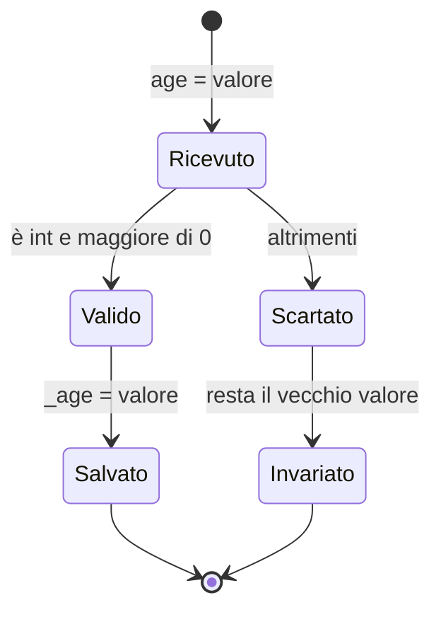

⚠️ Nel nostro esempio il setter **scarta in silenzio**: comodo da leggere, rischioso nei programmi veri, perché un errore passa inosservato. La buona pratica è sollevare un'eccezione:

```python
	@age.setter
	def age(self, value: int) -> None:
		if not isinstance(value, int) or isinstance(value, bool) or value <= 0:
			raise ValueError(f'invalid age: {value!r}')
		self._age = value
```

#### Riflessione 🐢
*Una property è una promessa: da fuori sembra un dato, ma dietro c'è un guardiano che controlla.*

<a id="cap05-IT"></a>

## 🪞 Capitolo 5: Rappresentare, convertire e confrontare

### 🖨️ `__str__` e `__repr__`

Quando fate `print(p1)`, Python chiama `__str__`: è il `toString()` di Java e il `ToString()` di C#.

| 🪞 Metodo | 👥 Per chi | 🎯 Obiettivo | 📟 Chiamato da |
|---|---|---|---|
| `__str__` | l'utente | testo leggibile | `print()`, `str()`, f-string |
| `__repr__` | lo sviluppatore | testo non ambiguo, idealmente ricostruibile | console, debugger, dentro le liste |

```python
class Point:
	def __str__(self) -> str:
		return f'P({self.__x:g}, {self.__y:g})'	# :g toglie gli zeri inutili

	def __repr__(self) -> str:
		return f'Point({self.__x!r}, {self.__y!r})'
```

💡 Se definite solo `__repr__`, anche `print` lo userà.
Se definite solo `__str__`, le *liste di oggetti continueranno a mostrare il brutto* `<Point object at 0x...>`.

### 📦 Da oggetto a dizionario con `vars()`

`vars(obj)` restituisce il dizionario degli attributi di istanza (è lo stesso di `obj.__dict__`). Con le chiavi pulite si arriva al JSON, che già sapete scrivere:

```python
import json

person = Person('Anna', 'Di Maio', 27, False)
data = vars(person)	# {'_firstname': 'Anna', '_lastname': 'Di Maio', ...}
clean = {k.lstrip('_'): v for k, v in data.items()}	# toglie gli underscore
print(json.dumps(clean, indent='\t'))
```

Output:

```json
{
	"firstname": "Anna",
	"lastname": "Di Maio",
	"age": 27,
	"isMale": false
}
```

- ⚠️ `vars()` non fa una copia: modificare il dizionario modifica l'oggetto. Se volete una copia usate `dict(vars(p))`.
- 🔁 Il percorso inverso funziona: `Person(**clean)` ricostruisce l'oggetto, perché le chiavi coincidono con i nomi dei parametri.
- 🔒 Per gli attributi con `__` le chiavi contengono il nome della classe (effetto del mangling): un buon motivo per usare `_x` negli oggetti da serializzare.

### ⚖️ Confrontare: `__eq__`, `__lt__`, `__hash__`

Per default `==` confronta l'**identità** dell'oggetto, come in Java con `==` sui riferimenti. Per confrontare i contenuti, si ridefinisce `__eq__`:

```python
class Point:
	def __eq__(self, other: object) -> bool:
		if not isinstance(other, Point):
			return NotImplemented	# lasciamo decidere a Python
		return self.__x == other.__x and self.__y == other.__y

	def __hash__(self) -> int:	# necessario insieme a __eq__
		return hash((self.__x, self.__y))

	def __lt__(self, other: 'Point') -> bool:
		return self.dist() < other.dist()	# più vicino all'origine = minore
```

| ☕ Java / C# | 🐍 Python | 🎯 Serve per |
|---|---|---|
| `toString()` | `__str__` | stampare |
| `equals()` | `__eq__` | `a == b` |
| `hashCode()` | `__hash__` | usare l'oggetto in `set` e come chiave di `dict` |
| `compareTo()` | `__lt__` | `<`, `sorted()`, `min()`, `max()` |

🍕 Immaginate un set di punti: con `__eq__` e `__hash__` coerenti, due punti `P(4, 3)` identici contano come **uno solo**. Con `__lt__` potete scrivere `sorted(points)`.

> 📌 **Regola d'oro:** se due oggetti sono uguali secondo `__eq__`, devono avere lo stesso `__hash__`. Se definite `__eq__` senza `__hash__`, Python rende l'oggetto non hashable.

#### Riflessione 🦄
*Gli oggetti hanno un loro vocabolario segreto: i metodi con doppio underscore sono le parole con cui Python li fa parlare.*

<a id="cap06-IT"></a>

## 🧬 Capitolo 6: Ereditarietà e `super()`

### 👨‍🏫 Persona, Studente, Insegnante

Lo schema è quello che conoscete: una classe madre con ciò che hanno in comune tutti, e due figlie che aggiungono il proprio.


| 🔍 Aspetto | ☕ Java / 🔷 C# | 🐍 Python |
|---|---|---|
| Dichiarare l'ereditarietà | `extends` / `:` | `class Student(Person):` |
| Chiamare il costruttore madre | `super(...)` / `base(...)` | `super().__init__(...)` |
| Chiamare un metodo madre | `super.m()` / `base.M()` | `super().m()` |
| Ridefinire un metodo | `@Override` / `override` | basta riscriverlo, senza parola chiave |

### 🚀 Le sottoclassi

```python
class Student(Person):
	def __init__(self, firstname: str = 'Paola', lastname: str = 'Cuomo', age: int = 15, isMale: bool = False, classroom: str = '4X'):
		super().__init__(firstname, lastname, age, isMale)	# prima la parte "Person"
		self._classroom: str = '4X'
		self.classroom = classroom	# poi quella specifica, via setter

	def __str__(self) -> str:
		return f'[Student] {super().__str__()}, classroom: {self._classroom}'
```

[`Teacher`](./es-1_people/model.py) è identica nella struttura, con `subject` al posto di `classroom` e `[Teacher]` nel testo.

⚠️ **Differenza dal Java:** in Python il costruttore madre **non** viene chiamato in automatico. Se dimenticate `super().__init__(...)`, gli attributi della classe madre semplicemente non esistono.

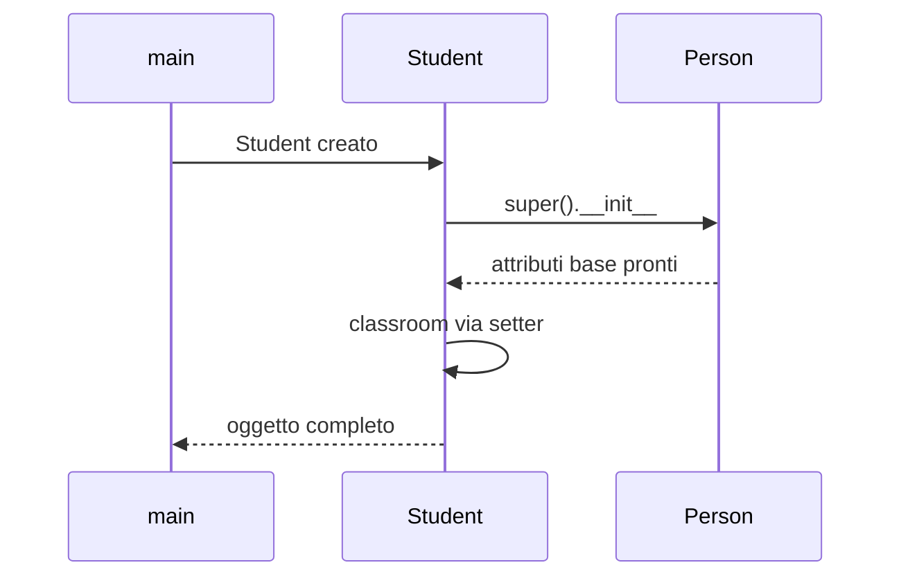

### 🎮 Argomenti per nome e valori di default

Con tanti parametri di default, i **keyword argument** salvano la vita: `Student(age = 16, firstname = 'Luca', classroom = '4G')` imposta solo ciò che serve, nell'ordine che volete.

```python
people: list[Person] = [
	Person(),
	Person('Anna', 'Di Maio', 27, False),
	Student(age = 16, firstname = 'Luca', classroom = '4G'),
	Student('Sofia', 'Rossi', 17, isMale = False, classroom = '5B'),
	Teacher(subject = 'Math', age = 45, lastname = 'Bianchi'),
	Teacher('El', 'Verdi', -5, False, subject = 'Physics'),
]

for p in people:
	print(p)
print()
print('-' * 15)
print(f'\n{vars(people[0])}')
```

Output:

```text
Ciro De Rosa (♂), age: 17
Anna Di Maio (♀), age: 27
[Student] Luca Cuomo (♀), age: 16, classroom: 4G
[Student] Sofia Rossi (♀), age: 17, classroom: 5B
[Teacher] Anna Bianchi (♀), age: 45, subject: Math
[Teacher] Ciro Verdi (♀), age: 17, subject: Physics

---------------

{'_firstname': 'Ciro', '_lastname': 'De Rosa', '_age': 17, '_isMale': True}
```

### 🕵️ L'ultima riga è un indovinello

`Teacher('El', 'Verdi', -5, False, ...)` produce **Ciro** e **17 anni**: perché?

1. `'El'` ha solo 2 lettere, e il setter pretende più di 2 caratteri: scartato.
2. `-5` non è maggiore di 0: scartato.
3. Restano i valori sicuri assegnati in `Person.__init__`, cioè `'Ciro'` e `17`, **non** i default di `Teacher` (`'Anna'`, 32).

Il pattern "valore sicuro, poi setter" funziona, ma le sorprese così sono un motivo in più per preferire `ValueError`.

#### Riflessione 🐝
*Un figlio eredita tutto e può cambiare ciò che non gli piace, ma deve sempre salutare il genitore con `super()`.*

<a id="cap07-IT"></a>
## 🎭 Capitolo 7: Polimorfismo, duck typing e classi astratte

### 🐉 Stesso messaggio, comportamenti diversi

In un RPG ogni nemico attacca, ma ogni nemico lo fa a modo suo: questo è il polimorfismo che già conoscete. In Python l'elemento nuovo sono le **classi astratte** con il modulo `abc` e il **duck typing**.

```python
from abc import ABC, abstractmethod

class Enemy(ABC):	# ABC: classe base astratta
	def __init__(self, name: str, hp: int):
		self.name = name
		self.hp = hp

	@abstractmethod
	def attack(self) -> int:	# i figli DEVONO ridefinirlo
		...

class Goblin(Enemy):
	def attack(self) -> int:
		return 5

class Dragon(Enemy):
	def attack(self) -> int:
		return 50

party = [Goblin('Grub', 10), Dragon('Smaug', 500)]
for enemy in party:
	print(f'{enemy.name} colpisce per {enemy.attack()}')
```

Output:

```text
Grub colpisce per 5
Smaug colpisce per 50
```

Provando `Enemy('x', 1)` Python solleva `TypeError`: una classe con metodi astratti non si può istanziare, come in Java e C#.

| 🔍 Aspetto | ☕ Java / 🔷 C# | 🐍 Python |
|---|---|---|
| Classe astratta | `abstract class` | eredita da `ABC` |
| Metodo astratto | `abstract` | `@abstractmethod` |
| Interfaccia | `interface` | non esiste: si usa una ABC con soli metodi astratti |
| Controllo | in compilazione | **all'istanziazione**, a runtime |

### 🦆 Duck typing

> 💬 *"Se cammina come un'anatra e fa qua come un'anatra, è un'anatra."*

Python non chiede che un oggetto **discenda** da una certa classe: chiede che **sappia fare** ciò che gli chiedete. Una trappola con il metodo giusto va bene anche se non eredita da `Enemy`:

```python
class Trap:	# nessuna parentela con Enemy
	def attack(self) -> int:
		return 20

for thing in [Goblin('Grub', 10), Trap()]:
	print(thing.attack())	# funziona con entrambi
```

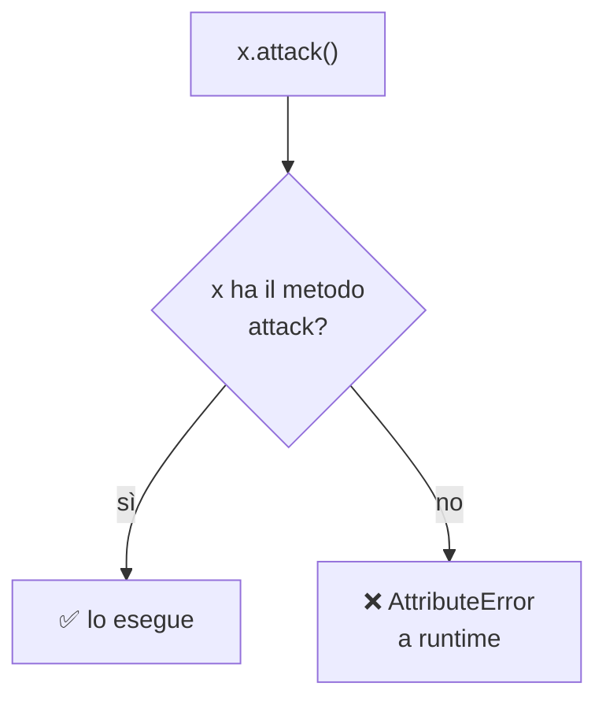

⚖️ **Pro e contro.** Il duck typing rende il codice flessibile e leggero, ma gli errori emergono solo quando il codice gira. Le ABC e i type hint servono proprio a rimettere un po' di disciplina dove serve.

### 🔎 Controllare i tipi: `isinstance` e `issubclass`

```python
isinstance(party[0], Goblin)	# True
isinstance(party[0], Enemy)	# True: un Goblin è anche un Enemy
issubclass(Dragon, Enemy)	# True: lavora sulle classi, non sugli oggetti
type(party[0]) == Enemy	# False: type() guarda solo il tipo esatto
```

- ✅ Usate `isinstance` per controllare i tipi: rispetta l'ereditarietà.
- ⚠️ Evitate `type(x) == ...` salvo casi precisi.
- 🧠 È ciò che abbiamo già usato nei setter: `isinstance(value, str)`.

### 🧭 Quale strumento scegliere?

| 🎯 Situazione | 🛠️ Strumento |
|---|---|
| Voglio obbligare le figlie a ridefinire un metodo | classe `ABC` + `@abstractmethod` |
| Mi basta che l'oggetto sappia fare una cosa | duck typing |
| Devo gestire due tipi in modo diverso | `isinstance` |

#### Riflessione 🦋
*Non importa chi siete di nascita, ma che cosa sapete fare quando vi chiamano.*

<a id="cap08-IT"></a>

## 🕸️ Capitolo 8: Ereditarietà multipla, composizione e moduli

### 💎 Più genitori: il diamante

Java e C# permettono una sola classe madre (più interfacce). **Python ne ammette più di una**:

```python
class A:
	def hello(self) -> str:
		return 'A'

class B(A):
	def hello(self) -> str:
		return 'B>' + super().hello()

class C(A):
	def hello(self) -> str:
		return 'C>' + super().hello()

class D(B, C):	# due genitori
	def hello(self) -> str:
		return 'D>' + super().hello()

print(D().hello())	# D>B>C>A
```


### 🧮 MRO: l'ordine di ricerca

Con più genitori, chi risponde per primo? Python calcola il **Method Resolution Order** (MRO) e lo segue sempre:

```python
print([c.__name__ for c in D.mro()])	# ['D', 'B', 'C', 'A', 'object']
```

- 📌 `super()` non significa "mio padre", ma **"il prossimo nell'MRO"**: per questo `B` chiama `C` e non `A` direttamente.
- 🧩 Ogni classe viene visitata **una sola volta**, quindi `A` non viene eseguita due volte.
- 🌳 `object` è la radice di tutte le classi, come `Object` in Java.

⚠️ L'ereditarietà multipla è potente ma complicata. Usatela per i **mixin**, piccole classi che aggiungono una singola capacità, e altrimenti non esagerate.

### 🔗 Composizione: "ha un" batte "è un"

Un'auto **ha un** motore, non **è un** motore. 🚗

```python
class Engine:
	def __init__(self, hp: int):
		self.hp = hp

	def start(self) -> str:
		return 'Vroom!'

class Car:
	def __init__(self, model: str, hp: int):
		self.model = model
		self.engine = Engine(hp)	# composizione: l'auto contiene un Engine

	def start(self) -> str:
		return f'{self.model}: {self.engine.start()}'	# delega al componente
```

| 🧬 Ereditarietà | 🔗 Composizione |
|---|---|
| relazione "è un" | relazione "ha un" |
| legame forte, rigido | legame debole, componibile |
| `Student` è una `Person` | `Car` ha un `Engine` |

> 🎯 **Regola:** se potete dire "è un", ereditate; se dovete dire "ha un" o "usa un", componete.

### 📦 Organizzare il codice: package e namespace

In Java avete i `package`, in C# i `namespace`. In Python **un file `.py` è un modulo e una cartella è un package**. I vostri esempi già lo fanno: `main.py` importa da `model.py`.

```text
game/
	__init__.py	# rende la cartella un package (può essere vuoto)
	main.py
	model/
		__init__.py
		geometry.py
		people.py
```

```python
from model import Point, Line	# importa solo ciò che serve
from model.people import Student	# importa da un sotto-modulo

if __name__ == '__main__':	# si esegue solo se il file è lanciato direttamente
	print(Point(4, 3))
```

| 🔍 Concetto | ☕ Java | 🔷 C# | 🐍 Python |
|---|---|---|---|
| Unità di codice | package | namespace | modulo e package |
| Importare | `import a.b.C;` | `using A.B;` | `from a.b import C` |
| Corrispondenza con il disco | cartelle | libera | cartelle e file |

### ✨ Un assaggio: le dataclass

Per classi che sono solo "contenitori di dati", `@dataclass` scrive per voi `__init__`, `__repr__` e `__eq__`:

```python
from dataclasses import dataclass

@dataclass
class Coin:
	value: int
	currency: str = 'EUR'

print(Coin(2))	# Coin(value=2, currency='EUR')
```

#### Riflessione 🐳
*Scegliete la parentela con cura: spesso un oggetto che ne contiene un altro regge più di un albero genealogico.*

<a id="finali-IT"></a>
## 🏁 Considerazioni finali

Siete partiti da un `Point` e siete arrivati a diamanti, MRO e package. Ricapitolando:

- 🏗️ Una classe si scrive con `class`, si inizializza con `__init__` e usa `self` **esplicito**.
- 🧪 Attributi di classe e di istanza non vanno confusi.
- 🔒 Privacy per convenzione: `x`, `_x`, `__x`, con i getter che scegliete voi (`x()`, `get_x()`, property).
- 🎛️ `@property` unisce comodità e controllo.
- 🪞 `__str__`, `__repr__`, `__eq__`, `__hash__`, `__lt__` e `vars()` fanno dialogare gli oggetti con Python e con il JSON.
- 🧬 `super()` è obbligatorio per inizializzare la classe madre.
- 🎭 Duck typing e `abc` convivono: flessibilità dove serve, regole dove servono.
- 🕸️ Meglio la composizione dell'ereditarietà multipla, quando possibile.

📚 **Cosa abbiamo lasciato fuori** (per il prossimo livello): metaclassi, descriptor, `__slots__`, `__getattr__`, decoratori avanzati e `Protocol`. Non servono per scrivere codice in autonomia, ma ci saranno quando vorrete andare oltre.

> 💬 *Il modo migliore per imparare è rompere il codice e capire perché si è rotto.* 🔧 Provate: togliete un `super()`, create un diamante, scartate un dato nel setter. Poi osservate cosa dice l'errore.

<a id="mappa-IT"></a>
## 🧭 Mappa dei concetti

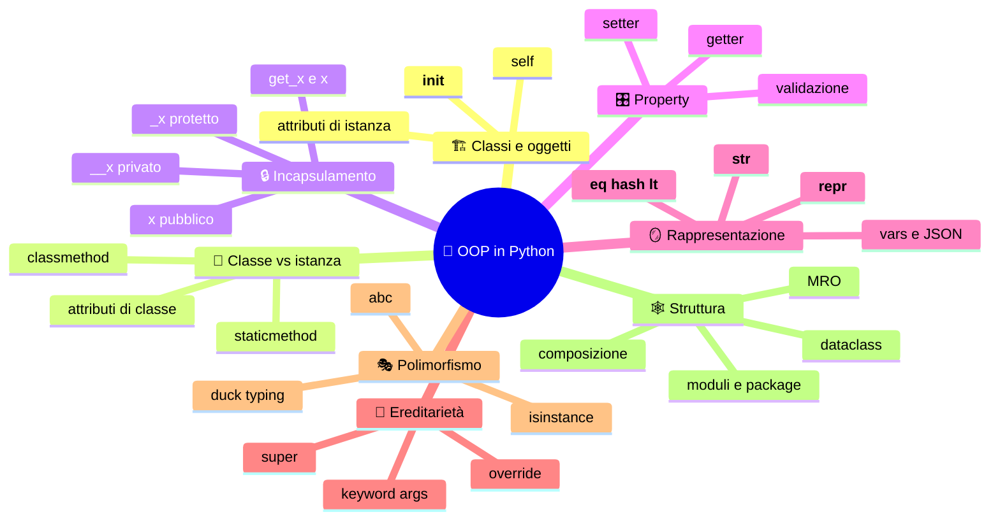

<a href="#TOP">&utrif; top &utrif;</a>

## 🔗 Links
[](https://www.linkedin.com/in/biagio-rosario-greco-77145774/)
[](https://twitter.com/birg_81)
[](mailto:birg81@gmail.com)