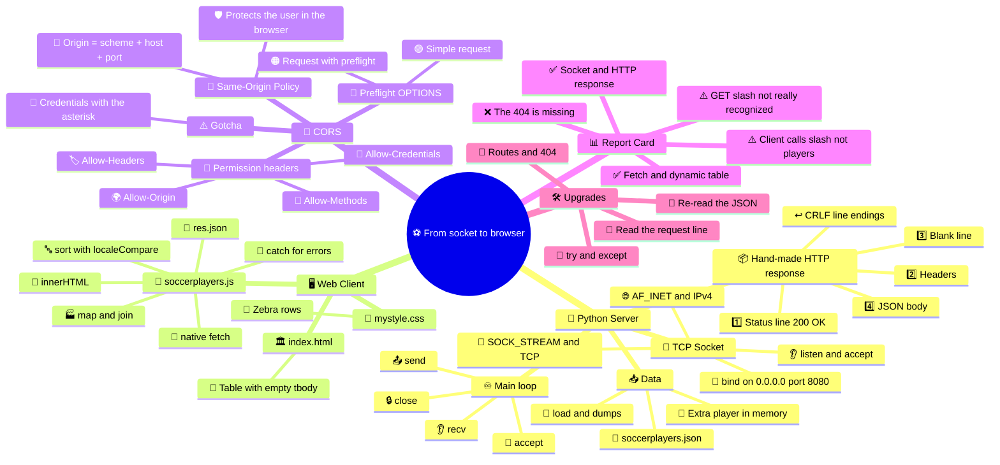
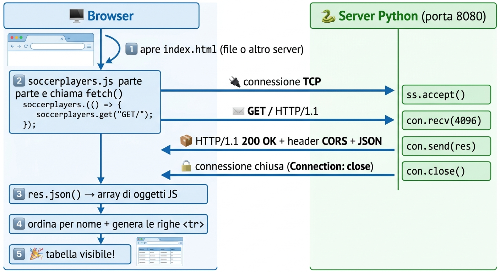
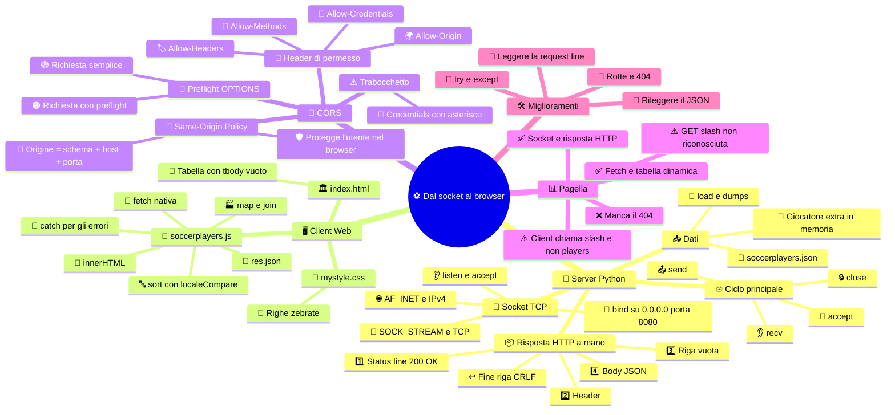

[](https://choosealicense.com/licenses/mit/)
[](https://opensource.org/licenses/)
[](http://www.gnu.org/licenses/agpl-3.0)

<a name="TOP"></a>

<a href="#IT"></a>
🤍
<a href="#EN"></a>

---

 <a name="EN"></A>

<!-- English -->

# ⚽ From Socket to Browser: Build Your Own Mini Server for Soccer Players

## 🚀 Goal:

build a small but complete web app where a Python server, built using nothing but the language's standard libraries, answers HTTP requests coming from the browser and sends back info about soccer players.

## 🧩 The idea:

the project hooks up three core building blocks of the web: sockets, the HTTP protocol, and JavaScript fetch().

## 🌐 The end result:
open [index.html](./frontend/index.html) in your browser and the user will be able to ask the server for the list of players stored in [soccerplayers.json](./soccerplayers.json) and see it show up dynamically inside a table.

## 🏗️ Scenario

⚽ Picture this: you've got to build the backend for a small app all about the world of soccer.

📁 The app's database, just to keep things simple, will be the file [soccerplayers.json](./soccerplayers.json), which will hold a list of players.

👤 Each player will be described by these attributes:
* 🧑 `fullname` — the player's first and last name;
* 🔢 `n` — jersey number;
* 🎂 `age` — how old they are;
* 🏃 `role` — the player's position;
* 🏟️ `soccerteam` — the team they play for.

💡 A possible JSON object could look something like this:
```json
{
	"fullname": "Lorenzo Bianchi",
	"n": 10,
	"age": 24,
	"role": "Midfielder",
	"soccerteam": "Example FC"
}
```

📚 The [soccerplayers.json](./soccerplayers.json) file has to contain a list of objects, one for each player.

### 🖥️ Part 1 — The Python server

🐍 Build a TCP server using Python's stream sockets and nothing but the standard library.
🔌 The server has to create a TCP socket, bind it to an address and a port, and start listening for incoming client connections.
👂 When a browser connects, the server has to read whatever the client sends and treat it as an HTTP request.
🔎 More specifically, the server should be able to recognize at least one request like this: `GET / HTTP/1.1`
📨 When a `GET /` request comes in, the server has to read the contents of [soccerplayers.json](./soccerplayers.json).
🔄 The file's contents have to be turned into a JSON representation to send back to the browser.
📦 The server then has to build a valid HTTP response by hand, including at least:

```text
HTTP/1.1 200 OK
Content-Type: application/json; charset=utf-8
Access-Control-Allow-Origin: *
Access-Control-Allow-Methods: GET, POST, PUT, DELETE, OPTIONS
Access-Control-Allow-Headers: Content-Type, Authorization, X-Requested-With
Access-Control-Allow-Credentials: true
Connection: close

[JSON content]
```

🧠 The point isn't just to "make the thing work", it's to really get that an HTTP response is made of a status line, headers, a blank line, and a body.

### 🌐 Part 2 — The web client

🖥️ Build a page called [index.html](./frontend/index.html) that serves as the app's interface.

🎨 You can build the page with HTML, [CSS](./frontend/mystyle.css) and [JavaScript](./frontend/soccerplayers.js) and, if you want, Bootstrap to make it look nicer.

🚫 Don't use any JavaScript library to make the HTTP requests: talking to the server has to happen through the browser's native Fetch API.

📡 When the page loads, or when a dedicated button gets clicked, JavaScript has to send a request to:
/players
🔗 The request has to be made with fetch().
📥 The client has to take the server's response and turn its content into a JavaScript object using the right method.

### 📊 Part 3 — Showing the players
⚽ The data coming back from the server has to be displayed dynamically inside an HTML table.

📋 The table has to have at least these columns:
| Name | Number | Age | Role | Team |
| :---: | :---: | :---: | :---: | :---: |
| ... | ... | ... | ... | ... | ... |

✨ The table rows must not be hand-written in the HTML, they have to be generated by JavaScript from the data the server sends back.

🔄 That way, if you edit [soccerplayers.json](./soccerplayers.json), the table should update on its own without touching index.html.

🧠 The challenge, then, is building every single step of the communication yourself, without leaning on a framework that hides what's going on behind the scenes.

#### 🧪 Minimum technical requirements

* ✅ The server has to use TCP/stream sockets from Python's standard library.
* ✅ The server has to accept HTTP connections coming from the browser.
* ✅ The `GET /` request has to be recognized.
* ✅ The server has to read [soccerplayers.json](./soccerplayers.json).
* ✅ The response has to have `Content-Type: application/json`.
* ✅ The response has to contain valid JSON.
* ✅ The client has to use the Fetch API.
* ✅ The data it gets back has to be turned into [JavaScript](./frontend/soccerplayers.js) objects.
* ✅ The HTML table has to be generated dynamically.
* ✅ The page has to work without any external JavaScript libraries.

🎨 Bootstrap can only be used for looks, never to handle client-server communication.

🏆 The best solution isn't necessarily the one with the most code, it's the one that shows you actually understand how the browser, sockets, HTTP, the Python server and JSON all work together to make a simple web app.

---

# ⚽🔥 From Socket to Browser: The "*Under the Hood*" Guide to Your Mini Server 🐍🌐

🎬 *Hey guys, welcome back*!
👋😎 Today we're taking the soccer players project apart piece by piece 🧑‍🔧⚽ and checking how the code stacks up against the assignment 📝✅, what the infamous **CORS** actually is 🚧🌍 and why those mysterious headers are sitting in the HTTP response 🕵️‍♂️📨.
*Buckle up* 🪢🚀!

## 🧠🗺️ The mind map: the whole project at a glance 👀

🎬 Before we dive into the nitty-gritty, here's your **treasure map** 🏴‍☠️💎:
every concept in the project and how it all links together 🔗.
Come back to it whenever you feel lost 🧭😅!



### 🧭🔗 How to read the map (the links between branches)

| 🔗 Link | 🧠 What it means |
| :--- | :--- |
| 🐍➡️🖥️ **Server → Client** | 📦 The server cooks up the JSON, the client eats it with `fetch()` |
| 🖥️➡️🚧 **Client → CORS** | 🌍 The client lives on a different origin than the server (`file://` or another port), so the browser demands a permission slip |
| 🚧➡️🐍 **CORS → Server** | 🎫 You get that permission slip through the `Access-Control-*` headers in the server's HTTP response |
| 📦➡️🚧 **HTTP response → CORS** | 🏷️ CORS headers live in "layer 2" of the response (the headers) |
| 📊➡️🛠️ **Report Card → Upgrades** | 🔧 Every ⚠️ and ❌ on the report card has a matching fix |

### 🎯⏱️ The map in one sentence

🎤 *A Python **server** 🐍 opens a **TCP socket** 🔌 and replies with an **HTTP** message 📨 carrying **JSON** 📦; a **client** 🖥️ asks for it with **fetch()** 📡 and turns it into a **table** 📊; and since client and server live on **different origins** 🧩, the server has to add the **CORS** headers 🎫 to tell the browser "yep, you're good to read this" ✅.*

## 🧩🌍 1. The big picture: who's talking to who 🗣️

🏗️ The project has **three main players** 🎭:

| 🎭 Player | 🧰 Tech | 🎯 Job |
| ---: | :--- | :--- |
| 🐍 **Server** | `socket` + Python standard library 📚 | 📡 Listens on port `8080` and answers with the data |
| 🌐 **Browser** | HTTP + `fetch()` 📥 | 🙋 Asks for the data and shows it |
| 🗄️ **"Database"** | [`soccerplayers.json`](./soccerplayers.json) 📁 | 📦 Holds the list of players |

🔄 Here's the whole movie of what goes down:



💡 Key takeaway 🧠: **there's no magic here** 🪄🚫.
The browser writes text 📝, the server reads text 📖 and answers with more text 📄.
That's literally all HTTP is 🤯.


## 🐍🖥️ 2. The Python server, line by line 🔬

[main.py](./main.py)

### 📚 2.1 Imports and loading the data 📥

```python
from json import load, dumps
import socket

SOCCERPLAYERS = 'soccerplayers.json'
with open(SOCCERPLAYERS, 'r', encoding = 'utf-8') as f:
	players = load(f)
```

- 📦 `from json import load, dumps` → pulls in just the two tools we need ✂️ (reading and writing JSON).
- 🔌 `import socket` → the heart of the project ❤️: the sockets library, 100% **standard library** ✅ (no Flask, no FastAPI 🚫).
- 📂 `with open(... encoding='utf-8')` → opens the file safely 🔐 and with the right encoding (matters for names like *Nicolò* 🇮🇹).
- 🧮 `load(f)` → turns the JSON text into a **list of Python dictionaries** 🐍.

### 🎁 2.2 The "bonus" player 🕵️‍♂️

```python
players.append({
	"fullname": "Biagio Rosario Greco",
	"n": 10,
	"age": 45,
	"role": "Midfielder",
	"soccerteam": "SSC Napoli"
})
```

- 🥚 This is a nice little **easter egg** 🐣: it adds a player **in memory only** 🧠, the [soccerplayers.json](./soccerplayers.json) file never gets touched 🙅‍♂️.
- 🔬 The result: the players sent to the browser are **31** (30 from the file + 1 added in code) 🔢.
- 😄 Cute, but heads up ⚠️: if someone checks the JSON by hand and then looks at the table, they'll spot a mismatch 🤔.

### 🧵 2.3 Serialization: from Python to a JSON string 📤

```python
playersStr:str = dumps(players, indent = 0, ensure_ascii = False, separators = (',', ':'))
```

| 🔧 Parameter | 🧠 What it does | 🤔 Why it's handy |
| :---: | :--- | :--- |
| `indent = 0` | 📏 Puts each element on a new line, no indentation | 👀 Just enough readability without wasting bytes |
| `ensure_ascii = False` | 🔤 Keeps accented letters as they are (`ò`, `è`) | 🇮🇹 No ugly `\u00f2` in your JSON |
| `separators = (',', ':')` | ✂️ Strips the spaces after commas and colons | 📉 Lighter payload |

✅ The result is **valid JSON** 🎯, so that requirement from the assignment? Nailed it.

### 🔌 2.4 Creating the TCP socket 🧱

```python
HOST = '0.0.0.0'
PORT = 8080

ss = socket.socket(socket.AF_INET, socket.SOCK_STREAM)
ss.setsockopt(socket.SOL_SOCKET, socket.SO_REUSEADDR, 1)
ss.bind((HOST, PORT))
ss.listen(1)
print(f'Server listening on http://{HOST}:{PORT}...')
```

| 🧩 Line | 🗣️ Translation into "human" |
| :---: | :--- |
| `AF_INET` 🌐 | "We're using IPv4 addresses" |
| `SOCK_STREAM` 🚰 | "I want **TCP**: a reliable, ordered stream, no lost pieces" |
| `SO_REUSEADDR` ♻️ | "If I restart the server right away, don't hit me with *Address already in use*" 😤 |
| `bind(('0.0.0.0', 8080))` 📍 | "Park yourself at address 0.0.0.0 (every network card) on port 8080" |
| `listen(1)` 👂 | "Wait for connections; only 1 can wait in line at a time" 🚶 |

#### 🎓 Pro tip 💡:

`0.0.0.0` means the server can be reached from **other devices on your network** 📱💻 too, not just from `localhost` 🏠.

### 📦 2.5 The hand-built HTTP response 🛠️

```python
res = f"""HTTP/1.1 200 OK
Content-Type: application/json; charset=utf-8
Access-Control-Allow-Origin: *
Access-Control-Allow-Methods: GET, POST, PUT, DELETE, OPTIONS
Access-Control-Allow-Headers: Content-Type, Authorization, X-Requested-With
Access-Control-Allow-Credentials: true
Connection: close

{playersStr}""".replace('\r', '').replace('\n', '\r\n').encode('utf-8')
```

🍰 An HTTP response is a cake with **4 layers**:

| 🥞 Layer | 📝 In the code | 🎯 What it's for |
| :---: | :--- | :--- |
| 1️⃣ **Status line** | `HTTP/1.1 200 OK` | ✅ Protocol version + result code |
| 2️⃣ **Headers** | `Content-Type`, `Access-Control-*`, `Connection` | 🏷️ Metadata about the response |
| 3️⃣ **Blank line** | the empty line right before `{playersStr}` | ✂️ Splits headers from body (super important!) |
| 4️⃣ **Body** | `{playersStr}` | 📦 The actual goods: the JSON |

🔍 The clever trick, line by line 🧠:

- 🧹 `.replace('\r', '')` → first wipes any `\r` that's already there (so you don't end up with two 👯).
- ↩️ `.replace('\n', '\r\n')` → HTTP **insists** on `CRLF` (`\r\n`) as the line ending 📜, not just `\n`. Skip it and some clients get cranky 😡.
- 🔢 `.encode('utf-8')` → sockets deal in **bytes**, not strings 🧱.
- 🚪 `Connection: close` → "I'm done, I'll hang up": that's why you **don't need** `Content-Length` 🤝 (the browser figures the body is over when the connection closes).
- ⚡ The response is built **just once** at startup and reused for everybody: fast 🏎️, but static 🧊 (we'll come back to that in the report card).

### ♾️ 2.6 The server's main loop 🔁

```python
goAway = True
while goAway:
	con, addr = ss.accept()
	req = con.recv(4096).decode('utf-8')
	print(f'{addr[0]}:{addr[1]} (recv) << Request recived')
	con.send(res)
	con.close()
	print(f'{addr[0]}:{addr[1]} (send) >> Response JSON DATA')
```

| 🔁 Step | 🧠 What happens |
| ---: | :--- |
| `ss.accept()` 🤝 | ⏳ The program **stops and waits** for a client; when one shows up, it hands back a new connection `con` + the address `addr` |
| `con.recv(4096)` 👂 | 📥 Reads up to 4096 bytes: the browser's HTTP request |
| `.decode('utf-8')` 🔤 | 🔄 From bytes to readable text |
| `con.send(res)` 📤 | 🚀 Fires off the ready-made response |
| `con.close()` 🔒 | 👋 Hangs up |

⚠️ Nerd stuff 🤓:

- 🧍 It's a **sequential** server: it serves **one client at a time** (no threads) 🐢. Totally fine for a demo ✅.
- 🪦 `goAway` is always `True`, so `ss.close()` and the *Server stopped* message never get reached (the only way out is `Ctrl+C`) ⌨️.
- 🔎 The big catch: the `req` variable gets **read but never looked at** 😮. The server sends back the same JSON for **any** request whatsoever. More on that in the report card 👇.

## 🖥️🎨 3. The web client: HTML, CSS and fetch() 📡

### 🏛️ 3.1 [`index.html`](./frontend/index.html): the skeleton 🦴

- 🧱 A table with a `<thead>` (headers: `#`, `Name`, `Age`, `Role`, `Team`) and an **empty** `<tbody id="SoccerPlayersTab">` 🕳️.
- ✨ The rows are **not** hand-written in the HTML ✅: JavaScript fills them in.
- 📜 `<script async src="./soccerplayers.js">` → loads the script without blocking the rest of the page 🏃.
- 🔗 No external JS libraries ✅ (the assignment explicitly asked for that 🙌).

### 🎨 3.2 [`mystyle.css`](./frontend/mystyle.css): the glow-up 💅

- 🦓 `tr:nth-child(even)` → alternating rows ("zebra" effect) 🦓 so it's easier on the eyes.
- 🌑 Dark header with white text ⚫⚪, thin borders, everything centered 🎯.
- 🚫 No Bootstrap: it was **optional** 😉.

### 📡 3.3 [`soccerplayers.js`](./frontend/soccerplayers.js): where the magic happens 🪄

```js
await fetch("http://localhost:8080")
	.then(res => res.json())
	.then(soccerplayers => [...soccerplayers].sort(
		(a, b) => a.fullname.localeCompare(b.fullname, 'it', { sensitivity: 'base' })
	))
	.then(soccerplayers => document.querySelector('#SoccerPlayersTab')
		.innerHTML = soccerplayers.map(player => `<tr>...</tr>`).join(''))
	.catch(e => { /* shows "Errore nel caricamento dei dati" */ });
```

🎢 It's a **Promise chain**, each `.then` hands its result to the next one ⛓️:

| ⛓️ Link | 🧠 What it does | 🎁 What it passes along |
| ---: | :--- | :--- |
| `fetch(url)` 📡 | Sends the HTTP request to the server | 📨 A `Response` object |
| `res.json()` 🔄 | Reads the body and **parses** it as JSON | 📚 An array of JS objects |
| `.sort(... localeCompare ...)` 🔤 | Sorts by name, the *Italian* way (accents handled) | 📋 Sorted array (on a **copy** `[...]` 🛡️, the original stays untouched) |
| `.map(player => ...)` 🏭 | Turns each player into a `<tr>…</tr>` string | 🧾 Array of HTML strings |
| `.join('')` 🪢 | Glues all the rows into one big string | 🧱 Final HTML |
| `.innerHTML = ...` 💉 | Injects the rows into the `<tbody>` | 🎉 Table on screen! |
| `.catch(...)` 🧯 | If anything goes sideways (server down, broken JSON…) | 🚨 An error row in the table |

#### 🔥 So yep, confirmed ✅:

it uses the **native Fetch API** ✅, turns the data into JS objects with `.json()` ✅, and builds the table dynamically ✅.

## 📊✅ 4. Report Card: assignment vs code

🎓 Alright, honest but friendly grade 🤝 (**spoiler:** it's a great result 👏, but there are a few details).

| 🧪 Assignment requirement | 🚦 Result | 🗒️ Comment |
| :--- | :---: | :--- |
| 🐍 Server with TCP/stream sockets from the stdlib | ✅ | 💯 `socket.AF_INET` + `SOCK_STREAM`, zero external libraries |
| 🔌 Bind, listen, accept | ✅ | 🧱 All three done, in the right order |
| 🌐 Accepts HTTP connections from the browser | ✅ | 🎯 The browser gets the response and understands it |
| 🔎 Recognizes `GET /` | ⚠️ | 🧐 It doesn't really *recognize* it: it answers **everything** the same way. `req` never gets analyzed |
| 📂 Reads `soccerplayers.json` | ✅ | 📖 It does, but **only once at startup** (to see changes you have to restart the server 🔄) |
| 📦 Response with `Content-Type: application/json` | ✅ | 🏷️ With `charset=utf-8` on top |
| 🧾 Valid JSON in the body | ✅ | 🎯 Generated by `json.dumps` |
| 🧱 Status line + headers + blank line + body | ✅ | 🍰 Built by hand with proper `CRLF` |
| 🚧 CORS headers | ✅ | 🌍 All five are there (explained in section 5) |
| 📡 Client using `fetch()` | ✅ | 🚀 Native, no libraries |
| 🔄 Data turned into JS objects | ✅ | 🧪 `res.json()` |
| 🧮 Dynamically generated table | ✅ | 🏭 `map` + `join` + `innerHTML` |
| 🚫 No external JS libraries | ✅ | 🧼 Squeaky clean |
| 🎁 Columns Name / Number / Age / Role / Team | ✅ | 📋 All there (in the order `#`, Name, Age, Role, Team) |

### 🔬 More notes from a code reviewer 🧐

- 🎁 **Extra player** injected from code → browser data ≠ file data 🤔.
- 🧍 **Single-threaded server**: if one client hangs, everybody else waits 🐌.
- 💥 **No `try/except`**: if the browser drops the connection midway, the server can crash 🤕.
- 💉 **`innerHTML` with server data**: if a name contained `<script>`, it'd be treated as HTML 😱. For a demo with your own data it's no big deal ✅, but in a real project you'd go with `textContent` or `createElement` 🛡️.
- ✍️ Little typo in the log: `recived` → `received` 😅.
- 🎭 But here's the juicy part: besides the page, the browser often also asks for `/favicon.ico` 🖼️ and (with CORS) sometimes an `OPTIONS` request 🛂. This server answers **everything** with the JSON 🙃.

## 🚧👹 5. CORS: the final boss

### 🤔❓ 5.1 What's CORS, in one sentence

> 🎤 **CORS** = **C**ross-**O**rigin **R**esource **S**haring = *Sharing Resources Between Different Origins* 🌍🤝.
It's how a **server** tells the **browser**:
"chill, this web page coming from another site **is allowed** to read my data" 🔓✅.

### 🏠🔑 5.2 First things first: what's an "origin"?

🧠 An **origin** is the combo of **three pieces** 🧩:

```text
http  ://  localhost  :  8080
🔐			🏠			🚪
scheme		host		port
```

🔍 If **even just one** of the three changes, the browser sees a **different origin** 🚨:

| 🌐 Page served from... | 📡 ...calls | 🚦 Same origin? | 🗒️ Why |
| :--- | :--- | :---: | :--- |
| `http://localhost:8080/index.html` | `http://localhost:8080/` | ✅ Yes | 🎯 Same scheme, host and port |
| `http://localhost:5500/index.html` | `http://localhost:8080/` | ❌ No | 🚪 Different **port** (e.g. VS Code's Live Server) |
| `https://miosito.it` | `http://localhost:8080/` | ❌ No | 🔐🏠🚪 Everything's different |
| `file:///C:/progetto/frontend/index.html` | `http://localhost:8080/` | ❌ No | 📁 Special origin called `null` |

💡 **This is exactly your situation** 🎯: when you open `index.html` with a double-click (`file://`) or through a server on another port, the page and your Python server are on **different origins** 😮.

### 👮‍♂️🛡️ 5.3 Same-Origin Policy: the browser's bouncer

🕴️ Browsers come with an ancient and super powerful security rule: the **Same-Origin Policy** (SOP) 🔒.

- 🚫 A script loaded from one origin **can't read** responses from another origin.
- 🏦 Why? Imagine you're logged into your bank 🏦 in one tab and you open a shady site 😈 in another. Without the SOP, that site could run `fetch("https://yourbank.com/balance")` with **your cookies** 🍪 and read your data 😱.
- 🧯 The SOP stops that disaster from happening ✅.

🤝 But sometimes you **actually want** another origin to read your data (like a public API, or a frontend that's separate from the backend 🧩). And that's where... **CORS** swoops in 🦸‍♂️.

### 🎭🧠 5.4 The thing almost everyone gets wrong

⚠️ Heads up, this one's worth a tattoo 💉🧠:

> 🔥 **The BROWSER does the blocking, not the server!** 🔥

- 📨 The request **really does reach** your Python server ✅ (you can see it in the `print` log 🖨️).
- 📦 The server answers ✅.
- 🧱 But the browser, seeing that the right CORS headers are **missing** from the response, **throws it away** and tells your JavaScript: `TypeError: Failed to fetch` 💥 (and in the console: *"blocked by CORS policy"* 🔴).
- 🧪 The litmus test: `curl http://localhost:8080` 🖥️ always works, because curl **isn't a browser** and doesn't enforce the SOP 🙅‍♂️.

🎬 So the server, through the headers, **doesn't "unblock" anything**: it gives the browser the **permission** 🎫 to hand the response over to the JavaScript.

### 📨🔍 5.5 The headers, one by one

🧾 Here are the lines in your response and **why they're there** 👇

| 🏷️ Header | 🗣️ What it tells the browser | 🎯 Needed in your project? |
| :--- | :--- | :---: |
| `Access-Control-Allow-Origin: *` 🌍 | "Any origin can read this response" 🔓 | 🔴 **ESSENTIAL**: without it, the `file://` page (or one on another port) can't read the JSON 💥 |
| `Access-Control-Allow-Methods: GET, POST, PUT, DELETE, OPTIONS` 🧰 | "These are the HTTP methods I accept from outside origins" 📋 | 🟡 Handy for **preflight** requests (see 5.6); with a plain `GET` it's not strictly needed |
| `Access-Control-Allow-Headers: Content-Type, Authorization, X-Requested-With` 🏷️ | "The client is allowed to send these custom headers" ✉️ | 🟡 Same as above: only matters when the client sends "non-standard" headers |
| `Access-Control-Allow-Credentials: true` 🍪 | "The client can send cookies/credentials" 🔑 | 🟠 Not needed here, and there's a **gotcha** (see 5.7) ⚠️ |
| `Content-Type: application/json; charset=utf-8` 📦 | "The body is JSON, in UTF-8" 🔤 | ✅ Crucial for `res.json()` and the accented characters to work |
| `Connection: close` 🚪 | "I'm closing the connection after this response" 👋 | ✅ Lets you skip `Content-Length` |

🎯 YouTuber summary 🎥: **only one header does the real work** (`Allow-Origin`) 🏆, the other three `Access-Control-*` ones are the "full gear" 🧰 for when things get more complicated 👇.

### 🛂✈️ 5.6 "Simple" requests vs requests with preflight

🧪 The browser splits cross-origin requests into **two categories** 📂:

| 📂 Type | 🧾 When it happens | 🔄 What the browser does |
| :---: | :--- | :--- |
| 🟢 **Simple** | `GET`/`HEAD`/`POST` with standard headers and a "harmless" Content-Type | 🚀 Sends the request **straight away**, then checks the CORS headers in the response |
| 🟠 **With preflight** | `PUT`/`DELETE`, or custom headers (`Authorization`…), or `Content-Type: application/json` in a POST | 🛂 First sends an **`OPTIONS`** "check-in" request, and only if the server gives the green light does it send the real one |

🎬 How preflight works, comic-strip style 🖼️:

🖥️ **Browser**: 🙋

```text
OPTIONS /players
Origin: http://localhost:5500
Access-Control-Request-Method: DELETE
Access-Control-Request-Headers: authorization
```

🐍 **Server**:  🙆

```text
200 OK
Access-Control-Allow-Origin: *
Access-Control-Allow-Methods: GET, POST, PUT, DELETE, OPTIONS
Access-Control-Allow-Headers: Content-Type, Authorization, X-Requested-With
```

🖥️ Browser: 😎 *"Cool, you've given me the go-ahead"* → sends the real DELETE

🔑 Here's **why** the assignment asks for `Allow-Methods` and `Allow-Headers`: they're the answers to the preflight's questions ❓➡️✅.
Your `fetch` is a plain `GET` 🟢, so preflight doesn't kick in, but the server is **already set** for when you add `POST`, `PUT`, `DELETE` 🚀.

#### 🍀 Fun fact:

in your server, even an `OPTIONS` request would get that 200 response with those headers (because it answers everything 😄).

*It works "by accident"... but hey, it works*! 🎰

### ⚠️🍪 5.7 The `Allow-Credentials: true` + `*` gotcha

🧨 Here's a rule that trips up a ton of people 😬:

- 🚫 If a request is **with credentials** (cookies, an `Authorization` header, `fetch(..., { credentials: 'include' })`), the browser **rejects** `Access-Control-Allow-Origin: *` 🙅‍♂️.
- ✅ In that case the server has to answer with the **exact origin** (e.g. `Access-Control-Allow-Origin: http://localhost:5500`) 🎯 and often add `Vary: Origin` 🧠.
- 😌 In your case **no problem** because `fetch` by default **doesn't send credentials** on cross-origin requests 🍃. So `*` + `true` live together peacefully... but technically that combo is a contradiction 🤷‍♂️.

### 🏭🔐 5.8 What about production?

| 🎯 Situation | 💡 What to do |
| :--- | :--- |
| 📚 Public read-only API (like this demo) | 🌍 `Allow-Origin: *` is perfectly fine ✅ |
| 🔒 API with login/cookies | 🎯 Set the **exact origin** of your frontend, **never** `*` 🚫 |
| 🧪 Local development | 🛠️ `*` for convenience, but remember to tighten it later 🔧 |
| 🛡️ Real security | ⚠️ CORS does **not** protect the server from attacks: it protects **the user in the browser**. You still need authentication and authorization 🔑 |

### 🎬🧠 5.9 The 30-second story (for the fast scrollers) ⏱️

1. 🌐 The browser enforces the **Same-Origin Policy**: it stops JS from reading data from other origins 🔒.
2. 🤝 The server can say "all good" with the **CORS** headers 🎫.
3. 🏆 Your `index.html` (origin `file://` or another port) asks `localhost:8080` (a different origin) for data ↔️.
4. 📨 Without `Access-Control-Allow-Origin` → ❌ CORS error, the JSON never reaches the script.
5. ✅ With `Access-Control-Allow-Origin: *` → the browser hands over the JSON, the table fills up 🎉.

## 🏁🎓 7. Final takeaways

| 🧠 Concept | 💎 Take it home |
| :--- | :--- |
| 🔌 **Socket** | 🧱 The basic building block: two programs swapping bytes |
| 📜 **HTTP** | 📝 It's just **text** in a precise format: status line → headers → blank line → body |
| 🔄 **CRLF** | ↩️ HTTP lines end with `\r\n`, not just `\n` |
| 📦 **JSON** | 🧾 The common language between Python 🐍 and JavaScript 🟨 |
| 📡 **fetch()** | 🚀 The browser's native way of "phoning" the server |
| 🚧 **CORS** | 🎫 A **permission slip** the server hands to the **browser**, not a wall the server builds |
| 🛡️ **Same-Origin Policy** | 👮 The bouncer that protects the user; CORS is the VIP list 📋 |

🏆 The code does **the most important thing**: it proves that the browser 🌐, sockets 🔌, HTTP 📨, the Python server 🐍 and JSON 📦 all work together **with no framework** hiding the magic 🪄✨.


---

<a href="#IT"></a>
🤍
<a href="#EN"></a>

---

 <a name="IT"></A>

<!-- Italiano -->

# ⚽ Dal socket al browser: costruisci il tuo mini server per i calciatori

## 🚀 Obiettivo:

realizzare una piccola applicazione web completa in cui un server Python, costruito esclusivamente con le librerie standard del linguaggio, risponde a richieste HTTP provenienti dal browser e restituisce informazioni sui giocatori di calcio.

## 🧩 L'idea:

il progetto mette in comunicazione tre elementi fondamentali del web: socket, protocollo HTTP e JavaScript fetch().

## 🌐 Il risultato finale:
aprendo [index.html](./frontend/index.html) nel browser, l'utente potrà richiedere al server l'elenco dei giocatori contenuto nel file [soccerplayers.json](./soccerplayers.json) e visualizzarlo dinamicamente all'interno di una tabella.

## 🏗️ Scenario

⚽ Immagina di dover realizzare il backend di una piccola applicazione dedicata al mondo del calcio.

📁 Il database dell'applicazione, per semplicità, sarà rappresentato dal file [soccerplayers.json](./soccerplayers.json), che conterrà una lista di giocatori.

👤 Ogni giocatore sarà descritto attraverso i seguenti attributi:
* 🧑 `fullname` — nome e cognome del giocatore;
* 🔢 `n` — numero di maglia;
* 🎂 `age` — età;
* 🏃 `role` — ruolo del giocatore;
* 🏟️ `soccerteam` — squadra di appartenenza.

💡 Un possibile oggetto JSON potrebbe quindi avere una struttura simile a questa:
```json
{
	"fullname": "Lorenzo Bianchi",
	"n": 10,
	"age": 24,
	"role": "Midfielder",
	"soccerteam": "Example FC"
}
```

📚 Il file [soccerplayers.json](./soccerplayers.json) dovrà contenere una lista di oggetti, uno per ogni giocatore.

### 🖥️ Parte 1 — Il server Python

🐍 Realizza un server TCP utilizzando i socket stream di Python e le sole librerie incluse nella standard library.
🔌 Il server dovrà creare un socket TCP, associarlo a un indirizzo e a una porta e mettersi in ascolto delle connessioni provenienti dai client.
👂 Quando un browser stabilirà una connessione, il server dovrà leggere i dati inviati dal client e interpretarli come una richiesta HTTP.
🔎 In particolare, il server dovrà essere in grado di riconoscere almeno una richiesta del tipo: `GET / HTTP/1.1`
📨 Quando riceverà la richiesta `GET /`, il server dovrà leggere il contenuto di [soccerplayers.json](./soccerplayers.json).
🔄 Il contenuto del file dovrà essere trasformato in una rappresentazione JSON da restituire al browser.
📦 Il server dovrà quindi costruire manualmente una risposta HTTP valida, comprensiva almeno di:

```text
HTTP/1.1 200 OK
Content-Type: application/json; charset=utf-8
Access-Control-Allow-Origin: *
Access-Control-Allow-Methods: GET, POST, PUT, DELETE, OPTIONS
Access-Control-Allow-Headers: Content-Type, Authorization, X-Requested-With
Access-Control-Allow-Credentials: true
Connection: close

[contenuto JSON]
```

🧠 L'obiettivo non è semplicemente "far funzionare il programma", ma comprendere che una risposta HTTP è composta da status line, header, riga vuota e body.

### 🌐 Parte 2 — Il client web

🖥️ Realizza una pagina [index.html](./frontend/index.html) che rappresenti l'interfaccia dell'applicazione.

🎨 La pagina potrà essere realizzata utilizzando HTML, [CSS](./frontend/mystyle.css) e [JavaScript](./frontend/soccerplayers.js) e, facoltativamente, Bootstrap per migliorarne l'aspetto grafico.

🚫 Non utilizzare librerie JavaScript per effettuare le richieste HTTP: la comunicazione con il server dovrà avvenire attraverso la Fetch API nativa del browser.

📡 Al caricamento della pagina, oppure attraverso un pulsante dedicato, JavaScript dovrà effettuare una richiesta verso:
/players
🔗 La richiesta dovrà essere realizzata utilizzando fetch().
📥 Il client dovrà ricevere la risposta dal server e trasformarne il contenuto in un oggetto JavaScript attraverso il metodo appropriato.

### 📊 Parte 3 — Visualizzare i giocatori
⚽ I dati ricevuti dal server dovranno essere visualizzati dinamicamente all'interno di una tabella HTML.

📋 La tabella dovrà contenere almeno le seguenti colonne:
| Nome | Numero | Età | Ruolo | Squadra |
| :---: | :---: | :---: | :---: | :---: |
| ... | ... | ... | ... | ... | ... |

✨ Le righe della tabella non dovranno essere scritte manualmente nell'HTML, ma generate dal codice JavaScript sulla base dei dati ricevuti dal server.

🔄 In questo modo, modificando [soccerplayers.json](./soccerplayers.json), la tabella dovrà aggiornarsi automaticamente senza modificare index.html.

🧠 La sfida consiste quindi nel costruire ogni passaggio della comunicazione, senza affidarsi a un framework che nasconda ciò che accade dietro le quinte.

#### 🧪 Requisiti tecnici minimi

* ✅ Il server deve utilizzare socket TCP/stream della libreria standard di Python.
* ✅ Il server deve accettare connessioni HTTP provenienti dal browser.
* ✅ Deve essere riconosciuta la richiesta `GET /`.
* ✅ Il server deve leggere [soccerplayers.json](./soccerplayers.json).
* ✅ La risposta deve avere `Content-Type: application/json`.
* ✅ La risposta deve contenere un JSON valido.
* ✅ Il client deve utilizzare la Fetch API.
* ✅ I dati ricevuti devono essere trasformati in oggetti [JavaScript](./frontend/soccerplayers.js).
* ✅ La tabella HTML deve essere generata dinamicamente.
* ✅ La pagina deve funzionare senza librerie JavaScript esterne.

🎨 Bootstrap può essere utilizzato solo come supporto grafico e non per gestire la comunicazione client-server.

🏆 La soluzione migliore non sarà necessariamente quella con più codice, ma quella che dimostrerà di aver compreso come browser, socket, HTTP, server Python e JSON collaborano per costruire una semplice applicazione web.

---

# ⚽🔥 Dal socket al browser: La guida "*sotto il cofano*" al tuo mini server 🐍🌐

🎬 *Ciao ragazzi e bentornati*!
👋😎 Oggi smontiamo pezzo per pezzo il progetto dei calciatori 🧑‍🔧⚽ e vediamo come il codice risponde alla traccia 📝✅, che cos'è il famigerato **CORS** 🚧🌍 e perché nella risposta HTTP ci sono quelle intestazioni misteriose 🕵️‍♂️📨.
*Allacciate le cinture* 🪢🚀!

## 🧠🗺️ La mappa mentale: tutto il progetto in un colpo d'occhio 👀

🎬 Prima di tuffarci nei dettagli, ecco la **mappa del tesoro** 🏴‍☠️💎:
tutti i concetti del progetto e come si collegano tra loro 🔗.
Tornaci ogni volta che ti senti perso 🧭😅!



### 🧭🔗 Come leggere la mappa (i collegamenti tra i rami)

| 🔗 Collegamento | 🧠 Cosa significa |
| :--- | :--- |
| 🐍➡️🖥️ **Server → Client** | 📦 Il server produce il JSON, il client lo consuma con `fetch()` |
| 🖥️➡️🚧 **Client → CORS** | 🌍 Il client sta su un'origine diversa dal server (`file://` o altra porta), quindi il browser pretende il permesso |
| 🚧➡️🐍 **CORS → Server** | 🎫 Il permesso si ottiene con gli header `Access-Control-*` nella risposta HTTP del server |
| 📦➡️🚧 **Risposta HTTP → CORS** | 🏷️ Gli header CORS vivono nello "strato 2" della risposta (gli header) |
| 📊➡️🛠️ **Pagella → Miglioramenti** | 🔧 Ogni ⚠️ e ❌ della pagella ha un ritocco corrispondente |

### 🎯⏱️ La mappa in una sola frase

🎤 *Un **server** Python 🐍 apre un **socket TCP** 🔌 e risponde con un messaggio **HTTP** 📨 contenente **JSON** 📦; un **client** 🖥️ lo richiede con **fetch()** 📡 e lo trasforma in una **tabella** 📊; e siccome client e server sono **origini diverse** 🧩, il server deve aggiungere gli header **CORS** 🎫 per dire al browser "sì, puoi leggere" ✅.*

## 🧩🌍 1. Il quadro generale: chi parla con chi 🗣️

🏗️ Il progetto ha **tre protagonisti** 🎭:

| 🎭 Attore | 🧰 Tecnologia | 🎯 Ruolo |
| ---: | :--- | :--- |
| 🐍 **Server** | `socket` + Python standard library 📚 | 📡 Ascolta sulla porta `8080` e risponde con i dati |
| 🌐 **Browser** | HTTP + `fetch()` 📥 | 🙋 Chiede i dati e li mostra |
| 🗄️ **"Database"** | [`soccerplayers.json`](./soccerplayers.json) 📁 | 📦 Contiene la lista dei giocatori |

🔄 Il film completo di quello che succede si vede così:


💡 Messaggio chiave 🧠: **non c'è nessuna magia** 🪄🚫.
Il browser scrive testo 📝, il server legge testo 📖 e risponde con altro testo 📄.
HTTP è esattamente questo 🤯.


## 🐍🖥️ 2. Il server Python, riga per riga 🔬

[main.py](./main.py)

### 📚 2.1 Import e caricamento dei dati 📥

```python
from json import load, dumps
import socket

SOCCERPLAYERS = 'soccerplayers.json'
with open(SOCCERPLAYERS, 'r', encoding = 'utf-8') as f:
	players = load(f)
```

- 📦 `from json import load, dumps` → importa solo i due strumenti che servono ✂️ (leggere e scrivere JSON).
- 🔌 `import socket` → il cuore del progetto ❤️: la libreria dei socket, tutta **standard library** ✅ (niente Flask, niente FastAPI 🚫).
- 📂 `with open(... encoding='utf-8')` → apre il file in sicurezza 🔐 e con la codifica giusta (importante per nomi come *Nicolò* 🇮🇹).
- 🧮 `load(f)` → trasforma il testo JSON in una **lista di dizionari Python** 🐍.

### 🎁 2.2 Il giocatore "bonus" 🕵️‍♂️

```python
players.append({
	"fullname": "Biagio Rosario Greco",
	"n": 10,
	"age": 45,
	"role": "Midfielder",
	"soccerteam": "SSC Napoli"
})
```

- 🥚 Questo è un bell'**easter egg** 🐣: aggiunge un giocatore **solo in memoria** 🧠, il file [soccerplayers.json](./soccerplayers.json) non viene toccato 🙅‍♂️.
- 🔬 Conseguenza: i giocatori mandati al browser sono **31** (30 nel file + 1 aggiunto da codice) 🔢.
- 😄 Simpatico, ma attenzione ⚠️: se qualcuno controlla il JSON a mano e poi guarda la tabella, trova una differenza 🤔.

### 🧵 2.3 Serializzazione: da Python a stringa JSON 📤

```python
playersStr:str = dumps(players, indent = 0, ensure_ascii = False, separators = (',', ':'))
```

| 🔧 Parametro | 🧠 Cosa fa | 🤔 Perché è utile |
| :---: | :--- | :--- |
| `indent = 0` | 📏 Mette ogni elemento su una nuova riga, senza rientri | 👀 Un minimo leggibile senza sprecare byte |
| `ensure_ascii = False` | 🔤 Lascia le lettere accentate come sono (`ò`, `è`) | 🇮🇹 Niente brutti `\u00f2` nel JSON |
| `separators = (',', ':')` | ✂️ Toglie gli spazi dopo virgole e due punti | 📉 Payload più compatto |

✅ Il risultato è un **JSON valido** 🎯, requisito della traccia centrato.

### 🔌 2.4 Creare il socket TCP 🧱

```python
HOST = '0.0.0.0'
PORT = 8080

ss = socket.socket(socket.AF_INET, socket.SOCK_STREAM)
ss.setsockopt(socket.SOL_SOCKET, socket.SO_REUSEADDR, 1)
ss.bind((HOST, PORT))
ss.listen(1)
print(f'Server listening on http://{HOST}:{PORT}...')
```

| 🧩 Riga | 🗣️ Traduzione in "umano" |
| :---: | :--- |
| `AF_INET` 🌐 | "Usiamo indirizzi IPv4" |
| `SOCK_STREAM` 🚰 | "Voglio **TCP**: flusso affidabile, ordinato, senza pezzi persi" |
| `SO_REUSEADDR` ♻️ | "Se riavvio il server subito, non rompermi con *Address already in use*" 😤 |
| `bind(('0.0.0.0', 8080))` 📍 | "Mettiti all'indirizzo 0.0.0.0 (tutte le schede di rete) sulla porta 8080" |
| `listen(1)` 👂 | "Aspetta connessioni; al massimo 1 può stare in coda" 🚶 |

#### 🎓 Pro tip 💡:

`0.0.0.0` significa che il server è raggiungibile anche da **altri dispositivi della tua rete** 📱💻, non solo da `localhost` 🏠.

### 📦 2.5 La risposta HTTP costruita a mano 🛠️

```python
res = f"""HTTP/1.1 200 OK
Content-Type: application/json; charset=utf-8
Access-Control-Allow-Origin: *
Access-Control-Allow-Methods: GET, POST, PUT, DELETE, OPTIONS
Access-Control-Allow-Headers: Content-Type, Authorization, X-Requested-With
Access-Control-Allow-Credentials: true
Connection: close

{playersStr}""".replace('\r', '').replace('\n', '\r\n').encode('utf-8')
```

🍰 Una risposta HTTP è una torta a **4 strati**:

| 🥞 Strato | 📝 Nel codice | 🎯 A cosa serve |
| :---: | :--- | :--- |
| 1️⃣ **Status line** | `HTTP/1.1 200 OK` | ✅ Versione del protocollo + codice esito |
| 2️⃣ **Header** | `Content-Type`, `Access-Control-*`, `Connection` | 🏷️ Metadati sulla risposta |
| 3️⃣ **Riga vuota** | la riga bianca prima di `{playersStr}` | ✂️ Separa header e body (fondamentale!) |
| 4️⃣ **Body** | `{playersStr}` | 📦 I dati veri: il JSON |

🔍 Il trucco furbo, riga per riga 🧠:

- 🧹 `.replace('\r', '')` → prima ripulisce eventuali `\r` già presenti (così non ne escono due 👯).
- ↩️ `.replace('\n', '\r\n')` → HTTP **pretende** `CRLF` (`\r\n`) come fine riga 📜, non il solo `\n`. Senza, alcuni client si arrabbiano 😡.
- 🔢 `.encode('utf-8')` → i socket lavorano con **byte**, non con stringhe 🧱.
- 🚪 `Connection: close` → "ho finito, chiudo io": per questo **non serve** `Content-Length` 🤝 (il browser capisce che il body finisce quando la connessione si chiude).
- ⚡ La risposta viene costruita **una volta sola** all'avvio e riusata per tutti: efficiente 🏎️, ma statica 🧊 (ne riparliamo nella pagella).

### ♾️ 2.6 Il ciclo principale del server 🔁

```python
goAway = True
while goAway:
	con, addr = ss.accept()
	req = con.recv(4096).decode('utf-8')
	print(f'{addr[0]}:{addr[1]} (recv) << Request recived')
	con.send(res)
	con.close()
	print(f'{addr[0]}:{addr[1]} (send) >> Response JSON DATA')
```

| 🔁 Passo | 🧠 Cosa succede |
| ---: | :--- |
| `ss.accept()` 🤝 | ⏳ Il programma **si ferma e aspetta** un client; quando arriva, restituisce una nuova connessione `con` + l'indirizzo `addr` |
| `con.recv(4096)` 👂 | 📥 Legge fino a 4096 byte: la richiesta HTTP del browser |
| `.decode('utf-8')` 🔤 | 🔄 Da byte a testo leggibile |
| `con.send(res)` 📤 | 🚀 Spedisce la risposta già pronta |
| `con.close()` 🔒 | 👋 Chiude la connessione |

⚠️ Dettagli da nerd 🤓:

- 🧍 È un server **sequenziale**: serve **un client alla volta** (nessun thread) 🐢. Per una demo va benissimo ✅.
- 🪦 `goAway` è sempre `True`, quindi `ss.close()` e il messaggio *Server stopped* non vengono mai raggiunti (si esce solo con `Ctrl+C`) ⌨️.
- 🔎 Il punto cruciale: la variabile `req` viene **letta ma mai analizzata** 😮. Il server risponde con lo stesso JSON a **qualunque** richiesta. Ci torniamo nella pagella 👇.

## 🖥️🎨 3. Il client web: HTML, CSS e fetch() 📡

### 🏛️ 3.1 [`index.html`](./frontend/index.html): lo scheletro 🦴

- 🧱 Una tabella con `<thead>` (intestazioni: `#`, `Name`, `Age`, `Role`, `Team`) e un `<tbody id="SoccerPlayersTab">` **vuoto** 🕳️.
- ✨ Le righe **non** sono scritte a mano nell'HTML ✅: ci pensa JavaScript a riempirle.
- 📜 `<script async src="./soccerplayers.js">` → carica lo script senza bloccare il resto della pagina 🏃.
- 🔗 Nessuna libreria esterna di JS ✅ (la traccia lo chiedeva espressamente 🙌).

### 🎨 3.2 [`mystyle.css`](./frontend/mystyle.css): il trucco del trucco 💅

- 🦓 `tr:nth-child(even)` → righe alternate (effetto "zebra") 🦓 per leggere meglio.
- 🌑 Header scuro con testo bianco ⚫⚪, bordi sottili, tutto centrato 🎯.
- 🚫 Niente Bootstrap: era **facoltativo** 😉.

### 📡 3.3 [`soccerplayers.js`](./frontend/soccerplasyers.js): dove avviene la magia 🪄

```js
await fetch("http://localhost:8080")
	.then(res => res.json())
	.then(soccerplayers => [...soccerplayers].sort(
		(a, b) => a.fullname.localeCompare(b.fullname, 'it', { sensitivity: 'base' })
	))
	.then(soccerplayers => document.querySelector('#SoccerPlayersTab')
		.innerHTML = soccerplayers.map(player => `<tr>...</tr>`).join(''))
	.catch(e => { /* mostra "Errore nel caricamento dei dati" */ });
```

🎢 È una **catena di Promise**, ogni `.then` passa il risultato al successivo ⛓️:

| ⛓️ Anello | 🧠 Cosa fa | 🎁 Cosa passa avanti |
| ---: | :--- | :--- |
| `fetch(url)` 📡 | Manda la richiesta HTTP al server | 📨 Un oggetto `Response` |
| `res.json()` 🔄 | Legge il body e lo **parsa** come JSON | 📚 Un array di oggetti JS |
| `.sort(... localeCompare ...)` 🔤 | Ordina per nome, in modo *italiano* (accenti ok) | 📋 Array ordinato (su una **copia** `[...]` 🛡️, l'originale non si tocca) |
| `.map(player => ...)` 🏭 | Trasforma ogni giocatore in una stringa `<tr>…</tr>` | 🧾 Array di stringhe HTML |
| `.join('')` 🪢 | Incolla tutte le righe in un'unica stringa | 🧱 HTML finale |
| `.innerHTML = ...` 💉 | Inietta le righe dentro il `<tbody>` | 🎉 Tabella visibile! |
| `.catch(...)` 🧯 | Se qualcosa va storto (server spento, JSON rotto…) | 🚨 Riga di errore nella tabella |

#### 🔥 Quindi sì ✅:

usa la **Fetch API nativa** ✅, trasforma i dati in oggetti JS con `.json()` ✅, genera la tabella dinamicamente ✅.

## 📊✅ 4. Pagella: traccia vs codice

🎓 Allora, voto sincero ma amichevole 🤝 (**spoiler:** è un ottimo risultato 👏, ma ci sono dei dettagli).

| 🧪 Requisito della traccia | 🚦 Esito | 🗒️ Commento |
| :--- | :---: | :--- |
| 🐍 Server con socket TCP/stream della stdlib | ✅ | 💯 `socket.AF_INET` + `SOCK_STREAM`, zero librerie esterne |
| 🔌 Bind, listen, accept | ✅ | 🧱 Fatti tutti e tre, in ordine |
| 🌐 Accetta connessioni HTTP dal browser | ✅ | 🎯 Il browser riceve e capisce la risposta |
| 🔎 Riconosce `GET /` | ⚠️ | 🧐 Non la *riconosce*: risponde uguale a **tutto**. `req` non viene mai analizzata |
| 📂 Legge `soccerplayers.json` | ✅ | 📖 Lo legge, ma **una volta sola all'avvio** (per vedere modifiche serve riavviare il server 🔄) |
| 📦 Risposta con `Content-Type: application/json` | ✅ | 🏷️ Con `charset=utf-8` per giunta |
| 🧾 JSON valido nel body | ✅ | 🎯 Generato da `json.dumps` |
| 🧱 Status line + header + riga vuota + body | ✅ | 🍰 Costruiti a mano con `CRLF` corretti |
| 🚧 Header CORS | ✅ | 🌍 Tutti e cinque presenti (spiegati nella sezione 5) |
| 📡 Client con `fetch()` | ✅ | 🚀 Nativa, senza librerie |
| 🔄 Dati trasformati in oggetti JS | ✅ | 🧪 `res.json()` |
| 🧮 Tabella generata dinamicamente | ✅ | 🏭 `map` + `join` + `innerHTML` |
| 🚫 Nessuna libreria JS esterna | ✅ | 🧼 Pulitissimo |
| 🎁 Colonne Nome / Numero / Età / Ruolo / Squadra | ✅ | 📋 Tutte presenti (in ordine `#`, Name, Age, Role, Team) |

### 🔬 Altre osservazioni da code reviewer 🧐

- 🎁 **Giocatore extra** inserito da codice → dati del browser ≠ dati del file 🤔.
- 🧍 **Server single-thread**: se un client resta appeso, gli altri aspettano 🐌.
- 💥 **Nessun `try/except`**: se il browser chiude la connessione a metà, il server può andare in crash 🤕.
- 💉 **`innerHTML` con dati del server**: se un nome contenesse `<script>`, verrebbe interpretato come HTML 😱. Per una demo con dati tuoi nessun problema ✅, ma in un progetto reale useresti `textContent` o `createElement` 🛡️.
- ✍️ Piccolo refuso nel log: `recived` → `received` 😅.
- 🎭 Ma la cosa più interessante: il browser, oltre alla pagina, spesso chiede anche `/favicon.ico` 🖼️ e (con CORS) a volte una richiesta `OPTIONS` 🛂. Questo server risponde a **tutto** col JSON 🙃.

## 🚧👹 5. CORS: il boss finale

### 🤔❓ 5.1 Cos'è CORS, in una frase

> 🎤 **CORS** = **C**ross-**O**rigin **R**esource **S**haring = *Condivisione di Risorse tra Origini Diverse* 🌍🤝.
È il meccanismo con cui un **server** dice al **browser**:
"tranquillo, questa pagina web proveniente da un altro sito **può** leggere i miei dati" 🔓✅.

### 🏠🔑 5.2 Prima di tutto: cos'è un'"origine"?

🧠 Un'**origine** è la combinazione di **tre pezzi** 🧩:

```text
http  ://  localhost  :  8080
🔐			🏠			🚪
schema		host		porta
```

🔍 Se **anche uno solo** dei tre cambia, per il browser è un'**origine diversa** 🚨:

| 🌐 Pagina da... | 📡 ...chiama | 🚦 Stessa origine? | 🗒️ Perché |
| :--- | :--- | :---: | :--- |
| `http://localhost:8080/index.html` | `http://localhost:8080/` | ✅ Sì | 🎯 Schema, host e porta uguali |
| `http://localhost:5500/index.html` | `http://localhost:8080/` | ❌ No | 🚪 **Porta** diversa (es. Live Server di VS Code) |
| `https://miosito.it` | `http://localhost:8080/` | ❌ No | 🔐🏠🚪 Cambia tutto |
| `file:///C:/progetto/frontend/index.html` | `http://localhost:8080/` | ❌ No | 📁 Origine speciale chiamata `null` |

💡 **Questo è esattamente il tuo caso** 🎯: aprendo `index.html` con doppio clic (`file://`) o con un server su un'altra porta, la pagina e il tuo server Python sono **origini diverse** 😮.

### 👮‍♂️🛡️ 5.3 Same-Origin Policy: il buttafuori del browser

🕴️ I browser hanno una regola di sicurezza antica e potentissima: la **Same-Origin Policy** (SOP) 🔒.

- 🚫 Uno script caricato da un'origine **non può leggere** le risposte di un'altra origine.
- 🏦 Perché? Immagina di essere loggato sulla tua banca 🏦 in un tab, e di aprire un sito malevolo 😈 in un altro. Senza SOP, quel sito potrebbe fare `fetch("https://tuabanca.it/saldo")` con i **tuoi cookie** 🍪 e leggerti i dati 😱.
- 🧯 La SOP evita questo disastro ✅.

🤝 Ma a volte **vuoi davvero** che un'altra origine legga i tuoi dati (es. un'API pubblica, un frontend separato dal backend 🧩). Ed ecco che entra in scena... **CORS** 🦸‍♂️.

### 🎭🧠 5.4 Il punto che quasi tutti sbagliano

⚠️ Attenzione, concetto da tatuarsi 💉🧠:

> 🔥 **Il blocco lo fa il BROWSER, non il server!** 🔥

- 📨 La richiesta **arriva davvero** al tuo server Python ✅ (lo vedi nel `print` del log 🖨️).
- 📦 Il server risponde ✅.
- 🧱 Ma il browser, vedendo che nella risposta **mancano** gli header CORS giusti, **butta via** la risposta e dice al tuo JavaScript: `TypeError: Failed to fetch` 💥 (e in console: *"blocked by CORS policy"* 🔴).
- 🧪 Prova del nove: `curl http://localhost:8080` 🖥️ funziona sempre, perché curl **non è un browser** e non applica la SOP 🙅‍♂️.

🎬 Quindi il server, tramite gli header, **non "sblocca" nulla**: dà al browser il **permesso** 🎫 di consegnare la risposta al JavaScript.

### 📨🔍 5.5 Gli header, uno per uno

🧾 Ecco le righe che hai nella risposta e **perché ci sono** 👇

| 🏷️ Header | 🗣️ Cosa dice al browser | 🎯 Serve nel tuo progetto? |
| :--- | :--- | :---: |
| `Access-Control-Allow-Origin: *` 🌍 | "Qualsiasi origine può leggere questa risposta" 🔓 | 🔴 **ESSENZIALE**: senza questo, la pagina `file://` o su altra porta non può leggere il JSON 💥 |
| `Access-Control-Allow-Methods: GET, POST, PUT, DELETE, OPTIONS` 🧰 | "Questi sono i metodi HTTP che accetto da origini esterne" 📋 | 🟡 Utile per le richieste **preflight** (vedi 5.6); con un semplice `GET` non è strettamente necessario |
| `Access-Control-Allow-Headers: Content-Type, Authorization, X-Requested-With` 🏷️ | "Questi header custom possono essere inviati dal client" ✉️ | 🟡 Come sopra: conta solo quando il client invia header "non standard" |
| `Access-Control-Allow-Credentials: true` 🍪 | "Il client può inviare cookie/credenziali" 🔑 | 🟠 Non serve qui, e c'è un **trabocchetto** (vedi 5.7) ⚠️ |
| `Content-Type: application/json; charset=utf-8` 📦 | "Il body è JSON, in UTF-8" 🔤 | ✅ Fondamentale perché `res.json()` e i caratteri accentati funzionino |
| `Connection: close` 🚪 | "Chiudo la connessione dopo la risposta" 👋 | ✅ Permette di omettere `Content-Length` |

🎯 Riassunto da youtuber 🎥: **un solo header fa il lavoro vero** (`Allow-Origin`) 🏆, gli altri tre `Access-Control-*` sono la "dotazione completa" 🧰 per quando il gioco si fa più complicato 👇.

### 🛂✈️ 5.6 Richieste "semplici" vs richieste con preflight

🧪 Il browser divide le richieste cross-origin in **due categorie** 📂:

| 📂 Tipo | 🧾 Quando succede | 🔄 Cosa fa il browser |
| :---: | :--- | :--- |
| 🟢 **Semplice** | `GET`/`HEAD`/`POST` con header standard e Content-Type "innocuo" | 🚀 Manda la richiesta **direttamente**, poi controlla gli header CORS nella risposta |
| 🟠 **Con preflight** | `PUT`/`DELETE`, oppure header custom (`Authorization`…), oppure `Content-Type: application/json` in un POST | 🛂 Prima manda una richiesta **`OPTIONS`** di "controllo", e solo se il server dà l'ok manda quella vera |

🎬 Come funziona il preflight, a fumetti 🖼️:

🖥️ **Browser**: 🙋

```text
OPTIONS /players
Origin: http://localhost:5500
Access-Control-Request-Method: DELETE
Access-Control-Request-Headers: authorization
```

🐍 **Server**:  🙆

```text
200 OK
Access-Control-Allow-Origin: *
Access-Control-Allow-Methods: GET, POST, PUT, DELETE, OPTIONS
Access-Control-Allow-Headers: Content-Type, Authorization, X-Requested-With
```

🖥️ Browser: 😎 *"Ok, mi hai dato il permesso"* → manda la vera DELETE

🔑 Ecco **perché** nella traccia ti chiedono `Allow-Methods` e `Allow-Headers`: sono le risposte alle domande del preflight ❓➡️✅.
Il tuo `fetch` è un semplice `GET` 🟢, quindi il preflight non scatta, ma il server è **già pronto** per quando aggiungerai `POST`, `PUT`, `DELETE` 🚀.

#### 🍀 Curiosità:

nel tuo server, anche una richiesta `OPTIONS` riceverebbe la risposta 200 con quei header (perché risponde a tutto 😄).

*Funziona "per caso"... ma funziona*! 🎰

### ⚠️🍪 5.7 Il trabocchetto di `Allow-Credentials: true` + `*`

🧨 Qui c'è una regola che frega tanti 😬:

- 🚫 Se una richiesta è **con credenziali** (cookie, header `Authorization`, `fetch(..., { credentials: 'include' })`), il browser **rifiuta** `Access-Control-Allow-Origin: *` 🙅‍♂️.
- ✅ In quel caso il server deve rispondere con l'**origine esatta** (es. `Access-Control-Allow-Origin: http://localhost:5500`) 🎯 e spesso aggiungere `Vary: Origin` 🧠.
- 😌 Nel tuo caso **non c'è problema** perché il `fetch` di default **non invia credenziali** per le richieste cross-origin 🍃. Quindi `*` + `true` convivono pacificamente... ma la combinazione è, tecnicamente, una contraddizione 🤷‍♂️.

### 🏭🔐 5.8 E in produzione?

| 🎯 Situazione | 💡 Cosa fare |
| :--- | :--- |
| 📚 API pubblica di sola lettura (come questa demo) | 🌍 `Allow-Origin: *` va benissimo ✅ |
| 🔒 API con login/cookie | 🎯 Metti l'**origine esatta** del tuo frontend, **mai** `*` 🚫 |
| 🧪 Sviluppo locale | 🛠️ `*` per comodità, ma ricordati di stringere dopo 🔧 |
| 🛡️ Sicurezza vera | ⚠️ CORS **non** protegge il server dagli attacchi: protegge **l'utente nel browser**. Autenticazione e autorizzazione servono comunque 🔑 |

### 🎬🧠 5.9 La storia in 30 secondi (per chi scrolla veloce) ⏱️

1. 🌐 Il browser applica la **Same-Origin Policy**: blocca JS dal leggere dati di altre origini 🔒.
2. 🤝 Il server può dire "va bene" con gli header **CORS** 🎫.
3. 🏆 Il tuo `index.html` (origine `file://` o altra porta) chiede dati a `localhost:8080` (altra origine) ↔️.
4. 📨 Senza `Access-Control-Allow-Origin` → ❌ errore di CORS, il JSON non arriva allo script.
5. ✅ Con `Access-Control-Allow-Origin: *` → il browser consegna il JSON, la tabella si riempie 🎉.

## 🏁🎓 7. Takeaway finali

| 🧠 Concetto | 💎 Da portarsi a casa |
| :--- | :--- |
| 🔌 **Socket** | 🧱 Il mattoncino di base: due programmi che si scambiano byte |
| 📜 **HTTP** | 📝 È solo **testo** con un formato preciso: status line → header → riga vuota → body |
| 🔄 **CRLF** | ↩️ Le righe HTTP finiscono con `\r\n`, non solo `\n` |
| 📦 **JSON** | 🧾 Il linguaggio comune tra Python 🐍 e JavaScript 🟨 |
| 📡 **fetch()** | 🚀 Il modo nativo del browser di "telefonare" al server |
| 🚧 **CORS** | 🎫 Un **permesso** che il server dà al **browser**, non un muro costruito dal server |
| 🛡️ **Same-Origin Policy** | 👮 Il buttafuori che protegge l'utente; CORS è la lista VIP 📋 |

🏆 Il codice, fa **la cosa più importante**: dimostra che browser 🌐, socket 🔌, HTTP 📨, server Python 🐍 e JSON 📦 collaborano **senza nessun framework** a nascondere la magia 🪄✨.


<a href="#TOP">&utrif; top &utrif;</a>

## 🔗 Links
[](https://www.linkedin.com/in/biagio-rosario-greco-77145774/)
[](https://twitter.com/birg_81)
[](mailto:birg81@gmail.com)