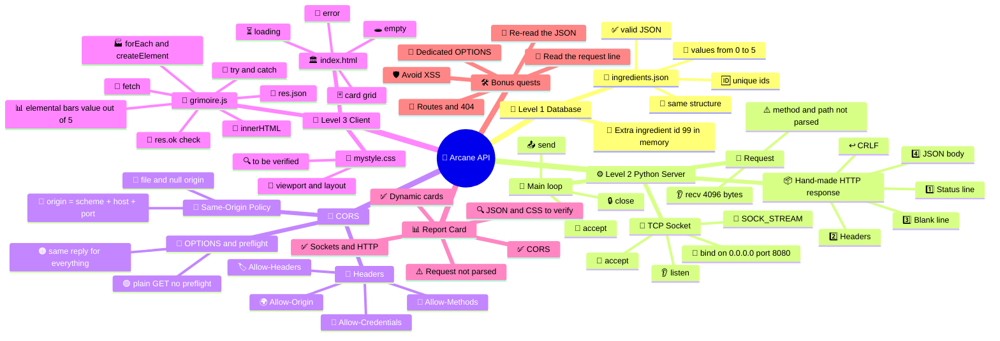
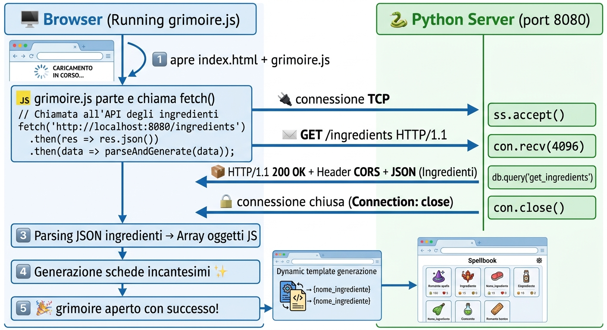
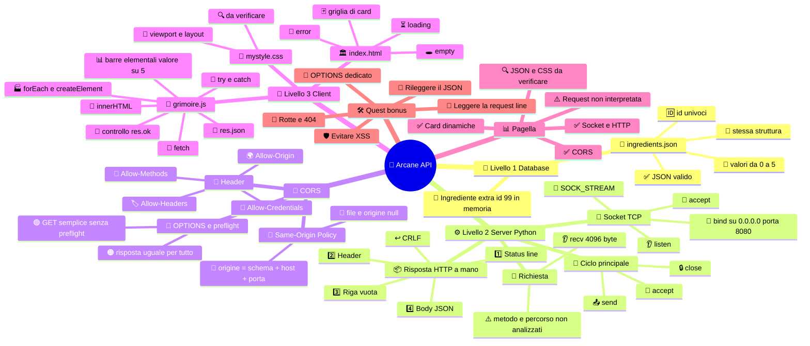

[](https://choosealicense.com/licenses/mit/)
[](https://opensource.org/licenses/)
[](http://www.gnu.org/licenses/agpl-3.0)

<a name="TOP"></a>

<a href="#IT"></a>
🤍
<a href="#EN"></a>

---

 <a name="EN"></A>

<!-- English -->

# 🧪 Project: Arcane API - Build Your Own Digital Grimoire! 🔮📖✨

🏗️ Build a server 🐍, a client 🖥️, a stash of magic ingredients 🧙‍♂️🌿 and a mission 🎯:
make Python 🐍 talk to the browser 🌐 with no shortcuts 🚫🛤️.

> «A real developer 👨‍💻 doesn't just fling spells around 🎲🪄: they know exactly which packet 📦 they're sending, to whom 🎯 and why 🤔.»

## 1. 🎮 The mission: wake up the grimoire 📖⚡

🕹️ Picture yourself as the developer 👨‍💻 of a *fantasy video game* 🐉🏰.
🧺 You've got a catalog of magic ingredients 🧪✨ to work with: *mandrake roots* 🌱, *dragon scales* 🐲, *mermaid tears* 🧜‍♀️💧, *phoenix feathers* 🔥🪶 and other mysterious components 🕵️‍♂️❓.

🚨 **The catch** 🧩? *The grimoire is still locked* 🔒📕!

🛠️ You need to build a system 🏗️ that lets the browser 🌐 browse the catalog 📚 through an HTTP server 📡 written in *Python* 🐍.

## 2. 🧙 Level 1 — Build your magic database 🗄️🔮

🧪 Before summoning the server 👻🖥️, you need to create your source of truth 📜✅: a file called [`ingredients.json`](./ingredients.json) 📁.
🔢 Inside it you'll need to put at least **25** magic ingredients 🧴🌿, each one described with a consistent JSON structure 🧱📐.
🏷️ Every item in the list will have `id` 🆔, `name` 🔤, `description` 📝, `earth` 🌍, `water` 💧, `fire` 🔥, `air` 💨 (an integer from 0 to 5 🔢 showing how strongly ❤️ the magic ingredient ✨ is tied to that element 🌀)

### 📜 Grimoire rules:

* 🆔 `ID`s must be unique 🦄☝️.
* 🔢 Elemental values 🌍💧🔥💨 must be integers from 0 to 5, both ends included ↔️✅.
* 🧱 Every ingredient must follow the exact same structure 📐🤝.
* ✅ The file must be valid JSON 🧾, with no comments 🚫💬 and no stray trailing commas 🚫✂️.

## 3. ⚙️ Level 2 — Build an HTTP server in Python 🐍🖥️

🔌 The server has to be built in Python 🐍 using a TCP socket 🧵 of type `SOCK_STREAM` 🚰.

### 🛠️ Mandatory technical requirements ⚠️
* 🔌 Create a TCP socket using Python's socket module 🐍.
* 📍 Bind the socket to an IP address 🌐 and a port 🚪.
* 👂 Put the server in listening mode with `listen()` 📡.
* 🤝 Accept incoming connections 📥 with `accept()`.
* 📨 Read the HTTP request 📜 sent by the client 🖥️.
* 🔎 Parse at least the HTTP method 🧭 and the requested path 🛣️.
* 📖 Read the [`ingredients.json`](./ingredients.json) file 📁.
* 📦 Send back a valid HTTP response ✅ containing the JSON 🧾.
* 🚧 Enable CORS 🌍🔓 so the web client 🖥️ can access the resources 🎁.

### 📡 The server has to reply with real HTTP 💯🌐

🍰 You have to build a complete HTTP response 📦, made up of:

* 🥇 **Status line**: HTTP version and status code 🚦.
* 🏷️ **Headers**: metadata about the response 🗂️.
* ✂️ *Blank line*: splits the headers from the body 🧱.
* 🎁 **Body**: the content of the JSON file 🧾.

### 🌐 CORS: open the portal to the browser 🌀🚪

🌍 **CORS** (**C**ross-**O**rigin **R**esource **S**haring 🤝) is the mechanism the server 🖥️ uses to declare which cross-origin requests 🔀 the browser is allowed to let through 🌐✅.
🎫 For this project, the server has to send back the required *CORS* headers 📨.
🛂 Handle the OPTIONS method too ❓, when needed, for the browser's preliminary requests ✈️🔍.

#### ⚠️ Heads up:

📁 opening an HTML file directly with `file://` can cause origin problems 🚨🌍.
🧪 To test the project properly ✅, serve the client from an HTTP origin too 🌐, or document 📝 and handle the execution context properly 🎬.

## 4. 🎨 Level 3 — Bring the HTML, CSS client to life 🖌️✨

🪄 *From JSON to magic storefront 🪟✨ Backend's working* ⚙️❓ *Awesome* 🎉👏.

🖼️ Now you need a page 📄 that turns the data 🔄 into an interface that looks great 😍 and feels easy to use 👆📱.
💻 Build a web client 🌐 with HTML 🏛️, CSS 🎨 and JavaScript 🟨 to request the ingredients from the server 📡 and show them as dynamic cards 🃏⚡.

🃏 Every card has to show:

* 🖼️ The ingredient's image (*optional* 🤷‍♂️).
* 🔤 The `name` and the `ID` 🆔.
* 📝 The `description`.
* 🌱💧🔥💨 The four elemental values.

### 🧩 Frontend requirements 🖥️

* 🏭 Create the cards dynamically from the data the server sends 📥.
* 📡 Get the data with `fetch()` 🚀 from the server's endpoint 🎯.
* 🚨 Handle connection errors 🔌💥 and invalid HTTP responses ❌📨.
* 💬 Show a clear message 😊 when there are no ingredients available 🫙🕳️.
* 📱 Make sure the page is readable on smartphones too 👀📲.

⌨️ Open your editor 📝, fire up the terminal 🖤💻 and start building your grimoire 🏗️📖🔥.

*The server won't write itself* 🤖🚫✍️!

---

# 🧪🔮 Arcane API: how we woke up the grimoire (and why it actually works!) 📖⚡🔥

👋😎 Today we're cracking open the **grimoire** 📕✨ and checking, piece by piece, how your code tackles the **Arcane API** mission 🎯🧙‍♂️:
a Python server 🐍 built with nothing but sockets, a web client 🖥️ that turns JSON into magic cards 🃏 and CORS 🚧 acting as the portal in between! Buckle up 🪢🚀: *let's go*!

> «A real developer 👨‍💻 doesn't just fling spells around 🎲🪄: they know exactly which packet 📦 they're sending, to whom 🎯 and why 🤔.»

## 🧠🗺️ 0. The mind map: the whole grimoire at a glance 👀

> 🎬 Before we jump into the details, here's your **treasure map** 🏴‍☠️💎: every concept of the mission and how the pieces fit together 🔗. Come back to it whenever you feel lost 🧭😅!



### 🧭🔗 How to read the map

| 🔗 Link | 🧠 What it means |
| :--- | :--- |
| 🧙➡️⚙️ **Database → Server** | 📖 The server reads `ingredients.json` and turns it into a JSON string ready to ship |
| ⚙️➡️🎨 **Server → Client** | 📦 The HTTP response carries the JSON all the way to `fetch()` |
| 🎨➡️🚧 **Client → CORS** | 🌍 The client can live on a different origin (`file://` or another port): the server's permission is needed |
| 🚧➡️⚙️ **CORS → Server** | 🎫 You give that permission with the `Access-Control-*` headers in the response |
| 📊➡️🛠️ **Report Card → Bonus quests** | 🔧 Every ⚠️ gets its own power-up |

### 🎯⏱️ The map in one sentence

> 🎤 *A **JSON file** 🧙 gets read by a **Python server** 🐍 that opens a **TCP socket** 🔌 and replies with an **HTTP** message 📨; a **client** 🎨 asks for it with **fetch()** 📡 and turns it into **magic cards** 🃏; and since client and server can be **different origins** 🧩, the server adds the **CORS** headers 🎫 to tell the browser "yep, you can read this" ✅.*

## 🎮🔥 1. The mission and the game plan

🕹️ The assignment asks you to make **Python** 🐍 talk to the **browser** 🌐 with **no shortcuts** 🚫🛤️: no Flask, no frameworks 🙅‍♂️, just sockets and "real" HTTP 💯.

🧩 Your project has **three pieces** 🎭:

| 🎭 File | 🧰 Role | 🎯 Level |
| :---: | :--- | :---: |
| 📁 `ingredients.json` | 🗄️ The source of truth: the magic ingredients | 🧙 Level 1 |
| 🐍 `main.py` | 📡 The HTTP server built with sockets | ⚙️ Level 2 |
| 🏛️ `index.html` + 🎨 `mystyle.css` + 📡 `grimoire.js` | 🃏 The client that shows the cards | 🎨 Level 3 |

🔄 The full movie of what goes down, comic-strip style 🎬:



#### 💡 Key takeaway 🧠:

**no dark magic here** 🪄🚫.

The browser writes text 📝, the server reads text 📖 and answers with more text 📄.

That's it! 🤯

## 🧙🗄️ 2. Level 1 — The magic database

📜 The assignment asks for a file [`ingredients.json`](./ingredients.json) with **at least 25 ingredients** 🧴, each one with `id`, `name`, `description`, `earth`, `water`, `fire`, `air` 🌍💧🔥💨.

| 📜 Grimoire rule | 🚦 Status | 🗒️ Note |
| :--- | :---: | :--- |
| 🔢 At least 25 ingredients | 🔍 | Needs counting (the server adds 1 in memory, see below 🎁) |
| 🆔 Unique `id`s | 🔍 | ⚠️ Careful: no ingredient in the file can have `id` **99**, it's already taken by the extra one in `main.py`! |
| 🔢 Elemental values are integers from 0 to 5 | 🔍 | Both ends included ↔️ |
| 🧱 Same structure for all | 🔍 | Same 7 keys in every object |
| ✅ Valid JSON | ✅ | 🎉 If `load(f)` doesn't blow up at startup, the syntax is good |

### 🎁☕ The easter egg: the Coffee Bean of Infinite Debugging

```python
grimoire.append({
	"id": 99,
	"name": "Professorial Coffee Bean of Infinite Debugging",
	"description": "A legendary, pitch-black coffee bean roasted in ancient server rooms. ...",
	"earth": 2,
	"water": 1,
	"fire": 5,
	"air": 4
})
```

- 🥚 A **legendary ingredient** added **in memory only** 🧠: the `ingredients.json` file never gets touched 🙅‍♂️.
- ✅ It follows the rules: it has all the keys and the elemental values are between 0 and 5 🔢.
- 🔥 Fire 5 out of 5: of course, it's coffee ☕😄.
- 🔬 Side effect: the browser gets **one ingredient more** than what's in the file (if the file has 25, you'll see 26 cards 🃏).

## ⚙️🐍 3. Level 2 — The HTTP server in Python

[`main.py`](./main.py)

### 📚 3.1 Loading and serializing the data 📥📤

```python
from json import load, dumps
import socket
GRIMOIRE_INGREDIENTS = './ingredients.json'
with open(GRIMOIRE_INGREDIENTS, 'r', encoding = 'utf-8') as f:
	grimoire = load(f)
...
grimoire2str:str = dumps(grimoire, indent = 0, ensure_ascii = False, separators = (',', ':'))
```

- 📖 `load(f)` → from JSON text to a **list of Python dictionaries** 🐍 (requirement: *read the file* ✅).
- 🧵 `dumps(...)` → back from Python to a **JSON string** ready to ship 📦.
- 🔤 `ensure_ascii = False` → no ugly `\u00e8` stuff: accented characters stay readable 🇮🇹.
- ✂️ `separators = (',', ':')` + `indent = 0` → lean payload 📉 but still tidy.

### 🔌 3.2 The TCP socket, step by step 🧱

```python
HOST = '0.0.0.0'
PORT = 8080

ss = socket.socket(socket.AF_INET, socket.SOCK_STREAM)
ss.setsockopt(socket.SOL_SOCKET, socket.SO_REUSEADDR, 1)
ss.bind((HOST, PORT))
ss.listen(1)
```

| 🧩 Assignment requirement | 💻 In the code | 🚦 |
| :--- | :--- | :---: |
| 🔌 Create a TCP `SOCK_STREAM` socket | `socket.socket(AF_INET, SOCK_STREAM)` | ✅ |
| 📍 Bind it to IP and port | `ss.bind((HOST, PORT))` → `0.0.0.0:8080` | ✅ |
| 👂 Put it in listening mode | `ss.listen(1)` | ✅ |
| 🤝 Accept connections | `con, addr = ss.accept()` | ✅ |

- ♻️ `SO_REUSEADDR` → restart the server on the fly without the annoying *Address already in use* 😤.
- 🌐 `0.0.0.0` → the server can be reached from **other devices on your network** 📱💻 (handy for testing from your phone! 🔥).

### 📦 3.3 The hand-built HTTP response 🛠️

```python
res = f"""HTTP/1.1 200 OK
Content-Type: application/json; charset=utf-8
Access-Control-Allow-Origin: *
Access-Control-Allow-Methods: GET, POST, PUT, DELETE, OPTIONS
Access-Control-Allow-Headers: Content-Type, Authorization, X-Requested-With
Access-Control-Allow-Credentials: true
Connection: close

{grimoire2str}""".replace('\r', '').replace('\n', '\r\n').encode('utf-8')
```

🍰 The assignment spells it out: an HTTP response is a cake with **4 layers**:

| 🥞 Layer (from the assignment) | 📝 In your code | 🚦 |
| :---: | :--- | :---: |
| 1️⃣ **Status line** | `HTTP/1.1 200 OK` | ✅ |
| 2️⃣ **Headers** | `Content-Type`, `Access-Control-*`, `Connection` | ✅ |
| 3️⃣ **Blank line** | the empty line right before `{grimoire2str}` | ✅ |
| 4️⃣ **Body** | the ingredients JSON | ✅ |

🔍 Pro-level tricks 🧠:

- 🧹 `.replace('\r', '')` → wipes any `\r` that's already there, so you don't end up with two 👯.
- ↩️ `.replace('\n', '\r\n')` → HTTP **insists** on `CRLF` as the line ending 📜.
- 🔢 `.encode('utf-8')` → sockets talk in **bytes**, not strings 🧱.
- 🚪 `Connection: close` → the server hangs up after replying, so you **don't need** `Content-Length` 🤝: the browser knows the body is over when the connection closes.
- ⚡ The response is built **just once** at startup and reused for every request 🏎️.

### ♾️ 3.4 The main loop 🔁

```python
goAway = True
while goAway:
	con, addr = ss.accept()
	req = con.recv(4096).decode('utf-8')
	print(f'{addr[0]}:{addr[1]} (recv) << Request recived')
	con.send(res)
	con.close()
	print(f'{addr[0]}:{addr[1]} (send) >> Response JSON DATA')
```

| 🔁 Step | 🧠 What happens |
| :---: | :--- |
| `accept()` 🤝 | ⏳ Stops and **waits** for a client; when one shows up, it hands back `con` + the address |
| `recv(4096)` 👂 | 📥 Reads up to 4096 bytes: the browser's HTTP request (**requirement: read the request** ✅) |
| `.decode('utf-8')` 🔤 | 🔄 From bytes to text |
| `send(res)` 📤 | 🚀 Fires off the ready-made response |
| `close()` 🔒 | 👋 Closes the connection |

### ⚠️🔎 3.5 The weak spot: the request is read but never *parsed*

🧐 The assignment says: *"Parse at least the HTTP method and the requested path"*. In the code, `req` gets **decoded and then never used** 😮.

- 🎭 The server sends back the **same JSON for any request whatsoever**: `GET /`, `GET /pizza`, `DELETE /everything`… always `200 OK` 🙃.
- 🖼️ Besides the page, the browser often asks for `/favicon.ico` too: it gets the JSON for that one as well 😅.
- 💡 No biggie for getting the demo to work ✅, but it's **the only mandatory server requirement left uncovered** 🎯 (we'll fix it in section 7 🛠️).

### 🧍🪦 3.6 More nerd stuff 🤓

- 🧍 **Sequential** server: it handles one client at a time 🐢 (*for a **demo** that's totally fine* ✅).
- 🪦 `goAway` is always `True`: `ss.close()` and *Server stopped* never get reached (you get out with `Ctrl+C` ⌨️).
- 💥 No `try/except`: if the browser drops the connection midway, the server can crash 🤕.

## 🚧🌐 4. CORS: the portal to the browser

### 🤔❓ 4.1 What's CORS, in one sentence

🎤 **CORS** = **C**ross-**O**rigin **R**esource **S**haring 🌍🤝:

> the way the **server** tells the **browser** "chill, this page coming from another origin **is allowed** to read my data" 🔓✅.

### 🏠🔑 4.2 What's an "origin"?

```text
http	://		localhost	:	8080
🔐					🏠			🚪
scheme			host			port
```

🚨 If even **just one** of the three changes, the browser sees a **different origin**:

| 🌐 Page served from... | 📡 ...calls | 🚦 Same origin? |
| :--- | :--- | :---: |
| `http://localhost:8080/index.html` | `http://localhost:8080/` | ✅ Yes |
| `http://localhost:5500/index.html` (e.g. Live Server) | `http://localhost:8080/` | ❌ No (different port) |
| `file:///.../frontend/index.html` | `http://localhost:8080/` | ❌ No (`null` origin) |

💡 Your client, [`grimoire.js`](./frontend/grimoire.js), calls `http://localhost:8080/`, while the page gets opened with a double-click (`file://`) or from another server: **different origins** 😮.

That's why the assignment warns you in the *"Heads up"* box ⚠️.

### 🎭🧠 4.3 The concept to tattoo on your brain

> 🔥 **The BROWSER does the blocking, not the server!** 🔥

- 📨 The request **really does reach** the Python server ✅ (you can see it in the log).
- 📦 The server answers ✅.
- 🧱 If the right CORS headers are missing, the browser **throws away** the response and your `fetch` errors out 💥 (*"blocked by CORS policy"* 🔴): that's the scenario your `catch` covers with the message *"Make sure your Python server is running on port 8080 with proper CORS headers"* 🧯.
- 🧪 Litmus test: `curl http://localhost:8080` always works, because curl **isn't a browser** 🙅‍♂️.

### 📨🔍 4.4 Your server's headers, one by one

| 🏷️ Header | 🗣️ What it tells the browser | 🎯 Needed here? |
| :--- | :--- | :---: |
| `Access-Control-Allow-Origin: *` 🌍 | "Any origin can read this response" 🔓 | 🔴 **ESSENTIAL**: it's the one that lets `file://` (or another port) read the JSON |
| `Access-Control-Allow-Methods: GET, POST, PUT, DELETE, OPTIONS` 🧰 | "These methods are okay from outside origins" 📋 | 🟡 Matters for **preflight** |
| `Access-Control-Allow-Headers: Content-Type, Authorization, X-Requested-With` 🏷️ | "The client can send these custom headers" ✉️ | 🟡 Matters for **preflight** |
| `Access-Control-Allow-Credentials: true` 🍪 | "The client can send cookies/credentials" 🔑 | 🟠 Not needed, and it comes with a gotcha ⚠️ |
| `Content-Type: application/json; charset=utf-8` 📦 | "The body is JSON in UTF-8" 🔤 | ✅ Crucial for `res.json()` |
| `Connection: close` 🚪 | "I'm hanging up after the response" 👋 | ✅ Lets you skip `Content-Length` |

### 🛂✈️ 4.5 The OPTIONS method and preflight

🧪 The assignment says: *"Handle the OPTIONS method too, when needed"* 🛂. The browser sends a check-in **`OPTIONS`** request (the *preflight*) **before** the real one when the real one is "not simple": methods like `PUT`/`DELETE`, custom headers like `Authorization`, or `Content-Type: application/json` in a `POST` 🟠.

- 🟢 Your `fetch('http://localhost:8080/')` is a **plain `GET`** with no custom headers → **no preflight**: it goes straight out 🚀.
- 🎰 If you add preflighted requests down the road, your server would still answer `200 OK` with all the CORS headers (because it **answers everything the same way**) → the browser would give the green light. It works *"by accident"*... but hey, it works! 😄
- 🛠️ Handling `OPTIONS` explicitly (with a `204` response) would be cleaner: you'll find it in the upgrades 👇.

### ⚠️🍪 4.6 The `Allow-Credentials: true` + `*` gotcha

- 🚫 With requests **that carry credentials** (cookies, `credentials: 'include'`) the browser **rejects** `Allow-Origin: *` 🙅‍♂️: you'd need the exact origin.
- 😌 In your case **no problem**: by default `fetch` doesn't send credentials cross-origin 🍃. The combo is technically contradictory but harmless here 🤷‍♂️.

### 🏭🔐 4.7 What about production?

| 🎯 Situation | 💡 What to do |
| :--- | :--- |
| 📚 Public read-only API (like this one) | 🌍 `Allow-Origin: *` is perfectly fine ✅ |
| 🔒 API with login/cookies | 🎯 **Exact** frontend origin, never `*` 🚫 |
| 🛡️ Real security | ⚠️ CORS protects **the user in the browser**, not the server: you still need authentication and authorization 🔑 |

## 🎨🃏 5. Level 3 — The HTML, CSS and JavaScript client

### 🏛️ 5.1 `index.html`: the skeleton with four "states" 🦴

🎭 The page sets up **four blocks**, and JavaScript decides which one to show:

| 🎬 State | 🆔 Element | 💬 What it shows | 👀 Visible when |
| :---: | :--- | :--- | :--- |
| ⏳ **Loading** | `#loading` | Spinner + *"Opening the grimoire and summoning ingredients..."* | 🟢 At the start (until the data arrives) |
| 🚨 **Error** | `#error-message` + `#error-text` | *"Summoning Failed!"* + the error details | 🔴 If `fetch` fails or the response isn't `ok` |
| 🕳️ **Empty** | `#empty-message` | *"The grimoire is empty..."* | 🟡 If the array is empty or invalid |
| 🃏 **Grid** | `#ingredients-container` | The ingredient cards | 🟢 When there's data |

- 🙈 The hidden states use the `d-none` class (defined in your CSS 🎨, no Bootstrap: the subtitle says so too, *"Pure CSS / No Bootstrap"* 😉).
- 📱 `<meta name="viewport" content="width=device-width, initial-scale=1.0" />` → must-have basics for readability on smartphones (assignment requirement ✅).
- 📜 `<script async src="./grimoire.js">` → at the bottom of the `<body>`, so the elements already exist when the script kicks in 🏃.

### 📡 5.2 [`grimoire.js`](./frontend/grimoire.js): where the magic happens 🪄

#### 🧯 Phase 1 — Fetching data and handling errors

```js
const res = await fetch('http://localhost:8080/');

if (!res.ok)
	throw new Error(`HTTP error! Status: ${res.status}`);

const ingredients = await res.json();
```

- 🚀 **`fetch()`** to the server's endpoint ✅ (requirement: *get the data with fetch*).
- 🚦 **`if (!res.ok) throw ...`** → handles **invalid HTTP responses** (404, 500...) ✅ (requirement: *handle invalid HTTP responses*).
- 🔄 **`res.json()`** → from the text body to an array of JS objects 📚.

#### 🕳️ Phase 2 — No ingredients? Clear message!

```js
loadingEl.classList.add('d-none');

if (!Array.isArray(ingredients) || ingredients.length === 0) {
	emptyEl.classList.remove('d-none');
	return;
}
```

- ⏳ First it hides the **spinner**.
- 🕳️ If it's not an array or it's empty, it shows `#empty-message` and **bails out** ✅ (requirement: *clear message when there are no ingredients*).

#### 🏭 Phase 3 — One card per ingredient

```js
ingredients.forEach(item => {
	const card = document.createElement('div');
	card.className = 'card';
	card.innerHTML = `...`;
	containerEl.appendChild(card);
});
```

- 🔁 `forEach` → one pass for each ingredient.
- 🧱 `createElement('div')` + `className = 'card'` → builds the card **in code**, without writing it in the HTML ✅ (requirement: *create the cards dynamically*).
- 💉 `innerHTML` with a template literal → fills the card with the data.
- 📌 `appendChild` → sticks it onto the `#ingredients-container` grid.

#### 🃏 What's inside each card (assignment requirements)

| 🃏 Required content | 💻 In the code | 🚦 |
| :--- | :--- | :---: |
| 🔤 The `name` | `<h3 class="card-title">${item.name}</h3>` | ✅ |
| 🆔 The `ID` | `<span class="badge-id">#${item.id}</span>` | ✅ |
| 📝 The `description` | `<p class="card-text">${item.description}</p>` | ✅ |
| 🌍💧🔥💨 The four elemental values | Four rows with a label, an `x/5` value and a bar | ✅ |
| 🖼️ The image (*optional*) | Not there | 🤷‍♂️ Optional |

#### 📊 The number turns into a bar: the math 🧮

```js
style="width: ${(item.earth / 5) * 100}%"
```

| 🔢 Value | 🧮 Calculation | 📏 Bar width |
| :---: | :---: | :---: |
| 0 | 0 / 5 × 100 | 0% 🪫 |
| 1 | 1 / 5 × 100 | 20% |
| 3 | 3 / 5 × 100 | 60% |
| 5 | 5 / 5 × 100 | 100% 🔋 |

- 🎨 Each element gets its own pair of classes (`text-earth` / `progress-bar-earth`, `...-water`, `...-fire`, `...-air`) for **dedicated colors** 🌍🟢 💧🔵 🔥🔴 💨⚪.
- 🧠 That's why the assignment asks for integers **from 0 to 5**: 5 is a "full" bar!

#### 🚨 Phase 4 — When things go sideways

```js
} catch (error) {
	loadingEl.classList.add('d-none');
	errorTextEl.textContent = `Error connecting to server: ${error.message}. Make sure your Python server is running on port 8080 with proper CORS headers.`;
	errorEl.classList.remove('d-none');
}
```

- 🧯 The `catch` picks up **both** network errors (server down 🔌💥, CORS block 🚧) **and** the error thrown by `!res.ok` ✅ (requirement: *handle connection errors*).
- 🗣️ The message is **clear**: it says what happened and **what to check** 👏.
- 🔒 It uses `textContent` (not `innerHTML`) for the error message: the safe move 🛡️.

### 🎨📱 5.3 `mystyle.css`: the styling (file to be verified 🔍)

🙈 The CSS **wasn't among the files I got either**, so I can't vouch for the layout. From the code, though, you can tell it defines: `.container`, `.grid`, `.card`, `.spinner`, `.alert-danger` / `.alert-warning`, `.d-none`, the `--gold` variable and the elemental classes 🎨.

📱 **Quick check for smartphone readability** (assignment requirement ✅):

- 🧱 The grid should use something like `grid-template-columns: repeat(auto-fill, minmax(260px, 1fr))` to fit narrow screens.
- 🔍 Try it in DevTools (`F12` → phone icon 📲) and shrink the window: the cards should stack up with no horizontal scrolling.

## 📊✅ 6. Mission Report Card

🎓 Honest but friendly grade 🤝 (**spoiler:** it's solid work 👏🔥, with one thing to improve).

| 🧪 Assignment requirement | 🚦 Result | 🗒️ Comment |
| :--- | :---: | :--- |
| 🆔 Unique IDs / values 0-5 / same structure | 🔍 | Same as above; watch out for `id` 99 ⚠️ |
| ✅ Valid JSON | ✅ | `load(f)` reads it with no errors |
| 🔌 TCP `SOCK_STREAM` socket | ✅ | 🧱 `AF_INET` + `SOCK_STREAM` |
| 📍 `bind` to IP and port | ✅ | `0.0.0.0:8080` |
| 👂 `listen()` | ✅ | `listen(1)` |
| 🤝 `accept()` | ✅ | In the main loop |
| 📨 Read the HTTP request | ✅ | `recv(4096)` |
| 🔎 Parse **method and path** | ⚠️ | Request read but never analyzed: same reply for everything |
| 📖 Read [`ingredients.json`](./ingredients.json) | ✅ | Just once at startup (to see changes you need to restart 🔄) |
| 📦 Valid HTTP response with the JSON | ✅ | 🍰 4 layers with proper `CRLF` |
| 🚧 Enable CORS | ✅ | 🌍 Full set of headers |
| 🛂 Handle `OPTIONS` when needed | ⚠️ | Works "by accident": no dedicated branch |
| 🃏 Dynamically created cards | ✅ | `createElement` + `innerHTML` |
| 📡 Data via `fetch()` | ✅ | Native, no libraries |
| 🚨 Connection errors and invalid HTTP responses | ✅ | `try/catch` + `!res.ok` |
| 🕳️ Message when there are no ingredients | ✅ | `#empty-message` |
| 📱 Page readable on smartphones | 🔍 | Viewport ✅, CSS layout to be verified |
| 🔤 Name, ID, description, 4 values on the cards | ✅ | All there (optional image missing 🤷‍♂️) |

## 🏁🎓 7. Final takeaways

| 🧠 Concept | 💎 Take it home |
| :--- | :--- |
| 🔌 **Socket** | 🧱 The basic building block: two programs swapping bytes |
| 📜 **HTTP** | 📝 It's just **text** in a precise format: status line → headers → blank line → body |
| 🔄 **CRLF** | ↩️ HTTP lines end with `\r\n` |
| 📦 **JSON** | 🧾 The common language between Python 🐍 and JavaScript 🟨 |
| 📡 **fetch()** | 🚀 The browser's native way of "phoning" the server |
| 🚦 **`res.ok`** | ✅ `fetch` doesn't fail by itself on a 404: you've got to check it yourself! |
| 🚧 **CORS** | 🎫 A **permission slip** the server hands to the **browser**, not a wall the server builds |
| 🃏 **Dynamic DOM** | 🏭 Data → `createElement` → card: you don't write the HTML by hand |

🏆 Your project does **the most important thing** of the mission:

it proves that a **JSON file** 📁, **sockets** 🔌, **HTTP** 📨, a **Python server** 🐍, **CORS** 🚧 and **fetch** 📡 all work together with **no framework** hiding the magic 🪄✨. Add request parsing and the grimoire goes from "it works!" to "**it works well**" 💯🔥.


---

<a href="#IT"></a>
🤍
<a href="#EN"></a>

---

 <a name="IT"></A>

<!-- Italiano -->

# 🧪 Project: Arcane API - Costruisci il tuo grimorio digitale! 🔮📖✨

🏗️ Costruisci un server 🐍, un client 🖥️, un archivio di ingredienti magici 🧙‍♂️🌿 e una missione 🎯:
far parlare Python 🐍 con il browser 🌐 senza scorciatoie 🚫🛤️.

> «Un vero developer 👨‍💻 non lancia magie a caso 🎲🪄: sa esattamente quale pacchetto 📦 invia, a chi 🎯 e perché 🤔.»

## 1. 🎮 La missione: risveglia il grimorio 📖⚡

🕹️ Immagina di essere il developer 👨‍💻 di un *videogioco fantasy* 🐉🏰.
🧺 Hai a disposizione un catalogo di ingredienti magici 🧪✨: *radici di mandragola* 🌱, *scaglie di drago* 🐲, *lacrime di sirena* 🧜‍♀️💧, *piume di fenice* 🔥🪶 e altri componenti misteriosi 🕵️‍♂️❓.

🚨 **Il problema** 🧩? *Il grimorio è ancora chiuso* 🔒📕!

🛠️ Devi costruire un sistema 🏗️ che permetta al browser 🌐 di consultare il catalogo 📚 attraverso un server HTTP 📡 scritto in *Python* 🐍.

## 2. 🧙 Livello 1 — Crea il tuo database magico 🗄️🔮

🧪 Prima di evocare il server 👻🖥️, devi creare la tua fonte di verità 📜✅: un file chiamato [`ingredients.json`](./ingredients.json) 📁.
🔢 Al suo interno dovrai inserire almeno **25** ingredienti magici 🧴🌿, ciascuno descritto attraverso una struttura JSON coerente 🧱📐.
🏷️ Ogni elemento nella lista avrà `id` 🆔, `name` 🔤, `description` 📝, `earth` 🌍, `water` 💧, `fire` 🔥, `air` 💨 (intero tra 0 e 5 🔢 che indica l'affinità ❤️ del elemento magico ✨ con quel elemento caratteristico 🌀)

### 📜 Regole del grimorio:

* 🆔 Gli `ID` devono essere univoci 🦄☝️.
* 🔢 I valori elementali 🌍💧🔥💨 devono essere interi compresi tra 0 e 5, estremi inclusi ↔️✅.
* 🧱 Tutti gli ingredienti devono rispettare la stessa struttura 📐🤝.
* ✅ Il file deve essere JSON valido 🧾, senza commenti 🚫💬 o virgole finali superflue 🚫✂️.

## 3. ⚙️ Livello 2 — Costruisci un server HTTP in Python 🐍🖥️

🔌 Il server deve essere realizzato in Python 🐍 utilizzando un socket TCP 🧵 di tipo `SOCK_STREAM` 🚰.

### 🛠️ Requisiti tecnici obbligatori ⚠️
* 🔌 Creare un socket TCP usando il modulo socket di Python 🐍.
* 📍 Associare il socket a un indirizzo IP 🌐 e a una porta 🚪.
* 👂 Mettere il server in ascolto con `listen()` 📡.
* 🤝 Accettare le connessioni in ingresso 📥 tramite `accept()`.
* 📨 Leggere la richiesta HTTP 📜 inviata dal client 🖥️.
* 🔎 Interpretare almeno il metodo HTTP 🧭 e il percorso richiesto 🛣️.
* 📖 Leggere il file [`ingredients.json`](./ingredients.json) 📁.
* 📦 Restituire una risposta HTTP valida ✅ contenente il JSON 🧾.
* 🚧 Abilitare CORS 🌍🔓 per consentire al client web 🖥️ di accedere alle risorse 🎁.

### 📡 Il server deve rispondere con HTTP vero 💯🌐

🍰 Devi costruire una risposta HTTP completa 📦, composta da:

* 🥇 **Status line**: versione HTTP e codice di stato 🚦.
* 🏷️ **Headers**: metadati della risposta 🗂️.
* ✂️ *Riga vuota*: separa gli header dal body 🧱.
* 🎁 **Body**: contenuto del file JSON 🧾.

### 🌐 CORS: apri il portale al browser 🌀🚪

🌍 **CORS** (**C**ross-**O**rigin **R**esource **S**haring 🤝) è il meccanismo attraverso cui il server 🖥️ dichiara quali richieste cross-origin 🔀 sono autorizzate dal browser 🌐✅.
🎫 Per questo progetto, il server deve restituire gli header *CORS* richiesti 📨.
🛂 Gestisci anche il metodo OPTIONS ❓, quando necessario, per le richieste preliminari del browser ✈️🔍.

#### ⚠️ Attenzione:

📁 aprire direttamente un file HTML con `file://` può creare problemi di origine 🚨🌍.
🧪 Per testare correttamente il progetto ✅, servi anche il client da un'origine HTTP 🌐, oppure documenta 📝 e gestisci correttamente il contesto di esecuzione 🎬.

## 4. 🎨 Livello 3 — Dai vita al client HTML, CSS 🖌️✨

🪄 *Dal JSON alla vetrina magica 🪟✨ Il backend funziona* ⚙️❓ *Perfetto* 🎉👏.

🖼️ Ora serve una pagina 📄 che trasformi i dati 🔄 in un'interfaccia bella da vedere 😍 e comoda da utilizzare 👆📱.
💻 Realizza un client web 🌐 con HTML 🏛️, CSS 🎨 e JavaScript 🟨 per richiedere gli ingredienti al server 📡 e visualizzarli attraverso card dinamiche 🃏⚡.

🃏 Ogni card deve mostrare:

* 🖼️ L'immagine dell'ingrediente (*facoltativamente* 🤷‍♂️).
* 🔤 Il `nome` e l'`ID` 🆔.
* 📝 La `descrizione`.
* 🌱💧🔥💨 I quattro valori elementali.

### 🧩 Requisiti del frontend 🖥️

* 🏭 Creare dinamicamente le card 🃏 a partire dai dati ricevuti dal server 📥.
* 📡 Recuperare i dati tramite `fetch()` 🚀 dall'endpoint del server 🎯.
* 🚨 Gestire gli errori di connessione 🔌💥 e le risposte HTTP non valide ❌📨.
* 💬 Mostrare un messaggio comprensibile 😊 se non sono disponibili ingredienti 🫙🕳️.
* 📱 Garantire che la pagina sia leggibile anche su smartphone 👀📲.

⌨️ Aprite l'editor 📝, avviate il terminale 🖤💻 e iniziate a costruire il vostro grimorio 🏗️📖🔥.

*Il server non si scriverà da solo* 🤖🚫✍️!

---

# 🧪🔮 Arcane API: come abbiamo risvegliato il grimorio (e perché funziona davvero!) 📖⚡🔥

👋😎 Oggi apriamo il **grimorio** 📕✨ e guardiamo, pezzo per pezzo, come il tuo codice risolve la missione di **Arcane API** 🎯🧙‍♂️:
un server Python 🐍 costruito con i soli socket, un client web 🖥️ che trasforma il JSON in carte magiche 🃏 e CORS 🚧 a fare da portale in mezzo! Allacciate le cinture 🪢🚀: *si parte*!

> «Un vero developer 👨‍💻 non lancia magie a caso 🎲🪄: sa esattamente quale pacchetto 📦 invia, a chi 🎯 e perché 🤔.»

## 🧠🗺️ 0. La mappa mentale: tutto il grimorio in un colpo d'occhio 👀

> 🎬 Prima di buttarci nei dettagli, ecco la **mappa del tesoro** 🏴‍☠️💎: ogni concetto della missione e come si incastra con gli altri 🔗. Tornaci quando ti senti perso 🧭😅!



### 🧭🔗 Come leggere la mappa

| 🔗 Collegamento | 🧠 Cosa significa |
| :--- | :--- |
| 🧙➡️⚙️ **Database → Server** | 📖 Il server legge `ingredients.json` e lo trasforma in una stringa JSON da spedire |
| ⚙️➡️🎨 **Server → Client** | 📦 La risposta HTTP porta il JSON fino a `fetch()` |
| 🎨➡️🚧 **Client → CORS** | 🌍 Il client può stare su un'altra origine (`file://` o altra porta): serve il permesso del server |
| 🚧➡️⚙️ **CORS → Server** | 🎫 Il permesso si dà con gli header `Access-Control-*` nella risposta |
| 📊➡️🛠️ **Pagella → Quest bonus** | 🔧 Ogni ⚠️ ha il suo potenziamento |

### 🎯⏱️ La mappa in una frase

> 🎤 *Un **file JSON** 🧙 viene letto da un **server Python** 🐍 che apre un **socket TCP** 🔌 e risponde con un messaggio **HTTP** 📨; un **client** 🎨 lo richiede con **fetch()** 📡 e lo trasforma in **card magiche** 🃏; e siccome client e server possono essere **origini diverse** 🧩, il server aggiunge gli header **CORS** 🎫 per dire al browser "sì, puoi leggere" ✅.*

## 🎮🔥 1. La missione e il piano d'attacco

🕹️ La traccia ti chiede di far parlare **Python** 🐍 con il **browser** 🌐 **senza scorciatoie** 🚫🛤️: niente Flask, niente framework 🙅‍♂️, solo socket e HTTP "veri" 💯.

🧩 Il tuo progetto ha **tre pezzi** 🎭:

| 🎭 File | 🧰 Ruolo | 🎯 Livello |
| :---: | :--- | :---: |
| 📁 `ingredients.json` | 🗄️ La fonte di verità: gli ingredienti magici | 🧙 Livello 1 |
| 🐍 `main.py` | 📡 Il server HTTP fatto con i socket | ⚙️ Livello 2 |
| 🏛️ `index.html` + 🎨 `mystyle.css` + 📡 `grimoire.js` | 🃏 Il client che mostra le card | 🎨 Livello 3 |

🔄 Il film completo di quello che succede, a fumetti 🎬:


#### 💡 Messaggio chiave 🧠:

**nessuna magia nera** 🪄🚫.

Il browser scrive testo 📝, il server legge testo 📖 e risponde con altro testo 📄.

Fine! 🤯

## 🧙🗄️ 2. Livello 1 — Il database magico

📜 La traccia chiede un file [`ingredients.json`](./ingredients.json) con **almeno 25 ingredienti** 🧴, ognuno con `id`, `name`, `description`, `earth`, `water`, `fire`, `air` 🌍💧🔥💨.

| 📜 Regola del grimorio | 🚦 Stato | 🗒️ Nota |
| :--- | :---: | :--- |
| 🔢 Almeno 25 ingredienti | 🔍 | Da contare (il server ne aggiunge 1 in memoria, vedi sotto 🎁) |
| 🆔 `id` univoci | 🔍 | ⚠️ Attenzione: nessun ingrediente nel file deve avere `id` **99**, già usato dall'extra di `main.py`! |
| 🔢 Valori elementali interi tra 0 e 5 | 🔍 | Estremi inclusi ↔️ |
| 🧱 Stessa struttura per tutti | 🔍 | Stesse 7 chiavi in ogni oggetto |
| ✅ JSON valido | ✅ | 🎉 Se `load(f)` non va in errore all'avvio, la sintassi è a posto |

### 🎁☕ L'easter egg: il Chicco di Caffè del Debugging Infinito

```python
grimoire.append({
	"id": 99,
	"name": "Professorial Coffee Bean of Infinite Debugging",
	"description": "A legendary, pitch-black coffee bean roasted in ancient server rooms. ...",
	"earth": 2,
	"water": 1,
	"fire": 5,
	"air": 4
})
```

- 🥚 Un **ingrediente leggendario** aggiunto **solo in memoria** 🧠: il file `ingredients.json` non viene toccato 🙅‍♂️.
- ✅ Rispetta le regole: ha tutte le chiavi e i valori elementali sono tra 0 e 5 🔢.
- 🔥 Fuoco 5 su 5: ovviamente, è caffè ☕😄.
- 🔬 Conseguenza: il browser riceve **un ingrediente in più** rispetto al file (se il file ne ha 25, vedrai 26 card 🃏).

## ⚙️🐍 3. Livello 2 — Il server HTTP in Python

[`main.py`](./main.py)

### 📚 3.1 Caricamento e serializzazione dei dati 📥📤

```python
from json import load, dumps
import socket
GRIMOIRE_INGREDIENTS = './ingredients.json'
with open(GRIMOIRE_INGREDIENTS, 'r', encoding = 'utf-8') as f:
	grimoire = load(f)
...
grimoire2str:str = dumps(grimoire, indent = 0, ensure_ascii = False, separators = (',', ':'))
```

- 📖 `load(f)` → dal testo JSON a una **lista di dizionari Python** 🐍 (requisito: *leggere il file* ✅).
- 🧵 `dumps(...)` → di nuovo da Python a **stringa JSON** pronta da spedire 📦.
- 🔤 `ensure_ascii = False` → niente `\u00e8` brutti: i caratteri accentati restano leggibili 🇮🇹.
- ✂️ `separators = (',', ':')` + `indent = 0` → payload compatto 📉 ma ancora ordinato.

### 🔌 3.2 Il socket TCP, passo dopo passo 🧱

```python
HOST = '0.0.0.0'
PORT = 8080

ss = socket.socket(socket.AF_INET, socket.SOCK_STREAM)
ss.setsockopt(socket.SOL_SOCKET, socket.SO_REUSEADDR, 1)
ss.bind((HOST, PORT))
ss.listen(1)
```

| 🧩 Requisito della traccia | 💻 Nel codice | 🚦 |
| :--- | :--- | :---: |
| 🔌 Creare un socket TCP `SOCK_STREAM` | `socket.socket(AF_INET, SOCK_STREAM)` | ✅ |
| 📍 Associarlo a IP e porta | `ss.bind((HOST, PORT))` → `0.0.0.0:8080` | ✅ |
| 👂 Metterlo in ascolto | `ss.listen(1)` | ✅ |
| 🤝 Accettare connessioni | `con, addr = ss.accept()` | ✅ |

- ♻️ `SO_REUSEADDR` → riavvii il server al volo senza il fastidioso *Address already in use* 😤.
- 🌐 `0.0.0.0` → il server è raggiungibile anche da **altri dispositivi della rete** 📱💻 (utile per testare dallo smartphone! 🔥).

### 📦 3.3 La risposta HTTP costruita a mano 🛠️

```python
res = f"""HTTP/1.1 200 OK
Content-Type: application/json; charset=utf-8
Access-Control-Allow-Origin: *
Access-Control-Allow-Methods: GET, POST, PUT, DELETE, OPTIONS
Access-Control-Allow-Headers: Content-Type, Authorization, X-Requested-With
Access-Control-Allow-Credentials: true
Connection: close

{grimoire2str}""".replace('\r', '').replace('\n', '\r\n').encode('utf-8')
```

🍰 La traccia lo chiede esplicitamente: una risposta HTTP è una torta a **4 strati**:

| 🥞 Strato (dalla traccia) | 📝 Nel tuo codice | 🚦 |
| :---: | :--- | :---: |
| 1️⃣ **Status line** | `HTTP/1.1 200 OK` | ✅ |
| 2️⃣ **Headers** | `Content-Type`, `Access-Control-*`, `Connection` | ✅ |
| 3️⃣ **Riga vuota** | la riga bianca prima di `{grimoire2str}` | ✅ |
| 4️⃣ **Body** | il JSON degli ingredienti | ✅ |

🔍 I trucchetti da pro 🧠:

- 🧹 `.replace('\r', '')` → pulisce eventuali `\r` già presenti, così non ne escono due 👯.
- ↩️ `.replace('\n', '\r\n')` → HTTP **pretende** `CRLF` come fine riga 📜.
- 🔢 `.encode('utf-8')` → i socket parlano in **byte**, non in stringhe 🧱.
- 🚪 `Connection: close` → il server chiude la connessione dopo aver risposto, quindi **non serve** `Content-Length` 🤝: il browser capisce che il body è finito quando la connessione si chiude.
- ⚡ La risposta è costruita **una volta sola** all'avvio e riusata a ogni richiesta 🏎️.

### ♾️ 3.4 Il ciclo principale 🔁

```python
goAway = True
while goAway:
	con, addr = ss.accept()
	req = con.recv(4096).decode('utf-8')
	print(f'{addr[0]}:{addr[1]} (recv) << Request recived')
	con.send(res)
	con.close()
	print(f'{addr[0]}:{addr[1]} (send) >> Response JSON DATA')
```

| 🔁 Passo | 🧠 Cosa succede |
| :---: | :--- |
| `accept()` 🤝 | ⏳ Si ferma e **aspetta** un client; quando arriva restituisce `con` + indirizzo |
| `recv(4096)` 👂 | 📥 Legge fino a 4096 byte: la richiesta HTTP del browser (**requisito: leggere la richiesta** ✅) |
| `.decode('utf-8')` 🔤 | 🔄 Da byte a testo |
| `send(res)` 📤 | 🚀 Spedisce la risposta già pronta |
| `close()` 🔒 | 👋 Chiude la connessione |

### ⚠️🔎 3.5 Il punto debole: la richiesta viene letta ma non *interpretata*

🧐 La traccia dice: *"Interpretare almeno il metodo HTTP e il percorso richiesto"*. Nel codice, `req` viene **decodificata e poi mai usata** 😮.

- 🎭 Il server risponde con lo **stesso JSON a qualunque richiesta**: `GET /`, `GET /pizza`, `DELETE /tutto`… sempre `200 OK` 🙃.
- 🖼️ Il browser, oltre alla pagina, spesso chiede anche `/favicon.ico`: riceve il JSON anche per quella 😅.
- 💡 Nessun dramma per far funzionare la demo ✅, ma è **l'unico requisito obbligatorio del server non coperto** 🎯 (lo sistemiamo nella sezione 7 🛠️).

### 🧍🪦 3.6 Altri dettagli da nerd 🤓

- 🧍 Server **sequenziale**: serve un client alla volta 🐢 (*per una **demo** va benissimo* ✅).
- 🪦 `goAway` è sempre `True`: `ss.close()` e *Server stopped* non vengono mai raggiunti (si esce con `Ctrl+C` ⌨️).
- 💥 Nessun `try/except`: se il browser molla la connessione a metà, il server può crashare 🤕.

## 🚧🌐 4. CORS: il portale verso il browser

### 🤔❓ 4.1 Cos'è CORS in una frase

🎤 **CORS** = **C**ross-**O**rigin **R**esource **S**haring 🌍🤝:

> il meccanismo con cui il **server** dice al **browser** "tranquillo, questa pagina proveniente da un'altra origine **può** leggere i miei dati" 🔓✅.

### 🏠🔑 4.2 Cos'è un'"origine"?

```text
http	://		localhost	:	8080
🔐					🏠			🚪
schema			host			porta
```

🚨 Se anche **uno solo** dei tre cambia, il browser vede un'**origine diversa**:

| 🌐 Pagina servita da... | 📡 ...chiama | 🚦 Stessa origine? |
| :--- | :--- | :---: |
| `http://localhost:8080/index.html` | `http://localhost:8080/` | ✅ Sì |
| `http://localhost:5500/index.html` (es. Live Server) | `http://localhost:8080/` | ❌ No (porta diversa) |
| `file:///.../frontend/index.html` | `http://localhost:8080/` | ❌ No (origine `null`) |

💡 Il tuo client, [`grimoire.js`](./frontend/grimoire.js), chiama `http://localhost:8080/`, mentre la pagina si apre con doppio clic (`file://`) o da un altro server: **origini diverse** 😮.

Ecco perché la traccia ti avvisa nel box *"Attenzione"* ⚠️.

### 🎭🧠 4.3 Il concetto da tatuarsi

> 🔥 **Il blocco lo fa il BROWSER, non il server!** 🔥

- 📨 La richiesta **arriva davvero** al server Python ✅ (lo vedi nel log).
- 📦 Il server risponde ✅.
- 🧱 Se mancano gli header CORS giusti, il browser **butta via** la risposta e il tuo `fetch` va in errore 💥 (*"blocked by CORS policy"* 🔴): è lo scenario che il tuo `catch` mostra con il messaggio *"Make sure your Python server is running on port 8080 with proper CORS headers"* 🧯.
- 🧪 Prova del nove: `curl http://localhost:8080` funziona sempre, perché curl **non è un browser** 🙅‍♂️.

### 📨🔍 4.4 Gli header del tuo server, uno per uno

| 🏷️ Header | 🗣️ Cosa dice al browser | 🎯 Serve qui? |
| :--- | :--- | :---: |
| `Access-Control-Allow-Origin: *` 🌍 | "Qualsiasi origine può leggere questa risposta" 🔓 | 🔴 **ESSENZIALE**: è lui che permette a `file://` (o ad altra porta) di leggere il JSON |
| `Access-Control-Allow-Methods: GET, POST, PUT, DELETE, OPTIONS` 🧰 | "Questi metodi sono ammessi da origini esterne" 📋 | 🟡 Conta per il **preflight** |
| `Access-Control-Allow-Headers: Content-Type, Authorization, X-Requested-With` 🏷️ | "Il client può inviare questi header custom" ✉️ | 🟡 Conta per il **preflight** |
| `Access-Control-Allow-Credentials: true` 🍪 | "Il client può inviare cookie/credenziali" 🔑 | 🟠 Non serve, e ha un trabocchetto ⚠️ |
| `Content-Type: application/json; charset=utf-8` 📦 | "Il body è JSON in UTF-8" 🔤 | ✅ Fondamentale per `res.json()` |
| `Connection: close` 🚪 | "Chiudo dopo la risposta" 👋 | ✅ Permette di omettere `Content-Length` |

### 🛂✈️ 4.5 Il metodo OPTIONS e il preflight

🧪 La traccia dice: *"Gestisci anche il metodo OPTIONS, quando necessario"* 🛂. Il browser manda una richiesta **`OPTIONS`** di controllo (il *preflight*) **prima** della richiesta vera quando questa è "non semplice": metodi come `PUT`/`DELETE`, header custom come `Authorization`, oppure `Content-Type: application/json` in un `POST` 🟠.

- 🟢 Il tuo `fetch('http://localhost:8080/')` è un **semplice `GET`** senza header custom → **nessun preflight**: parte diretto 🚀.
- 🎰 Se in futuro aggiungessi richieste con preflight, il tuo server risponderebbe comunque `200 OK` con tutti gli header CORS (perché risponde **a tutto allo stesso modo**) → il browser darebbe l'ok. Funziona *"per caso"*... ma funziona! 😄
- 🛠️ Una gestione esplicita di `OPTIONS` (con risposta `204`) sarebbe più pulita: la trovi nei potenziamenti 👇.

### ⚠️🍪 4.6 Il trabocchetto `Allow-Credentials: true` + `*`

- 🚫 Con richieste **con credenziali** (cookie, `credentials: 'include'`) il browser **rifiuta** `Allow-Origin: *` 🙅‍♂️: servirebbe l'origine esatta.
- 😌 Nel tuo caso **nessun problema**: `fetch` di default non invia credenziali cross-origin 🍃. La combinazione è tecnicamente contraddittoria ma innocua qui 🤷‍♂️.

### 🏭🔐 4.7 In produzione?

| 🎯 Situazione | 💡 Cosa fare |
| :--- | :--- |
| 📚 API pubblica in sola lettura (come questa) | 🌍 `Allow-Origin: *` va benissimo ✅ |
| 🔒 API con login/cookie | 🎯 Origine **esatta** del frontend, mai `*` 🚫 |
| 🛡️ Sicurezza vera | ⚠️ CORS protegge **l'utente nel browser**, non il server: servono comunque autenticazione e autorizzazione 🔑 |

## 🎨🃏 5. Livello 3 — Il client HTML, CSS e JavaScript

### 🏛️ 5.1 `index.html`: lo scheletro con quattro "stati" 🦴

🎭 La pagina prepara **quattro blocchi**, e JavaScript decide quale mostrare:

| 🎬 Stato | 🆔 Elemento | 💬 Cosa mostra | 👀 Visibile quando |
| :---: | :--- | :--- | :--- |
| ⏳ **Loading** | `#loading` | Spinner + *"Opening the grimoire and summoning ingredients..."* | 🟢 All'inizio (finché arrivano i dati) |
| 🚨 **Error** | `#error-message` + `#error-text` | *"Summoning Failed!"* + dettaglio dell'errore | 🔴 Se `fetch` fallisce o la risposta non è `ok` |
| 🕳️ **Empty** | `#empty-message` | *"The grimoire is empty..."* | 🟡 Se l'array è vuoto o non valido |
| 🃏 **Grid** | `#ingredients-container` | Le card degli ingredienti | 🟢 Quando ci sono dati |

- 🙈 Gli stati nascosti usano la classe `d-none` (definita nel tuo CSS 🎨, niente Bootstrap: lo dice anche il sottotitolo *"Pure CSS / No Bootstrap"* 😉).
- 📱 `<meta name="viewport" content="width=device-width, initial-scale=1.0" />` → base indispensabile per la leggibilità su smartphone (requisito della traccia ✅).
- 📜 `<script async src="./grimoire.js">` → in fondo al `<body>`, così gli elementi esistono già quando lo script parte 🏃.

### 📡 5.2 [`grimoire.js`](./frontend/grimoire.js): dove nasce la magia 🪄

#### 🧯 Fase 1 — Recupero dati e gestione errori

```js
const res = await fetch('http://localhost:8080/');

if (!res.ok)
	throw new Error(`HTTP error! Status: ${res.status}`);

const ingredients = await res.json();
```

- 🚀 **`fetch()`** verso l'endpoint del server ✅ (requisito: *recuperare i dati tramite fetch*).
- 🚦 **`if (!res.ok) throw ...`** → gestisce le **risposte HTTP non valide** (404, 500...) ✅ (requisito: *gestire le risposte HTTP non valide*).
- 🔄 **`res.json()`** → dal body testuale a un array di oggetti JS 📚.

#### 🕳️ Fase 2 — Nessun ingrediente? Messaggio chiaro!

```js
loadingEl.classList.add('d-none');

if (!Array.isArray(ingredients) || ingredients.length === 0) {
	emptyEl.classList.remove('d-none');
	return;
}
```

- ⏳ Prima nasconde lo **spinner**.
- 🕳️ Se non è un array o è vuoto, mostra `#empty-message` e **esce** ✅ (requisito: *messaggio comprensibile se non ci sono ingredienti*).

#### 🏭 Fase 3 — Una card per ogni ingrediente

```js
ingredients.forEach(item => {
	const card = document.createElement('div');
	card.className = 'card';
	card.innerHTML = `...`;
	containerEl.appendChild(card);
});
```

- 🔁 `forEach` → un giro per ogni ingrediente.
- 🧱 `createElement('div')` + `className = 'card'` → crea la card **da codice**, senza scriverla nell'HTML ✅ (requisito: *creare dinamicamente le card*).
- 💉 `innerHTML` con un template literal → riempie la card con i dati.
- 📌 `appendChild` → la attacca alla griglia `#ingredients-container`.

#### 🃏 Cosa c'è dentro ogni card (requisiti della traccia)

| 🃏 Contenuto richiesto | 💻 Nel codice | 🚦 |
| :--- | :--- | :---: |
| 🔤 Il `nome` | `<h3 class="card-title">${item.name}</h3>` | ✅ |
| 🆔 L'`ID` | `<span class="badge-id">#${item.id}</span>` | ✅ |
| 📝 La `descrizione` | `<p class="card-text">${item.description}</p>` | ✅ |
| 🌍💧🔥💨 I quattro valori elementali | Quattro righe con etichetta, valore `x/5` e barra | ✅ |
| 🖼️ L'immagine (*facoltativa*) | Non presente | 🤷‍♂️ Opzionale |

#### 📊 Il numero diventa una barra: la matematica 🧮

```js
style="width: ${(item.earth / 5) * 100}%"
```

| 🔢 Valore | 🧮 Calcolo | 📏 Larghezza barra |
| :---: | :---: | :---: |
| 0 | 0 / 5 × 100 | 0% 🪫 |
| 1 | 1 / 5 × 100 | 20% |
| 3 | 3 / 5 × 100 | 60% |
| 5 | 5 / 5 × 100 | 100% 🔋 |

- 🎨 Ogni elemento ha la sua coppia di classi (`text-earth` / `progress-bar-earth`, `...-water`, `...-fire`, `...-air`) per i **colori dedicati** 🌍🟢 💧🔵 🔥🔴 💨⚪.
- 🧠 Per questo la traccia chiede interi **tra 0 e 5**: il 5 è il "pieno" della barra!

#### 🚨 Fase 4 — Se qualcosa va storto

```js
} catch (error) {
	loadingEl.classList.add('d-none');
	errorTextEl.textContent = `Error connecting to server: ${error.message}. Make sure your Python server is running on port 8080 with proper CORS headers.`;
	errorEl.classList.remove('d-none');
}
```

- 🧯 Il `catch` intercetta **sia** gli errori di rete (server spento 🔌💥, blocco CORS 🚧) **sia** l'errore lanciato da `!res.ok` ✅ (requisito: *gestire gli errori di connessione*).
- 🗣️ Il messaggio è **comprensibile**: dice cosa è successo e **cosa controllare** 👏.
- 🔒 Usa `textContent` (non `innerHTML`) per il messaggio d'errore: scelta sicura 🛡️.

### 🎨📱 5.3 `mystyle.css`: lo stile (file da verificare 🔍)

🙈 Anche il CSS **non era tra i file ricevuti**, quindi non posso garantire il layout. Dal codice, però, si capisce che definisce: `.container`, `.grid`, `.card`, `.spinner`, `.alert-danger` / `.alert-warning`, `.d-none`, la variabile `--gold` e le classi elementali 🎨.

📱 **Check rapido per la leggibilità su smartphone** (requisito della traccia ✅):

- 🧱 La griglia dovrebbe usare qualcosa come `grid-template-columns: repeat(auto-fill, minmax(260px, 1fr))` per adattarsi alle larghezze piccole.
- 🔍 Prova in DevTools (`F12` → icona smartphone 📲) a restringere la finestra: le card devono impilarsi senza scroll orizzontale.

## 📊✅ 6. Pagella della missione

🎓 Voto sincero ma amichevole 🤝 (**spoiler:** è un lavoro solido 👏🔥, con un punto da migliorare).

| 🧪 Requisito della traccia | 🚦 Esito | 🗒️ Commento |
| :--- | :---: | :--- |
| 🆔 ID univoci / valori 0-5 / stessa struttura | 🔍 | Idem; attenzione all'`id` 99 ⚠️ |
| ✅ JSON valido | ✅ | `load(f)` lo legge senza errori |
| 🔌 Socket TCP `SOCK_STREAM` | ✅ | 🧱 `AF_INET` + `SOCK_STREAM` |
| 📍 `bind` a IP e porta | ✅ | `0.0.0.0:8080` |
| 👂 `listen()` | ✅ | `listen(1)` |
| 🤝 `accept()` | ✅ | Nel ciclo principale |
| 📨 Leggere la richiesta HTTP | ✅ | `recv(4096)` |
| 🔎 Interpretare **metodo e percorso** | ⚠️ | Richiesta letta ma mai analizzata: risposta identica a tutto |
| 📖 Leggere [`ingredients.json`](./ingredients.json) | ✅ | Una volta sola all'avvio (per vedere modifiche serve riavviare 🔄) |
| 📦 Risposta HTTP valida col JSON | ✅ | 🍰 4 strati con `CRLF` corretti |
| 🚧 Abilitare CORS | ✅ | 🌍 Header completi |
| 🛂 Gestire `OPTIONS` quando necessario | ⚠️ | Funziona "per caso": nessun ramo dedicato |
| 🃏 Card create dinamicamente | ✅ | `createElement` + `innerHTML` |
| 📡 Dati via `fetch()` | ✅ | Nativa, senza librerie |
| 🚨 Errori di connessione e risposte HTTP non valide | ✅ | `try/catch` + `!res.ok` |
| 🕳️ Messaggio se non ci sono ingredienti | ✅ | `#empty-message` |
| 📱 Pagina leggibile su smartphone | 🔍 | Viewport ✅, layout CSS da verificare |
| 🔤 Nome, ID, descrizione, 4 valori nelle card | ✅ | Tutto presente (immagine facoltativa assente 🤷‍♂️) |

## 🏁🎓 7. Takeaway finali

| 🧠 Concetto | 💎 Da portarsi a casa |
| :--- | :--- |
| 🔌 **Socket** | 🧱 Il mattoncino di base: due programmi che si scambiano byte |
| 📜 **HTTP** | 📝 È solo **testo** in un formato preciso: status line → header → riga vuota → body |
| 🔄 **CRLF** | ↩️ Le righe HTTP finiscono con `\r\n` |
| 📦 **JSON** | 🧾 La lingua comune tra Python 🐍 e JavaScript 🟨 |
| 📡 **fetch()** | 🚀 Il modo nativo del browser di "telefonare" al server |
| 🚦 **`res.ok`** | ✅ `fetch` non fallisce da solo su un 404: devi controllarlo tu! |
| 🚧 **CORS** | 🎫 Un **permesso** che il server dà al **browser**, non un muro costruito dal server |
| 🃏 **DOM dinamico** | 🏭 Dati → `createElement` → card: l'HTML non si scrive a mano |

🏆 Il tuo progetto fa **la cosa più importante** della missione:

dimostra che **file JSON** 📁, **socket** 🔌, **HTTP** 📨, **server Python** 🐍, **CORS** 🚧 e **fetch** 📡 collaborano **senza nessun framework** a nascondere la magia 🪄✨. Con il parsing della richiesta il grimorio passa dal "funziona!" al "**funziona bene**" 💯🔥.


<a href="#TOP">&utrif; top &utrif;</a>

## 🔗 Links
[](https://www.linkedin.com/in/biagio-rosario-greco-77145774/)
[](https://twitter.com/birg_81)
[](mailto:birg81@gmail.com)