[](https://choosealicense.com/licenses/mit/)
[](https://opensource.org/licenses/)
[](http://www.gnu.org/licenses/agpl-3.0)

<a name="TOP"></a>

<a href="#IT"></a>
🤍
<a href="#EN"></a>

 <a name="EN"></A>

<!-- English -->
# Master Python 🐍: The Pro Way to Build Projects 💻

<a name="hook-EN"></a>
## 🎬 **Code Like a True Professional**

🔥 *Wanna take your Python projects to the next level, like a real pro?*

🚀 Then you absolutely, positively need to master *virtual environments*!

Skip them and you're signing up for dependency conflicts, "but it works on my machine" bugs, and libraries haunting you from one project folder to the next 👻

Today we're going under the hood 💡:

* 🫧 What a virtual environment really is (and what's inside it)
	* The anatomy of the folder, no magic involved
* 🛠️ How to create one on every OS
	* Plus the handy flags nobody tells you about
* ⚡ How to activate it, check it, and ditch it
* 📦 How to manage dependencies like an adult
* 📜 How to freeze and rebuild your setup with `requirements.txt`
* 🌍 And why it's non-negotiable the moment you push to GitHub!

| 😱 Without venv | 😎 With venv |
|:--|:--|
| One global bucket of libraries | One private bucket per project |
| Version clashes between projects | Every project picks its own versions |
| "Works on my machine" 🤷 | Reproducible on any machine |
| System Python slowly turns into a bug factory | System Python stays squeaky clean |

> 🎒 **What you need:** Python 3 installed, a terminal, and an editor you like. Quick sanity check: `python --version` (or `python3 --version` on Linux / macOS).

<a name="indice-EN"></a>
## 🧭 **Index**

* [🎬 Hook](#hook-EN)
* [🗺️ Map of the tutorial](#mappa-EN)
* [🧨 1. Why you need a venv](#cap01-EN)
	* Dependency hell, explained with a diagram
* [🔬 2. Under the hood](#cap02-EN)
	* Folder anatomy, `pyvenv.cfg`, and the tool lineup
* [🛠️ 3. Creating a venv](#cap03-EN)
	* Commands per OS, useful flags, naming
* [⚡ 4. Activating a venv](#cap04-EN)
	* CMD, PowerShell, Bash / Zsh, and how to verify
* [📦 5. Installing dependencies](#cap05-EN)
	* pip commands and version specifiers
* [📜 6. The requirements.txt file](#cap06-EN)
	* freeze, install -r, and the cycle that saves your team
* [🏗️ 7. Project layout and workflow](#cap07-EN)
	* The lifecycle of a well-run project
* [🌍 8. GitHub: README.md and .gitignore](#cap08-EN)
	* What goes up, what stays home
* [🚑 9. Troubleshooting](#cap09-EN)
	* The classic gotchas and how to defuse them
* [🧾 10. Cheatsheet](#cap10-EN)
	* Everything on one screen
* [🏁 Conclusion](#fine-EN)

<a name="mappa-EN"></a>
## 🗺️ **Map of the Tutorial**

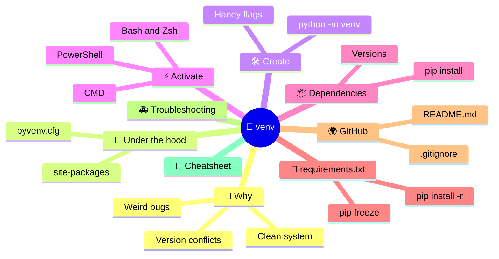

<a href="#indice-EN">&utrif; index &utrif;</a>

<a name="cap01-EN"></a>
## 🧨 **1. Why You Need a venv**

👉 A *virtual environment* (`venv`) is an **isolated Python bubble** where you install only the libraries your project needs.

⚡ So if one project needs `FastAPI 0.109` and another requires `FastAPI 0.116.1`, you can run both on the same machine with zero drama!

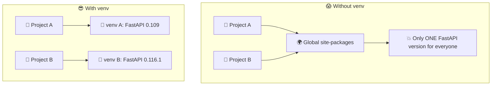

### 🩺 **Symptoms of a Venv-less Life**

| 🤒 Symptom | 🔍 Real cause | 💊 Cure |
|:--|:--|:--|
| `ImportError` out of nowhere | Another project upgraded the library | One venv per project |
| Code works yesterday, explodes today | Global `pip install --upgrade` | Pinned versions in a venv |
| Teammate can't run your code | Different libraries on each machine | `requirements.txt` |
| Hundreds of orphan packages | Everything installed globally | Delete the venv folder, done |

### 🎯 **The 4 Superpowers**

| 💪 Superpower | 🧠 What you get |
|:--|:--|
| 🗂️ **Order** | Every project owns its dependencies |
| 🎛️ **Control** | You decide exactly which version runs |
| 📦 **Portability** | Rebuild the setup anywhere in a minute |
| 🧼 **Cleanliness** | System Python stays untouched |

> ⚠️ **Gotcha:** on recent Debian / Ubuntu releases, `pip install` outside a venv can fail with an `externally-managed-environment` error. That's the OS politely telling you to use a venv. Listen to it! 🙏

<a href="#indice-EN">&utrif; index &utrif;</a>

<a name="cap02-EN"></a>
## 🔬 **2. Under the Hood**

A venv is **not** a virtual machine, **not** a container, and **not** a magic trick: it's just a folder with a tiny config file and its own copy (or link) of the Python executable 🪄

### 🧬 **Folder Anatomy (Windows)**

```text
.birg81env/
	pyvenv.cfg	← 📝 the config that marks this folder as a venv
	Scripts/	← ⚙️ python.exe, pip.exe, activate scripts
	Lib/
		site-packages/	← 📦 YOUR libraries live here
	Include/	← 🧩 C headers, for packages that compile stuff
```

| 🖥️ Item | 🔵 Windows | 🟢 Linux / macOS |
|:--|:--|:--|
| Executables and activate scripts | `Scripts/` | `bin/` |
| Installed libraries | `Lib/site-packages/` | `lib/python3.x/site-packages/` |
| Config file | `pyvenv.cfg` | `pyvenv.cfg` |

### 📝 **The pyvenv.cfg File**

```ini
home = C:\Python313
include-system-site-packages = false
version = 3.13.0
```

* `home` → where the base interpreter lives 🏠
* `include-system-site-packages` → whether the venv can peek at global libraries (default: `false`, nope!) 🙈

### 🕵️ **How Does Python Know It's Inside a venv?**

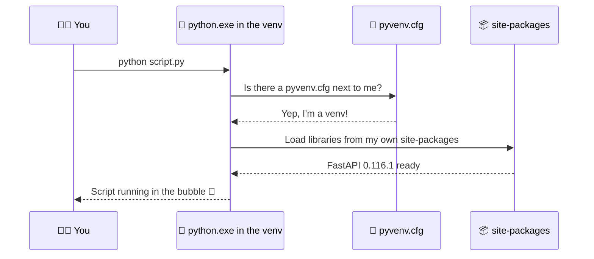

### 🥊 **The Tool Lineup**

| 🧰 Tool | 🎯 What it is | 🏷️ When to use it |
|:--|:--|:--|
| `venv` | Built into Python | ✅ The default, zero installs (our pick here) |
| `virtualenv` | Third-party ancestor of venv | Legacy setups, extra features |
| `pipenv` | Venv + dependency manager | Pipfile-based workflows |
| `poetry` | Dependency + packaging manager | Libraries and complex projects |
| `conda` | Environment manager for Python and non-Python stuff | Data science, heavy native deps |
| `uv` | Blazing fast Rust-based tool (`uv venv`) | When speed is your religion ⚡ |

<a href="#indice-EN">&utrif; index &utrif;</a>

<a name="cap03-EN"></a>
## 🛠️ **3. Creating a venv**

📌 The `venv` module ships with Python, so no extra installs needed.
Here's the universal command:

```bash
python -m venv env_name
```

* 🔵 **Windows (CMD or PowerShell)**

```bash
python -m venv .birg81env
```

* 🟢 **Linux / macOS**

```bash
python3 -m venv .birg81env
```

> 🪟 **Windows pro tip:** if `python` isn't recognized, try the launcher: `py -m venv .birg81env`.

> 🐧 **Ubuntu / Debian gotcha:** if you get an `ensurepip is not available` error, install the missing piece with `sudo apt install python3-venv`.

### ⚙️ **What Happens When You Run It**

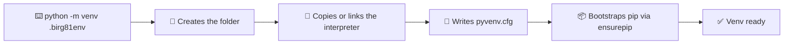

### 🎛️ **Handy Flags**

| 🚩 Flag | 🧠 What it does |
|:--|:--|
| `--prompt NAME` | Custom label in your terminal prompt 🏷️ |
| `--clear` | Wipes the target folder before creating the venv 🧹 |
| `--upgrade-deps` | Upgrades pip to the latest version on creation ⬆️ |
| `--system-site-packages` | Lets the venv see global libraries (use with care!) 👀 |
| `--without-pip` | Creates the venv without installing pip 🪶 |
| `--copies` | Copies binaries instead of symlinking them 📋 |

### 🏷️ **Naming Your Venv**

| 🔤 Name | 👍 Pros | 👎 Cons |
|:--|:--|:--|
| `venv` | Super clear | Easy to forget in `.gitignore` |
| `.venv` | Very common convention, hidden on Unix | None really |
| `.birg81env` | Hidden, unique, personal | Must be added to `.gitignore` by name |

💡 Tip: the name is up to you, but best practice is to call it simply `venv` or use a hidden name like `.birg81env`, which we'll use throughout this guide.

<a href="#indice-EN">&utrif; index &utrif;</a>

<a name="cap04-EN"></a>
## ⚡ **4. Activating a venv**

| 🐚 Shell | ⌨️ Command |
|:--|:--|
| 🔵 **Windows (CMD)** (recommended over PowerShell) | `.birg81env\Scripts\activate.bat` |
| 🔵 **Windows (PowerShell)** | `.\.birg81env\Scripts\Activate.ps1` |
| 🟢 **Linux / macOS (Bash / Zsh)** | `source .birg81env/bin/activate` |
| 🐟 **Fish** | `source .birg81env/bin/activate.fish` |
| 🌀 **csh / tcsh** | `source .birg81env/bin/activate.csh` |

✨ Once activated, you'll see `(.birg81env)` in your terminal prompt → meaning you're inside your protected bubble.

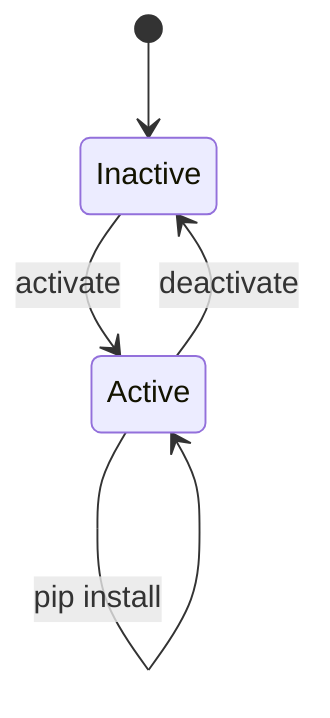

### 🔧 **What activate Does Under the Hood**

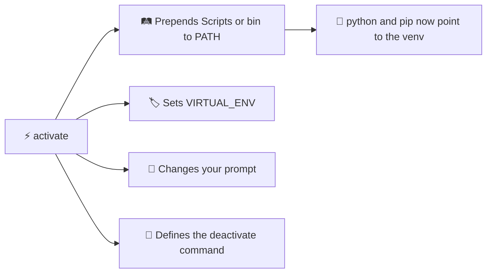

> 🤯 **Plot twist:** activation is just comfort. You can skip it and call the interpreter directly: `.birg81env/bin/python script.py` (Windows: `.birg81env\Scripts\python.exe script.py`).

### 🔍 **Verify You're in the Bubble**

```bash
# Linux / macOS: should point inside .birg81env
which python

# Windows: should list the venv path first
where python
```

```python
import sys

# Inside a venv these two paths differ
print(sys.prefix)
print(sys.base_prefix)
print("I'm in a venv!" if sys.prefix != sys.base_prefix else "Nope, still global 😬")
```

### 🛑 **Deactivate and Delete**

```bash
# Step out of the bubble
deactivate
```

🗑️ Want to nuke the venv? Just delete the folder. There's nothing else to uninstall.

### 🔐 **PowerShell Blocks the Script?**

If you see a "running scripts is disabled on this system" error, that's the PowerShell execution policy. Fix it for your user only:

```bash
Set-ExecutionPolicy -Scope CurrentUser -ExecutionPolicy RemoteSigned
```

(Or just use CMD, as we recommended 😉)

<a href="#indice-EN">&utrif; index &utrif;</a>

<a name="cap05-EN"></a>
## 📦 **5. Installing Dependencies in the venv**

Once your venv is active, you can install libraries *without polluting your global system*:

```bash
pip install package_name
```

Example:

```bash
pip install fastapi uvicorn
```

👉 Everything stays neatly contained inside `.birg81env`.

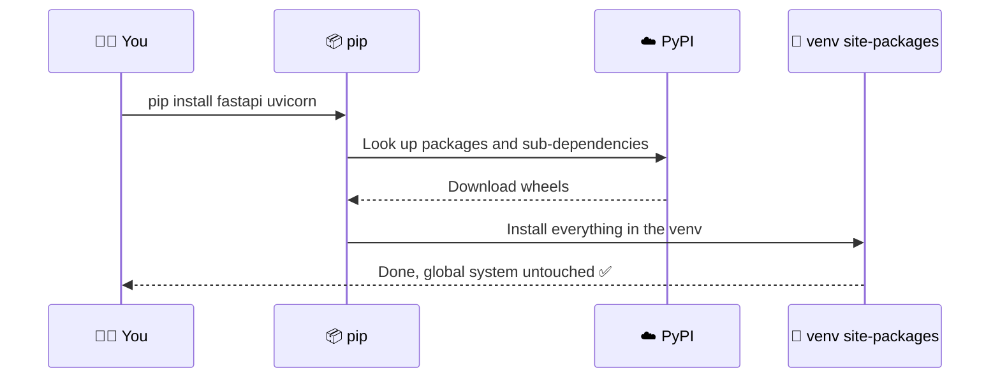

### 🧰 **Essential pip Commands**

| ⌨️ Command | 🎯 What it does |
|:--|:--|
| `python -m pip install --upgrade pip` | Upgrades pip itself ⬆️ |
| `pip install package_name` | Installs the latest version 📥 |
| `pip install package_name==1.2.3` | Installs an exact version 📌 |
| `pip install --upgrade package_name` | Upgrades a package 🔄 |
| `pip uninstall package_name` | Removes a package 🗑️ |
| `pip list` | Lists installed packages 📋 |
| `pip show package_name` | Shows details about a package 🔎 |

### 🔢 **Version Specifiers**

| ✍️ Syntax | 🧠 Meaning | 💡 Example |
|:--|:--|:--|
| `==` | Exactly this version | `fastapi==0.116.1` |
| `>=` | This version or newer | `fastapi>=0.109` |
| `<` | Strictly older than | `fastapi<1.0` |
| `~=` | Compatible release | `fastapi~=0.116.0` |
| `!=` | Anything but this version | `fastapi!=0.115.0` |

### 🧪 **Smoke Test**

```python
from fastapi import FastAPI

app = FastAPI()

@app.get("/")
def home():
	return {"message": "Hello from the venv!"}
```

```bash
uvicorn main:app --reload
```

> 🔥 **Golden rule:** use `python -m pip` when in doubt. It guarantees pip belongs to the same Python you're running.

<a href="#indice-EN">&utrif; index &utrif;</a>

<a name="cap06-EN"></a>
## 📜 **6. The requirements.txt File**

💾 If you want to share your project or replicate it on another machine, you need to save the list of installed libraries.

In practice, `requirements.txt` is just a text file. Think of it as your project's **shopping list** of dependencies 🛒
You can create it manually before coding, or generate it from your current setup using:

```bash
pip freeze > requirements.txt
```

🔄 To install everything from `requirements.txt`:

```bash
pip install -r requirements.txt
```

⚡ This ensures anyone can recreate your environment exactly as you built it.

### 🔁 **The Cycle**

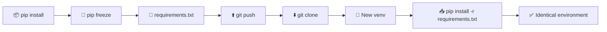

### ✍️ **Handwritten vs Frozen**

| 🖊️ Handwritten | 🧊 `pip freeze` |
|:--|:--|
| Only your direct dependencies | Direct **and** transitive dependencies |
| Loose or flexible versions | Everything pinned with `==` |
| Short, readable, easy to maintain | Long, but perfectly reproducible |
| Great for libraries | Great for apps and deployments |

Example of a `pip freeze` output (illustrative versions):

```text
annotated-types==0.7.0
anyio==4.9.0
click==8.2.1
fastapi==0.116.1
h11==0.16.0
idna==3.10
pydantic==2.11.7
pydantic_core==2.33.2
sniffio==1.3.1
starlette==0.47.2
typing_extensions==4.14.1
uvicorn==0.35.0
```

> 🤯 **Gotcha:** in Windows PowerShell 5.1, the `>` operator can write the file as UTF-16, and pip will choke on it. Run the command from CMD, or use `pip freeze | Out-File -Encoding utf8 requirements.txt`.

### 🧪 **Split Dev and Prod**

```text
# requirements.txt (production)
fastapi==0.116.1
uvicorn==0.35.0
```

```text
# requirements-dev.txt (development)
-r requirements.txt
pytest
```

<a href="#indice-EN">&utrif; index &utrif;</a>

<a name="cap07-EN"></a>
## 🏗️ **7. Project Layout and Workflow**

```text
my_project/
	.birg81env/	← 🫧 the venv (stays local, NEVER on GitHub)
	src/
		main.py	← 🐍 your code
	.gitignore	← 🚫 what Git must ignore
	README.md	← 📖 your project's business card
	requirements.txt	← 📜 the dependency shopping list
```

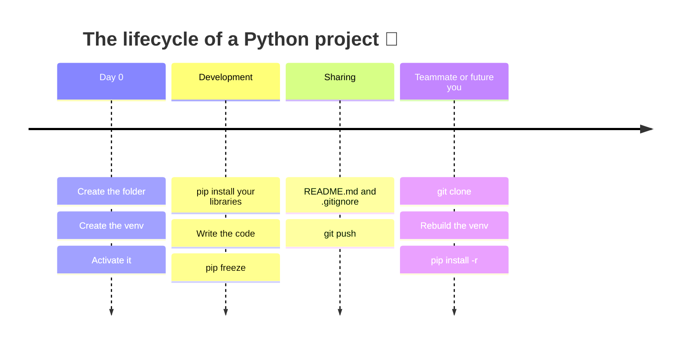

| 🧭 Step | ⌨️ Action | 🎯 Why |
|:--|:--|:--|
| 1️⃣ | Create the project folder | Everything in one place |
| 2️⃣ | `python -m venv .birg81env` | Your private bubble |
| 3️⃣ | Activate the venv | Point `python` and `pip` at it |
| 4️⃣ | `pip install ...` | Add what you need |
| 5️⃣ | `pip freeze > requirements.txt` | Save the shopping list |
| 6️⃣ | Write `README.md` and `.gitignore` | Get GitHub-ready |

🔥 **Remember**: every new project = a new venv. No exceptions!

<a href="#indice-EN">&utrif; index &utrif;</a>

<a name="cap08-EN"></a>
## 🌍 **8. If You Publish on GitHub: README.md & .gitignore**

When collaborating on GitHub, two small but essential text files make your project shine ✨

### 📖 **README.md**

Your project's **business card**. Here you explain:

* What it's about 💡
* How to install it ⚙️
* How to use it 🚀

````markdown
# My Awesome Project

A short description of what it does.

## Installation

python -m venv .birg81env
source .birg81env/bin/activate
pip install -r requirements.txt

## Usage

uvicorn main:app --reload
````

### 🚫 **.gitignore**

Prevents **unnecessary files** (like the venv) from being uploaded to GitHub.
Inside [`.gitignore`](./.gitignore) add:

```text
venv/
.birg81env/
__pycache__/
*.pyc
```

👉 This keeps your repository clean, lightweight, and professional.

> ⚠️ **Gotcha:** the ignore rule must match the **real name** of your venv folder. If you named it `.birg81env`, then `venv/` alone won't cut it!

> 🆕 Since Python 3.13, `venv` drops a `.gitignore` inside the new environment on its own. Still, an explicit entry in your project's `.gitignore` is the safe move.

### 🧹 **Oops, I Already Committed the venv!**

```bash
git rm -r --cached .birg81env
git commit -m "Remove venv from the repository"
```

### 🚦 **What Goes Up and What Stays Home**

| 📄 Item | ⬆️ On GitHub? | 💬 Why |
|:--|:--|:--|
| Source code | ✅ Yes | It's the project |
| `requirements.txt` | ✅ Yes | Lets others rebuild the environment |
| `README.md` | ✅ Yes | Your business card |
| `.gitignore` | ✅ Yes | Protects the repo |
| `.birg81env/` | ❌ No | Heavy and machine-specific |
| `__pycache__/`, `*.pyc` | ❌ No | Auto-generated bytecode |
| `.env` (secrets) | ❌ Never | Passwords and API keys! 🔐 |

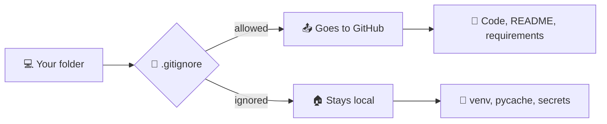

<a href="#indice-EN">&utrif; index &utrif;</a>

<a name="cap09-EN"></a>
## 🚑 **9. Troubleshooting**

| 🐛 Problem | 🔍 Why it happens | 💊 Fix |
|:--|:--|:--|
| `pip` installs globally | The venv isn't active | Activate it and check the `(.birg81env)` prefix |
| `python` isn't recognized (Windows) | Python is missing from PATH | Use `py -m venv`, or reinstall with "Add to PATH" |
| `ensurepip is not available` (Ubuntu) | Missing system package | `sudo apt install python3-venv` |
| PowerShell blocks `Activate.ps1` | Execution policy | `Set-ExecutionPolicy -Scope CurrentUser -ExecutionPolicy RemoteSigned`, or use CMD |
| `externally-managed-environment` | The OS protects its own Python | Create and activate a venv |
| Venv breaks after moving the folder | Absolute paths baked into the scripts | Delete it and rebuild with `pip install -r` |
| Editor doesn't see your libraries | Wrong interpreter selected | Pick the venv's Python in your editor |
| `pip freeze` output unreadable (Windows) | UTF-16 encoding | Use CMD or `Out-File -Encoding utf8` |

### 🧭 **Quick Diagnosis**

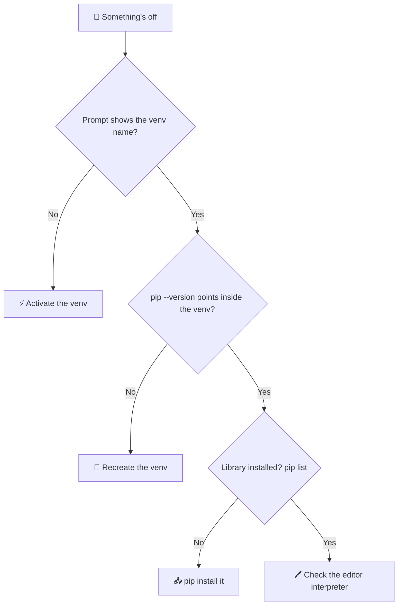

<a href="#indice-EN">&utrif; index &utrif;</a>

<a name="cap10-EN"></a>
## 🧾 **10. Cheatsheet**

| 🧭 Phase | 🔵 Windows (CMD) | 🔷 Windows (PowerShell) | 🟢 Linux / macOS |
|:--|:--|:--|:--|
| 🛠️ Create | `python -m venv .birg81env` | `python -m venv .birg81env` | `python3 -m venv .birg81env` |
| ⚡ Activate | `.birg81env\Scripts\activate.bat` | `.\.birg81env\Scripts\Activate.ps1` | `source .birg81env/bin/activate` |
| 📦 Install | `pip install package_name` | `pip install package_name` | `pip install package_name` |
| 🧊 Freeze | `pip freeze > requirements.txt` | `pip freeze \| Out-File -Encoding utf8 requirements.txt` | `pip freeze > requirements.txt` |
| 📥 Restore | `pip install -r requirements.txt` | `pip install -r requirements.txt` | `pip install -r requirements.txt` |
| 🛑 Deactivate | `deactivate` | `deactivate` | `deactivate` |

### ✅ **Final Checklist**

| ☑️ Item | 🎯 Done? |
|:--|:--|
| New project → new venv | ✅ |
| Venv activated before `pip install` | ✅ |
| `requirements.txt` up to date | ✅ |
| Venv folder listed in `.gitignore` | ✅ |
| `README.md` with install steps | ✅ |
| Secrets kept out of the repo | ✅ |

<a href="#indice-EN">&utrif; index &utrif;</a>

<a name="fine-EN"></a>
## 🏁 **Conclusion**

🔥 Now you know what a *virtual environment* is, how to create and activate it, install dependencies, work with `requirements.txt`, and structure a GitHub-ready project with `README.md` and `.gitignore`.

✨ **Remember**: every time you start a new Python project, **create a venv first**!
It's the secret to coding like a pro, with no chaos and no conflicts.

🌟 *May your Python projects grow stronger, cleaner, and ready to conquer the open-source world!* 🚀🐍💻

<a href="#TOP">&utrif; top &utrif;</a>

 <a name="IT"></A>

<!-- Italian -->
# Master Python 🐍: Il Modo Pro per Costruire Progetti 💻

<a name="hook-IT"></a>
## 🎬 **Programmare come un vero professionista**

🔥 *Vuoi portare i tuoi progetti Python al livello successivo, come un vero professionista?*

🚀 Allora devi assolutamente imparare a usare i *virtual environment*!

Senza di loro rischi conflitti, bug assurdi e dipendenze che ti inseguono da un progetto all'altro come fantasmi 👻

Oggi ti spiego tutto, cofano aperto 💡:

* 🫧 Cos'è davvero un virtual environment (e cosa c'è dentro)
	* L'anatomia della cartella, senza magie
* 🛠️ Come crearlo su ogni sistema operativo
	* Con i flag utili che nessuno ti racconta
* ⚡ Come attivarlo, verificarlo e buttarlo via
* 📦 Come gestire le dipendenze da persona adulta
* 📜 Come congelare e ricostruire il tuo ambiente con `requirements.txt`
* 🌍 E perché è fondamentale se pubblichi il tuo progetto su GitHub!

| 😱 Senza venv | 😎 Con venv |
|:--|:--|
| Un unico secchio globale di librerie | Un secchio privato per ogni progetto |
| Conflitti di versione tra progetti | Ogni progetto sceglie le sue versioni |
| "Sul mio PC funziona" 🤷 | Riproducibile su qualsiasi macchina |
| Il Python di sistema diventa una fabbrica di bug | Il Python di sistema resta pulito |

> 🎒 **Cosa ti serve:** Python 3 installato, un terminale e un editor che ti piace. Controllo al volo: `python --version` (o `python3 --version` su Linux / macOS).

<a name="indice-IT"></a>
## 🧭 **Indice**

* [🎬 Hook](#hook-IT)
* [🗺️ Mappa del tutorial](#mappa-IT)
* [🧨 1. Perché serve un venv](#cap01-IT)
	* L'inferno delle dipendenze spiegato con uno schema
* [🔬 2. Sotto il cofano](#cap02-IT)
	* Anatomia della cartella, `pyvenv.cfg` e panoramica degli strumenti
* [🛠️ 3. Creare un venv](#cap03-IT)
	* Comandi per sistema operativo, flag utili, nomi
* [⚡ 4. Attivare un venv](#cap04-IT)
	* CMD, PowerShell, Bash / Zsh e come verificare
* [📦 5. Installare le dipendenze](#cap05-IT)
	* Comandi pip e specificatori di versione
* [📜 6. Il file requirements.txt](#cap06-IT)
	* freeze, install -r e il ciclo che salva il tuo team
* [🏗️ 7. Struttura del progetto e workflow](#cap07-IT)
	* Il ciclo di vita di un progetto ben fatto
* [🌍 8. GitHub: README.md e .gitignore](#cap08-IT)
	* Cosa sale, cosa resta a casa
* [🚑 9. Risoluzione dei problemi](#cap09-IT)
	* Le trappole classiche e come disinnescarle
* [🧾 10. Cheatsheet](#cap10-IT)
	* Tutto su una sola schermata
* [🏁 Conclusione](#fine-IT)

<a name="mappa-IT"></a>
## 🗺️ **Mappa del Tutorial**

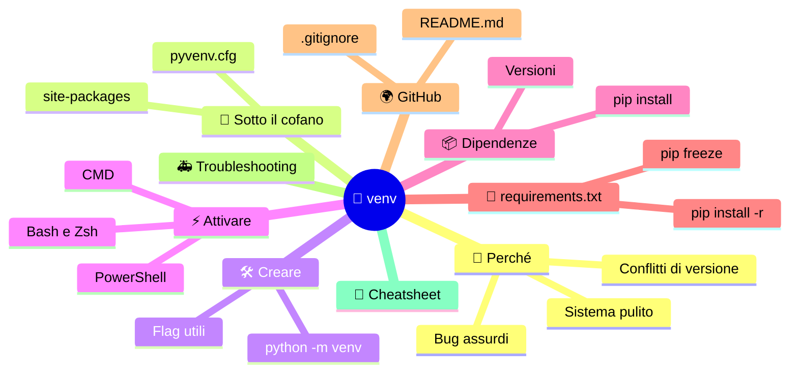

<a href="#indice-IT">&utrif; indice &utrif;</a>

<a name="cap01-IT"></a>
## 🧨 **1. Perché Serve un venv**

👉 Un *virtual environment* (`venv`) è una **bolla isolata di Python** in cui installi solo le librerie necessarie al tuo progetto.

⚡ Questo significa che se un progetto ha bisogno di `FastAPI 0.109` e un altro di `FastAPI 0.116.1`, puoi averle entrambe sullo stesso computer senza drammi!

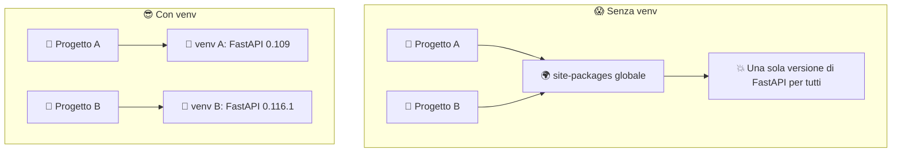

### 🩺 **Sintomi di una Vita senza Venv**

| 🤒 Sintomo | 🔍 Causa reale | 💊 Cura |
|:--|:--|:--|
| `ImportError` dal nulla | Un altro progetto ha aggiornato la libreria | Un venv per progetto |
| Ieri funzionava, oggi esplode | `pip install --upgrade` globale | Versioni bloccate in un venv |
| Il collega non riesce a eseguire il tuo codice | Librerie diverse su ogni macchina | `requirements.txt` |
| Centinaia di pacchetti orfani | Tutto installato globalmente | Elimini la cartella del venv e basta |

### 🎯 **I 4 Superpoteri**

| 💪 Superpotere | 🧠 Cosa ottieni |
|:--|:--|
| 🗂️ **Ordine** | Ogni progetto possiede le sue dipendenze |
| 🎛️ **Controllo** | Decidi tu quale versione esatta gira |
| 📦 **Portabilità** | Ricostruisci l'ambiente ovunque in un minuto |
| 🧼 **Pulizia** | Il Python di sistema non si tocca |

> ⚠️ **Trappola:** sulle versioni recenti di Debian / Ubuntu, `pip install` fuori da un venv può fallire con l'errore `externally-managed-environment`. È il sistema operativo che ti dice gentilmente di usare un venv. Ascoltalo! 🙏

<a href="#indice-IT">&utrif; indice &utrif;</a>

<a name="cap02-IT"></a>
## 🔬 **2. Sotto il Cofano**

Un venv **non** è una macchina virtuale, **non** è un container e **non** è un trucco di magia: è solo una cartella con un piccolo file di configurazione e la sua copia (o link) dell'eseguibile Python 🪄

### 🧬 **Anatomia della Cartella (Windows)**

```text
.birg81env/
	pyvenv.cfg	← 📝 la configurazione che marchia la cartella come venv
	Scripts/	← ⚙️ python.exe, pip.exe, script di attivazione
	Lib/
		site-packages/	← 📦 qui vivono LE TUE librerie
	Include/	← 🧩 header C, per i pacchetti che compilano roba
```

| 🖥️ Elemento | 🔵 Windows | 🟢 Linux / macOS |
|:--|:--|:--|
| Eseguibili e script di attivazione | `Scripts/` | `bin/` |
| Librerie installate | `Lib/site-packages/` | `lib/python3.x/site-packages/` |
| File di configurazione | `pyvenv.cfg` | `pyvenv.cfg` |

### 📝 **Il File pyvenv.cfg**

```ini
home = C:\Python313
include-system-site-packages = false
version = 3.13.0
```

* `home` → dove vive l'interprete di base 🏠
* `include-system-site-packages` → se il venv può sbirciare le librerie globali (default: `false`, no!) 🙈

### 🕵️ **Come Fa Python a Sapere di Essere in un venv?**

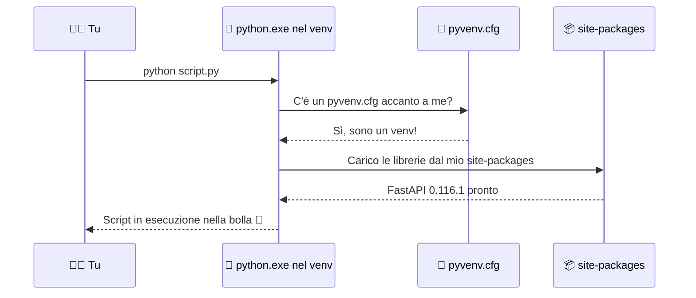

### 🥊 **Panoramica degli Strumenti**

| 🧰 Strumento | 🎯 Cos'è | 🏷️ Quando usarlo |
|:--|:--|:--|
| `venv` | Incluso in Python | ✅ Lo standard, zero installazioni (la nostra scelta) |
| `virtualenv` | Antenato di terze parti di venv | Setup legacy, funzioni extra |
| `pipenv` | Venv + gestore di dipendenze | Workflow basati su Pipfile |
| `poetry` | Gestore di dipendenze e packaging | Librerie e progetti complessi |
| `conda` | Gestore di ambienti per Python e non solo | Data science, dipendenze native pesanti |
| `uv` | Strumento velocissimo scritto in Rust (`uv venv`) | Quando la velocità è la tua religione ⚡ |

<a href="#indice-IT">&utrif; indice &utrif;</a>

<a name="cap03-IT"></a>
## 🛠️ **3. Creare un venv**

📌 Il modulo `venv` è incluso in Python, quindi non devi installare nulla.
Ecco il comando universale:

```bash
python -m venv nome_venv
```

* 🔵 **Windows (CMD o PowerShell)**

```bash
python -m venv .birg81env
```

* 🟢 **Linux / macOS**

```bash
python3 -m venv .birg81env
```

> 🪟 **Dritta per Windows:** se `python` non viene riconosciuto, prova il launcher: `py -m venv .birg81env`.

> 🐧 **Trappola Ubuntu / Debian:** se compare l'errore `ensurepip is not available`, installa il pezzo mancante con `sudo apt install python3-venv`.

### ⚙️ **Cosa Succede Quando Lo Lanci**


### 🎛️ **Flag Utili**

| 🚩 Flag | 🧠 Cosa fa |
|:--|:--|
| `--prompt NOME` | Etichetta personalizzata nel prompt del terminale 🏷️ |
| `--clear` | Svuota la cartella di destinazione prima di creare il venv 🧹 |
| `--upgrade-deps` | Aggiorna pip all'ultima versione in fase di creazione ⬆️ |
| `--system-site-packages` | Il venv vede le librerie globali (da usare con cautela!) 👀 |
| `--without-pip` | Crea il venv senza installare pip 🪶 |
| `--copies` | Copia i binari invece di creare symlink 📋 |

### 🏷️ **Come Chiamare il Tuo Venv**

| 🔤 Nome | 👍 Pro | 👎 Contro |
|:--|:--|:--|
| `venv` | Chiarissimo | Facile dimenticarlo nel `.gitignore` |
| `.venv` | Convenzione diffusissima, nascosta su Unix | Praticamente nessuno |
| `.birg81env` | Nascosto, unico, personale | Va aggiunto al `.gitignore` col suo nome |

💡 Consiglio: il nome della `venv` è a scelta, buona norma può essere chiamarlo sempre `venv` o in alternativa usare un nome che inizia col punto e finisce con env, nel nostro esempio `.birg81env`, che di seguito verrà riproposto.

<a href="#indice-IT">&utrif; indice &utrif;</a>

<a name="cap04-IT"></a>
## ⚡ **4. Attivare un venv**

| 🐚 Shell | ⌨️ Comando |
|:--|:--|
| 🔵 **Windows (CMD)** (è preferibile a PowerShell) | `.birg81env\Scripts\activate.bat` |
| 🔵 **Windows (PowerShell)** | `.\.birg81env\Scripts\Activate.ps1` |
| 🟢 **Linux / macOS (Bash / Zsh)** | `source .birg81env/bin/activate` |
| 🐟 **Fish** | `source .birg81env/bin/activate.fish` |
| 🌀 **csh / tcsh** | `source .birg81env/bin/activate.csh` |

✨ Quando attivi il venv, nel prompt compare `(.birg81env)` → significa che sei dentro la tua bolla protetta.

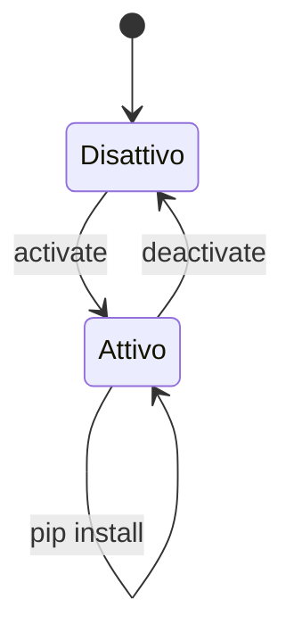

### 🔧 **Cosa Fa activate Sotto il Cofano**

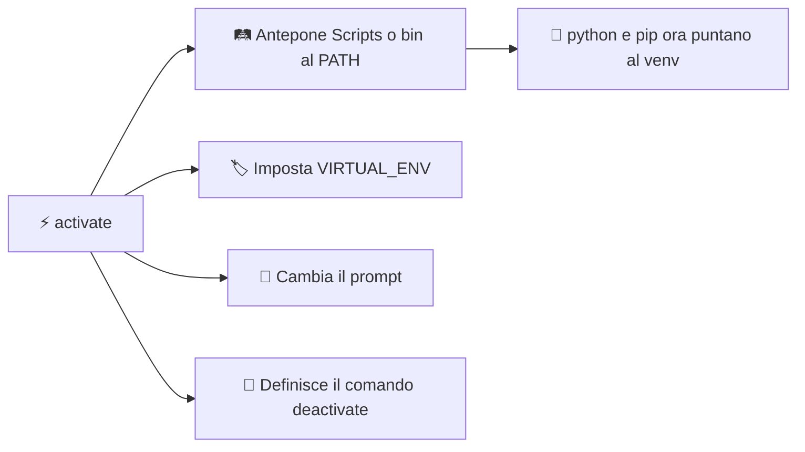

> 🤯 **Colpo di scena:** l'attivazione è solo comodità. Puoi saltarla e chiamare direttamente l'interprete: `.birg81env/bin/python script.py` (Windows: `.birg81env\Scripts\python.exe script.py`).

### 🔍 **Verifica di Essere nella Bolla**

```bash
# Linux / macOS: deve puntare dentro .birg81env
which python

# Windows: deve elencare per primo il percorso del venv
where python
```

```python
import sys

# Dentro un venv questi due percorsi sono diversi
print(sys.prefix)
print(sys.base_prefix)
print("Sono in un venv!" if sys.prefix != sys.base_prefix else "No, sono ancora globale 😬")
```

### 🛑 **Disattivare ed Eliminare**

```bash
# Esci dalla bolla
deactivate
```

🗑️ Vuoi radere al suolo il venv? Elimina la cartella. Non c'è nient'altro da disinstallare.

### 🔐 **PowerShell Blocca lo Script?**

Se compare l'errore "l'esecuzione di script è disabilitata nel sistema", è la execution policy di PowerShell. Sistemala solo per il tuo utente:

```bash
Set-ExecutionPolicy -Scope CurrentUser -ExecutionPolicy RemoteSigned
```

(Oppure usa direttamente CMD, come consigliato 😉)

<a href="#indice-IT">&utrif; indice &utrif;</a>

<a name="cap05-IT"></a>
## 📦 **5. Installare le Dipendenze nel venv**

Una volta attivato il venv, puoi installare librerie *senza sporcare il sistema globale*:

```bash
pip install nome_pacchetto
```

Esempio:

```bash
pip install fastapi uvicorn
```

👉 Tutto rimane confinato dentro `.birg81env`.

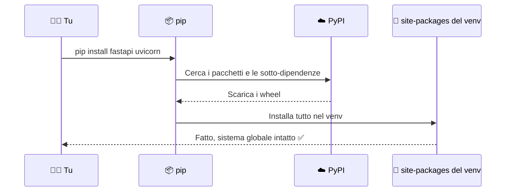

### 🧰 **Comandi pip Essenziali**

| ⌨️ Comando | 🎯 Cosa fa |
|:--|:--|
| `python -m pip install --upgrade pip` | Aggiorna pip stesso ⬆️ |
| `pip install nome_pacchetto` | Installa l'ultima versione 📥 |
| `pip install nome_pacchetto==1.2.3` | Installa una versione esatta 📌 |
| `pip install --upgrade nome_pacchetto` | Aggiorna un pacchetto 🔄 |
| `pip uninstall nome_pacchetto` | Rimuove un pacchetto 🗑️ |
| `pip list` | Elenca i pacchetti installati 📋 |
| `pip show nome_pacchetto` | Mostra i dettagli di un pacchetto 🔎 |

### 🔢 **Specificatori di Versione**

| ✍️ Sintassi | 🧠 Significato | 💡 Esempio |
|:--|:--|:--|
| `==` | Esattamente questa versione | `fastapi==0.116.1` |
| `>=` | Questa versione o più recente | `fastapi>=0.109` |
| `<` | Strettamente più vecchia di | `fastapi<1.0` |
| `~=` | Release compatibile | `fastapi~=0.116.0` |
| `!=` | Qualsiasi versione tranne questa | `fastapi!=0.115.0` |

### 🧪 **Smoke Test**

```python
from fastapi import FastAPI

app = FastAPI()

@app.get("/")
def home():
	return {"message": "Ciao dal venv!"}
```

```bash
uvicorn main:app --reload
```

> 🔥 **Regola d'oro:** nel dubbio usa `python -m pip`. Garantisce che pip appartenga allo stesso Python che stai eseguendo.

<a href="#indice-IT">&utrif; indice &utrif;</a>

<a name="cap06-IT"></a>
## 📜 **6. Il File requirements.txt**

💾 Se vuoi condividere il progetto o replicarlo altrove, devi salvare l'elenco delle librerie installate.

In pratica `requirements.txt` è un semplice file di testo, possiamo immaginarlo come una sorta di **lista della spesa** che contiene tutte le dipendenze installate nel nostro progetto 🛒
Dunque possiamo creare questo file prima di iniziare il progetto e scrivere ciò che ci serve, o a progetto in corso copiando la lista delle dipendenze installate; in tal caso digiteremo:

```bash
pip freeze > requirements.txt
```

🔄 Per installare tutto da `requirements.txt`:

```bash
pip install -r requirements.txt
```

⚡ In questo modo chiunque potrà ricreare il tuo ambiente esattamente come il tuo.

### 🔁 **Il Ciclo**

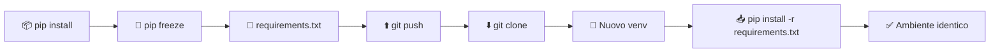

### ✍️ **A Mano vs Congelato**

| 🖊️ A mano | 🧊 `pip freeze` |
|:--|:--|
| Solo le tue dipendenze dirette | Dipendenze dirette **e** transitive |
| Versioni larghe o flessibili | Tutto bloccato con `==` |
| Breve, leggibile, facile da mantenere | Lungo, ma perfettamente riproducibile |
| Ottimo per le librerie | Ottimo per app e deploy |

Esempio di output di `pip freeze` (versioni indicative):

```text
annotated-types==0.7.0
anyio==4.9.0
click==8.2.1
fastapi==0.116.1
h11==0.16.0
idna==3.10
pydantic==2.11.7
pydantic_core==2.33.2
sniffio==1.3.1
starlette==0.47.2
typing_extensions==4.14.1
uvicorn==0.35.0
```

> 🤯 **Trappola:** in Windows PowerShell 5.1 l'operatore `>` può scrivere il file in UTF-16 e pip si strozza. Lancia il comando da CMD oppure usa `pip freeze | Out-File -Encoding utf8 requirements.txt`.

### 🧪 **Separare Dev e Prod**

```text
# requirements.txt (produzione)
fastapi==0.116.1
uvicorn==0.35.0
```

```text
# requirements-dev.txt (sviluppo)
-r requirements.txt
pytest
```

<a href="#indice-IT">&utrif; indice &utrif;</a>

<a name="cap07-IT"></a>
## 🏗️ **7. Struttura del Progetto e Workflow**

```text
mio_progetto/
	.birg81env/	← 🫧 il venv (resta in locale, MAI su GitHub)
	src/
		main.py	← 🐍 il tuo codice
	.gitignore	← 🚫 cosa Git deve ignorare
	README.md	← 📖 il biglietto da visita del progetto
	requirements.txt	← 📜 la lista della spesa delle dipendenze
```

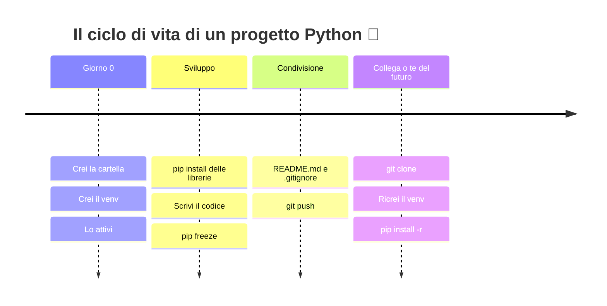

| 🧭 Passo | ⌨️ Azione | 🎯 Perché |
|:--|:--|:--|
| 1️⃣ | Crea la cartella del progetto | Tutto in un unico posto |
| 2️⃣ | `python -m venv .birg81env` | La tua bolla privata |
| 3️⃣ | Attiva il venv | Fai puntare `python` e `pip` a lui |
| 4️⃣ | `pip install ...` | Aggiungi ciò che ti serve |
| 5️⃣ | `pip freeze > requirements.txt` | Salva la lista della spesa |
| 6️⃣ | Scrivi `README.md` e `.gitignore` | Preparati per GitHub |

🔥 **Ricorda**: ogni nuovo progetto = un nuovo venv. Nessuna eccezione!

<a href="#indice-IT">&utrif; indice &utrif;</a>

<a name="cap08-IT"></a>
## 🌍 **8. Se Pubblichi su GitHub: README.md & .gitignore**

Lavorando in un team di sviluppo capita spesso di condividere il lavoro su **GitHub**, e a tal scopo è fondamentale aggiungere al nostro progetto due tasselli fondamentali, ovvero due file di testo piccoli ma indispensabili ✨

### 📖 **README.md**

È il **biglietto da visita** del tuo progetto. Qui spieghi:

* Di cosa si tratta 💡
* Come installarlo ⚙️
* Come usarlo 🚀

````markdown
# Il Mio Fantastico Progetto

Una breve descrizione di cosa fa.

## Installazione

python -m venv .birg81env
source .birg81env/bin/activate
pip install -r requirements.txt

## Utilizzo

uvicorn main:app --reload
````

### 🚫 **.gitignore**

Serve a **non caricare file inutili** (come il venv) su GitHub.
Dentro [`.gitignore`](./.gitignore) aggiungi:

```text
venv/
.birg81env/
__pycache__/
*.pyc
```

👉 Così il tuo repo rimane pulito, leggero e professionale.

> ⚠️ **Trappola:** la regola di ignore deve corrispondere al **nome reale** della cartella del venv. Se l'hai chiamata `.birg81env`, il solo `venv/` non basta!

> 🆕 Da Python 3.13, `venv` inserisce da solo un `.gitignore` dentro il nuovo ambiente. Meglio comunque una riga esplicita nel `.gitignore` del progetto.

### 🧹 **Ops, Ho Già Committato il venv!**

```bash
git rm -r --cached .birg81env
git commit -m "Rimuovi il venv dal repository"
```

### 🚦 **Cosa Sale e Cosa Resta a Casa**

| 📄 Elemento | ⬆️ Su GitHub? | 💬 Perché |
|:--|:--|:--|
| Codice sorgente | ✅ Sì | È il progetto |
| `requirements.txt` | ✅ Sì | Permette agli altri di ricostruire l'ambiente |
| `README.md` | ✅ Sì | Il tuo biglietto da visita |
| `.gitignore` | ✅ Sì | Protegge il repo |
| `.birg81env/` | ❌ No | Pesante e legato alla macchina |
| `__pycache__/`, `*.pyc` | ❌ No | Bytecode generato in automatico |
| `.env` (segreti) | ❌ Mai | Password e chiavi API! 🔐 |

```mermaid
flowchart LR
	A["💻 La tua cartella"] --> B{"🚫 .gitignore"}
	B -->|ammesso| C["📤 Va su GitHub"]
	B -->|ignorato| D["🏠 Resta in locale"]
	C --> E["🐍 Codice, README, requirements"]
	D --> F["🫧 venv, pycache, segreti"]
```

<a href="#indice-IT">&utrif; indice &utrif;</a>

<a name="cap09-IT"></a>
## 🚑 **9. Risoluzione dei Problemi**

| 🐛 Problema | 🔍 Perché succede | 💊 Soluzione |
|:--|:--|:--|
| `pip` installa in globale | Il venv non è attivo | Attivalo e controlla il prefisso `(.birg81env)` |
| `python` non riconosciuto (Windows) | Python non è nel PATH | Usa `py -m venv` o reinstalla con "Add to PATH" |
| `ensurepip is not available` (Ubuntu) | Manca un pacchetto di sistema | `sudo apt install python3-venv` |
| PowerShell blocca `Activate.ps1` | Execution policy | `Set-ExecutionPolicy -Scope CurrentUser -ExecutionPolicy RemoteSigned`, oppure usa CMD |
| `externally-managed-environment` | Il sistema protegge il suo Python | Crea e attiva un venv |
| Il venv si rompe dopo aver spostato la cartella | Percorsi assoluti scritti negli script | Eliminalo e ricostruiscilo con `pip install -r` |
| L'editor non vede le librerie | Interprete sbagliato selezionato | Scegli il Python del venv nell'editor |
| Output di `pip freeze` illeggibile (Windows) | Codifica UTF-16 | Usa CMD oppure `Out-File -Encoding utf8` |

### 🧭 **Diagnosi Rapida**

```mermaid
flowchart TD
	A["🤔 Qualcosa non va"] --> B{"Il prompt mostra il nome del venv?"}
	B -->|No| C["⚡ Attiva il venv"]
	B -->|Sì| D{"pip --version punta dentro il venv?"}
	D -->|No| E["🔁 Ricrea il venv"]
	D -->|Sì| F{"Libreria installata? pip list"}
	F -->|No| G["📥 Installala con pip install"]
	F -->|Sì| H["🖊️ Controlla l'interprete dell'editor"]
```

<a href="#indice-IT">&utrif; indice &utrif;</a>

<a name="cap10-IT"></a>
## 🧾 **10. Cheatsheet**

| 🧭 Fase | 🔵 Windows (CMD) | 🔷 Windows (PowerShell) | 🟢 Linux / macOS |
|:--|:--|:--|:--|
| 🛠️ Creare | `python -m venv .birg81env` | `python -m venv .birg81env` | `python3 -m venv .birg81env` |
| ⚡ Attivare | `.birg81env\Scripts\activate.bat` | `.\.birg81env\Scripts\Activate.ps1` | `source .birg81env/bin/activate` |
| 📦 Installare | `pip install nome_pacchetto` | `pip install nome_pacchetto` | `pip install nome_pacchetto` |
| 🧊 Congelare | `pip freeze > requirements.txt` | `pip freeze \| Out-File -Encoding utf8 requirements.txt` | `pip freeze > requirements.txt` |
| 📥 Ripristinare | `pip install -r requirements.txt` | `pip install -r requirements.txt` | `pip install -r requirements.txt` |
| 🛑 Disattivare | `deactivate` | `deactivate` | `deactivate` |

### ✅ **Checklist Finale**

| ☑️ Voce | 🎯 Fatto? |
|:--|:--|
| Nuovo progetto → nuovo venv | ✅ |
| Venv attivato prima di `pip install` | ✅ |
| `requirements.txt` aggiornato | ✅ |
| Cartella del venv nel `.gitignore` | ✅ |
| `README.md` con i passi di installazione | ✅ |
| Segreti fuori dal repo | ✅ |

<a href="#indice-IT">&utrif; indice &utrif;</a>

<a name="fine-IT"></a>
## 🏁 **Conclusione**

🔥 Ora sai cos'è un *virtual environment*, come crearlo, attivarlo, installare dipendenze, usare `requirements.txt` e strutturare un progetto GitHub-ready con `README.md` e `.gitignore`.

✨ **Ricorda**: ogni volta che crei un nuovo progetto Python, **crea prima un venv**!
È il segreto per sviluppare come un vero professionista, senza caos né conflitti.

🌟 *Che i tuoi progetti Python diventino sempre più solidi, eleganti e pronti a conquistare il mondo open source!* 🚀🐍💻

<a href="#TOP">&utrif; top &utrif;</a>

## 🔗 Links
[](https://www.linkedin.com/in/biagio-rosario-greco-77145774/)
[](https://twitter.com/birg_81)